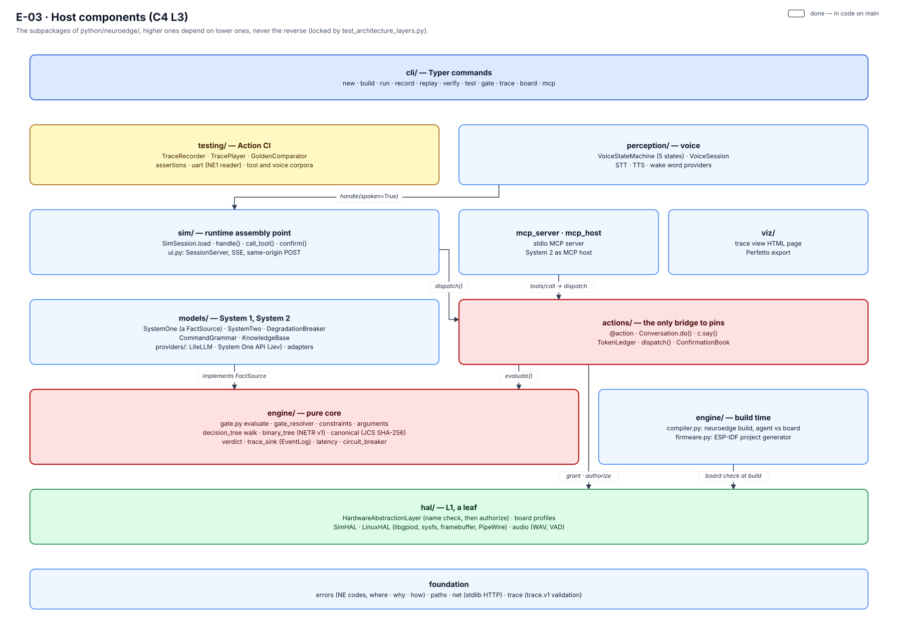
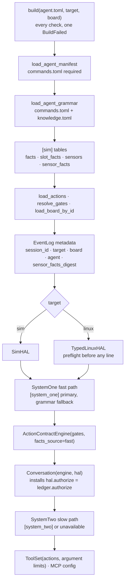

# 03 · Host components (C4 L3)

> **Scope:** Python package `python/neuroedge/` — subpackages, responsibilities of each package,
> actual dependencies between them, connecting protocols, and assembly locus. **Sources:** code in `python/neuroedge/`;
> dependency graph is locked by test [`test_architecture_layers.py`](../../python/tests/test_architecture_layers.py).

## 1. Component diagram


*Figure E-03 — Subpackages ordered by dependency direction: packages above use packages below, never the reverse.*

## 2. Layers and dependency rules

Each package's docstring declares its layer name: HAL is **L1**, models and perception are **L2**, engine
and actions are **L3** ("Action Contract"), targets are **L0**. Ordered by actual dependencies, from bottom
to top:

| Tier | Package | Allowed dependencies | Layer |
|:---:|:---|:---|:---|
| 0 | `errors`, `paths`, `net`, `trace` | each other only | foundation |
| 1 | `hal` | `errors`, `paths` | L1 |
| 1 | `sdk` | `errors` — surface for extensions: `ToolRequest`, `Outcome`, `SDK_VERSION`, Protocol `Actuator` and accompanying classes; no HAL, no `Guard` (RFC-0016 §3c, RFC-0018 §3c) | plugin surface |
| 5 | `plugins` | `errors`, `hal` (`board.v1` envelope schema; `hal.remote.Vocabulary`), `models` (secret rules of config tables), `sdk` — plugin loader (RFC-0016 §3d), `[actuators]` declaration and its sole validator (RFC-0018 §3b), `neuroedge conformance` (TSK-I2c-16) | extension loading |
| 2 | `engine` | tier 0; **`engine/compiler.py` and `engine/chip_actions.py` only** may use `hal`, both at build time (board validation; an action's pin operations for the chip, Q-83) and lazy-import `actions`, `models`, `perception`, `mcp_host` (config validation), `plugins` (`[plugins]` and `[actuators]`) | L3 core |
| 3 | `actions` | `engine`, `hal`, tier 0 (edge `actions` → `paths`: `actions/tools.py::result_schema` reads `schemas/tool-result.v1.json`, RFC-0015) | L3 surface |
| 4 | `models` | `engine` (implements its protocol), `net`, tier 0 | L2 |
| 5 | `mcp_server`, `mcp_host`, `mcp_desktop`, `mcp_http`, `pairing`, `isolation` | `actions`, tier 0; `mcp_http` specifically uses only `mcp_server` and `errors` — network door (TSK-P2-04) placed behind the same stdio server, without building a second path; `pairing` uses only `errors` — the keys, certificates and short-lived tokens of that door (`neuroedge pair`, Q-83); `isolation` imports no other layer — `neuroedge doctor`, is the brain's user kept apart (DP-A-03) | L4 per `docs/architecture/00-overview.md` §5.1 (docstring does not declare layer) |
| 6 | `viz`, `templates` | `viz`: `hal`, `trace`, tier 0; `templates`: `errors`, `paths` | tools |
| 7 | `sim` | all tiers below (including `plugins`: `SimSession` re-runs `[actuators]` validator on load, `sim/hal_build.py` connects remote actuators to HAL); lazy-imports `perception` in `sim/session.py` and `sim/vision/feed.py` (camera → gate facts, only when agent declares `[vision]`: `perception` sits above `sim`) | L0, **assembly locus** |
| 8 | `perception` | `sim` (voice sessions wrap typing sessions), `models`, `actions`, `engine`, `hal`, `net` | L2 |
| 8 | `guard` | `sim` (shares HAL builder `sim/hal_build.py` with `SimSession`), `models` (reads `guard.toml`), `plugins` (`[plugins]`, `[actuators]`), `actions`, `engine`, `hal`, `sdk`, `trace` — agent-free safety core: dedicated `Conversation` with own action registry, then calls standard `dispatch()` (RFC-0016 §3b, TSK-I2c-07) | L3 standalone |
| 9 | `testing` | `perception`, `actions`, `engine`, `hal`, `trace`; `sim`, `guard`, and `plugins` lazy-imported (`guard` in `testing/player.py`: `TracePlayer(trace, guard=…)`; `plugins` there only to read `[actuators]`, loads no plugins; and `sim/serve.py` lazy-imports `testing` for trace recorder — only when `trace_out` is present) | Action CI |
| 10 | `studio` | all tiers below except `cli` — local web application `neuroedge studio` exposing all capabilities (TSK-I1-04, `docs/spec/studio.md`) | tools |
| 11 | `cli` | all packages | entry |

Between L2 and L3 lies the dependency inversion principle: System 1 adapters of L2 in `models/` (`SystemOne`, `CommandGrammar`, `systemone_api`) implement the `FactSource` protocol of `engine/gate.py` (L3), instead of L3 depending on L2.

Four rules, each a deliberate architectural choice:

1. **Pure engine core.** `gate.py`, `gate_resolver.py`, `decision_tree.py`, `binary_tree.py`,
   `verdict.py` have no knowledge of HAL, actions, or models. They receive facts via the
   `FactSource` protocol and return `GateResult`. Consequently, gate resolution is a pure function (Invariant 4).
2. **HAL is a leaf.** `hal` depends only on `errors` and `paths`. It does not know what a gate is: it only calls an
   injected `authorize(token, pin, called_from)` function, and defaults to rejecting all
   commands. Remote actuators preserve this rule: HAL receives the `Command` class and four plugin errors via
   `hal.remote.Vocabulary` provided by the assembly locus (`plugins.actuators.SDK_VOCABULARY`), without importing `sdk`.
3. **A single bridge between gates and HAL:** `actions/conversation.py` (`Conversation.do`). No
   other package both calls `evaluate()` and touches pins.
4. **A single runtime assembly locus:** `SimSession.load` (`sim/session.py`) creates and connects engine, token ledger,
   HAL, models, toolset, and MCP. `VoiceSession` wraps a `SimSession`; CLI, MCP servers, and corpus
   runners all pass through it. At build time, the assembly locus is `engine/compiler.py::build`.

### 2.1 Planned packages

Packages in this section have no code in the repository today, or were removed from the plan:

- Removed from the roadmap (Q-77, Q-88): `lab/` (NeuroEdge Lab), `services/fleet/` and `services/registry/` (Fleet OS, Gate Registry) — see roadmap §6. `perception/vision/` and `sim/vision/` (TSK-V1b-*) already exist and are described in §3.5 and §3.6.

The operator agent and NeuroEdge Blueprint of [Q-72](../../roadmap/neuroedge-prd.md#15-decision-log) add five packages (`planned · Q-72`; no code yet, package names are proposed):

| Package | Increment | Responsibility | Allowed dependencies (planned) |
|:---|:---:|:---|:---|
| `mission/` | I2d | Mission contracts per `docs/spec/missions.md` (Q-87; `mission.v1`, pending RFC): load, conflict check, compiler lowering clauses across tiers (only devices with `ne_gate` have reflex tier; Home Assistant devices terminate at host and approval explicitly states so), deterministic approval summary ≤ 5 lines from structured diff | `engine`, `hal` (reads `board.v1`, including `safe_state`), tier 0 |
| `agent/` | I2d | 24/7 runtime core: scheduler, deterministic detectors, `llm_budget`, message budget, LLM worker supervisor; wall-clock facts carry `unsynced` status | `mission`, `actions`, `engine`, tier 0 |
| `channels/` | I2d | Chat channel adapters (Telegram first) and approval record check `{id, nonce, expiration, digest}`; inbound commands become `ToolCall` | **only** `actions` (enters `dispatch()` and confirmation path), `egress`, tier 0 — **never imports `hal`** |
| `blueprint/` | I2e | Per `docs/spec/blueprint.md` (Q-86): `blueprint pack`/`install`: downloads by URL, verifies full bundle digest, then runs `gate lint` on all gates in bundle | `engine`, `mission`, tier 0 |
| `egress/` | I2d | Data egress: sends only to declared destinations, blocks and traces undeclared destinations | tier 0 |

Layer rules for this group strictly follow rules 2 and 3 above: `channels/` and the LLM worker only touch devices via
`dispatch()` → gate; no package other than `actions` both calls `evaluate()` and touches pins. The LLM worker is a
separate process, not a package in core ([`02`](02-container-c4l2.md) §3).

When one of them enters the repository, it requires an entry in `ALLOWED` (and `LAZY` if lazy imports are used) in [`python/tests/test_architecture_layers.py`](../../python/tests/test_architecture_layers.py). The five Q-72 packages follow the same rule: each adds an `ALLOWED` entry when coded, and tests should assert `channels` contains no `hal` in its set, just as tests today assert `ALLOWED["hal"]`. `perception/vision/` and `sim/vision/` belong to existing `perception` and `sim` units and do not need new entries.

## 3. Component catalog

### 3.1 `engine/` — action contract engine

| Module | Responsibility | Key types and functions |
|:---|:---|:---|
| `gate_resolver.py` | Merges `extends` chain into a `ResolvedGate`, enforces five inheritance principles and RFC-0004/0005/0006; resolves `neuroedge://` in gate directory | `GateRegistry`, `ResolvedGate`, `resolve_gate_file`, `resolve_gate_uri` |
| `constraints.py` | Normalizes `allow_when` clauses into accepted value sets; compares strictness | `Constraint.is_at_least_as_strict_as`, `parse_allow_when` |
| `arguments.py` | Argument limits (RFC-0005): validates, merges narrowing-only, schema hints | `check`, `merge_arguments`, `schema_hint` |
| `canonical.py` | Canonical JSON RFC 8785 and SHA-256 hash | `canonicalize`, `digest`, `gate_digest` |
| `decision_tree.py` | Compiles gates into internal JSON trees; walks tree (Python version C walker must match) | `compile_tree`, `walk`, `known_failure`, `truth_table` |
| `binary_tree.py` | Encodes tree into `NETR` v1 for chips; generates C headers | `encode`, `c_header`, `domain_index` |
| `gate.py` | Evaluates a gate: validates arguments, collects facts within time budget, walks tree, applies `on_block` and `budget.fail` | `ActionContractEngine.evaluate`, `GateResult`, `FactSource` protocol |
| `verdict.py` | Verdict vocabulary | `GateVerdict`, `Reason`, `Fact`, `Unavailable` |
| `circuit_breaker.py` | Trips primary model after consecutive failures; routing only, never creates `ALLOW` | `DegradationBreaker` |
| `trace_sink.py` | Session event log, exports `trace.v1` | `EventLog.emit`, `EventLog.to_trace` |
| `latency.py` | Stage-by-stage latency and System 1 / System 2 ratio | `TurnMeter`, `turn_summary` |
| `gate_explain.py` | Data for `gate explain`: criteria origins, tightened conditions | `explain_gate_file` |
| `compiler.py` | `neuroedge build`: checks agent ↔ board compatibility, validates all config tables, writes artifacts; aggregates **all** issues into one `BuildFailed` | `build`, `load_agent_manifest`, `check_capabilities` |
| `firmware.py` | Generates ESP-IDF project for agent: `ne_agent` component, `version.txt`, copies firmware code | `render_project`, `firmware_problems`, `checks` |

### 3.2 `actions/` — physical action surface

| Module | Responsibility | Key types and functions |
|:---|:---|:---|
| `spec.py` | `@action`: registers actions, their gates, required capabilities; direct function invocation ⇒ `NE1001` | `action`, `ActionSpec`, `REGISTRY` |
| `conversation.py` | `c.do()`: gate → token → function body → close token; `degrade` fallback; opens `ask` prompts. `c.say()` speaks, bypasses gates | `Conversation.do`, `confirm`, `say`, `ActionResult` |
| `token.py` | One-time verdict token ledger, TTL = p95 × 3; acts as HAL `authorize` function | `TokenLedger.issue`, `authorize`, `close`, `VerdictToken` |
| `tools.py` | Each `@action` is a tool; `dispatch()` is the single path from tool calls to pins | `ToolCall`, `dispatch`, `ToolResult`, `input_schema` |
| `confirmation.py` | `on_block: ask` prompt: who can respond, expiration time, bound to gate digest | `ConfirmationBook.open`, `take`, `PendingConfirmation` |

### 3.3 `hal/` — hardware abstraction layer

| Module | Responsibility |
|:---|:---|
| `__init__.py` | `HardwareAbstractionLayer`: checks pin name, then envelope, then calls `authorize` (misspelled pin or envelope rejection consumes no token), then records command; `off` commands toward safety bypass envelope and `authorize` (RFC-0007 §3d) |
| `remote.py` | Remote actuators (RFC-0018): HAL states (`off`, `on`, `uncertain`, `quarantined`), pre-envelope state lock, turn-off debt, timers by levels L0–L3, P2, persistent record `<name>.remote.json`; plugin-free replay (`ReplayedRemote`) |
| `envelope.py` | `SafetyEnvelope`: per-pin safety envelope — atomically reserves on-time under per-pin lock, mandatory auto-off, refunds remainder, write-ahead state file on `linux`; reject-only (`EnvelopeRefusedError`), never permits |
| `supervisor.py` | Supervisor process holding actuator pin lines on `linux`: heartbeat from runtime, missing heartbeat or timeout releases line (`LineSupervisor`, `SupervisorClient`) |
| `board.py` | Reads and validates `boards/*.toml`; five primitives (`PRIMITIVES`), three targets (`SUPPORTED_TARGETS`), reference boards |
| `digital.py`, `sensor.py`, `display.py` | API for `@action` bodies: `digital.out("door_lock").pulse(...)`, `sensor.read(...)`, `display.show(...)`; `digital.out` outside `c.do()` ⇒ `NE1001` |
| `sim.py` | `SimHAL`: virtual pins, sensors, display, microphone, speaker; timed commands and cancellation on barge-in |
| `linux.py` | `LinuxHAL`, `TypedLinuxHAL`: GPIO lines via libgpiod v2 looked up by name; preflight check on all devices before claiming lines; releases all lines on exit |
| `sysfs.py` | hwmon and IIO sensors, looked up by label; never returns default values |
| `virtual_board.py` | `sim-virtual` (Q-84 phase A, `docs/spec/virtual_parts.md` §3.1): board built in memory from the reference sim board plus what the agent declares; `sim` only, label `risk=virtual_board` |
| `pin_map.py` | Per-board pin map `[targets.<board>.pins]` (Q-84 phase A+, VP-PM-*): renames mapped pins in the board declaration so an agent keeps its pin names from `sim` to a real board |
| `parts.py`, `parts.toml` | Parts catalogue and `[sim.parts]` (Q-84 phase B, VP-PT-*): each kind names an existing HAL primitive and adds no behaviour; `parts.toml` is the one place listing kinds |
| `framebuffer.py` | In-memory display or `/dev/fbN` |
| `audio.py` | Standard library: WAV read/write, energy VAD, 20 ms frames, speaker timeline |

### 3.4 `models/` — System 1, System 2, grammar, knowledge

| Module | Responsibility |
|:---|:---|
| `system.py` | `SystemOne` (implements `FactSource`: primary model then fallback, with circuit breaker) and `SystemTwo` (LLM, with fallback, logs `system_two_call`) |
| `grammar.py` | Fixed command grammar from `commands.toml`: normalization, pattern matching, `difflib` scoring; `GrammarAdjudicator` resolves criteria from command utterances |
| `knowledge.py` | Local knowledge from `knowledge.toml`, deterministic lookup |
| `providers/` | **Sole location naming providers.** LiteLLM (lazy import), System One API (Jev), `python:pkg.mod:factory` adapter, common rules for all config tables (no keys in files, endpoint verification) |

### 3.5 `perception/` — voice

| Module | Responsibility |
|:---|:---|
| `voice_fsm.py` | Five-state conversation state machine (`IDLE`, `LISTENING`, `THINKING`, `SPEAKING`, `BARGE_IN`) per `docs/spec/voice_fsm.md`; never evaluates gates or touches pins |
| `voice_session.py` | Places state machine in front of a `SimSession`: audio frames → VAD or wake word → STT → same path as typed commands; virtual time |
| `providers/` | OpenAI-standard STT/TTS, wake words (openWakeWord or adapter), mock providers for testing |
| `vision/` | Vision pipeline (TSK-V1b-03, RFC-0012 §3c–§3e, `docs/spec/vision.md`): frames in, typed facts out; the model is untrusted, its labels are domain-checked and its confidence is the gate's to threshold (Q-54) |

### 3.6 `sim/`, MCP, `testing/`, `viz/`, `cli/`

| Component | Responsibility |
|:---|:---|
| `sim/session.py` | `SimSession`: assembly locus for an agent on `sim` or `linux`; processes turns (`handle`), tool calls (`call_tool`), confirmation responses |
| `sim/vision/` | `vision.in` on `sim` (TSK-V1b-02): `VirtualCamera` and `VisionFeed`, camera frames to gate facts, fail-closed |
| `sim/ui.py` | `SessionServer`: same-session web UI, SSE, same-origin verification |
| `sim/serve.py` | Shared MCP serving loop: `neuroedge mcp serve` and `neuroedge.serve_mcp` (public Python function, `docs/spec/python_api.md`) both call `run_stdio`; `mcp serve --http` calls `run_http`, with identical session shutdown |
| `mcp_server.py` | Agent as stdio MCP server; one call at a time |
| `mcp_http.py` | Authenticated network door for the same server (TSK-P2-04, `docs/spec/tool_calling.md` §8): Streamable HTTP over mTLS, per-device OAuth 2.1 token, preflight config verification before opening port; tokens at most 7 days, `--revoked` certificate list read again on change (DP-A-04, DP-A-11) |
| `proxy_mcp.py` | `neuroedge proxy mcp` (TSK-I2c-14): an existing MCP server (Home Assistant's, any stdio server) put behind a `Guard`; the real server is reached only inside a tool's `run`, after the gate said ALLOW |
| `proxy_http.py` | `neuroedge proxy http` (TSK-I2c-15): a local HTTP API behind a `Guard`; each route of `[[proxy.http.routes]]` is a tool, the original request is forwarded only after ALLOW |
| `install.py` | `neuroedge install --profile full` (Q-83, DP-A-09): Profile A on one machine, two OS users, keys and pairing set up in one command |
| `paths.py` | Repository layout discovery: finds `schemas/`, `gates/`, `boards/`, `fixtures/`, `targets/` in a checkout, an editable install or a wheel (`neuroedge/_data/`) |
| `isolation.py` | `neuroedge doctor` (Q-83, DP-A-03): the brain's OS user in no device group, opening no device node, reading no key, `/proc` with `hidepid=2`; fails closed |
| `pairing.py` | `neuroedge pair init / renew / rotate` (Q-83): CA, box and brain certificates, token signing key, brain tokens of at most 7 days, revocation list (`docs/spec/deployment_profiles.md` DP-A-04, DP-A-11) |
| `mcp_host.py` | *Legacy, off by default (Q-83).* System 2 as MCP host: device tools via agent's own MCP server (still gated), external info tools from allowlist |
| `guard.py` | `Guard`, `Tool`, `Dispatcher`, `guard.toml`: gate → token → envelope → trace without `agent.toml`; all bridge `dispatch` calls serialized under a lock (traces must form a sequential step sequence for replay) |
| `sdk/` | `ToolRequest` (no `source`), `Outcome`, `SDK_VERSION`, Protocol `Actuator`, `Command`, `DeviceDouble`, and four plugin errors |
| `plugins/` | Entry point loader (actuator type only), `[actuators]` declaration + `check_actuators`, `neuroedge conformance` (`docs/spec/extension_sdk.md` §6–§8) |
| `sim/hal_build.py` | Common `sim`/`linux` HAL builder for `SimSession` and `Guard`, and `release_hal` |
| `testing/` | Action CI: `TraceRecorder`, `TracePlayer`, `GoldenComparator`, assert library, UART reader, tool call and voice corpus runner |
| `viz/` | Self-contained HTML pages for `trace view` and web UI; Perfetto export |
| `cli/` | Typer: all commands; converts errors to three-part messages and exit codes 0/1/2 |

## 4. Protocols connecting components

These are the integration points that engineers implement or replace. Signatures are taken verbatim from code.

```python
# engine/gate.py — fact sources for gates (implemented by SystemOne, GrammarAdjudicator, SystemOneApi)
class FactSource(Protocol):
    async def adjudicate(self, criterion: str, definition: Mapping[str, Any],
                         state: Mapping[str, Any] | None, deadline_ms: float) -> Fact | Unavailable: ...

# hal/__init__.py — HAL does not know gates; it only calls an injected authorize function
Authorizer = Callable[[Any, str, str], None]          # (token, pin, called_from) -> None or raise

# actions/token.py — token ledger serves as HAL authorize function
class TokenLedger:
    def issue(self, *, gate: str, gate_digest: str, action: str, pins: frozenset[str],
              session_id: str, p95_ms: float) -> VerdictToken: ...
    def authorize(self, signature: Any, pin: str, called_from: str) -> None: ...
    def close(self, token: VerdictToken) -> None: ...

# actions/tools.py — single path from a tool call to pins
async def dispatch(conversation: Conversation, tools: ToolSet, call: ToolCall) -> ToolResult: ...

# engine/trace_sink.py — all components record into a single session log
class EventLog:
    def emit(self, type: str, data: dict[str, Any]) -> None: ...

# models/providers/base.py — System 2 providers
class Provider(Protocol):
    def __call__(self, task: str, name: str | None, state: Mapping[str, Any] | None) -> Any: ...

# perception/providers/base.py and wake.py — voice
class SpeechToText(Protocol):
    def transcribe(self, clip: AudioClip) -> str | Transcript | Awaitable[str | Transcript]: ...
class TextToSpeech(Protocol):
    def synthesize(self, text: str) -> Speech | Awaitable[Speech]: ...
class WakeWordDetector(Protocol):
    def detect(self, frame: AudioFrame) -> tuple[str, float] | None: ...
```

## 5. Assembling a session

`SimSession.load(agent_toml, target=...)` executes precisely the following steps, in order; if any step
fails, no session is created and no GPIO lines are claimed.



Fact priority order for gates within a session: `[sim.facts]` → `[sim.slot_facts]` → `[sim.sensor_facts]`
(sensors read on each collection) → primary model of `[system_one]` for assigned criteria →
command grammar.

## 6. External dependencies

Core requires only seven libraries; each optional capability is an extension, lazy-imported in the exact function
requiring it — missing installations produce a three-part error identifying the required extra.

| Extension | Package | Lazy-imported in |
|:---|:---|:---|
| (core) | `typer`, `rich`, `pydantic`, `jsonschema[format-nongpl]`, `pyyaml`, `rfc8785`, `deepdiff` | — |
| `mcp` | `mcp` (pulls `starlette`, `uvicorn`, `PyJWT[crypto]`) | `mcp_server.py::_sdk`, `mcp_host.py::ToolHost.__aenter__`, `mcp_http.py` (SDK libraries, in each function) |
| `cloud` | `litellm==1.102.0` | `models/providers/litellm_provider.py::_import_litellm` |
| `linux` | `gpiod` (LGPL, optional only) | `hal/linux.py::_import_gpiod` |
| `audio` | `sounddevice` | `hal/linux.py::_import_sounddevice`, `live` backend only |
| `wake` | `openwakeword`, `onnxruntime` | `perception/providers/wake.py` |
| `serial` | `pyserial` | `testing/uart.py` |

HTTP calls to Jev and STT/TTS use the standard library (`net.py`): no redirects, no proxy,
hard deadlines and size limits.

## 7. Extension points

| Want to add | Where to do it | Do not modify |
|:---|:---|:---|
| An LLM, STT, TTS, System 1 provider | `python:pkg.mod:func` adapter in `agent.toml` | Core |
| A wake word | Adapter implementing `WakeWordDetector` | Core |
| An agent template | `python/neuroedge/templates/` | Engine |
| A trace event type | `EventLog.emit("…", data)` — `type` in `trace.v1` is an open string | `schemas/` (no RFC needed) |
| A target | `HardwareAbstractionLayer` subclass + `boards/` profile + vectors | Engine, gates — but target list frozen until RFC-0002 ([`10`](10-target-equivalence.md) §7) |
| An `allow_when` operator or criterion type | **Requires RFC** (`CONTRIBUTING.md` §3) | — |
