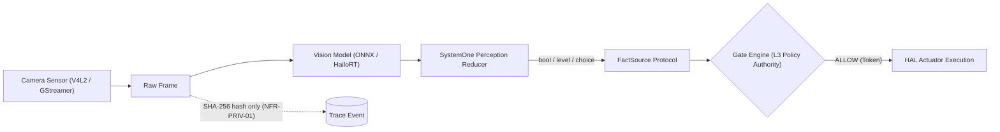
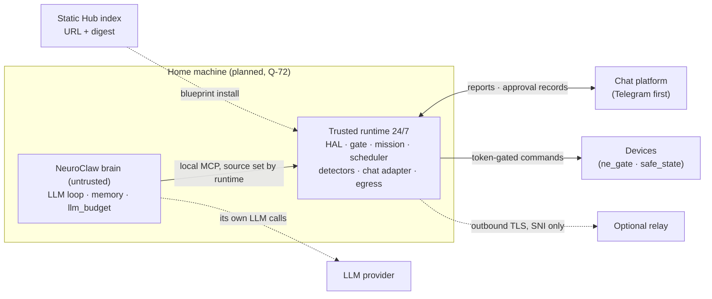

# 15 · Target Architecture

> **Scope:** to-be architecture of NeuroEdge up to v1.0 and the planned bands of §6. **Source of truth:**
> [`neuroedge-roadmap.md`](../../roadmap/neuroedge-roadmap.md) §2.1, §3, §4.3–§4.8, §5, §6, §7, Appendix D;
> [`neuroedge-prd.md`](../../roadmap/neuroedge-prd.md) §15, Appendix D.2;
> `docs/architecture/00-overview.md` §5.1;
> [`missions.md`](../spec/missions.md), [`blueprint.md`](../spec/blueprint.md), [`deployment_profiles.md`](../spec/deployment_profiles.md);
> Q-72 band: [`product-proposal.md`](../business/product-proposal.md) and Q-72 in PRD §15.
> **Status conventions:** `done` / `partial` / `planned`.

**Why read this chapter:** For software architects, embedded engineers, and systems engineers who need to understand the target architecture (to-be architecture) of NeuroEdge across each stage of completion. This document answers: *Which components, drivers, protocols, and services does each planned band introduce? How are safety boundaries and fail-closed mechanisms ([fail-closed](../user/thuat-ngu.md): if a gate cannot be evaluated, block; if network is lost, the gate still evaluates via local fallback, blocking only when fallback is absent or fails to run — Q-14) preserved when scaling from a single chip to a home box and an optional cloud brain?* Before reading, readers should understand the high-level picture in [`00`](00-overview.md) and the current evolution status in roadmap §0.5. After this chapter, continue to [`16`](16-ecosystem-landscape.md) for the complete picture of participants across the extended ecosystem.

---

## 1. Current Scope

Two planned bands sit on top of `main`; milestones and dates are in roadmap §0.5 and §0.2, removed items
(Q-77: Fleet OS, Gate Registry, robots, Jetson, voice, Lab) in roadmap [§6](../../roadmap/neuroedge-roadmap.md#6-removed-from-roadmap-q-77).

| Band | Increments | What it adds | Design |
|:---|:---|:---|:---|
| **Run and share** (`planned · Q-72`) | I2d, I2e | Mission contracts, 24/7 operator agent (trusted runtime + untrusted LLM worker), chat approval records, segmented traces (I2d); minimal NeuroEdge Blueprint with static Hub index (I2e). Runs before the rest of v1.0 (roadmap §0.2); public launch (I6) verified on esp-emulator (Q-92) | §6 |
| **v1.0 = MVP** | I2a–I7 | On-chip HAL and drivers, hardware security, LVGL bound to the display, four extension packs (Q-53), open platform (Q-67); real-board checks (Q-92 (5)) | §2, §4.4; [`04`](04-component-device-c4l3.md) |


*Figure E-10 — Current status on `main`, v1.0 (I2a–I7), the Q-72 band (I2d, I2e) and the Q-73 / Q-74 / Q-83 band (deployment profiles, verification steps, cloud brain, mesh — §6.10). Solid blocks have code (◐ partial), dashed blocks are planned; the Q-72 band is drawn below v1.0 but runs before the rest of it. Generated by scripts/gen_architecture_diagrams.py.*

---


*Figure E-09 — Eight release milestones post-Q-77 (milestone 8: increments I2f NeuroEdge Cloud, opens on launch data, Q-74; I2g box API and home web; I2h native app, Q-91, Q-92), each milestone grouping its increments; status, progress, and forecast date.*

## 2. Horizon 1 — On-Device v1.0 (I2a–I7)

### 2.1 Planned Firmware Components

On the ESP32-S3 microcontroller, components with existing code on `main` include the `components/ne_gate/` walker, the `components/ne_trace/` trace formatter, the agent-specific generator `components/ne_agent/`, and the update module `components/ne_ota/` (already running on Espressif QEMU, details in [`04`](04-component-device-c4l3.md) §3). The table below plans the components that need to be added and completed on real hardware from tasks I3–I7 (extension primitive packs: I2a, I3a):

| Component (Planned Path) | What & Why Needed | Governing Task | Open Source Reuse (Roadmap §3) | Status |
|:---|:---|:---|:---|:---:|
| `targets/esp32s3/hal/` | Implementation of 5 HAL primitives on ESP-IDF; necessary to provide standard physical pin interfaces equivalent to `sim` and `linux`. | [`TSK-S4-01`](../../roadmap/neuroedge-roadmap.md#44-i3--gate-on-real-box-3) | ESP-IDF (toolchain) — roadmap §4.4 | `planned` |
| `targets/esp32s3/hal/` (four extension packs) | `digital.in`, read-only I2C bus, `analog.in`, PWM, `motion.*`, and `vision.in` on ESP32-S3 camera boards, alongside safety envelope enforcement in firmware; necessary for the four packs to run on-chip on par with `sim` and `linux` (Q-53, Q-55). | [`TSK-I3a-02`](../../roadmap/neuroedge-roadmap.md#441-i3a--extended-primitives-on-esp32s3), [`TSK-I3a-03`](../../roadmap/neuroedge-roadmap.md#441-i3a--extended-primitives-on-esp32s3), [`TSK-W1-04`](../../roadmap/neuroedge-roadmap.md#441-i3a--extended-primitives-on-esp32s3), [`TSK-I3a-04`](../../roadmap/neuroedge-roadmap.md#441-i3a--extended-primitives-on-esp32s3), [`TSK-N7-02`](../../roadmap/neuroedge-roadmap.md#441-i3a--extended-primitives-on-esp32s3) | Per RFC-0007, RFC-0010 → RFC-0013 contracts | `planned` |
| `targets/esp32s3/drivers/` | Real peripheral drivers: I2S ES8311/ES7210 codec, ST7789 LCD, GPIO; necessary to directly control Box-3 hardware registers. | [`TSK-S4-03`](../../roadmap/neuroedge-roadmap.md#44-i3--gate-on-real-box-3) | Direct driver port from XiaoZhi ESP32 (roadmap [§3.4](../../roadmap/neuroedge-roadmap.md#34-integration-matrix-by-block), [§3.5](../../roadmap/neuroedge-roadmap.md#35-five-directly-ported-projects)) | `planned` |
| `targets/esp32s3/security/` | Hardware security block: Secure Boot, flash encryption, physical microphone disconnect button, eFuse; necessary to prevent pirated firmware loading and eavesdropping. | [`TSK-S6-05`](../../roadmap/neuroedge-roadmap.md#48-i7--v10) | ESP-IDF (specific components not yet selected) | `planned` |
| `targets/esp32s3/ui/` | 9 screens built and golden-image compared on host (TSK-S4-10 done); not yet linked into firmware, awaiting display driver (TSK-S4-01). Necessary to display status and confirmation prompts. | [`TSK-S4-01`](../../roadmap/neuroedge-roadmap.md#44-i3--gate-on-real-box-3), [`TSK-S4-10`](../../roadmap/neuroedge-roadmap.md#44-i3--gate-on-real-box-3) | LVGL v9 embedded graphics library (roadmap [§3.4](../../roadmap/neuroedge-roadmap.md#34-integration-matrix-by-block)) | `partial` |
| `targets/esp32s3/sdkconfig.defaults` | Configuration file already in repo; the memory tuning for the voice path (TSK-S5-05) was removed from the roadmap with on-chip voice (Q-77). | TSK-S5-05 (removed, roadmap §6) | ESP-IDF Kconfig | removed |

### 2.2 On-Chip Voice Pipeline — Dropped from v1.0 (Q-77)

The standalone voice pipeline (I5) is removed (Q-77, roadmap §6); host voice code remains. On-chip voice exists only as a channel of NeuroClaw-ESP on the all-in-one chip (Q-93, DP-B-20 → DP-B-22, §6.10).

### 2.3 Planned Protocols

Transport protocols are planned according to open standards and optimized for microcontroller resources (PRD [Appendix D.2](../../roadmap/neuroedge-prd.md#d2-wire-protocols-and-trace-format), roadmap [Appendix D](../../roadmap/neuroedge-roadmap.md#appendix-d--wire-protocol)):

1. **Wi-Fi / LAN Network Protocol:**
   - **Transport channel:** Secure `WebSocket` (WSS).
   - **Binary Frame:** none planned; the Opus voice stream left with the I5 voice pipeline (Q-77).
   - **Text Frame:** transports JSON trace events (PRD Appendix D.2). Status: `planned`.
2. **UART Serial Port Protocol:**
   - **Baud rate:** **not yet decided** — PRD Appendix D.2 states 921600, but `sdkconfig.defaults` does not specify it (ESP-IDF defaults to 115200) and Box-3 can route console over USB-Serial-JTAG; to be decided when hardware arrives ([`TODOS.md`](../../TODOS.md) #35, [`TSK-S4-12`](../../roadmap/neuroedge-roadmap.md#44-i3--gate-on-real-box-3)).
   - **Trace format:** JSON Lines, each line prefixed with fixed `NE1 ` to separate from firmware logs. `NE1 ` line trace format is completed on host and QEMU ([`TSK-S4-09`](../../roadmap/neuroedge-roadmap.md#44-i3--gate-on-real-box-3), `docs/spec/simulation_coverage.md` §4).
   - **Binary encapsulation:** When binary transport is needed, frame encapsulation uses `SLIP` (Serial Line Internet Protocol) per PRD Appendix D.2. Status: `planned`.

### 2.4 Device Security

Hardware security architecture at Horizon 1 establishes an integrity defense perimeter for the device:

- **Secure Boot:** enable Secure Boot on ESP32-S3 ([`TSK-S6-05`](../../roadmap/neuroedge-roadmap.md#48-i7--v10), NFR-SEC-02); signature algorithm not yet selected (NFR-SEC-02 does not specify algorithm; RSA-3072 today is used for OTA image signatures per FR-OTA-03, [`TSK-S6-03`](../../roadmap/neuroedge-roadmap.md#48-i7--v10)). Without Secure Boot, anyone with a cable can alter firmware (roadmap [`TSK-S6-03`](../../roadmap/neuroedge-roadmap.md#48-i7--v10)).
- **Flash encryption:** enable flash encryption on ESP32-S3 ([`TSK-S6-05`](../../roadmap/neuroedge-roadmap.md#48-i7--v10), NFR-SEC-02); algorithm and key management not yet designed.
- **Physical microphone disconnect button:** reference board includes a physical microphone disconnect button ([`TSK-S6-05`](../../roadmap/neuroedge-roadmap.md#48-i7--v10), NFR-SEC-03); power cut vs. signal cut not yet designed.
- **Anti-rollback eFuse:** anti-downgrade via eFuse paired with Secure Boot ([`TSK-S6-05`](../../roadmap/neuroedge-roadmap.md#48-i7--v10); roadmap [`TSK-S6-03`](../../roadmap/neuroedge-roadmap.md#48-i7--v10)). Today downgrades are only prevented by milestones in NVS — i.e., software protection.
- **OTA update mechanism:** Device-level OTA updates — dual A/B partitions (`ota_0`, `ota_1`), RSA-3072 signature verification on downloaded images, and automatic rollback upon bootloop detection or self-test failure — are implemented on QEMU and described in detail in [`04`](04-component-device-c4l3.md) §6.

---

## 3. Horizon 2 — Service Tier v1.1 (Dropped, Q-77; §3.4 Preserved)

### 3.1 Fleet OS — Dropped (Q-75, Q-77)

Fleet management is not implemented before user demand; reopening milestones in roadmap §6.

### 3.2 Gate Registry — Dropped (Q-77)

Blueprint Hub (I2e, §6.4) serves as the distribution channel; reopening milestones in roadmap §6.

### 3.3 Self-Hosted Provider Layer — Dropped (Q-77)

The NeuroEdge brain (NeuroClaw, Q-76, Q-83, §6.10) handles LLM calls; LiteLLM in core remains only on the legacy System 2 path, off by default (DP-A-08).

### 3.4 Boundary: Core ↔ Commercial Services

The boundary between the source-available core and anything commercial is fixed by [`Q-45`](../../roadmap/neuroedge-prd.md#15-decision-log) (core PolyForm Noncommercial; schemas, specifications and compliance harnesses Apache-2.0) and [`Q-85`](../../roadmap/neuroedge-prd.md#15-decision-log)(4) as reshaped by [`Q-92`](../../roadmap/neuroedge-prd.md#15-decision-log) (the paid Hub opens when a maker asks to sell; NeuroEdge Cloud opens on launch data; commercial-licence terms are written when the first business asks, `TODOS.md` #44). Fleet OS, the Gate Registry and the Registry-hosted adapter index were removed from the roadmap (Q-77, roadmap §6), so there is no fleet-level service to compare against.

| Criterion | Source-available core |
|:---|:---|
| **Core features** | All on-device logic, safety mechanisms, perception runtime, Action CI |
| **OTA** | Device-level agent: self-fetch over HTTP(S), A/B slots, local rollback, on-chip signature verification |
| **Error capture and reproduction** | Local `traces/*.json`; `neuroedge replay` on any machine |
| **Offline operation** | Gates, state machines and fail-closed behaviour run 100% offline; models need their provider |
| **Account requirements** | None |
| **AI provider connectivity** | The NeuroClaw brain (Q-83) or the legacy System 2 path; users pay providers directly, NeuroEdge does not resell tokens |
| **NeuroEdge Blueprint distribution** (`planned · Q-72`, I2e) | `blueprint pack`/`install`, full-package digest check, no account; the Hub index is a static git repository (§6.4); selling Blueprints or devices is commercial use (Q-45) |
| **Remote access relay** (`planned · Q-72`) | Not needed for safety; optional paid relay is TLS pass-through by SNI, no decryption (§6.5) |

**Non-goals:**
1. **No account required for safety:** All safety functionality — gate evaluation, single-use token issuance, and HAL fail-closed enforcement — operates 100% independently on-device without creating an account or connecting to NeuroEdge servers (§3.4; [`P-3`](../../roadmap/neuroedge-prd.md#15-five-invariant-design-principles): safety features are never unbundled into paid tiers).
2. **No reselling of inference tokens:** NeuroEdge never acts as an AI token reseller (PRD §1.4 N4); users pay model providers directly based on actual usage.

---

## 4. Horizon 3 — Post-Beta Extensions (Dropped, Q-77; §4.4 Vision Preserved)

> **Note:** Horizon 3 left the roadmap with Q-77 (roadmap §6). Basic vision belongs to v1.0 in I2a and I3a ([`Q-53`](../../roadmap/neuroedge-prd.md#15-decision-log), [`Q-54`](../../roadmap/neuroedge-prd.md#15-decision-log)) and keeps its design in §4.4; dates and dependencies reside solely in roadmap §0.2.

### 4.1 Target Tiers and Open Target List — Dropped (Q-77)

The three tier-1 targets remain unchanged. Common ESP32-S3 boards and the Arduino library (I3a, Q-75) replace opening the target list to third parties.

### 4.2 NeuroEdge Lab over MCP — Dropped (Q-77)

The standard MCP toolset (TSK-I2d-23) and the user's existing brain or MCP client (Q-76) replace the Lab's build loop. The Lab design remains in `docs/spec/lab_mcp.md` for reference.

### 4.3 Layered Robot — Dropped (Q-77)

Minimal Pi ↔ ESP32 link (heartbeat, `safe_state` on loss of comms) in I3a (Q-75); multi-node home mesh in §6.10.

### 4.4 Vision (I2a, I3a)

Vision expands NeuroEdge's perceptual capabilities from audio to imagery; `vision.in` on `sim`, `linux`, and `esp32s3` belongs to v1.0 (Roadmap [§4.3.1](../../roadmap/neuroedge-roadmap.md#431-i2a--extended-primitives-on-sim-and-linux), [§4.4.1](../../roadmap/neuroedge-roadmap.md#441-i3a--extended-primitives-on-esp32s3)):



*How to read the diagram:* Solid arrows represent the data pipeline: camera sensors capture frames, vision models run inference, and the SystemOne reducer converts tensors into discrete facts (`bool`, `level`, `choice`) fed into FactSource for the Gate Engine. Dashed arrows denote privacy preservation. The core takeaway: vision models serve strictly as L2 perception fact sources; Gate Engine L3 retains independent action verdict authority; traces never contain raw frames.

- **L2 vs. L3 Authority Principle:** Vision is an L2 perception input, strictly **never an L3 verdict authority** (§4.4). Under [`Q-54`](../../roadmap/neuroedge-prd.md#15-decision-log), makers define facts (`bool`, `level`, or `choice`, with numeric confidence) from vision model labels and write `@action` and gates as with any other facts; gates threshold confidence via `numeric` criteria (RFC-0009), without vision-specific gate semantics. If camera or model is lost, facts remain undecided and gates block (§4.4). The gate engine preserves its determinism and never receives image tensors.
- **Software Components:** The vision module resides in the package `python/neuroedge/perception/vision/` ([`TSK-V1b-03`](../../roadmap/neuroedge-roadmap.md#431-i2a--extended-primitives-on-sim-and-linux)). The `sim` environment provides a virtual camera replaying image sequences for Action CI regression testing without physical cameras ([`TSK-V1b-02`](../../roadmap/neuroedge-roadmap.md#431-i2a--extended-primitives-on-sim-and-linux), [`TSK-V1b-04`](../../roadmap/neuroedge-roadmap.md#431-i2a--extended-primitives-on-sim-and-linux)).
- **Hardware Accelerators:**
  - On `linux` (Raspberry Pi 5): uses GStreamer and V4L2 for frame capture pipeline; Ultralytics YOLO and ONNX Runtime for models; discrete NPU connection via HailoRT (Hailo-8) and Edge TPU runtime (Coral) ([`TSK-V1b-05`](../../roadmap/neuroedge-roadmap.md#431-i2a--extended-primitives-on-sim-and-linux)).
  - `jetson` (I16) and multimodal fusion (I17) were removed from the roadmap (Q-77, roadmap §6).
- **Data Privacy:** Strictly complies with NFR-PRIV-01 and NFR-PRIV-03 (§4.4, [`TSK-V1b-08`](../../roadmap/neuroedge-roadmap.md#431-i2a--extended-primitives-on-sim-and-linux)). Trace files **never embed raw frames**. Traces by default store only SHA-256 hashes (`vision_ref`) and frame dimensions. Raw image capture is only activated with explicit flag `metadata.raw_capture`.

### 4.5 Ecosystem — Dropped (Q-77)

The current ecosystem landscape is in chapter [`16`](16-ecosystem-landscape.md).

## 5. Invariants Across All Horizons

Whether the architecture adds vision, missions or a cloud brain, the following six principles (synthesized from invariants and architectural properties) are preserved across all horizons:

1. **Single path to a physical pin (Single path to a pin):** Every physical action must traverse the closed chain: `dispatch()` → `c.do()` → gate evaluate → single-use token → HAL `authorize()`. There are zero shortcuts to actuators ([`Q-24`](../../roadmap/neuroedge-prd.md#15-decision-log)).
2. **Fail-closed by default:** If a gate cannot be evaluated — timeout, network loss without local fallback, camera disconnect, missing or mistyped facts — then `BLOCK`; only gates explicitly declaring `fail: open` permit passage ([`00`](00-overview.md) §2, CHANGELOG §3.3 #2). On inter-node heartbeat loss, actuators revert to safe state (Q-35). *Modified per [`Q-72`](../../roadmap/neuroedge-prd.md#15-decision-log) (`planned`, awaiting conditional safety RFC):* this rule remains strictly intact for **commands**; with a second clause added — all actuators autonomously return to the `safe_state` declared in `board.v1` (defaults to `off`, so today's behavior is unchanged). Details: §6.3.
3. **Gate is versioned data (Gate is data):** Safety gates are always versioned data, canonically identified as `neuroedge://`, hashed via JCS SHA-256, compiled into deterministic decision trees, and inheritance rules may only tighten policies ([`Q-18`](../../roadmap/neuroedge-prd.md#15-decision-log)).
4. **Replay recomputes:** Trace files contain sufficient facts to recompute the entire decision sequence in Action CI test environments without invoking AI models again and without touching physical hardware.
5. **One trace per session:** Each interaction session generates exactly one complete trace file (NFR-OBS-01, FR-ACE-06). *Modified per [`Q-72`](../../roadmap/neuroedge-prd.md#15-decision-log) (`planned`, awaiting `trace.v1` RFC):* for 24/7 runtimes, a session is **a sequence of trace segments**, each independently replayable. Details: §6.7.
6. **Same decision on every target:** Environmental equivalence ensures agent source code never branches by target; identical fact scenarios yield strictly consistent verdicts and responses across `sim`, `linux`, and `esp32s3` ([`Q-8`](../../roadmap/neuroedge-prd.md#15-decision-log), P-2, `docs/architecture/00-overview.md` §5.2).

Sources for each: [`00`](00-overview.md) §2, §4; [`CHANGELOG.md`](../../CHANGELOG.md) §3.3 (ten invariants — a different, more detailed list; Q-72 modifications recorded there, not duplicated here).

---

## 6. Q-72 Band — Operator Agent and NeuroEdge Blueprint (I2d, I2e)

> **Entire section `planned · Q-72`: no code yet.** Decision: [`Q-72`](../../roadmap/neuroedge-prd.md#15-decision-log).
> Increments, ordering, and dates: roadmap [§0.2](../../roadmap/neuroedge-roadmap.md#02-increment-matrix)
> (I2d — missions and operator agents; I2e — minimal NeuroEdge Blueprint). Any touches to `schemas/`, canonical
> traces, or safety semantics **await RFC** (`CONTRIBUTING.md` §3); planned RFC list in [PRD §15](../../roadmap/neuroedge-prd.md#15-decision-log).
> Proposal: [`product-proposal.md`](../business/product-proposal.md).

Q-72 positions NeuroEdge across three loops: ① **build** (existing MCP clients through the standard tool set TSK-I2d-23; Q-77, Q-88; §4.2), ② **run** (operator agent), ③
**share and sell** (NeuroEdge Blueprint). This section is the target design for loops ② and ③. It builds on what
already exists or is planned through I2c: single-path gate execution, runtime-assigned call sources (RFC-0017), remote actuators and
auto-off tiers (RFC-0018), triggers running without client sessions (§4.2, block N6), community plugin index (I2c).



*How to read the diagram:* two processes on the home machine; only the trusted runtime touches hardware, holds bot tokens, and verifies approvals.
The brain invokes the runtime like any MCP client (Q-83); its LLM calls are its own. Relay and Hub index are
optional, dashed, not on the safety path.

### 6.1 Operator Agent: Two Processes (I2d)

Today there is no background process that runs indefinitely ([`02`](02-container-c4l2.md) §3). Q-72 requires a 24/7 process that simultaneously
holds GPIO permissions, user LLM keys, chat bot tokens, and reads text sent by external parties. Bundling these into a single
process would give a prompt injection via chat messages equal privileges to HAL. Therefore, the operator agent consists of **two
processes**, reusing the boundary from Q-71 (only one process holds HAL; MCP clients are untrusted):

| Process | Holds | Never |
|:---|:---|:---|
| **Trusted runtime** (systemd, 24/7) | HAL and `gpio`/`i2c` permissions; gates, token ledgers, envelopes; executes **mission contracts**; scheduling; **deterministic detectors**; a cap on how often it wakes the brain, computed from the cost the brain reports (Q-87(1), MS-RT-06); chat channel adapter, bot tokens, and approval record verification; egress gateway; segmented traces | calls LLMs (the LLM loop and its `llm_budget` belong to NeuroClaw, Q-83(4)); allows LLM approval |
| **NeuroClaw brain** (dedicated OS user, Q-83) | LLM keys and loop, memory, its own `llm_budget` (MS-RT-06); explanation, suggestions, report drafting | touches HAL; holds bot tokens; approves; reaches the box other than through MCP and mTLS |

- **Mission contracts** (`mission.v1`, awaiting RFC) group multiple devices: permitted/prohibited, frequency, time windows, obligations
  (bounded watchdog), data flows, failure handling, expiration, LLM cost ceilings. The mission compiler compiles each
  clause down to the lowest capable layer: version 1 compiles every term to **skill tier** on the box; the reflex tier on the chip waits for a `NETR` RFC and the approval card says so (Q-87(2), MS-CP-04). Contracts are YAML, locked when a person approves the exact digest, and the box writes `missions.lock` (Q-87(3), MS-AP-05); requirements in [`missions.md`](../spec/missions.md).
- **Deterministic detectors run before LLMs.** They extend N6 triggers (§4.2): running without client sessions,
  `trigger ∉ HUMAN_SOURCES`, with debouncing and rate limits. Only when a detector fires and the wake-up cap (Q-87(1)) allows
  does the runtime wake the brain for analysis; reports are aggregated according to message budgets.
- **Clocks.** Durations, approval deadlines, watchdogs, and reflexes use monotonic clocks. Wall-clock facts have an
  `unsynced` state (home machine power loss, missing NTP/RTC); time-window clauses treat `unsynced` as missing facts,
  i.e. fail-closed.
- **Error branches.** Worker crashes or hangs: runtime continues running reflexes, detectors, and hardcoded template alerts, then restarts
  the worker. Depleted budget: reflexes and hardcoded template alerts still run. Network loss: safety features run
  locally as they do today.
- **Debt becomes real risk.** An event loop living for months elevates `TODOS.md` #25 (MCP connections live only for a single turn)
  and #48 (`linux` sensor reads block the event loop — detectors read sensors periodically) into issues that must be resolved before the 24/7
  runtime runs in production ([`15`](15-target-architecture.md) §9).

### 6.2 Chat Channels and Approval Records (I2d)

Chat channels (Telegram first, then Slack, Zalo) are adapters inside the runtime. They only call `dispatch()`, without importing
`hal`. Incoming messages from chat are commands like any other source: passed through gates.

Q-72 allows humans to **approve via chat** — both `ask` and contract modifications, except modifications expanding data permissions (approved only locally, FR-MSN-14). Today only `local_grammar` and `ui` can
confirm (`HUMAN_SOURCES`, Q-26). The target design does not add a source name to that tuple, but uses **approval records**:

1. Runtime emits request `{id, nonce, deadline, change digest, approval text ≤ 5 lines}` to paired chat. The **approval
   text is generated deterministically by runtime and compiler from structured diffs**, not from LLM prose.
2. Responses must target the exact `id` (button or code).
3. Runtime checks: sender paired locally; not a group chat; `nonce` unused; not expired (monotonic
   clock); digest matches pending change. If all five pass, approval enters the confirmation path with source `chat:<id>` (same
   syntax as `bridge:<id>` in RFC-0017) and the gate re-evaluates; if any fails, rejected and traced.
4. LLMs and group chats **never** approve. Approvals do not pass through relays.

Error branches: expired requests are not approved; if chat API errors, queues are bounded and local alerts show on UI.
Pairing is strictly local; revocation, pairing expiry, and hourly approval limits are deferred (`TODOS.md` #62). Accepted risk
in Q-72: compromised chat account can approve on behalf of owner.

### 6.3 Conditional Safety: Symmetric `safe_state` (Awaiting RFC)

Core today implicitly treats `off` as safe: commands returning to `off` are not blocked (Q-62), turn-on commands have durations and auto-off. For an aquarium aerator, safe means *on*. The target design generalizes the entire core around **`safe_state`**, without adding exceptions:

- Every actuator has a `safe_state` declared in `board.v1`, defaulting to `off`. Durations, `max_continuous_ms`, leases,
  L0–L3 levels in RFC-0018, and gate exemptions in Q-62 all refer to "**returning to `safe_state`**". The direction **leaving** `safe_state`
  is gated and bounded.
- `safe_state: on` is implemented via default-on wiring (normally closed relay), declared as hardware
  interlock; software only issues bounded commands to leave that state. On power loss, hardware, not software, maintains the
  safe state.
- `safe_state = on` is allowed on a `sim` board that carries an interlock entry, under the label `risk=simulated_interlock`, and never on `sim-virtual` (Q-87(4), MS-SF-05). Values other than `off` are declared in `board.v1`, not in contracts, gates, or Blueprints; a Blueprint carrying a `board.v1` profile is refused until the conditional-safety RFC (TSK-I2d-02) lands (Q-86(2), BL-FMT-04). `TODOS.md` #58
  (`board.v1` ignores unrecognized keys) must be resolved first.
- Existing profiles (`off`; `motion.*` `stop`/`hold`) preserve their behavior; the corpus is re-run to verify.

### 6.4 NeuroEdge Blueprint and Hub Index (I2e)

**NeuroEdge Blueprint** is the sharing unit of loop ③: kit (BOM with purchase links), firmware, sample mission
contracts, detectors, and trace files as evidence. It differs from **Home Assistant Blueprint** — automation blueprints shared via
Blueprint Exchange and imported via URL; a NeuroEdge Blueprint can bundle an HA blueprint for single-step installation.
The first Blueprint is the aquarium.

- `blueprint pack` packages; `blueprint install` downloads via **URL (git or HTTPS) + digest**. The manifest is `blueprint.toml`; the digest is taken over the canonical manifest and each file's SHA-256, so a directory, a git checkout and a `.tar.gz` give one digest; if mismatched, installation is rejected before any file is written (Q-86(4), BL-PK-02). `contract` and `detectors` were reserved manifest sections; Q-92 lets blueprints carry them from launch (BL-FMT-05 amended through the `blueprint.v1` RFC, TSK-I2e-01), and the installer approves and locks a contract before it runs; nothing from a package runs before the person approves the summary (Q-86(1)). Requirements: [`blueprint.md`](../spec/blueprint.md).
- **The Hub in MVP is a static index repository**, following the same model as I2c plugin index: listing URLs, digests, and evidence. Packages
  reside in seller repositories. Zero NeuroEdge servers exist at launch.
- Evidence explicitly states **"unsigned"**: trace signatures return when the Hub monetizes for sellers (`TODOS.md` #1).
- The paid Hub (FR-BP-10) opens when a maker asks to sell (Q-92); the OCI Gate Registry was removed from the roadmap (Q-77).
- Sample contracts never declare `safe_state` (§6.3); installers lock contracts on their own machines.

### 6.5 Optional Relay (Outside I2d, I2e)

The relay enables opening remote management dashboards, pushing messages, and backing up traces without opening home network ports. It is a **TLS pass-through tunnel**
(Nabu Casa's SniTun model): the home machine initiates outbound connections; the relay routes by SNI and **never decrypts**; TLS keys remain strictly
on the home machine. Trace backups are encrypted client-side by the home machine; the relay stores only opaque blobs. Approvals do not pass through relays; remote management pages opened via relay are **not yet** permitted to answer `ask` or approvals until the relay RFC decides how to authenticate dashboard viewers (today the UI assumes the viewer is physically at the device — `docs/spec/threat_model.md` §2h). A compromised
relay can only block traffic or inspect metadata; if the relay crashes, remote access is lost while safety continues running. This is a
bounded exception to "zero servers operated by NeuroEdge" (Q-10).

### 6.6 Leak-Proof Data Flows (I2d)

Data flow rules aim to **prevent data leaks** (attacks, prompt injection, exfiltration), without restricting user-configured
pipelines. All destinations declared by the user (LLM providers, chat channels, relays, webhooks) receive data permitted by the user,
including images sent to LLMs. Enforced by:

- the runtime decides what the worker **sees**;
- the LLM worker's network is blocked at OS level, restricted strictly to declared provider endpoints;
- the runtime only transmits to declared destinations; undeclared destinations are blocked and traced.

Remaining risk: a duped worker can still send permitted data to permitted destinations. Content policies (e.g. "photos
never leave the home") are optional user-toggled contract clauses, not defaults.

### 6.7 Segmented Traces (I2d)

A single trace file for a process running for months would grow indefinitely and risk total loss on power failure. Traces for 24/7
runtimes are **segmented sequences** (`trace.v1`, awaiting RFC):

- rotated daily or when exceeding size limits; each segment carries **initial segment state** (gate digest, token ledger, envelope
  counters, leases) and the preceding segment's digest, ensuring that `replay` of a single segment reproduces the correct verdicts and detects missing segments;
- append-only logging, time-flushed (approximately every 10 seconds, configurable) and flushed **immediately** upon block verdicts or approvals;
  power outages lose at most the tail of ordinary events, with `replay` reporting a truncated segment;
- retained for **30 days** locally — sufficient for Blueprint evidence; older segments are compressed and deleted or exported encrypted via relay.
  The 30-day size is measured on G1 `sim` before committing numbers to NFRs.

The "one trace per session" invariant (§5 #5) becomes "one session is a sequence of trace segments, each independently replayable".

### 6.8 Simulation First: Four Tiers G1–G4

Launch is verified on simulation and esp-emulator; real hardware is needed for v1.0 (Q-92). Four simulation tiers (distinct from market milestones G1–G4 in PRD §11.2):

| Tier | Runs | Catches |
|:---|:---|:---|
| **G1** | `sim` with physical model (e.g. aquarium temperature and dissolved oxygen), fast-forwarded 30 days | contract logic, detectors, budgets, 30-day trace size |
| **G2** | `linux` on `gpio-sim` | real `linux` HAL, 24/7 runtime under systemd |
| **G3** | ESP32 firmware on Espressif QEMU (main track, Q-21); Wokwi, Velxio awaiting Q-21, Q-69 comparison | MCU reflexes, `ne_gate` |
| **G4** | ESPHome host platform | Home Assistant-style device integration |

Simulation does not catch wiring errors, electrical noise, or Wi-Fi flakiness (accepted consequences under Q-72).

### 6.9 Demand Gate (removed)

There is no demand gate (Q-92 (1)). The first adoption signal is the launch's anonymous telemetry (FR-TEL-01); the paid Hub, paid relay and other monetization open on request or on launch data, not on a gate (PRD §8, Q-85 as amended by Q-92).

---

### 6.10 Two Deployment Profiles, Optional Cloud Brain, Multi-Node Mesh, and Verification Steps (`planned · Q-73, Q-74, Q-76, Q-83`)

[`Q-74`](../../roadmap/neuroedge-prd.md#15-decision-log) leverages the exact boundary of §6.1 to move the **LLM worker** (chat, suggestions, mission
contract compilation) to the **optional NeuroEdge Cloud**; the **trusted runtime always stays at home**. No code yet; the cloud opens on
launch data showing people stuck installing the box (Q-74 step 2, Q-92 (8)).

```
 📱 single chat box (multi-user, role-based — FR-CH-07)
        │
 ☁️ NeuroEdge Cloud (optional): LLM worker, conversation, planning, rule compilation
        │  home box opens outbound connection; no home network ports opened
 🏠 home box — trusted runtime (Pi, mini PC or NAS) or ESP32-S3 for single tasks
        │  signed rules; approvals verified at the node
 ESP32 with `ne_gate` · Pi · devices via Home Assistant — each node holds rules locally, autonomously reverts to `safe_state`
```

- **Cloud coordinates, never sovereign.** Each node only enforces signed rules; approvals (FR-CH-04) are verified
  at the node; irreversible actions in any home always require human confirmation; a single command cannot exceed pre-declared ceilings
  on device counts or homes touched (FR-AGT-11). If the cloud is compromised, doors still do not open.
- **Two tiers of home boxes.** *Full* — Pi, mini PC or NAS (cameras, multi-vendor, 30-day traces §6.7, optional
  local LLMs). *Small* — ESP32-S3: `NETR` walker, token ledger, reflexes, on-chip approval verification; rules compiled in
  the cloud and loaded with signatures (requires real Wi-Fi, `TODOS.md` #50); traces pushed to cloud encrypted or stored on SD card.
- **Cloud disconnection** ⇒ reflexes, gates, and local alerts continue running; only chat and summarization are lost.
- **User-declared verification steps** ([`Q-73`](../../roadmap/neuroedge-prd.md#15-decision-log), FR-CH-06, awaiting RFC TSK-I2d-20): read code, voice,
  face, keypad, fingerprint on phone… via verifier plugins; each carries a risk label. LLMs, MCP
  clients, and automated sources never answer verification steps.
- **NeuroEdge Brain: NeuroClaw, two deployment profiles** ([`Q-83`](../../roadmap/neuroedge-prd.md#15-decision-log), [`Q-76`](../../roadmap/neuroedge-prd.md#15-decision-log),
  [`Q-78`](../../roadmap/neuroedge-prd.md#15-decision-log), [`Q-79`](../../roadmap/neuroedge-prd.md#15-decision-log),
  [`Q-80`](../../roadmap/neuroedge-prd.md#15-decision-log)). The brain is **NeuroClaw**, dedicated repository
  [`letrongminh/neuroclaw`](https://github.com/letrongminh/neuroclaw) (MIT, hard fork of PicoClaw v0.3.1, with releases).
  It acts as the home's LLM worker: chat channels, LLMs with fallback and call budgets, file-based memory, schedules and heartbeats, MCP
  client; shell, hardware buses, skill installs enabled or disabled by users, each active feature carrying a risk label (Q-80). Home
  devices are accessed exclusively through the box's tools; the box holds gates, approvals, and traces. One contract (the tool
  list and `tool-result.v1`), two transports; requirements and test cases in
  [`docs/spec/deployment_profiles.md`](../spec/deployment_profiles.md):
  - **Profile A — Full**, in two forms:
  - *Self-hosted* — NeuroClaw (Go) on cheap Linux boards, servers, or the runtime Pi itself (under a separate user without
    hardware privileges, TSK-I2d-24). Speaks MCP over HTTP with TLS 1.3, mTLS, and tokens to `neuroedge mcp serve --http`.
  - *NeuroEdge Cloud* (conditional, I2f) — same NeuroClaw, isolated instance per user, communicating with the box over the box's
    outbound connection.
  - **Profile B — One chip** — NeuroClaw-ESP and the gate in one ESP32-S3 image, `risk=single_chip`; with screen and voice
    the **all-in-one chip** (Q-93). Profile B+ (real isolation on one board) is under evaluation (TSK-I2f-17). Details below.

  Other workers (upstream PicoClaw, Claude Desktop, OpenClaw) plug into the same MCP toolset; workers unable to present certificates
  use demo mTLS bridges. Capabilities per run mode, risk labels, and feature gap vs. zclaw, MimiClaw:
  `docs/reference/capabilities.md` in the `neuroclaw` repo.

- **Contract between the two repos.** `neuroedge-init` provides runtime, gates, and the MCP server; `neuroclaw` provides the brain.
  They meet at three points, and strictly three points:
  - **The box's MCP toolset** — tool schemas generated from agents and `ALLOW`, `BLOCK`, `REJECTED` results
    ([`tool_calling.md`](../spec/tool_calling.md) §3, §4). NeuroClaw reads these results to communicate with the LLM when the box asks the owner.
  - **Networked MCP channel** — TLS 1.3, mTLS, certificate-bound tokens (`neuroedge mcp serve --http`,
    [`tool_calling.md`](../spec/tool_calling.md) §8.1); on the NeuroClaw side, the
    `tls` block for the MCP server in `config.json` (`docs/guides/neuroedge.md` in that repo).
  - **Single-chip firmware** — `targets/esp32s3/` embeds the `neuroclaw` component pinned by version and SHA-256 (DP-B-01);
    `nc_gate` is implemented on the box side by `ne_brain_bridge` (DP-B-02 → DP-B-08, TSK-I2f-12).

  Modifying any of these three points requires updating both repos in tandem; the rest of each repository evolves independently.

```
 self-hosted: 📱 chat ── NeuroClaw (board / Pi, separate user) ══MCP, mTLS══► home runtime ──► hardware
 cloud:       📱 chat ── shared channel gateway ── NeuroClaw instance (microVM) ══MCP via outbound conn══► home runtime
 approval:    📱 approve button ── passkey signature on phone ───────────────────────────────► box verifies signature locally
```

- **Profile B ([`Q-79`](../../roadmap/neuroedge-prd.md#15-decision-log), [`Q-83`](../../roadmap/neuroedge-prd.md#15-decision-log), [`Q-93`](../../roadmap/neuroedge-prd.md#15-decision-log)).**
  Brain and gate share one chip with no process isolation, so the §6.1 boundary is replaced by a typed queue into `ne_gate`
  and the label `risk=single_chip` (`threat_model.md` §2l). An `ask` is answered only by a human source on the chip or the
  owner's Telegram callback; a spoken answer only by the on-chip command word (DP-B-21). Requirements, build steps and
  tests: [`deployment_profiles.md`](../spec/deployment_profiles.md) §3.3 (DP-B-*); firmware: [`04`](04-component-device-c4l3.md) §3.

- **Approvals never route through the brain** (FR-CH-08): irreversible actions are approved via passkey signatures on phone
  or locally within the home network; the cloud's shared channel gateway forwards messages but cannot forge approvals.
- **Follow-up tasks:** verification steps TSK-I2d-20, TSK-I2d-21; NeuroEdge brain and worker isolation TSK-I2d-22 → TSK-I2d-24; cloud dedicated instances, ESP32 tier, mesh network, and user roles: increment I2f (conditional, roadmap §4.3.6); passkey approvals: I2g (Q-92 (9)); Profile B (Q-79, Q-83): TSK-I2f-10 → I2f-17; all-in-one chip (Q-93): TSK-I2f-18 → I2f-20, TSK-I7-03; Profile A contract and legacy System 2: TSK-I2d-26, TSK-I2d-27.

## 7. Sources

1. **Development Roadmap:**
   - [`neuroedge-roadmap.md`](../../roadmap/neuroedge-roadmap.md) (§2.1 Dependency Graph, §3 OSS Reuse Strategy, §3.8 Preserving Target Equivalence, §4.4–§4.8 Task Tables I3–I7, §5 I8 Developer Beta, §4.3.3 I2c Open Platform, §6 Removed from Roadmap, Appendix D Wire Protocol).
2. **Product Requirements Document:**
   - [`neuroedge-prd.md`](../../roadmap/neuroedge-prd.md) (§1.4 Non-goals N4; §9 Non-functional Requirements; §15 Decision Log: `Q-3`, `Q-6`, `Q-8`, `Q-10`, `Q-11`, `Q-12`, `Q-13`, `Q-14`, `Q-18`, `Q-24`, `Q-26`, `Q-28`, `Q-31`, `Q-32`, `Q-33`, `Q-34`, `Q-35`, `Q-36`, `Q-37`, `Q-45`, `Q-52`, `Q-53`, `Q-54`, `Q-55`, `Q-62`, `Q-71`, `Q-72`; Appendix D.2 Wire protocol).
   - [`product-proposal.md`](../business/product-proposal.md) (Blueprint positioning, three loops — source for §6).
3. **Format Specifications:**
   - [`core_contracts.md`](../spec/core_contracts.md) (APIs, `board.toml`, `agent.toml`, gates, HAL, traces)
4. **Detailed Design Notes:**
   - `docs/spec/lab_mcp.md` (design notes of NeuroEdge Lab, removed from the roadmap by Q-77, Q-88; kept for reference).
   - [`missions.md`](../spec/missions.md), [`blueprint.md`](../spec/blueprint.md), [`deployment_profiles.md`](../spec/deployment_profiles.md) (Q-87, Q-86, Q-83).
5. **Related Architecture Chapters:**
   - [`00 · Overview`](00-overview.md) (§2 System in One Picture, §4 Architectural Properties).
   - [`02 · Container Architecture`](02-container-c4l2.md) (§5 Planned Containers).
   - [`04 · ESP32-S3 Firmware Components`](04-component-device-c4l3.md) (§3 Component Catalog, §6 Signed OTA Updates).
   - [`05 · Detailed Design of Gate and HAL`](05-code-gate-hal-c4l4.md) (§5 From Verdict to Pin).
   - [`16 · Ecosystem Landscape`](16-ecosystem-landscape.md).

## 8. Existing Extension Points

Points where today's architecture is intentionally left open, so upcoming milestones avoid tearing up foundations:

| Extension Point | Location | Enables |
|:---|:---|:---|
| Fact source | `FactSource` protocol (`engine/gate.py`) | adding decision models, sensors, vision as fact sources without modifying the engine |
| Model and voice providers | `models/providers/`, `perception/providers/`, `python:` adapter | switching providers via configuration |
| HAL | `HardwareAbstractionLayer` subclass + `boards/` profile | new targets (RFC-0002 signed; code portion in I2c) |
| Registry backend | `GateRegistry` (`gate_resolver.py`) — docstring notes replacement with OCI lookup | none planned (Gate Registry removed, Q-77) |
| Trace events | `type` is a free string in `trace.v1`; `metadata` accepts arbitrary fields | new events without needing `trace.v2` |
| Firmware configuration layers | layered `SDKCONFIG_DEFAULTS` | toggling board features without code branching |
| On-device tree | `NETR` has `layout_version` | layout v2 (RFC-0009 §3d: `numeric` table, gate labels) implemented in TSK-W1-02; walker rejects foreign layouts instead of misreading |

## 9. Known Architectural Debt

Each item is an intentional trade-off, with an activation milestone in `TODOS.md`:

| Debt | Why Accepted Today | `TODOS.md` |
|:---|:---|:---|
| Unsigned traces | requires device keys; needs device keys; NeuroEdge Blueprint evidence marked "unsigned" until Hub monetizes (Q-72) | #1 |
| Tokens are in-memory `(nonce, digest)`, unsigned | in-scope threat model is accidental bypass | #2 |
| `extends` not yet pinned by digest | registry not yet available; `digests.lock` covers CI; scheduled for I2c (TSK-S3-21, Q-67) | #15 |
| MCP connections live for only one turn | each REPL turn has its own event loop; **becomes a real risk** when 24/7 runtime and LLM worker keep an MCP connection alive for months (I2d, `planned · Q-72`) | #25 |
| On-chip pin command operation and duration taken from host-built table | how actions run on MCU is not yet decided | #37 |
| `linux` sensor reads block the event loop | no agent yet speaks while simultaneously reading sensors; **becomes a real risk** when 24/7 runtime detectors read sensors periodically (I2d, `planned · Q-72`) | #48 |
| `board.v1` silently ignores unrecognized keys | today only one parser exists; must be fixed **before** `safe_state` other than `off` enters `board.v1` (Q-72) | #58 |
| Chat pairing lacks revocation, expiry, and approval rate limits | approval via chat has no code yet; milestone: prior to I2d chat approval task (Q-72) | #62 |
