# 06 · Runtime flows (Dynamic views)

> **Scope:** the important flows, each with a sequence or state diagram, calling functions by their
> exact names in the code. **Source:** `sim/session.py`, `actions/`, `engine/gate.py`, `mcp_server.py`,
> `mcp_host.py`, `models/system.py`, `perception/`, `testing/`, `docs/spec/voice_fsm.md`,
> `docs/spec/tool_calling.md`.

Every flow below, wherever it starts, meets at the same segment: `dispatch()` → `Conversation.do`
→ `ActionContractEngine.evaluate` → `TokenLedger` → HAL ([`05`](05-code-gate-hal-c4l4.md) §5). The
diagrams draw that segment once in §1 and call it by name in the other flows.

## 1. A typed command turn

`neuroedge run -c "mở cửa phòng 101"` on `sim`.

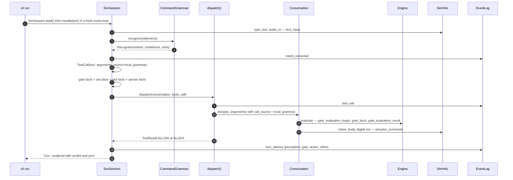

A sentence that does not match the grammar: with `[system_two]` it goes to the flow in §4; otherwise
`command_not_recognized` and the device speaks the local commands that still work (`offline_help`).

## 2. Ask and confirmation (`on_block: ask`, RFC-0006)

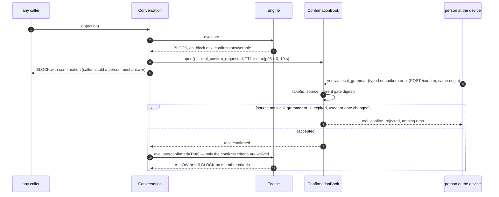

- System 2 and the MCP client have **no confirmation tool**; a question created by System 2's own call
  cannot be answered by System 2 (Q-26).
- A spoken "yes" only answers the question of **that very turn** (Q-46).

## 3. MCP calls

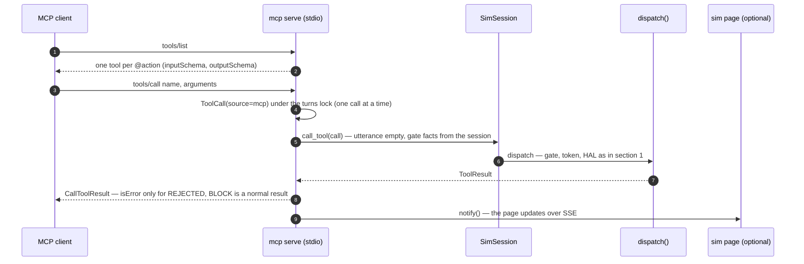

An MCP call has no spoken words, so `[system_one]` sends nothing to the model: that criterion falls
back to grammar or blocks. A gate can refuse the `mcp` source specifically through the `call_source`
criterion.

## 4. A System 2 (LLM) turn, with an external MCP server

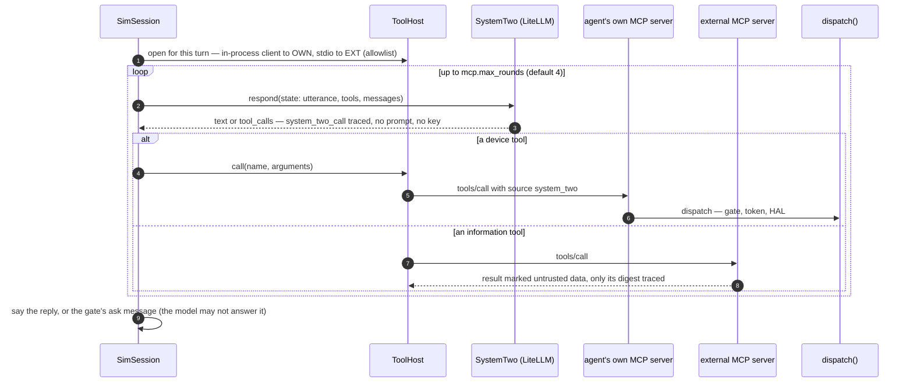

The provider cannot answer ⇒ `system_two_unavailable`, the device speaks an offline line. If content
from an external MCP server contains an injected command (prompt injection), the call it leads to still
has to pass the gate (`test_mcp_host.py::test_prompt_injection_in_the_news_still_meets_the_gate`).

## 5. The System 1 model and when offline

`SystemOne` is the engine's `FactSource`. With `[system_one]`, it asks the primary model (Jev via the
System One API) for the delegated criteria, within the remaining budget minus 50 ms of reserve; if the
model is not usable, the command grammar decides.

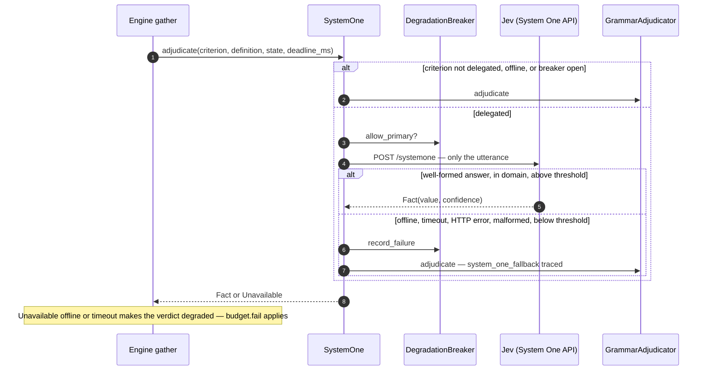

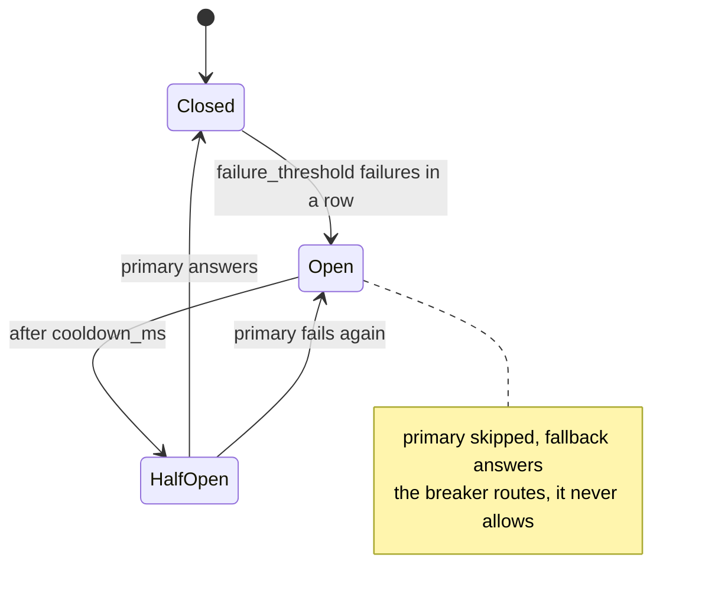

No fallback can run for a model-decided criterion ⇒ `BLOCK` with `gate_unreachable` (Q-14, the third
I4 exit criterion).

## 6. Voice

### 6.1 The conversation state machine

Normative in `docs/spec/voice_fsm.md` §4 (T01–T14). Every state change writes `voice_state_changed`.
The state machine never evaluates a gate or touches a pin.

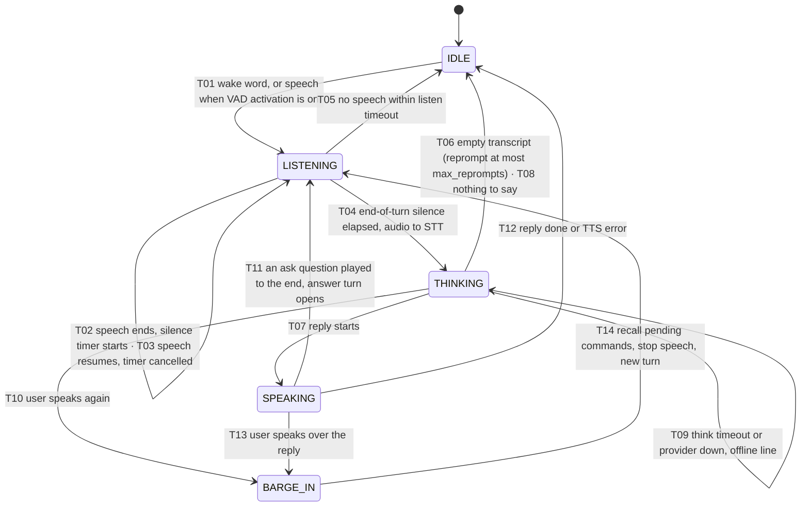

### 6.2 One voice turn from a WAV file

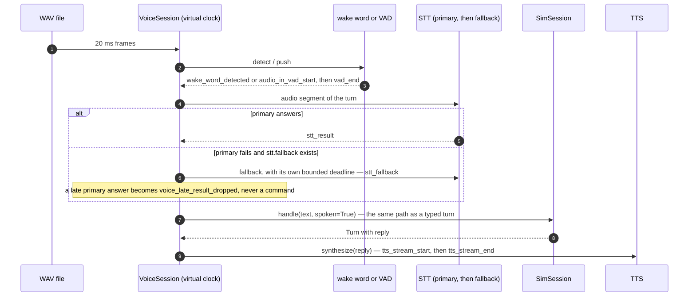

**Barge-in** (`docs/spec/voice_fsm.md` §5): the user speaks while the device is thinking or speaking ⇒
the speaker stops, every command **not yet delivered** to a pin is aborted (`actuator_aborted`, reason
`ACTUATOR_ABORTED_BY_BARGE_IN`) and its token is closed. A delivered command (a pulse already running)
runs to the end.

**A broken wake word** (model fails to load, adapter throws) ⇒ `wake_word_unavailable`, no turn opens,
the session keeps running.

Voice sessions today run in **virtual time** from a WAV file; a real-time session with a real
microphone does not exist yet (`TODOS.md` #45).

## 7. The evidence loop: record, replay, compare


*Figure E-06 — A session becomes a trace; the trace is recomputed on each target and compared with the original.*

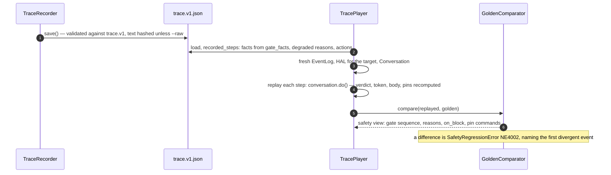

- Replay **calls no model and reads no machine**: the recorded facts are fed back in, while verdicts,
  tokens and pin commands are **recomputed**.
- Comparison is by **decision** (verdict, reason, `on_block`, pin commands), ignoring time and spoken
  words.
- `neuroedge verify --targets sim,linux,esp32s3` does this for every canonical trace on each target; on
  `esp32s3`, the firmware itself replays the three canonical traces at boot and sends the results over
  UART.

## 8. From agent to chip

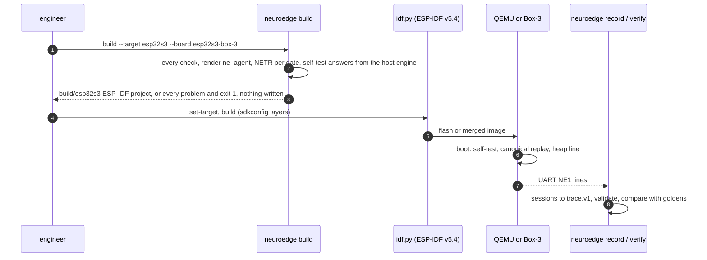

## 9. Lifecycle of a `linux` session

1. `SimSession.load(target="linux")` builds `TypedLinuxHAL` and calls `preflight`: every sensor,
    display and audio device the agent needs is checked **before** any GPIO line is held. Anything
    missing ⇒ three-part error, exit code 1, no line held.
2. Pin commands reach the kernel line through libgpiod v2, looked up by name. A pulse with a duration
    is released by a timer; `run -c` waits for the pulse to finish before exiting.
3. Exit — normal, Ctrl-D, SIGTERM (MCP client stops the server), SIGHUP (terminal closed) — ⇒ every
    line returns to the idle state and is released. SIGKILL cannot be caught: that is why hardware
    safety is still needed (`docs/spec/threat_model.md` §3b).

## 10. Planned flows

| Flow | Increment | Target architecture |
|:---|:---|:---|
| On-chip voice turn | I5 | [`15`](15-target-architecture.md) §2.2 |
| Rejection by physical safety envelope | I2a | [`15`](15-target-architecture.md) §4.2 |
| Event trigger call source (`call_source = "trigger"`, TSK-N6-*) | I2d (moved from I4a by Q-72) | [`15`](15-target-architecture.md) §4.2 |
| Multi-node intent and communication loss | I14 | [`15`](15-target-architecture.md) §4.3 |
| Vision facts | I2a, I3a | [`15`](15-target-architecture.md) §4.4 |
| Mission contract lifecycle, proactive reports, commands and approvals over chat (`planned · Q-72`) | I2d | §11 below; [`15`](15-target-architecture.md) |
| Installing a NeuroEdge Blueprint (`planned · Q-72`) | I2e | §11.5 below; [`15`](15-target-architecture.md) |

## 11. Planned flows under Q-72 (`planned · Q-72`)

No flow in this section has code yet. They record the target design of [Q-72](../../../roadmap/neuroedge-prd.md#15-sổ-quyết-định) for increment I2d (missions and the operating agent) and I2e (minimal NeuroEdge Blueprint); progress is in roadmap §0.2. Parts that need an RFC are marked "pending RFC".

Two processes on the home machine ([`02`](02-container-c4l2.md)):

- **trusted runtime** (24/7, systemd): HAL, gate, mission contract execution, scheduling, deterministic detectors, chat channel adapters and approval checks, egress;
- **untrusted LLM worker**: holds the user's LLM key (BYOK), calls the runtime over local MCP like any MCP client, source assigned by the runtime, **never approves** — the same boundary as the MCP client in Q-71.

Every command to a pin, whether it comes from chat, the scheduler or a detector, still goes through exactly the one segment of §1: `dispatch()` → `Conversation.do` → gate → token → HAL. The chat adapter only calls into `dispatch()` and does not import `hal`. Durations, approval expiry, the watchdog and reflexes use the **monotonic clock**; wall-clock facts carry the `unsynced` state while the machine has not synchronized its time, and time-window clauses treat `unsynced` as a missing fact (fail-closed).

### 11.1 Lifecycle of a mission contract (I2d)

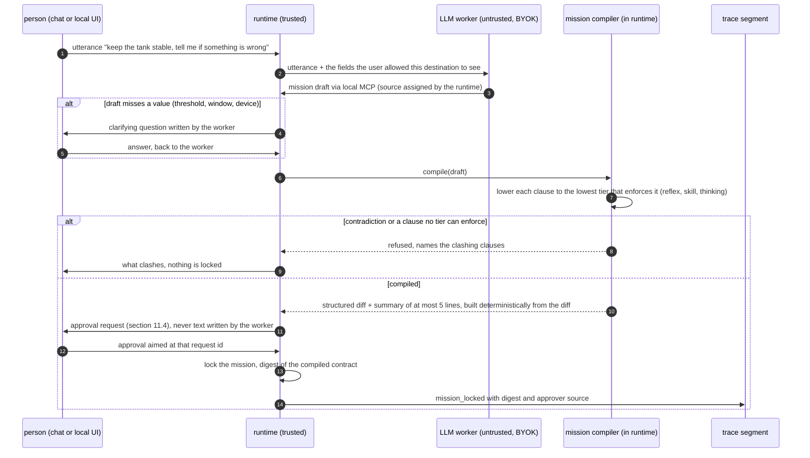

- Only devices with `ne_gate` have a reflex tier; Home Assistant devices stop at the host tier and the approval summary says so.
- The approval summary is compiler output, not LLM text: a tricked worker cannot write a single line of the approval message.

### 11.2 Triggers, detectors and proactive reports (I2d)

This extends the Block N6 trigger flow (I2d, moved from I4a by Q-72; [`15`](15-target-architecture.md) §4.2: runs without a client session, `call_source = "trigger"`, `trigger ∉ HUMAN_SOURCES`, debounce, rate cap), not a parallel path: the mission contract's scheduler and detectors are new activation sources of that same path.

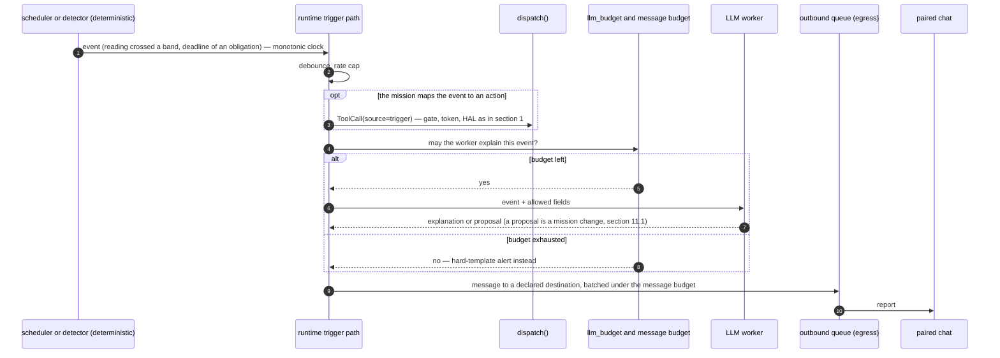

Detectors run first, and the LLM is called only after an event: reflexes and hard-template alerts do not depend on the LLM. Detectors reading sensors periodically inside the 24/7 runtime turn `TODOS.md` #48 (sensor reads blocking the event loop) into a real risk ([`02`](02-container-c4l2.md)).

### 11.3 Commands arriving from chat (I2d)

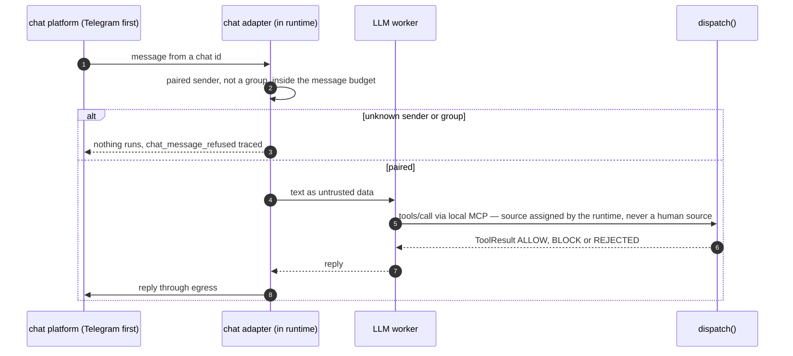

The chat adapter does not import `hal` and does not call `Conversation.do` directly: every command with a physical effect goes through `dispatch()` like the MCP calls in §3. A call the gate blocks with `on_block: ask` is not answered by the worker; it becomes an approval request in §11.4.

### 11.4 Approval requests and replies over chat (I2d, pending the RFC for the `chat:<id>` source)

This extends §2: today only `local_grammar` and `ui` can answer an `ask` question (Q-26). Q-72 adds a path over chat through an **approval record**, not through a new source name in `HUMAN_SOURCES` for a free-form "yes" message.

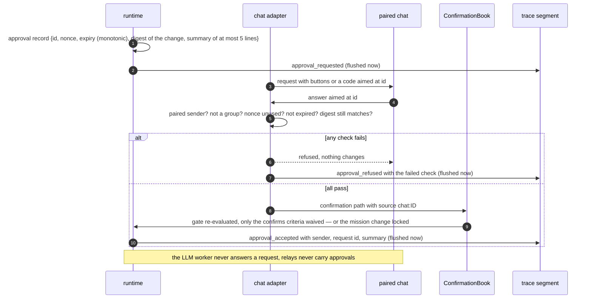

Pairing is done locally; revocation, pairing expiry and the cap on the number of approvals are still deferred (`TODOS.md` #62).

### 11.5 Installing a NeuroEdge Blueprint (I2e)

```mermaid
sequenceDiagram
    autonumber
    participant U as installer
    participant CLI as neuroedge blueprint install
    participant IDX as Hub index (static git repository)
    participant SRC as package URL (git or HTTPS)
    participant RT as runtime
    U->>CLI: install by name or by URL
    opt by name
        CLI->>IDX: look up URL, digest, evidence (marked unsigned)
    end
    CLI->>SRC: fetch the whole package
    CLI->>CLI: digest over the whole package: kit, firmware, mission templates, detectors, evidence traces
    alt digest does not match
        CLI-->>U: three-part error (where, why, how), nothing installed
    else match
        CLI->>CLI: validate blueprint.v1, board check, safe_state other than off only from board.v1
        CLI-->>U: install summary; missions start as drafts that still need approval (section 11.1)
        U->>CLI: replay the evidence traces locally (optional)
        CLI->>RT: load the approved missions
    end
```

A NeuroEdge Blueprint only declares; it carries no code that runs in the runtime. It is different from a Home Assistant Blueprint (HA's automation template), and it may carry an HA blueprint.

### 11.6 Failure branches

| Path | Failure | Handling in the design | What the user sees |
|:---|:---|:---|:---|
| Runtime ↔ LLM worker | worker dies or hangs | the runtime keeps running reflexes, detectors, hard-template alerts; restarts the worker | an "analysis paused" message; alerts still arrive |
| Runtime → chat channel | the chat platform's API fails | bounded queue + local alert on the UI | alert on the UI; messages arrive late, with timestamps |
| LLM provider | `llm_budget` exhausted | reflexes + hard-template alerts | an "analysis budget exhausted" message |
| Approval over chat | request expired | not approved, traced | a "request expired" message |
| Approval over chat | reply from an unknown account or a group | refused, traced | nothing changes |
| Relay (`planned · Q-72`, outside I2d/I2e) | relay down | no effect on safety; remote access lost | the page cannot be opened remotely |
| Clock | power loss, no NTP/RTC yet | wall-clock fact `unsynced` ⇒ time-window clause lacks a fact ⇒ block | the approval summary and the UI report the clock is not synchronized |
| Trace | power loss in the middle of a segment | at most the tail of ordinary events is lost; blocks and approvals were already flushed | `replay` reports a truncated segment |
| NeuroEdge Blueprint install | digest does not match | install refused | three-part error |
