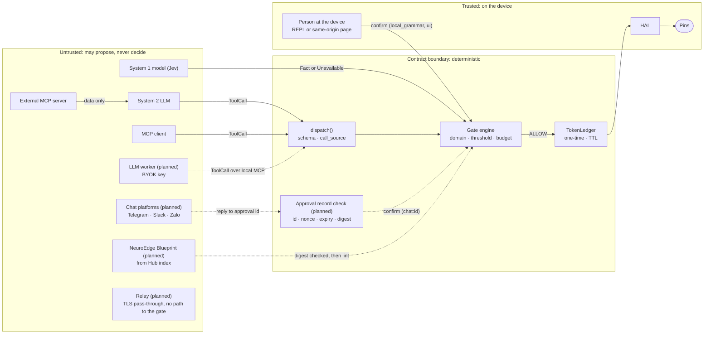

# 00 · Tổng quan kiến trúc

> **Phạm vi:** toàn hệ thống, ở mức cao nhất. **Nguồn sự thật:** mã trong `main`; yêu cầu ở
> [`neuroedge-prd.md`](../../../roadmap/neuroedge-prd.md); tiến độ ở
> [`neuroedge-roadmap.md`](../../../roadmap/neuroedge-roadmap.md) §0. Quy ước nhãn `done` / `partial` /
> `planned`: [`README.md`](../README.md).

**Đọc chương này để làm gì:** Chương này dành cho mọi kỹ sư, kiến trúc sư và đối tác cần cái nhìn bao quát toàn bộ kiến trúc NeuroEdge. Tài liệu trả lời các câu hỏi nền tảng: *NeuroEdge giải bài toán gì trong Physical AI? Cơ chế nào bảo đảm hành động vật lý không bao giờ vượt qua gate an toàn? Hệ thống phân tầng và tương đương target ra sao giữa máy phát triển (host) và chip biên ($5)?* Trước khi đọc, người đọc chỉ cần hiểu cơ bản về agent AI và điều khiển nhúng. Sau chương này, lập trình viên ứng dụng nên đọc §9 và [`python/README.md`](../../../python/README.md); kỹ sư hệ thống đọc tiếp [`02`](02-container-c4l2.md) và [`03`](03-component-host-c4l3.md); kiến trúc sư đọc [`15`](15-target-architecture.md).

## 1. NeuroEdge giải bài toán gì

Một chatbot trả lời sai thì người dùng bấm "tạo lại". Một agent điều khiển thiết bị vật lý mà sai
thì chốt cửa đã mở, quạt đã tắt, rơ-le đã đóng — không có nút "tạo lại". Mô hình AI sinh ra đề
xuất; nó không thể là nơi quyết định một hành động vật lý có được làm hay không.

NeuroEdge tách hai việc đó ra. Mọi đề xuất hành động — từ ngữ pháp lệnh cục bộ, từ một LLM, từ
một agent khác qua MCP — đều được chuẩn hoá thành một **tool call có kiểu**, rồi phải qua một
**gate**: chính sách an toàn viết bằng YAML, có phiên bản, kế thừa được, được biên dịch thành cây
quyết định tất định. Gate cho `ALLOW` thì một **token phán quyết dùng một lần** ([one-time token](../../user/thuat-ngu.md)) được cấp, và chỉ
token đó mở được đúng các chân phần cứng của hành động đó. Mọi dữ kiện, phán quyết và lệnh chân
được ghi vào một **vết ghi** ([trace](../../user/thuat-ngu.md)) phát lại được. Cùng một gate chạy trên trình mô phỏng (`sim`), trên
Linux (`linux`) và trên chip ESP32-S3 (`esp32s3`).

**Hướng đã chốt, chưa có mã (`planned · Q-72`).** [Q-72](../../../roadmap/neuroedge-prd.md#15-sổ-quyết-định) đặt lõi trên vào ba vòng: ① **dựng** —
client MCP người dùng đang có viết hợp đồng qua NeuroEdge Lab (Q-71); ② **chạy** — một *agent vận
hành* chạy liên tục trên máy nhà, thực thi **hợp đồng nhiệm vụ** và báo, hỏi duyệt qua kênh chat
(I2d); ③ **chia sẻ, bán** — một **NeuroEdge Blueprint** gói kit, firmware, hợp đồng mẫu, bộ phát hiện
và vết ghi làm bằng chứng, cài bằng một lệnh (I2e). NeuroEdge Blueprint khác **Home Assistant
Blueprint** (mẫu automation chia sẻ qua Blueprint Exchange); một NeuroEdge Blueprint có thể mang kèm
một HA blueprint trong gói. Gate và hợp đồng là lớp niềm tin của cả ba vòng; mọi đường mới vẫn đi
qua xương sống dưới đây.

### 1.1 Tinh thần sản phẩm — sáu lời hứa

**Không hợp đồng, không hành động.** Mỗi lời hứa dưới đây là một điều người dùng cảm nhận được, và mỗi
lời hứa có một cơ chế kiến trúc giữ nó. Khi một quyết định thiết kế làm yếu một lời hứa, quyết định đó sai
— kể cả khi nó làm sản phẩm nhanh hơn hay dễ demo hơn.

| # | Lời hứa với người dùng | Kiến trúc giữ lời hứa bằng | Người dùng thấy điều đó ở đâu |
|:---:|:---|:---|:---|
| 1 | **Sai ở thế giới thật không bấm lại được, nên mọi lệnh phải được duyệt trước.** Model chỉ đề xuất, không bao giờ quyết | Một đường duy nhất `dispatch()` → gate → token dùng một lần → HAL; không có đường tắt ([`05`](05-code-gate-hal-c4l4.md)) | Mỗi hành động có một phán quyết `ALLOW`/`BLOCK` kèm lý do |
| 2 | **Không chắc thì không làm.** Mất mạng, cảm biến cũ, camera đứng hình, model không trả lời ⇒ chặn | Fail-closed ở mọi hướng (bất biến 2); chỉ lệnh đưa cơ cấu về trạng thái an toàn là luôn được phép (Q-62) | Thiết bị dừng hoặc hỏi lại, không đoán |
| 3 | **Một hợp đồng ở mọi nơi.** Thử trên laptop là đúng như chạy trên chip $5 | Cùng tệp gate, phân giải thuần, hai hiện thực Python và C của cùng đặc tả ([`10`](10-target-equivalence.md)) | `neuroedge verify` cho cùng phán quyết trên `sim`, `linux`, `esp32s3` |
| 4 | **Bằng chứng thay cho lời hứa.** Mọi sự cố tái hiện được trên máy lập trình viên | Mọi dữ kiện, phán quyết, lệnh chân vào vết ghi; replay tính lại không gọi model ([`06`](06-runtime-flows.md) §7) | `neuroedge replay`, `gate explain`, Action CI trong PR |
| 5 | **Người giữ quyền cuối.** Model và agent khác không tự xác nhận thay người; nhưng cũng không ai xác nhận thay một số đo vật lý | `ask` chỉ người trên thiết bị trả lời được (Q-26); bản nháp do client MCP viết qua NeuroEdge Lab phải có người duyệt, không tool nào khoá được (Q-71); tiêu chí số bị cấm trong `confirms` (Q-62) | Câu hỏi xác nhận trên trang `--ui`, bằng giọng nói hay nút bấm |
| 6 | **Cắm vào stack của người khác, không ôm cả stack.** NeuroEdge là lớp hợp đồng, không phải một nền tảng khép kín | MCP là cửa gọi vào; model và giọng nói là provider thay được (P-4); lược đồ, đặc tả, bộ kiểm tuân thủ theo Apache-2.0 (Q-45); MCP qua mạng có xác thực ở mốc ra mắt (Q-58) | Claude, Home Assistant hay agent framework gọi thiết bị qua gate |

**Sẽ đổi theo Q-72 (chờ RFC an toàn có điều kiện, `planned · Q-72`, I2d).** Lời hứa 2: "trạng thái
an toàn" thành **`safe_state` khai trong `board.v1`** cho từng cơ cấu (mặc định `off`; khác `off` chỉ
khi đấu dây mặc định bật, ví dụ rơ-le thường đóng, khai làm khoá liên động phần cứng). Lệnh vẫn
"không chắc thì chặn"; chỉ hướng **về** `safe_state` luôn được phép, hướng **rời** `safe_state` mới bị
gate và giới hạn. Profile hiện có (`off`; `motion.*` `stop`/`hold`) giữ nguyên hành vi. Lời hứa 5: người
duyệt được cả qua kênh chat đã ghép đôi bằng **bản ghi duyệt** có mã một lần, hạn và digest của đúng
thay đổi; LLM và nhóm chat không bao giờ duyệt ([`00`](00-overview.md) §9.4). Quyết định: [Q-72](../../../roadmap/neuroedge-prd.md#15-sổ-quyết-định).

Sản phẩm lớn lên qua tám mốc phát hành theo người dùng (roadmap §0.5); kiến trúc của từng mốc và cách
mỗi mốc chứng minh lại sáu lời hứa ở roadmap §0.5.

## 2. Hệ thống trong một hình


*Hình E-01 — Người dùng, hệ thống bên ngoài, và ranh giới của NeuroEdge. Chi tiết: [`00`](00-overview.md) §9.*

*Cách đọc hình E-01:* Hình thể hiện bối cảnh toàn hệ thống ở mức cao nhất: tác nhân người dùng và hệ thống bên ngoài nằm ngoài ranh giới; bên trong ranh giới là NeuroEdge (SDK + CLI Python, firmware C99), thiết bị (`sim` · `linux` · `esp32s3`) và tệp dự án. Khối viền nét liền là các thành phần đã có mã; khối viền nét đứt là các thành phần quy hoạch tương lai (`planned`). Điểm cốt lõi cần nhớ: dù bắt nguồn từ lệnh gõ, giọng nói hay kết nối mạng, mọi hành động tác động vật lý đều phải đi qua cùng một ranh giới kiểm soát an toàn của NeuroEdge.

**Hai phần: bộ não và hộp.** Người dùng nhắn tin cho **bộ não** — [NeuroClaw](https://github.com/letrongminh/neuroclaw),
repo riêng: chat, gọi LLM, nhớ, nhắc lịch. Bộ não không chạm phần cứng; nó gọi tool MCP của **hộp
NeuroEdge** (kho này), và hộp đưa lời gọi qua gate như mọi nguồn khác. Bộ não chạy trên máy riêng hoặc
chung một chip ESP32-S3 với hộp; cách chạy và hợp đồng giữa hai repo: [`15`](15-target-architecture.md) §6.10.

```text
 📱 chat ──► NeuroClaw (bộ não, không tin cậy) ══ MCP, mTLS ══► hộp NeuroEdge: gate ──► chân, thiết bị
```

Đường đi duy nhất từ ý định tới chân phần cứng — **xương sống thực thi** — giống nhau ở mọi nguồn
gọi và mọi môi trường:


*Cách đọc sơ đồ:* Khối chữ nhật là các thành phần phần mềm; hình thoi là điểm thẩm định gate an toàn; hình elip là chân actuator vật lý. Mũi tên nét liền biểu diễn xương sống thực thi bắt buộc (từ nguồn gọi không tin cậy → `dispatch()` → `c.do()` → gate → token → HAL); mũi tên nét đứt biểu diễn dữ liệu ghi nhật ký ra tệp vết ghi (`trace.v1.json`). Điểm cốt lõi cần nhớ: không có bất kỳ đường tắt nào tới chân phần cứng mà không sở hữu token phán quyết dùng một lần được cấp từ gate.

- **Không có đường tắt.** Gọi thẳng hàm `@action`, gọi `digital.out()` ngoài `c.do()`, đưa một
  chuỗi hay token tự chế cho HAL, dùng lại token, dùng token hết hạn — đều bị từ chối và ghi vết
  (`docs/spec/threat_model.md` §2).
- **Không chắc thì chặn.** Không thẩm định kịp, mất mạng mà không có fallback, dữ kiện thiếu hay
  sai kiểu ⇒ `BLOCK`, không bao giờ `ALLOW` (bất biến 2, `CHANGELOG.md` §3.3).
- **Bằng chứng tự sinh.** Vết ghi chứa đủ dữ kiện để tính lại mọi phán quyết mà không gọi model
  và không động vào máy (chi tiết: [`06`](06-runtime-flows.md) §7).

## 3. Năm nguyên tắc và nơi kiến trúc cưỡng chế chúng

Nội dung nguyên tắc ở PRD §1.5; bảng này chỉ ra **cơ chế kiến trúc** giữ từng nguyên tắc.

| Nguyên tắc (PRD §1.5) | Cơ chế kiến trúc cưỡng chế | Ở đâu |
|:---|:---|:---|
| **P-1** Hành động vật lý là hợp đồng chuẩn kiểu | Một đường duy nhất `dispatch()` → `c.do()` → gate → token → HAL; HAL không có sổ token thì từ chối mọi lệnh | [`05`](05-code-gate-hal-c4l4.md) · `actions/`, `hal/` |
| **P-2** Các môi trường thực thi ngang hàng | Cùng tệp gate, cùng ngữ nghĩa lượng giá trên host (Python) và chip (C); `verify` so quyết định giữa target; cam kết kiểm chứng phân theo bậc target (FR-TGT-08, Q-13) | [`10`](10-target-equivalence.md) |
| **P-3** Giá trị ở quản trị đội thiết bị và license thương mại | Lõi an toàn nằm trọn trong gói `neuroedge`; dịch vụ (Fleet OS) là container riêng, chưa có mã | [`02`](02-container-c4l2.md) §5 |
| **P-4** Mô hình AI thay thế được | Mọi model sau giao thức `FactSource` / provider; STT/TTS cũng là provider thay thế được qua cấu hình; chip chỉ thu/phát âm thanh và lượng giá gate (PRD §1.5 P-4); không SDK nào được import ở lõi | [`03`](03-component-host-c4l3.md) §3.4 |
| **P-5** Hiệu ứng mạng từ chia sẻ chính sách | Gate là dữ liệu có phiên bản, định danh `neuroedge://`, băm JCS SHA-256, kế thừa chỉ siết chặt | [`07`](07-data-contracts.md) §2 |

## 4. Đặc tính kiến trúc, theo thứ tự ưu tiên

Khi hai đặc tính xung đột, đặc tính đứng trên thắng. Mỗi dòng là một quyết định thiết kế đã có mã.

| # | Đặc tính | Nghĩa là | Chiến thuật chính | Chương |
|:---:|:---|:---|:---|:---|
| 1 | **An toàn theo mặc định** | Mọi lỗi đều dẫn tới chặn | `budget.fail` mặc định `closed`; `fail: open` không kế thừa; sổ token đầy thì từ chối, không đẩy token cũ ra | [`05`](05-code-gate-hal-c4l4.md), [PRD §9](../../../roadmap/neuroedge-prd.md#9-yêu-cầu-phi-chức-năng) |
| 2 | **Tất định và phát lại được** | Cùng dữ kiện ⇒ cùng phán quyết, ở mọi nơi | Phân giải gate là hàm thuần; cây quyết định không đọc đồng hồ; replay tính lại từ dữ kiện đã ghi | [`05`](05-code-gate-hal-c4l4.md), [`06`](06-runtime-flows.md) |
| 3 | **Tương đương giữa môi trường** | Agent không rẽ nhánh theo target | Hai hiện thực (Python, C) của cùng một đặc tả, chứng minh bằng bảng sự thật và vector chung | [`10`](10-target-equivalence.md) |
| 4 | **Có thể kiểm toán** | Người duyệt hiểu được mà không đọc mã | Gate là YAML đọc được; `gate explain`; vết ghi theo lược đồ đóng băng; lỗi luôn có ba phần | [`07`](07-data-contracts.md) |
| 5 | **Thay được model** | Đổi nhà cung cấp bằng cấu hình | Chuẩn OpenAI-compatible, adapter `python:`; model chỉ trả dữ kiện, không bao giờ trả `ALLOW` | [`03`](03-component-host-c4l3.md) |
| 6 | **Chạy được khi mất mạng** | Chức năng an toàn không cần Internet | Ngữ pháp lệnh cục bộ là fallback của mọi model; lõi chỉ dùng thư viện chuẩn cho HTTP | [`06`](06-runtime-flows.md) §5 |
| 7 | **Vừa chip nhỏ** | Gate chạy trên ESP32-S3 | Không JSON, không CEL trên chip; cây nhị phân `NETR` đọc tại chỗ trong flash; walker không cấp phát, stack ≤ 512 B | [`04`](04-component-device-c4l3.md) |

**Đặc tính 1 sẽ đổi theo Q-72 (chờ RFC, `planned · Q-72`, I2d).** "Mọi lỗi đều dẫn tới chặn" vẫn đúng
cho **lệnh**. Thêm một vế cho **cơ cấu**: khi lỗi, hết hạn, mất liên lạc hay runtime chết, cơ cấu trở
về `safe_state` đã khai trong `board.v1`, không nhất thiết là `off`. Thời lượng, `max_continuous_ms`,
lease, mức L0–L3 (RFC-0018) và miễn gate của Q-62 đều đọc là "trở về `safe_state`" ([`05`](05-code-gate-hal-c4l4.md) §5).
Đặc tính 6 gặp thêm một nguồn mất mạng: agent vận hành mất LLM, kênh chat hay relay thì phản xạ,
bộ phát hiện tất định và cảnh báo mẫu cứng vẫn chạy ([`06`](06-runtime-flows.md)). Bất biến gốc:
`CHANGELOG.md` §3.3.

## 5. Hình dạng hệ thống

NeuroEdge có ba phần, cộng với chuỗi CI giữ chúng khớp nhau:

| Phần | Là gì | Ngôn ngữ | Trạng thái |
|:---|:---|:---|:---|
| **Gói `neuroedge`** (host) | SDK, CLI, engine gate, HAL `sim`/`linux`, model, thoại (từ tệp WAV `done`, phiên thoại thời gian thực `partial` — [`neuroedge-roadmap.md`](../../../roadmap/neuroedge-roadmap.md) I4), MCP, Action CI | Python 3.11+ | `done` (thoại thời gian thực `partial` — roadmap I4) |
| **Firmware `esp32s3`** | Walker `NETR`, sổ token, vết ghi UART, component sinh cho agent, OTA có ký | C99 trên ESP-IDF v5.4 | `partial` — chạy trên QEMU; chưa điều khiển chân |
| **Hợp đồng dữ liệu** | `gate.v1`, `trace.v1`, `board.v1`, `agent.toml`, `NETR` v1, dòng UART | JSON Schema, TOML, nhị phân | `done`, đóng băng qua RFC |
| **CI** | Test Python, gpio-sim, QEMU, ảnh golden, OTA, bảo mật | GitHub Actions | `done` |
| **Agent vận hành** (máy nhà) | Hai tiến trình: **runtime tin cậy** chạy 24/7 (HAL, gate, hợp đồng nhiệm vụ, lập lịch, bộ phát hiện tất định, adapter kênh chat và kiểm lời duyệt, cửa ra dữ liệu) và **LLM worker không tin cậy** (giữ key BYOK, gọi runtime qua MCP cục bộ, không bao giờ duyệt) — [`02`](02-container-c4l2.md) §3 | Python | `planned · Q-72` (I2d) |
| **NeuroEdge Blueprint** | Gói kit + firmware + hợp đồng mẫu + bộ phát hiện + vết ghi bằng chứng; `blueprint pack`/`install` tải bằng URL và kiểm digest toàn gói; Hub là kho index tĩnh | Tệp, git/HTTPS | `planned · Q-72` (I2e) |

Hai phần không có mã hôm nay và chỉ xuất hiện ở trạng thái `planned`: **Fleet OS** (I9) và **Gate
Registry** (I10). Q-72 thêm ba phần `planned` ở bảng trên và ngoài máy: agent vận hành (I2d), NeuroEdge
Blueprint với Hub index (I2e), và relay đám mây tuỳ chọn (`planned · Q-72`, ngoài I2d/I2e). Mọi thứ quy hoạch khác (bốn gói nguyên thủy mở rộng, NeuroEdge Lab qua MCP, robot nhiều node, thị giác trên Jetson) ở
roadmap §0.5.

### 5.1 Mô hình logic năm lớp

Mô hình logic 5 tầng của NeuroEdge (§5.1) được vắt ngang bởi trục kiểm thử Action CI:

| Tầng / Trục | Bản chất tầng (§5.1) | Gói host (`03` §2) và component firmware (`04`) hiện thực | Trạng thái |
|:---|:---|:---|:---|
| **L4: Tầng ứng dụng Agent** | Logic agent, bộ nhớ ngữ cảnh, tool call có gate (MCP), System 2 | `mcp_host`, `mcp_server`, System 2 trong `models/` | `done` |
| **L3: Động cơ hợp đồng hành động** (IP cốt lõi) | Thẩm định gate chuẩn kiểu, kế thừa chính sách, mạch ngắt fail-closed | `engine/`, `actions/` (sổ token dùng một lần), `ne_gate` (`ne_walker.c`, `ne_token.c`), `ne_agent` | `done` (host và QEMU) |
| **L2: Nhận thức & runtime hội thoại** | Nhận diện wake-word, neural VAD, khử vang AEC, STT/TTS độ trễ thấp, máy trạng thái hội thoại thời gian thực (Q-48) | `perception/` (máy trạng thái, wake, STT/TTS), `hal/audio.py` (`EnergyVAD`), `models/` (System 1/2, ngữ pháp, tri thức) | `partial` — thoại từ tệp WAV và STT/TTS cloud `done`; phiên thời gian thực, AEC (Q-22), mô hình wake-word thật còn lại (roadmap I4) |
| **L1: Lớp trừu tượng phần cứng (HAL)** | 5 nguyên thủy cơ bản v1.x (`audio.in`, `audio.out`, `digital.out`, `sensor.read`, `display`), đối chiếu hợp đồng năng lực lúc biên dịch | `hal/` (đối chiếu bo mạch, API); firmware HAL trên chip | `done` (`hal/` trên host); `planned` trên chip (TSK-S4-01) |
| **L0: Các môi trường thực thi ngang hàng** | Triển khai cụ thể cho từng target (`sim`, `linux`, `esp32s3`) | `hal/sim.py` (`SimHAL`), `hal/linux.py` (`LinuxHAL`), firmware cho `esp32s3` trong `targets/esp32s3/` (gói `sim/` vừa là target `sim` (L0) vừa là nơi lắp ráp phía host — `03` §2 bậc 7) | `done` (`sim`, `linux` ảo); `partial` (`esp32s3` trên QEMU) |
| **Trục ngang: Action CI** | Ghi nhận sự kiện (JSON) → Replay chuẩn xác → Đối chiếu hành động | `testing/` (`TraceRecorder`, `TracePlayer`, `GoldenComparator`), `trace.py` (`trace.v1`) và `engine/trace_sink.py` (`EventLog`), `cli` (`record`, `replay`, `verify`) | `done` |

Các adapter System 1 ở L2 (`models/`) hiện thực giao thức `FactSource` do L3 quy định (`engine/gate.py`) thay vì L3 phụ thuộc L2 — đó là đảo ngược phụ thuộc (dependency inversion); còn `perception/` thì phụ thuộc `sim` ([`03`](03-component-host-c4l3.md) §2, bậc 8). Do đó đồ thị import giữa các gói không phải là một ngăn xếp từ trên xuống dưới một cách ngây thơ.

### 5.2 Thuật ngữ phân tầng

Để người đọc không nhầm lẫn giữa các cách phân chia tầng/bậc trong tài liệu:

| Khái niệm | Thang đo | Ý nghĩa | Tài liệu quy định |
|:---|:---|:---|:---|
| **Mức kiến trúc C4** | L1…L4 | Bốn cấp độ trực quan hoá kiến trúc: L1 Context (Bối cảnh) · L2 Container · L3 Component (Thành phần) · L4 Code (Mã) | Mô hình C4 (Simon Brown) · [`00`](00-overview.md) §9…[`05`](05-code-gate-hal-c4l4.md) |
| **Tầng logic hệ thống** | L0…L4 | Năm tầng chức năng logic của nền tảng: L0 Target · L1 HAL · L2 Perception/Runtime · L3 Action Contract Engine · L4 Agent Application, cùng trục Action CI | §5.1 |
| **Bậc phụ thuộc gói** | Bậc 0…10 | Thứ tự import các module Python phía host, ngăn ngừa phụ thuộc vòng lặp (Bậc 0: `errors`, `paths`… Bậc 10: `cli`) | [`03`](03-component-host-c4l3.md) §2 · `python/tests/test_architecture_layers.py` |
| **Bậc cam kết target** | Bậc 1…3 | Mức cam kết kiểm chứng phần cứng của đội lõi: Bậc 1 (chính thức: `sim`, `linux`, `esp32s3`), Bậc 2 (mở rộng: `jetson`), Bậc 3 (cộng đồng: `stm32`, `rp2350`) | PRD FR-TGT-08, Q-13 · §5.2 · [`15`](15-target-architecture.md) §4.1 |
| **Tầng phân tầng robot** | T0…T6 | Bảy tầng kiến trúc robot phân tán: T0 Cơ cấu phần cứng/an toàn cục bộ · T1 Wire Zenoh-pico · T2 Lớp an toàn black channel · T3 Gate từng node · T4 Trace hợp nhất · T5 MCP · T6 ROS 2 bridge | `docs/architecture/vi/15-target-architecture.md` §4.3 · [`15`](15-target-architecture.md) §4.3 |

## 6. Hiện trạng theo năng lực

Bảng dưới là ảnh chụp hình dạng, không phải bảng tiến độ; tiến độ từng task ở roadmap §4–§8.

| Năng lực | `sim` | `linux` | `esp32s3` |
|:---|:---|:---|:---|
| Gate: phân giải, lượng giá, token | `done` | `done` | `done` trên host và QEMU |
| Điều khiển chân | `done` (ảo) | `done` trên gpio-sim | `planned` (TSK-S4-01) |
| Cảm biến, màn hình | `done` (ảo) | `done` trên `i2c-stub`, `vkms` | `planned`; giao diện LVGL chỉ build trên host |
| Thoại (từ tệp WAV) | `done` | `done` | `planned` (I5) |
| Thoại thời gian thực (micro) | `done` trên laptop (`run --mic`, TSK-I4-04) | `partial` — mới mở thiết bị | `planned` |
| Model cloud (System 1, System 2) | `done` | `done` | không áp dụng: chip chỉ lượng giá gate |
| MCP | `done` | `done` | không áp dụng |
| Vết ghi, replay, verify | `done` | `done` | `done` (UART, QEMU) |
| Cập nhật OTA có ký | không áp dụng | không áp dụng | `partial` — trên QEMU |

## 7. Ranh giới — NeuroEdge không phải là gì

- **Không phải chức năng an toàn được chứng nhận** (không SIL theo IEC 61508, không PL theo ISO
  13849 — Q-38). Gate không thay nút dừng khẩn hay khoá liên động phần cứng.
- **Không chống kẻ tấn công trong cùng tiến trình.** Token là `(nonce, digest)` trong bộ nhớ; mối
  đe doạ trong phạm vi là **bỏ qua gate do nhầm lẫn**, và điều đó được chứng minh bằng test
  (`docs/spec/threat_model.md` §3, `TODOS.md` #2).
- **Không phải dịch vụ đám mây.** Hôm nay NeuroEdge là một thư viện, một CLI và một firmware; không
  có máy chủ nào do NeuroEdge vận hành. *Sẽ đổi theo Q-72 (`planned · Q-72`):* hai ngoại lệ tuỳ chọn,
  không bao giờ nằm trên đường an toàn — relay chỉ chuyển TLS theo SNI, không giải mã; Hub index là
  kho git tĩnh ([PRD §15](../../../roadmap/neuroedge-prd.md#15-sổ-quyết-định)). *Có điều kiện theo Q-74:* NeuroEdge Cloud tuỳ chọn cho phần "não" (trò chuyện,
  LLM), mở sau cổng nhu cầu nếu số đo cần; luật và phản xạ vẫn luôn ở nhà ([`15`](15-target-architecture.md) §6.10).
- **Không bán lại token suy luận** (`docs/architecture/vi/15-target-architecture.md` §3.4; PRD §1.4 N4). Lớp trừu tượng provider là self-host thuộc lõi; người dùng tự vận hành và trả tiền trực tiếp cho nhà cung cấp mô hình.
- **Không tự làm SLAM hay điều hướng** — chỉ gate lệnh vận tốc qua ROS 2 / Nav2 ([`neuroedge-prd.md`](../../../roadmap/neuroedge-prd.md) §14, Q-34).
- **Không có sàn giao dịch trả phí (paid marketplace)** ([`neuroedge-prd.md`](../../../roadmap/neuroedge-prd.md) §14, PF-3).
- **Không có thanh toán tự động giữa các agent (agent-to-agent payment)** ([`neuroedge-prd.md`](../../../roadmap/neuroedge-prd.md) §14, PF-4).
- **Không tự huấn luyện từ đánh thức (custom wake-word training) trong v1.0** ([`neuroedge-prd.md`](../../../roadmap/neuroedge-prd.md) §3).

Kiến trúc quy hoạch tổng thể (to-be architecture) cho các chặng tiếp theo xem tại [`15-target-architecture.md`](15-target-architecture.md).

## 8. Đọc tiếp

Lộ trình đọc theo vai trò ở [`README.md`](../README.md). Người mới bắt đầu ở
[`python/README.md`](../../../python/README.md).

## 9. Bối cảnh hệ thống (C4 L1)

> **Phạm vi:** NeuroEdge nhìn từ bên ngoài — ai dùng nó, nó nói chuyện với hệ thống nào, và ranh
> giới tin cậy nằm ở đâu. **Nguồn:** `python/neuroedge/models/providers/`,
> `python/neuroedge/perception/providers/`, `python/neuroedge/mcp_server.py`, PRD §2,
> `docs/spec/threat_model.md`.

**Đọc chương này để làm gì:** Chương này mô tả NeuroEdge ở mức C4 L1 (Bối cảnh hệ thống). Tài liệu trả lời các câu hỏi: *Ai là người dùng trực tiếp của NeuroEdge? Hệ thống tích hợp với các dịch vụ bên ngoài nào (LLM, giọng nói, MCP, thiết bị nhúng, robot)? Ranh giới tin cậy nằm ở đâu và dữ liệu nào được phép rời khỏi máy?* Trước khi đọc, nên nắm tổng quan tại [`00`](00-overview.md). Sau chương này, đọc tiếp [`02`](02-container-c4l2.md) để hiểu cấu trúc các tiến trình và container chạy độc lập.

### 9.1 Sơ đồ bối cảnh

Hình E-01 ở §2 (đọc chú giải ở đó). Phần dưới là chi tiết của bối cảnh.

Các khối nét đứt mang nhãn I2d, I2e hay Q-72 là thiết kế đích của [Q-72](../../../roadmap/neuroedge-prd.md#15-sổ-quyết-định) (`planned · Q-72`), chưa có mã:
**Operating agent** trong ranh giới hệ thống (runtime tin cậy 24/7 + LLM worker không tin cậy, I2d),
hai người dùng của NeuroEdge Blueprint (I2e), và ba hệ thống ngoài — nền tảng chat (I2d), Blueprint Hub
index (I2e), relay tuỳ chọn (Q-72).

### 9.2 Người dùng

| Người dùng | Làm gì với NeuroEdge | Công cụ chính | Trạng thái |
|:---|:---|:---|:---|
| **Maker, lập trình viên ứng dụng** | Viết agent (`agent.toml`, gate, action), chạy và kiểm trên máy mình | `neuroedge new · run · test · record` | `done` |
| **Kỹ sư lõi và kỹ sư nhúng** | Sinh firmware cho agent, nạp lên chip, so phán quyết giữa các môi trường | `build --target esp32s3 · verify · record --port` | `done` (trên QEMU) |
| **Người duyệt an toàn, QA** | Đọc và duyệt gate mà không đọc mã; điều tra một phiên từ vết ghi | `gate explain · trace view · replay` | `done` |
| **Đối tác OEM** | Khai báo một bo mạch mới, port HAL, chứng minh tương đương | `board.toml`, vector tuân thủ | `partial` — xem [`10`](10-target-equivalence.md) §7 |
| **Người vận hành đội thiết bị** | Quản trị đội qua 5 năng lực: cấp phát danh tính (provisioning), cập nhật OTA theo đợt & rollback (staged OTA), giám sát sức khoẻ và sổ kiểm kê (monitoring/inventory), cập nhật cấu hình và gate từ xa (remote gate/config), thu thập trace sự cố (incident traces); cần để cập nhật, giám sát và thu vết ghi trên hàng trăm, hàng nghìn thiết bị mà không nạp lại firmware bằng tay (`docs/architecture/vi/15-target-architecture.md` §3.1) | Fleet OS | `planned` (I9) — xem [`15`](15-target-architecture.md) §3.1 |
| **Đội tích hợp robot phân tầng** | Tích hợp hệ thống nhiều node qua bus Zenoh, bridge ROS 2 / Nav2; cần thiết để tách bạch ý định tập trung trên SBC với an toàn chấp hành cục bộ trên từng MCU node ([`neuroedge-prd.md`](../../../roadmap/neuroedge-prd.md) U6, Q-32, Q-34) | Node firmware, Zenoh router, ROS 2 bridge | `planned` — xem [`15`](15-target-architecture.md) §4.3 |

Hai nhóm người dùng mới của Q-72 (`planned · Q-72`, I2e — cộng đồng maker Home Assistant, ESPHome là người dùng đầu):

| Người dùng | Làm gì với NeuroEdge | Công cụ chính | Trạng thái |
|:---|:---|:---|:---|
| **Người cài NeuroEdge Blueprint** | Cài một NeuroEdge Blueprint bằng một lệnh, cho agent vận hành chạy hợp đồng nhiệm vụ của nó, nhận báo và duyệt qua chat. NeuroEdge Blueprint khác Home Assistant Blueprint (mẫu automation); gói có thể mang kèm một HA blueprint | `blueprint install <url>` (kiểm digest), kênh chat | `planned · Q-72` (I2e) |
| **Người bán Blueprint, nhà sản xuất nhỏ (micro-OEM)** | Đóng gói kit, firmware, hợp đồng mẫu, bộ phát hiện và vết ghi bằng chứng ("chưa ký") thành Blueprint, đăng URL + digest lên Hub index; bán là dùng thương mại (Q-45) | `blueprint pack` | `planned · Q-72` (I2e) |

Các nhóm người dùng và hành trình gốc ở PRD §2 (`U1`…`U6`, `J1`…`J7`).

### 9.3 Hệ thống bên ngoài

Mọi kết nối ra ngoài đều **tuỳ chọn**: bản cài cơ bản chạy toàn bộ `sim` không cần mạng hay khoá
(Q-15). Khoá API không bao giờ nằm trong tệp: chỉ **tên** biến môi trường được ghi (`api_key_env`),
và build từ chối mọi trường trông giống khoá (`models/providers/common.py`).

| Hệ thống | Vai trò | Giao thức và định dạng | Mã đảm nhận | Trạng thái |
|:---|:---|:---|:---|:---|
| **Nhà cung cấp LLM** (System 2) | Trả lời câu tự do, đề xuất tool call | Chat completions chuẩn OpenAI qua thư viện LiteLLM (không chạy proxy — Q-10); hoặc adapter `python:` | `models/providers/litellm_provider.py`, `openai_chat.py` | `done` |
| **Jev trên OpenRouter** (System 1) | Quyết một số tiêu chí gate từ lời người nói | `POST {api_base}/systemone` (System One API), HTTPS bắt buộc trừ loopback | `models/providers/systemone_api.py` | `done` |
| **Nhà cung cấp giọng nói** | STT, TTS | `POST {base_url}/audio/transcriptions` và `/audio/speech` chuẩn OpenAI | `perception/providers/openai_audio.py` | `done` |
| **Máy chủ STT cục bộ** | STT dự phòng khi STT chính hỏng | Như trên, thường `http://localhost` | `[stt.fallback]` | `done` |
| **Client MCP** | Gọi action của agent như công cụ | JSON-RPC qua **stdio**; qua mạng chỉ khi bật `--http` (mTLS + token OAuth 2.1, mặc định tắt — NFR-SEC-09, `mcp_http.py`) | `mcp_server.py` | `done` |
| **MCP server bên ngoài** | Nguồn thông tin cho System 2 (tin tức, tra cứu) | stdio; chỉ công cụ trong danh sách cho phép | `mcp_host.py` | `done` |
| **ESP-IDF v5.4 và Espressif QEMU** | Biên dịch firmware, chạy chip ảo | Project ESP-IDF sinh bởi `build`; UART đọc qua tệp hoặc `tcp://` | `engine/firmware.py`, `testing/uart.py` | `done` |
| **Máy chủ ảnh OTA** | Phục vụ một ảnh app đã ký | HTTP(S) GET bất kỳ máy chủ tĩnh nào | `components/ne_ota/` | `partial` — trên QEMU |
| **Fleet OS, Gate Registry** | Quản trị đội thiết bị (5 năng lực) và kho gate chia sẻ; cần thiết để tự động hoá cập nhật an toàn và phân phối chính sách trên quy mô lớn | Quy hoạch: MQTT với broker giấy phép dễ dãi (Mosquitto, NanoMQ hoặc VerneMQ — **không** EMQX, Q-11); OCI qua ORAS và Harbor | chưa có mã | `planned` (I9, I10) — xem [`15`](15-target-architecture.md) §3.1, §3.2 |
| **ROS 2 / Nav2** | Hệ thống điều hướng và lập kế hoạch di chuyển; chỉ nhận lệnh vận tốc qua gate; cần thiết để tận dụng hệ sinh thái robot mà không nhượng bộ an toàn ([`neuroedge-prd.md`](../../../roadmap/neuroedge-prd.md) §14, Q-34) | ROS 2 messages/actions qua bridge trên SBC Linux | Chưa có mã (ngoài lõi) | `planned` (I14) — xem [`15`](15-target-architecture.md) §4.3 |
| **Nhà cung cấp LLM của agent vận hành** (BYOK) | LLM worker giải thích, đề xuất, viết báo cáo; không bao giờ duyệt | Như System 2 (LiteLLM, có mô hình tại chỗ); key của người dùng chỉ nằm trong tiến trình worker; mạng của worker chỉ tới endpoint đã khai | Chưa có mã | `planned · Q-72` (I2d) |
| **Nền tảng chat** (Telegram trước; Slack, Zalo) | Agent vận hành báo chủ động, nhận lệnh, gửi yêu cầu duyệt | API bot của nền tảng; token bot nằm trong runtime tin cậy | Chưa có mã | `planned · Q-72` (I2d) |
| **Blueprint Hub index** | Danh sách công khai các NeuroEdge Blueprint: URL, digest toàn gói, bằng chứng "chưa ký" | Kho index tĩnh (git), tải gói qua git/HTTPS; chuyển sang Gate Registry OCI khi Hub thu tiền | Chưa có mã | `planned · Q-72` (I2e) |
| **Relay đám mây** (tuỳ chọn) | Truy cập từ xa không mở cổng mạng nhà; sao lưu vết ghi | Máy nhà mở kết nối ra; relay chọn đích theo SNI, chuyển TLS xuyên, không giải mã (mẫu SniTun); bản sao lưu mã hoá phía máy nhà; lời duyệt không đi qua relay | Chưa có mã | `planned · Q-72` |
| **Bộ định tuyến Zenoh (Zenoh router)** | Mạng truyền dẫn giữa máy chủ agent (Pi) và các node MCU; kênh "black channel" không tin cậy (IEC 61784-3 — `docs/architecture/vi/15-target-architecture.md` §4.3); Zenoh-pico theo Q-36 | Eclipse Zenoh (`zenohd` trên host, `zenoh-pico` trên MCU, nhánh Apache-2.0) | Chưa có mã | `planned` (I14) — xem [`15`](15-target-architecture.md) §4.3 |

### 9.4 Ranh giới tin cậy



Bốn luật định ranh giới, mỗi luật có test ở `docs/spec/threat_model.md` §2b:

1. **Model và client chỉ đề xuất.** LLM và client MCP chỉ gửi được `ToolCall` qua `dispatch()`.
   Công cụ không tồn tại hay tham số sai kiểu ⇒ `REJECTED`, không phán quyết nào được tính.
2. **Nguồn gọi do runtime gán, không do bên gọi khai.** `call_source` được dispatcher chèn vào như
   một dữ kiện tin cậy; một gate có thể từ chối một hành động cho riêng nguồn `mcp` hay
   `system_two`.
3. **Câu trả lời của model là dữ kiện, không phải phán quyết.** Jev trả `Fact` hoặc `Unavailable`,
   rồi bị kiểm miền giá trị và ngưỡng tin cậy trước khi vào gate. Model không bao giờ trả `ALLOW`.
   Nội dung từ MCP server bên ngoài được đánh dấu "dữ liệu không tin cậy"; lời gọi nó dẫn tới vẫn
   phải qua gate.
4. **Chỉ người có mặt tại thiết bị mới xác nhận được.** Khi gate hỏi lại (`on_block: ask`), chỉ hai
   kênh `local_grammar` (gõ hoặc nói "có") và `ui` (nút trên trang cùng nguồn gốc 127.0.0.1) được
   trả lời (Q-26). System 2 và client MCP không có cách nào xác nhận thay.
   *Sẽ đổi theo Q-72 (chờ RFC nguồn `chat:<id>`, `planned · Q-72`, I2d):* thêm đường duyệt qua chat
   bằng **bản ghi duyệt**. Runtime gửi tới chat đã ghép đôi một yêu cầu `{id, nonce, hạn, digest thay
   đổi, bản duyệt ≤ 5 dòng}`; bản duyệt do runtime và trình biên dịch sinh tất định từ diff có cấu trúc,
   không từ chữ của LLM. Câu trả lời phải nhắm đúng `id`. Runtime kiểm: người gửi đã ghép đôi, không
   phải nhóm, nonce chưa dùng, còn hạn theo đồng hồ đơn điệu, digest khớp; đủ cả năm thì đi vào đường
   xác nhận hiện có với nguồn `chat:<id>`, thiếu một thì từ chối và ghi vết. LLM không bao giờ duyệt.
   Vòng đời ghép đôi (thu hồi, hạn, trần lời duyệt) hoãn ở `TODOS.md` #62. Quyết định: [Q-72](../../../roadmap/neuroedge-prd.md#15-sổ-quyết-định).

Ngoài phạm vi, nói rõ: kẻ tấn công trong cùng tiến trình, và an
toàn chức năng được chứng nhận (`docs/spec/threat_model.md` §3, §3b). Vì vậy agent vận hành
(`planned · Q-72`, I2d) tách LLM ra một tiến trình riêng: worker đọc văn bản người ngoài gửi và giữ key
LLM, nhưng không cùng tiến trình với HAL, token bot hay bảng lời duyệt; nó chỉ là một client MCP như
ranh giới Q-71 ([`02`](02-container-c4l2.md) §3).

### 9.5 Dữ liệu rời khỏi máy

| Tới | Dữ liệu gửi đi | Không bao giờ gửi |
|:---|:---|:---|
| LLM (System 2) | Câu người dùng, danh sách công cụ, lịch sử lượt | Khoá API (chỉ đọc từ biến môi trường), token phán quyết |
| Jev (System 1) | **Chỉ lời người nói** và câu hỏi có kiểu cho từng tiêu chí | Tên action, tham số, dữ kiện phiên; lời gọi MCP không ai nói thì không gửi gì |
| STT | Đoạn âm thanh của một lượt | — |
| TTS | Câu trả lời cần đọc | — |
| Camera / thị giác *(`sim`, `linux`: `done`; `esp32s3`: planned)* | Tới model thị giác; maker khai dữ kiện `bool`/`level`/`choice` kèm độ tin cậy số, gate khoá ngưỡng bằng tiêu chí `numeric` (Q-54, `docs/architecture/vi/15-target-architecture.md` §4.4) | Vết ghi không nhúng khung hình thô: mặc định chỉ lưu băm SHA-256 và kích thước; lưu ảnh thô phải bật tường minh (`metadata.raw_capture`, phase2 §2.3, TSK-V1b-08) — xem [`15`](15-target-architecture.md) §4.4 |

Vết ghi mặc định chỉ lưu quyết định: chữ thô (câu gõ, bản chép lời) được băm tại nguồn (NFR-PRIV-03);
`--raw` là cách bật tường minh giữ nguyên văn, vết ghi đó mang `metadata.anonymized = false` (NFR-PRIV-04).
Âm thanh không bao giờ được lưu vào vết ghi.

#### Luồng dữ liệu của agent vận hành (`planned · Q-72`, I2d)

Luật luồng dữ liệu của [Q-72](../../../roadmap/neuroedge-prd.md#15-sổ-quyết-định) nhằm **chống rò rỉ** (hack, prompt injection, đánh cắp), không hạn chế
luồng người dùng tự dựng: mọi đích người dùng khai trong hợp đồng hay cấu hình nhận được dữ liệu người
dùng cho phép, kể cả ảnh tới LLM. Luật nội dung (ví dụ "ảnh không rời nhà") là tuỳ chọn người dùng bật
trong hợp đồng, không phải mặc định.

| Tới | Dữ liệu gửi đi | Cưỡng chế |
|:---|:---|:---|
| Nhà cung cấp LLM (qua LLM worker, BYOK) | Những gì runtime cho worker *thấy*: dữ kiện, sự kiện bộ phát hiện, lời người dùng, ảnh nếu hợp đồng cho | Runtime quyết định worker thấy gì; mạng của worker bị chặn ở mức hệ điều hành, chỉ tới endpoint provider đã khai |
| Nền tảng chat đã ghép đôi | Báo chủ động, câu trả lời, yêu cầu duyệt với bản duyệt ≤ 5 dòng | Runtime chỉ gửi tới đích đã khai; token bot chỉ trong runtime |
| Relay (tuỳ chọn) | Byte TLS mà relay không giải mã được; bản sao lưu vết ghi mã hoá phía máy nhà | Relay thấy siêu dữ liệu (tên miền, thời điểm), không thấy nội dung; lời duyệt không qua relay |
| Webhook hay đích khác người dùng khai | Trường hợp đồng cho phép | Như trên |
| Đích không khai | — | Bị chặn và ghi vết |

**Rủi ro còn lại, nói rõ:** worker bị lừa vẫn gửi được dữ liệu đã cho phép tới đích đã cho phép.
