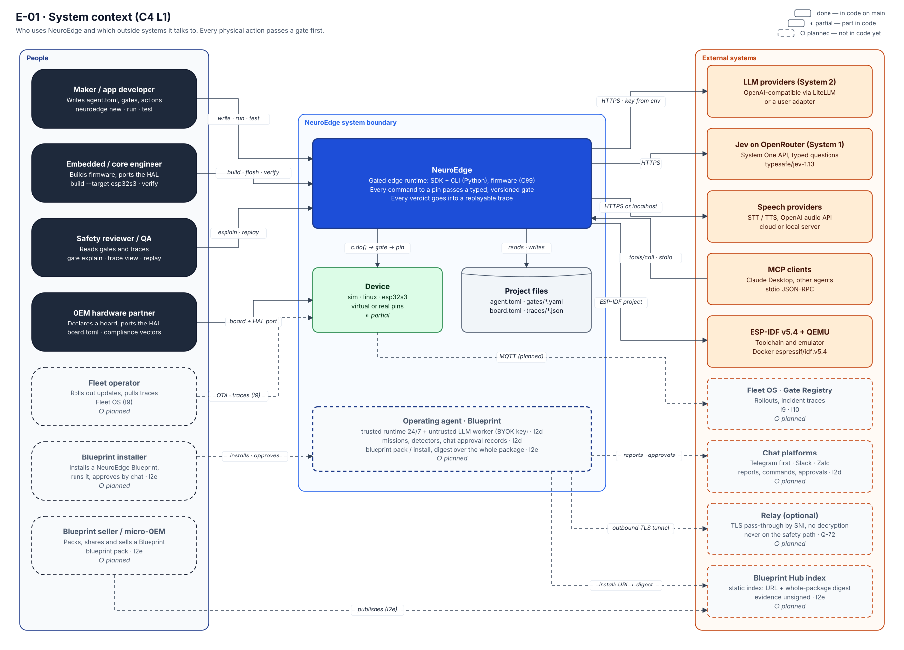
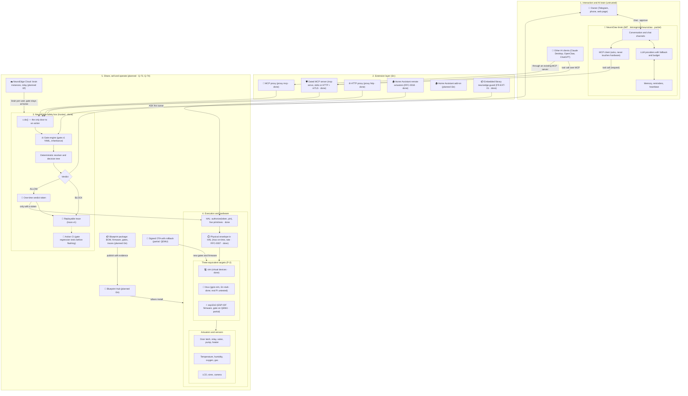
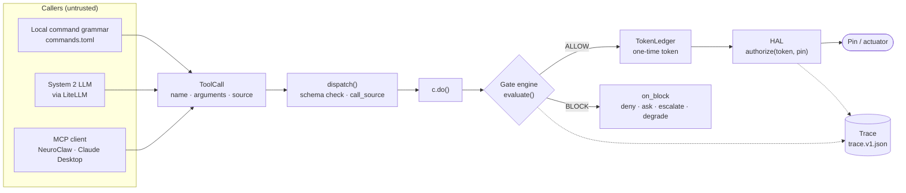

# 00 · Architecture overview

> **Scope:** entire system, at the highest level. **Sources of truth:** code in `main`; requirements in
> [`neuroedge-prd.md`](../../../roadmap/neuroedge-prd.md); progress in
> [`neuroedge-roadmap.md`](../../../roadmap/neuroedge-roadmap.md) §0. Conventions for labels `done` / `partial` /
> `planned`: [`README.md`](../README.md).

**Purpose of this chapter:** This chapter is for every engineer, architect, and partner who needs a comprehensive overview of the entire NeuroEdge architecture. It answers foundational questions: *What problem does NeuroEdge solve in Physical AI? What mechanism guarantees physical actions never bypass safety gates? How does the system layer and maintain target equivalence between host development machines and $5 edge chips?* Before reading, readers only need a basic understanding of AI agents and embedded control. After this chapter, application developers should read §9 and [`python/README.md`](../../../python/README.md); systems engineers should continue to [`02`](02-container-c4l2.md) and [`03`](03-component-host-c4l3.md); architects should read [`15`](15-target-architecture.md).

## 1. What problem NeuroEdge solves

**The Physical AI that really does things, safely by design** (Q-82). *Really does things*: the AI drives
relays, valves and door latches, not just text. *Safely by design*: safety comes from the structure — gate,
one-time token, fail-closed, physical envelope — not from the model behaving well. The rest of this chapter is
how that structure works.

When a chatbot gives a wrong answer, the user clicks "regenerate". When an agent controlling physical devices makes an error,
a door latch has already opened, a fan has already turned off, a relay has already closed — there is no "regenerate" button. An AI model generates proposals;
it cannot be the place that decides whether a physical action is permitted to occur.

NeuroEdge separates those two concerns. Every action proposal — whether from local command grammar, from an LLM, or from
another agent via MCP — is normalized into a **typed tool call**, and then must pass through a
**gate**: a safety policy written in YAML, versioned, inheritable, compiled into a deterministic
decision tree. If the gate yields `ALLOW`, a **one-time verdict token** ([one-time token](../../user/thuat-ngu.md)) is issued, and only
that token can open the specific hardware pins for that action. Every fact, verdict, and pin command
is recorded into a replayable **trace** ([trace](../../user/thuat-ngu.md)). The same gate runs on the simulator (`sim`), on
Linux (`linux`), and on the ESP32-S3 chip (`esp32s3`).

**Direction decided, no code yet (`planned · Q-72`).** [Q-72](../../../roadmap/neuroedge-prd.md#15-sổ-quyết-định) places the above core into three loops: ① **build** —
existing user MCP clients write contracts via NeuroEdge Lab (Q-71); ② **run** — an *operator agent*
runs continuously on the home machine, executing **mission contracts** and reporting or asking for approval via chat channels
(I2d); ③ **share, sell** — a **NeuroEdge Blueprint** packages kit, firmware, template contracts, detectors,
and traces as evidence, installable with one command (I2e). A NeuroEdge Blueprint differs from a **Home Assistant
Blueprint** (automation template shared via Blueprint Exchange); a NeuroEdge Blueprint may bundle
an HA blueprint in its package. Gates and contracts form the trust layer across all three loops; all new paths still traverse
the backbone below.

### 1.1 Product ethos — six promises

**No contract, no action.** Each promise below is something the user directly experiences, and each
promise has an architectural mechanism upholding it. When a design decision weakens a promise, that decision is wrong
— even if it makes the product faster or easier to demo.

| # | User promise | Architecture upholds the promise by | Where the user sees it |
|:---:|:---|:---|:---|
| 1 | **Errors in the physical world cannot be redone, so every command must be approved first.** Models only propose, never decide | A single path `dispatch()` → gate → one-time token → HAL; no shortcuts ([`05`](05-code-gate-hal-c4l4.md)) | Each action has an `ALLOW`/`BLOCK` verdict with a reason |
| 2 | **When unsure, do not act.** Network down, stale sensor, frozen camera, model unresponsive ⇒ block | Fail-closed in all directions (Invariant 2); only commands moving actuators toward safe state are always allowed (Q-62) | Device stops or asks again, does not guess |
| 3 | **One contract everywhere.** Testing on a laptop is identical to running on a $5 chip | Same gate file, pure resolution, two Python and C implementations of the same specification ([`10`](10-target-equivalence.md)) | `neuroedge verify` yields identical verdicts on `sim`, `linux`, `esp32s3` |
| 4 | **Evidence instead of promises.** Every incident can be reproduced on a developer's machine | All facts, verdicts, pin commands recorded into traces; replay recalculates without calling models ([`06`](06-runtime-flows.md) §7) | `neuroedge replay`, `gate explain`, Action CI in PRs |
| 5 | **Humans retain final authority.** Models and other agents cannot confirm on a human's behalf; nor can anyone override a physical measurement | `ask` can only be answered by a person at the device (Q-26); drafts written by MCP clients via NeuroEdge Lab require human approval, no tool can lock them (Q-71); numeric criteria forbidden in `confirms` (Q-62) | Confirmation prompt on `--ui` page, via voice or button press |
| 6 | **Plugs into other stacks, does not consume the whole stack.** NeuroEdge is a contract layer, not a closed platform | MCP is the entry door; models and voice are replaceable providers (P-4); schemas, specifications, compliance harnesses under Apache-2.0 (Q-45); network MCP authenticated at launch milestone (Q-58) | Claude, Home Assistant, or agent frameworks call devices through gates |

**Will change under Q-72 (pending conditional safety RFC, `planned · Q-72`, I2d).** Promise 2: "safe state"
becomes **`safe_state` declared in `board.v1`** for each actuator (default `off`; differs from `off` only
when wired normally-on by default, e.g., normally-closed relays, declared as hardware interlocks). Commands still
follow "when unsure, block"; only movement **toward** `safe_state` is always permitted; movement **away from** `safe_state` is subject to
gates and limits. Existing profiles (`off`; `motion.*` `stop`/`hold`) retain their behavior. Promise 5: owners
can also approve via paired chat channels using an **approval record** containing a one-time code, expiration, and digest of the exact
change; LLMs and chat groups can never approve ([`00`](00-overview.md) §9.4). Decision: [Q-72](../../../roadmap/neuroedge-prd.md#15-sổ-quyết-định).

The product grows across eight user-facing release milestones (roadmap §0.5); the architecture of each milestone and how
each milestone re-proves the six promises is in roadmap §0.5.

## 2. The system in one diagram


*Figure E-01 — Users, external systems, and NeuroEdge boundaries. Details: [`00`](00-overview.md) §9.*

*How to read Figure E-01:* The diagram shows the entire system context at the highest level: user actors and external systems lie outside the boundary; inside the boundary are NeuroEdge (Python SDK + CLI, C99 firmware), devices (`sim` · `linux` · `esp32s3`), and project files. Solid-bordered boxes represent components that already have code; dashed-bordered boxes represent planned future components (`planned`). Core takeaway: whether originating from typed commands, voice, or network connections, every physical action must pass through the same NeuroEdge safety control boundary.

### 2.1 End-to-end view in five layers

From the user's intent, through the AI brain and the extension layer, to the safety box, the hardware and
the share-and-sell loop. Labels follow the `done` / `partial` / `planned` convention of
[`README.md`](../README.md); see §6 for the status table.



Not drawn: robot bridges (ROS 2, Nav2) left the roadmap with Q-77; an ESPHome component has no task yet.

### 2.2 Two parts: brain and box

The user messages the **brain** — [NeuroClaw](https://github.com/letrongminh/neuroclaw),
a separate repository (Q-76, Q-80): chat, LLM calls, memory, calendar reminders. The brain does not touch hardware; it calls MCP tools on the
**NeuroEdge box** (this repo), and the box routes calls through gates like any other source. The brain runs on its own machine or
coexists on an ESP32-S3 chip with the box (Q-79); execution modes and contracts between the two repos: [`15`](15-target-architecture.md) §6.10.

```text
 📱 chat ──► NeuroClaw (brain, untrusted) ══ MCP, mTLS ══► NeuroEdge box: gate ──► pins, devices
```

### 2.3 The execution backbone

The single path from intention to hardware pins — the **execution backbone** — is identical across all call sources
and execution environments:



*How to read the diagram:* Rectangles are software components; diamonds are safety gate evaluation points; ellipses are physical actuator pins. Solid arrows represent the mandatory execution backbone (from untrusted caller → `dispatch()` → `c.do()` → gate → token → HAL); dashed arrows represent logging data written to trace files (`trace.v1.json`). Core takeaway: there is no shortcut to hardware pins without possessing a one-time verdict token issued by the gate.

- **No shortcuts.** Calling `@action` functions directly, calling `digital.out()` outside `c.do()`, supplying a
  custom string or token to HAL, reusing tokens, using expired tokens — all are rejected and recorded in traces
  (`docs/spec/threat_model.md` §2).
- **When unsure, block.** Evaluation timeout, network loss without fallback, missing or
  mistyped facts ⇒ `BLOCK`, never `ALLOW` (Invariant 2, `CHANGELOG.md` §3.3).
- **Self-generating evidence.** Traces contain sufficient facts to recalculate every verdict without calling models
  and without touching hardware (details: [`06`](06-runtime-flows.md) §7).

## 3. Five principles and where architecture enforces them

Principle statements are in PRD §1.5; this table identifies the **architectural mechanisms** enforcing each principle.

| Principle (PRD §1.5) | Enforcing architecture mechanism | Where |
|:---|:---|:---|
| **P-1** Physical action is a typed contract | A single path `dispatch()` → `c.do()` → gate → token → HAL; HAL without token ledger rejects all commands | [`05`](05-code-gate-hal-c4l4.md) · `actions/`, `hal/` |
| **P-2** Peer execution environments | Same gate file, same evaluation semantics on host (Python) and chip (C); `verify` compares verdicts across targets; verification commitment by target tier (FR-TGT-08, Q-13) | [`10`](10-target-equivalence.md) |
| **P-3** Value lies in fleet management and commercial licensing | Safety core sits entirely within `neuroedge` package; services (Fleet OS) are separate containers, no code yet | [`02`](02-container-c4l2.md) §5 |
| **P-4** AI models are replaceable | All models behind `FactSource` protocol / providers; STT/TTS are also replaceable providers via config; chip only records/plays audio and evaluates gates (PRD §1.5 P-4); no SDK imported in core | [`03`](03-component-host-c4l3.md) §3.4 |
| **P-5** Network effects from policy sharing | Gates are versioned data, identified by `neuroedge://`, hashed with JCS SHA-256, inheritance only tightens | [`07`](07-data-contracts.md) §2 |

## 4. Architecture characteristics, in order of priority

When two characteristics conflict, the higher-ranking characteristic wins. Each row represents a design decision already implemented in code.

| # | Characteristic | Meaning | Key tactic | Chapter |
|:---:|:---|:---|:---|:---|
| 1 | **Safe by default** | All errors lead to block | `budget.fail` defaults to `closed`; `fail: open` does not inherit; full token ledger rejects instead of evicting old tokens | [`05`](05-code-gate-hal-c4l4.md), [PRD §9](../../../roadmap/neuroedge-prd.md#9-yêu-cầu-phi-chức-năng) |
| 2 | **Deterministic and replayable** | Same facts ⇒ same verdict, everywhere | Gate resolution is a pure function; decision tree never reads clock; replay recalculates from recorded facts | [`05`](05-code-gate-hal-c4l4.md), [`06`](06-runtime-flows.md) |
| 3 | **Cross-environment equivalence** | Agents do not branch on target | Two implementations (Python, C) of the same specification, proven with shared truth tables and vectors | [`10`](10-target-equivalence.md) |
| 4 | **Auditable** | Reviewers understand without reading code | Gates are human-readable YAML; `gate explain`; traces follow frozen schemas; errors always have three parts | [`07`](07-data-contracts.md) |
| 5 | **Replaceable models** | Switch providers via configuration | OpenAI-compatible standard, `python:` adapter; models only return facts, never return `ALLOW` | [`03`](03-component-host-c4l3.md) |
| 6 | **Runs without network** | Safety functions do not need Internet | Local command grammar is fallback for all models; core only uses standard library for HTTP | [`06`](06-runtime-flows.md) §5 |
| 7 | **Fits small chips** | Gate runs on ESP32-S3 | No JSON, no CEL on chip; `NETR` binary tree read in place in flash; non-allocating walker, stack ≤ 512 B | [`04`](04-component-device-c4l3.md) |

**Characteristic 1 will change under Q-72 (pending RFC, `planned · Q-72`, I2d).** "All errors lead to block" remains true
for **commands**. Add one clause for **actuators**: upon error, timeout, loss of communication, or runtime crash, actuators return
to `safe_state` declared in `board.v1`, which is not necessarily `off`. Duration, `max_continuous_ms`,
lease, levels L0–L3 (RFC-0018), and Q-62 gate exemptions are all read as "return to `safe_state`" ([`05`](05-code-gate-hal-c4l4.md) §5).
Characteristic 6 encounters an additional network loss source: if the operator agent loses its LLM, chat channel, or relay, local reflexes,
deterministic detectors, and hardcoded template alerts continue to run ([`06`](06-runtime-flows.md)). Original invariant:
`CHANGELOG.md` §3.3.

## 5. System shape

NeuroEdge has three parts, plus the CI pipeline that keeps them aligned:

| Part | What it is | Language | Status |
|:---|:---|:---|:---|
| **Package `neuroedge`** (host) | SDK, CLI, gate engine, `sim`/`linux` HAL, models, voice (from WAV files `done`, real-time voice sessions `partial` — [`neuroedge-roadmap.md`](../../../roadmap/neuroedge-roadmap.md) I4), MCP, Action CI | Python 3.11+ | `done` (real-time voice `partial` — roadmap I4) |
| **Firmware `esp32s3`** | `NETR` walker, token ledger, UART trace, generated components for agents, signed OTA | C99 on ESP-IDF v5.4 | `partial` — runs on QEMU; pins not yet driven |
| **Data contracts** | `gate.v1`, `trace.v1`, `board.v1`, `agent.toml`, `NETR` v1, UART stream | JSON Schema, TOML, binary | `done`, frozen via RFC |
| **CI** | Python tests, gpio-sim, QEMU, golden images, OTA, security | GitHub Actions | `done` |
| **Operator agent** (home box) | Two processes: **trusted runtime** running 24/7 (HAL, gates, mission contracts, scheduler, deterministic detectors, chat channel adapter and approval check, data egress) and **untrusted LLM worker** (holds BYOK keys, calls runtime via local MCP, never approves) — [`02`](02-container-c4l2.md) §3 | Python | `planned · Q-72` (I2d) |
| **NeuroEdge Blueprint** | Kit + firmware + template contracts + detectors + trace evidence bundle; `blueprint pack`/`install` downloads by URL and verifies full-bundle digest; Hub is static index repository | Files, git/HTTPS | `planned · Q-72` (I2e) |

Two parts have no code today and only appear in `planned` status: **Fleet OS** (I9) and **Gate
Registry** (I10). Q-72 adds three `planned` parts in the table above and external to the machine: operator agent (I2d), NeuroEdge
Blueprint with Hub index (I2e), and optional cloud relay (`planned · Q-72`, outside I2d/I2e). All other planned items (four extended primitive packages, NeuroEdge Lab via MCP, multi-node robotics, vision on Jetson) are in
roadmap §0.5.

### 5.1 Five-layer logical model

The 5-layer logical model of NeuroEdge (§5.1) is spanned horizontally by the Action CI testing axis:

| Layer / Axis | Layer nature (§5.1) | Implemented by host packages (`03` §2) and firmware components (`04`) | Status |
|:---|:---|:---|:---|
| **L4: Agent Application Layer** | Agent logic, context memory, gated tool calls (MCP), System 2 | `mcp_host`, `mcp_server`, System 2 in `models/` | `done` |
| **L3: Action Contract Engine** (core IP) | Typed gate evaluation, policy inheritance, fail-closed circuit breaker | `engine/`, `actions/` (one-time token ledger), `ne_gate` (`ne_walker.c`, `ne_token.c`), `ne_agent` | `done` (host and QEMU) |
| **L2: Perception & Conversation Runtime** | Wake-word detection, neural VAD, AEC echo cancellation, low-latency STT/TTS, real-time conversation state machine (Q-48) | `perception/` (state machine, wake, STT/TTS), `hal/audio.py` (`EnergyVAD`), `models/` (System 1/2, grammar, knowledge) | `partial` — voice from WAV files and cloud STT/TTS `done`; real-time sessions, AEC (Q-22), remaining real wake-word models (roadmap I4) |
| **L1: Hardware Abstraction Layer (HAL)** | 5 fundamental primitives v1.x (`audio.in`, `audio.out`, `digital.out`, `sensor.read`, `display`), compile-time capability contract checking | `hal/` (board checking, API); firmware HAL on chip | `done` (`hal/` on host); `planned` on chip (TSK-S4-01) |
| **L0: Peer Execution Environments** | Concrete implementations per target (`sim`, `linux`, `esp32s3`) | `hal/sim.py` (`SimHAL`), `hal/linux.py` (`LinuxHAL`), firmware for `esp32s3` in `targets/esp32s3/` (`sim/` package is both target `sim` (L0) and host-side assembly — `03` §2 tier 7) | `done` (`sim`, virtual `linux`); `partial` (`esp32s3` on QEMU) |
| **Cross-cutting axis: Action CI** | Event recording (JSON) → Exact replay → Action reconciliation | `testing/` (`TraceRecorder`, `TracePlayer`, `GoldenComparator`), `trace.py` (`trace.v1`) and `engine/trace_sink.py` (`EventLog`), `cli` (`record`, `replay`, `verify`) | `done` |

The System 1 adapters at L2 (`models/`) implement the `FactSource` protocol specified by L3 (`engine/gate.py`) rather than L3 depending on L2 — this is dependency inversion; while `perception/` depends on `sim` ([`03`](03-component-host-c4l3.md) §2, tier 8). Therefore, the import graph between packages is not a naive top-down stack.

### 5.2 Layering terminology

To prevent readers from confusing the various layering and tiering systems in the documentation:

| Concept | Scale | Meaning | Governing document |
|:---|:---|:---|:---|
| **C4 architecture levels** | L1…L4 | Four architecture visualization levels: L1 Context · L2 Container · L3 Component · L4 Code | C4 model (Simon Brown) · [`00`](00-overview.md) §9…[`05`](05-code-gate-hal-c4l4.md) |
| **System logical layers** | L0…L4 | Five logical functional layers of the platform: L0 Target · L1 HAL · L2 Perception/Runtime · L3 Action Contract Engine · L4 Agent Application, along with Action CI axis | §5.1 |
| **Package dependency tiers** | Tier 0…10 | Import order of host Python modules, preventing cyclic dependencies (Tier 0: `errors`, `paths`… Tier 10: `cli`) | [`03`](03-component-host-c4l3.md) §2 · `python/tests/test_architecture_layers.py` |
| **Target commitment tiers** | Tier 1…3 | Core team hardware verification commitment level: Tier 1 (official: `sim`, `linux`, `esp32s3`), Tier 2 (extended: `jetson`), Tier 3 (community: `stm32`, `rp2350`) | PRD FR-TGT-08, Q-13 · §5.2 · [`15`](15-target-architecture.md) §4.1 |
| **Robot layering tiers** | T0…T6 | Seven distributed robotics architecture tiers: T0 Hardware actuators/local safety · T1 Wire Zenoh-pico · T2 Safety black channel layer · T3 Per-node gates · T4 Unified trace · T5 MCP · T6 ROS 2 bridge | `docs/architecture/vi/15-target-architecture.md` §4.3 · [`15`](15-target-architecture.md) §4.3 |

## 6. Current status by capability

The table below is a capability snapshot, not a progress tracking table; task progress is in roadmap §4–§8.

| Capability | `sim` | `linux` | `esp32s3` |
|:---|:---|:---|:---|
| Gate: resolution, evaluation, tokens | `done` | `done` | `done` on host and QEMU |
| Pin control | `done` (virtual) | `done` on gpio-sim | `planned` (TSK-S4-01) |
| Sensors, display | `done` (virtual) | `done` on `i2c-stub`, `vkms` | `planned`; LVGL interface built only on host |
| Voice (from WAV files) | `done` | `done` | `planned` (I5) |
| Real-time voice (microphone) | `done` on laptop (`run --mic`, TSK-I4-04) | `partial` — device opening only | `planned` |
| Cloud models (System 1, System 2) | `done` | `done` | not applicable: chip only evaluates gates |
| MCP | `done` | `done` | not applicable |
| Traces, replay, verify | `done` | `done` | `done` (UART, QEMU) |
| Signed OTA updates | not applicable | not applicable | `partial` — on QEMU |

## 7. Boundaries — what NeuroEdge is not

- **Not certified functional safety** (not SIL under IEC 61508, not PL under ISO
  13849 — Q-38). Gates do not replace emergency stop buttons or hardware interlocks.
- **Does not protect against in-process attackers.** Tokens are `(nonce, digest)` in memory; the in-scope
  threat is **accidental gate bypass**, and that is proven through tests
  (`docs/spec/threat_model.md` §3, `TODOS.md` #2).
- **Not a cloud service.** Today NeuroEdge is a library, a CLI, and firmware; there are
  no servers operated by NeuroEdge. *Will change under Q-72 (`planned · Q-72`):* two optional exceptions,
  never on the safety path — relays only pass TLS by SNI without decrypting; Hub index is a
  static git repository ([PRD §15](../../../roadmap/neuroedge-prd.md#15-sổ-quyết-định)). *Conditional under Q-74:* optional NeuroEdge Cloud for the "brain" (chat,
  LLMs), unlocked after demand gates if metrics require; rules and reflexes remain strictly at home ([`15`](15-target-architecture.md) §6.10).
- **Does not resell inference tokens** (`docs/architecture/vi/15-target-architecture.md` §3.4; PRD §1.4 N4). The provider abstraction layer is self-hosted in core; users operate and pay model providers directly.
- **Does not implement SLAM or navigation** — only gates velocity commands via ROS 2 / Nav2 ([`neuroedge-prd.md`](../../../roadmap/neuroedge-prd.md) §14, Q-34).
- **No paid marketplace** ([`neuroedge-prd.md`](../../../roadmap/neuroedge-prd.md) §14, PF-3).
- **No automated agent-to-agent payment** ([`neuroedge-prd.md`](../../../roadmap/neuroedge-prd.md) §14, PF-4).
- **No custom wake-word training in v1.0** ([`neuroedge-prd.md`](../../../roadmap/neuroedge-prd.md) §3).

For overall planned architecture (to-be architecture) across subsequent phases, see [`15-target-architecture.md`](15-target-architecture.md).

## 8. Next reading

Role-based reading roadmap is in [`README.md`](../README.md). Beginners start at
[`python/README.md`](../../../python/README.md).

## 9. System context (C4 L1)

> **Scope:** NeuroEdge viewed from outside — who uses it, which systems it talks to, and where
> trust boundaries lie. **Sources:** `python/neuroedge/models/providers/`,
> `python/neuroedge/perception/providers/`, `python/neuroedge/mcp_server.py`, PRD §2,
> `docs/spec/threat_model.md`.

**Purpose of this chapter:** This chapter describes NeuroEdge at the C4 L1 level (System Context). It answers the questions: *Who are the direct users of NeuroEdge? What external services does the system integrate with (LLMs, voice, MCP, embedded devices, robots)? Where do trust boundaries lie and what data is permitted to leave the machine?* Before reading, readers should grasp the overview at [`00`](00-overview.md). After this chapter, continue to [`02`](02-container-c4l2.md) to understand the structure of independently running processes and containers.

### 9.1 Context diagram

Figure E-01 in §2 (read notes there). Details of the context follow below.

Dashed-line boxes bearing labels I2d, I2e, or Q-72 represent target designs of [Q-72](../../../roadmap/neuroedge-prd.md#15-sổ-quyết-định) (`planned · Q-72`), with no code yet:
**Operating agent** within system boundary (trusted 24/7 runtime + untrusted LLM worker, I2d),
two user personas for NeuroEdge Blueprint (I2e), and three external systems — chat platforms (I2d), Blueprint Hub
index (I2e), optional relay (Q-72).

### 9.2 Users

| User | What they do with NeuroEdge | Primary tools | Status |
|:---|:---|:---|:---|
| **Maker, application developer** | Writes agents (`agent.toml`, gates, actions), runs and tests on their own machine | `neuroedge new · run · test · record` | `done` |
| **Core and embedded engineer** | Generates firmware for agent, flashes to chip, compares verdicts across environments | `build --target esp32s3 · verify · record --port` | `done` (on QEMU) |
| **Safety reviewer, QA** | Reads and approves gates without reading code; investigates a session from traces | `gate explain · trace view · replay` | `done` |
| **OEM partner** | Declares a new board, ports HAL, proves equivalence | `board.toml`, compliance vectors | `partial` — see [`10`](10-target-equivalence.md) §7 |
| **Fleet operator** | Manages fleets across 5 capabilities: identity provisioning, staged OTA updates & rollback, health monitoring and inventory, remote gate and config updates, incident trace collection; needed to update, monitor, and collect traces on hundreds or thousands of devices without manual flashing (`docs/architecture/vi/15-target-architecture.md` §3.1) | Fleet OS | `planned` (I9) — see [`15`](15-target-architecture.md) §3.1 |
| **Tiered robot integration team** | Integrates multi-node systems via Zenoh bus, ROS 2 / Nav2 bridge; necessary to decouple centralized intent on SBC from local actuator safety on each MCU node ([`neuroedge-prd.md`](../../../roadmap/neuroedge-prd.md) U6, Q-32, Q-34) | Node firmware, Zenoh router, ROS 2 bridge | `planned` — see [`15`](15-target-architecture.md) §4.3 |

Two new user groups from Q-72 (`planned · Q-72`, I2e — Home Assistant and ESPHome maker communities as early users):

| User | What they do with NeuroEdge | Primary tools | Status |
|:---|:---|:---|:---|
| **NeuroEdge Blueprint installer** | Installs a NeuroEdge Blueprint with one command, lets the operator agent run its mission contract, receives reports and approves via chat. NeuroEdge Blueprint differs from Home Assistant Blueprint (automation template); package may bundle an HA blueprint | `blueprint install <url>` (digest verified), chat channel | `planned · Q-72` (I2e) |
| **Blueprint seller, micro-OEM** | Packages kit, firmware, template contracts, detectors, and trace evidence ("unsigned") into a Blueprint, publishes URL + digest to Hub index; selling constitutes commercial use (Q-45) | `blueprint pack` | `planned · Q-72` (I2e) |

Original user groups and user journeys are in PRD §2 (`U1`…`U6`, `J1`…`J7`).

### 9.3 External systems

All external connections are **optional**: basic installation runs entirely on `sim` without network or keys
(Q-15). API keys are never stored in files: only environment variable **names** are written (`api_key_env`),
and build rejects any field resembling a key (`models/providers/common.py`).

| System | Role | Protocol and format | Responsible code | Status |
|:---|:---|:---|:---|:---|
| **LLM provider** (System 2) | Answers open-ended questions, proposes tool calls | OpenAI-standard Chat completions via LiteLLM library (no proxy process — Q-10); or `python:` adapter | `models/providers/litellm_provider.py`, `openai_chat.py` | `done` |
| **Jev on OpenRouter** (System 1) | Decides selected gate criteria from user utterances | `POST {api_base}/systemone` (System One API), HTTPS required except loopback | `models/providers/systemone_api.py` | `done` |
| **Voice provider** | STT, TTS | OpenAI-standard `POST {base_url}/audio/transcriptions` and `/audio/speech` | `perception/providers/openai_audio.py` | `done` |
| **Local STT server** | Fallback STT when primary STT fails | As above, typically `http://localhost` | `[stt.fallback]` | `done` |
| **MCP client** | Calls agent actions as tools | JSON-RPC over **stdio**; over network only when `--http` enabled (mTLS + OAuth 2.1 token, disabled by default — NFR-SEC-09, `mcp_http.py`) | `mcp_server.py` | `done` |
| **External MCP server** | Information source for System 2 (news, lookups) | stdio; only allowlisted tools | `mcp_host.py` | `done` |
| **ESP-IDF v5.4 and Espressif QEMU** | Compiles firmware, runs virtual chip | ESP-IDF project generated by `build`; UART read via file or `tcp://` | `engine/firmware.py`, `testing/uart.py` | `done` |
| **OTA image server** | Serves a signed app image | HTTP(S) GET on any static server | `components/ne_ota/` | `partial` — on QEMU |
| **Fleet OS, Gate Registry** | Fleet management (5 capabilities) and shared gate registry; needed to automate safety updates and distribute policy at scale | Planned: MQTT with permissive-license broker (Mosquitto, NanoMQ, or VerneMQ — **not** EMQX, Q-11); OCI via ORAS and Harbor | no code yet | `planned` (I9, I10) — see [`15`](15-target-architecture.md) §3.1, §3.2 |
| **ROS 2 / Nav2** | Navigation and motion planning system; only receives velocity commands through gates; needed to leverage robotics ecosystem without compromising safety ([`neuroedge-prd.md`](../../../roadmap/neuroedge-prd.md) §14, Q-34) | ROS 2 messages/actions via bridge on Linux SBC | No code yet (out of core) | `planned` (I14) — see [`15`](15-target-architecture.md) §4.3 |
| **Operator agent LLM provider** (BYOK) | LLM worker explains, proposes, writes reports; never approves | Same as System 2 (LiteLLM, local models supported); user key only lives in worker process; worker network restricted to declared endpoints | No code yet | `planned · Q-72` (I2d) |
| **Chat platform** (Telegram first; Slack, Zalo) | Operator agent reports proactively, receives commands, sends approval requests | Platform bot API; bot token resides in trusted runtime | No code yet | `planned · Q-72` (I2d) |
| **Blueprint Hub index** | Public list of NeuroEdge Blueprints: URL, full-package digest, "unsigned" evidence | Static index repository (git), downloads packages via git/HTTPS; migrates to OCI Gate Registry when Hub monetizes | No code yet | `planned · Q-72` (I2e) |
| **Cloud relay** (optional) | Remote access without opening home ports; trace backup | Home box initiates outbound connection; relay selects destination by SNI, passes TLS through, no decryption (SniTun pattern); backups encrypted at home box; approvals do not pass through relay | No code yet | `planned · Q-72` |
| **Zenoh router** | Transport network between agent host (Pi) and MCU nodes; untrusted "black channel" (IEC 61784-3 — `docs/architecture/vi/15-target-architecture.md` §4.3); Zenoh-pico per Q-36 | Eclipse Zenoh (`zenohd` on host, `zenoh-pico` on MCU, Apache-2.0 branch) | No code yet | `planned` (I14) — see [`15`](15-target-architecture.md) §4.3 |

### 9.4 Trust boundaries


Four boundary rules, each tested in `docs/spec/threat_model.md` §2b:

1. **Models and clients only propose.** LLMs and MCP clients can only send `ToolCall` via `dispatch()`.
   Nonexistent tool or invalid parameter type ⇒ `REJECTED`, no verdict is calculated.
2. **Call sources assigned by runtime, not declared by caller.** `call_source` is inserted by the dispatcher as
   a trusted fact; a gate can reject an action specifically for source `mcp` or
   `system_two`.
3. **Model responses are facts, not verdicts.** Jev returns `Fact` or `Unavailable`,
   which is then checked for value domain and confidence threshold before entering gates. Models never return `ALLOW`.
   Content from external MCP servers is marked "untrusted data"; calls originating from it still
   must pass through gates.
4. **Only persons present at the device can confirm.** When a gate asks for confirmation (`on_block: ask`), only the two
   channels `local_grammar` (type or say "có" [yes]) and `ui` (button on same-origin page 127.0.0.1) may
   respond (Q-26). System 2 and MCP clients have no way to confirm on behalf of users.
   *Will change under Q-72 (pending RFC for source `chat:<id>`, `planned · Q-72`, I2d):* add chat approval path
   via **approval records**. The runtime sends to a paired chat a request `{id, nonce, expiration, change digest, approval summary ≤ 5 lines}`;
   the approval summary is generated deterministically by runtime and compiler from structured diffs,
   not from LLM text. The reply must target the exact `id`. The runtime checks: sender is paired, not
   a group, nonce unused, unexpired per monotonic clock, digest matches; if all five pass, it enters the existing
   confirmation path with source `chat:<id>`; if any fails, it rejects and traces. LLMs never approve.
   Pairing lifecycle (revocation, expiration, approval rate limits) deferred in `TODOS.md` #62. Decision: [Q-72](../../../roadmap/neuroedge-prd.md#15-sổ-quyết-định).

Explicitly out of scope: in-process attackers, and certified
functional safety (`docs/spec/threat_model.md` §3, §3b). Therefore, the operator agent
(`planned · Q-72`, I2d) separates the LLM into a dedicated process: the worker reads text sent by external parties and holds LLM
keys, but does not share a process with HAL, bot tokens, or approval ledgers; it is merely an MCP client as in the
Q-71 boundary ([`02`](02-container-c4l2.md) §3).

### 9.5 Data leaving the machine

| To | Data sent | Never sent |
|:---|:---|:---|
| LLM (System 2) | User utterance, tool list, turn history | API keys (only read from environment variables), verdict tokens |
| Jev (System 1) | **Only speaker utterance** and typed question for each criterion | Action names, parameters, session facts; MCP calls without spoken words send nothing |
| STT | Audio chunk of one turn | — |
| TTS | Response string to read | — |
| Camera / vision *(`sim`, `linux`: `done`; `esp32s3`: planned)* | To vision models; maker declares `bool`/`level`/`choice` facts with numeric confidence, gate bounds thresholds via `numeric` criteria (Q-54, `docs/architecture/vi/15-target-architecture.md` §4.4) | Traces do not embed raw frames: default stores only SHA-256 hash and size; storing raw frames requires explicit opt-in (`metadata.raw_capture`, phase2 §2.3, TSK-V1b-08) — see [`15`](15-target-architecture.md) §4.4 |

Traces by default only store decisions: raw text (typed commands, transcripts) is hashed at the source (NFR-PRIV-03);
`--raw` is the explicit opt-in to preserve verbatim text, and that trace carries `metadata.anonymized = false` (NFR-PRIV-04).
Audio is never stored in traces.

#### Data flows of the operator agent (`planned · Q-72`, I2d)

Data flow rules of [Q-72](../../../roadmap/neuroedge-prd.md#15-sổ-quyết-định) aim to **prevent data leaks** (hacks, prompt injection, exfiltration), without restricting
user-constructed flows: every destination declared by users in contracts or configurations receives data permitted
by the user, including images sent to LLMs. Content rules (e.g. "images do not leave home") are user options enabled
in contracts, not defaults.

| To | Data sent | Enforcement |
|:---|:---|:---|
| LLM provider (via LLM worker, BYOK) | What the runtime allows the worker to *see*: facts, detector events, user utterances, images if contract permits | Runtime controls what worker sees; worker network blocked at OS level, restricted to declared provider endpoints |
| Paired chat platform | Proactive reports, replies, approval requests with approval summary ≤ 5 lines | Runtime only sends to declared destinations; bot token only in runtime |
| Relay (optional) | TLS bytes that relay cannot decrypt; trace backups encrypted at home box | Relay sees metadata (domain, timestamp), not content; approvals do not pass through relay |
| Webhook or other user-declared destination | Fields permitted by contract | As above |
| Undeclared destination | — | Blocked and recorded in trace |

**Residual risk, explicitly stated:** a tricked worker can still send permitted data to permitted destinations.
