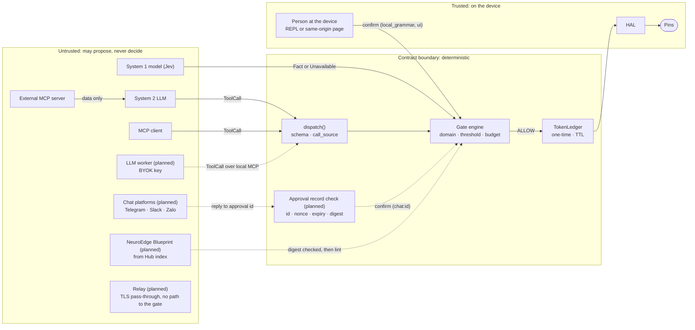

# 01 · Bối cảnh hệ thống (C4 L1)

> **Phạm vi:** NeuroEdge nhìn từ bên ngoài — ai dùng nó, nó nói chuyện với hệ thống nào, và ranh
> giới tin cậy nằm ở đâu. **Nguồn:** `python/neuroedge/models/providers/`,
> `python/neuroedge/perception/providers/`, `python/neuroedge/mcp_server.py`, PRD §2,
> `docs/spec/threat_model.md`.

**Đọc chương này để làm gì:** Chương này mô tả NeuroEdge ở mức C4 L1 (Bối cảnh hệ thống). Tài liệu trả lời các câu hỏi: *Ai là người dùng trực tiếp của NeuroEdge? Hệ thống tích hợp với các dịch vụ bên ngoài nào (LLM, giọng nói, MCP, thiết bị nhúng, robot)? Ranh giới tin cậy nằm ở đâu và dữ liệu nào được phép rời khỏi máy?* Trước khi đọc, nên nắm tổng quan tại [`00`](00-overview.md). Sau chương này, đọc tiếp [`02`](02-container-c4l2.md) để hiểu cấu trúc các tiến trình và container chạy độc lập.

## 1. Sơ đồ bối cảnh

*Hình E-01 — Người dùng bên trái, hệ thống bên ngoài bên phải. Nét đứt là `planned`.*

*Cách đọc hình E-01:* Hình thể hiện ranh giới bối cảnh giữa người dùng (bên trái), hệ thống NeuroEdge (ở giữa), và các nhà cung cấp bên ngoài (bên phải). Khối nét liền là các tác nhân và kết nối đã vận hành; khối nét đứt là các bên tham gia trong quy hoạch (`planned`). Điểm cốt lõi cần nhớ: các hệ thống bên ngoài chỉ đề xuất tool call, cung cấp dữ kiện hoặc nhận văn bản/âm thanh; không hệ thống nào tự quyết một hành động vật lý — mọi tool call vẫn qua gate.

Các khối nét đứt mang nhãn I2d, I2e hay Q-72 là thiết kế đích của [Q-72](../../../roadmap/neuroedge-prd.md#15-sổ-quyết-định) (`planned · Q-72`), chưa có mã:
**Operating agent** trong ranh giới hệ thống (runtime tin cậy 24/7 + LLM worker không tin cậy, I2d),
hai người dùng của NeuroEdge Blueprint (I2e), và ba hệ thống ngoài — nền tảng chat (I2d), Blueprint Hub
index (I2e), relay tuỳ chọn (Q-72).

## 2. Người dùng

| Người dùng | Làm gì với NeuroEdge | Công cụ chính | Trạng thái |
|:---|:---|:---|:---|
| **Maker, lập trình viên ứng dụng** | Viết agent (`agent.toml`, gate, action), chạy và kiểm trên máy mình | `neuroedge new · run · test · record` | `done` |
| **Kỹ sư lõi và kỹ sư nhúng** | Sinh firmware cho agent, nạp lên chip, so phán quyết giữa các môi trường | `build --target esp32s3 · verify · record --port` | `done` (trên QEMU) |
| **Người duyệt an toàn, QA** | Đọc và duyệt gate mà không đọc mã; điều tra một phiên từ vết ghi | `gate explain · trace view · replay` | `done` |
| **Đối tác OEM** | Khai báo một bo mạch mới, port HAL, chứng minh tương đương | `board.toml`, vector tuân thủ | `partial` — xem [`11`](11-hal-port-guide.md) |
| **Người vận hành đội thiết bị** | Quản trị đội qua 5 năng lực: cấp phát danh tính (provisioning), cập nhật OTA theo đợt & rollback (staged OTA), giám sát sức khoẻ và sổ kiểm kê (monitoring/inventory), cập nhật cấu hình và gate từ xa (remote gate/config), thu thập trace sự cố (incident traces); cần để cập nhật, giám sát và thu vết ghi trên hàng trăm, hàng nghìn thiết bị mà không nạp lại firmware bằng tay ([`neuroedge-proposal.md`](../../../roadmap/neuroedge-proposal.md) §6.2) | Fleet OS | `planned` (I9) — xem [`15`](15-target-architecture.md) §3.1 |
| **Đội tích hợp robot phân tầng** | Tích hợp hệ thống nhiều node qua bus Zenoh, bridge ROS 2 / Nav2; cần thiết để tách bạch ý định tập trung trên SBC với an toàn chấp hành cục bộ trên từng MCU node ([`neuroedge-prd.md`](../../../roadmap/neuroedge-prd.md) U6, Q-32, Q-34) | Node firmware, Zenoh router, ROS 2 bridge | `planned` — xem [`15`](15-target-architecture.md) §4.3 |

Hai nhóm người dùng mới của Q-72 (`planned · Q-72`, I2e — cộng đồng maker Home Assistant, ESPHome là người dùng đầu):

| Người dùng | Làm gì với NeuroEdge | Công cụ chính | Trạng thái |
|:---|:---|:---|:---|
| **Người cài NeuroEdge Blueprint** | Cài một NeuroEdge Blueprint bằng một lệnh, cho agent vận hành chạy hợp đồng nhiệm vụ của nó, nhận báo và duyệt qua chat. NeuroEdge Blueprint khác Home Assistant Blueprint (mẫu automation); gói có thể mang kèm một HA blueprint | `blueprint install <url>` (kiểm digest), kênh chat | `planned · Q-72` (I2e) |
| **Người bán Blueprint, nhà sản xuất nhỏ (micro-OEM)** | Đóng gói kit, firmware, hợp đồng mẫu, bộ phát hiện và vết ghi bằng chứng ("chưa ký") thành Blueprint, đăng URL + digest lên Hub index; bán là dùng thương mại (Q-45) | `blueprint pack` | `planned · Q-72` (I2e) |

Các nhóm người dùng và hành trình gốc ở PRD §2 (`U1`…`U6`, `J1`…`J7`).

## 3. Hệ thống bên ngoài

Mọi kết nối ra ngoài đều **tuỳ chọn**: bản cài cơ bản chạy toàn bộ `sim` không cần mạng hay khoá
(Q-15). Khoá API không bao giờ nằm trong tệp: chỉ **tên** biến môi trường được ghi (`api_key_env`),
và build từ chối mọi trường trông giống khoá (`models/providers/common.py`).

| Hệ thống | Vai trò | Giao thức và định dạng | Mã đảm nhận | Trạng thái |
|:---|:---|:---|:---|:---|
| **Nhà cung cấp LLM** (System 2) | Trả lời câu tự do, đề xuất tool call | Chat completions chuẩn OpenAI qua thư viện LiteLLM (không chạy proxy — Q-10); hoặc adapter `python:` | `models/providers/litellm_provider.py`, `openai_chat.py` | `done` |
| **Jev trên OpenRouter** (System 1) | Quyết một số tiêu chí gate từ lời người nói | `POST {api_base}/systemone` (System One API), HTTPS bắt buộc trừ loopback | `models/providers/systemone_api.py` | `done` |
| **Nhà cung cấp giọng nói** | STT, TTS | `POST {base_url}/audio/transcriptions` và `/audio/speech` chuẩn OpenAI | `perception/providers/openai_audio.py` | `done` |
| **Máy chủ STT cục bộ** | STT dự phòng khi STT chính hỏng | Như trên, thường `http://localhost` | `[stt.fallback]` | `done` |
| **Client MCP** | Gọi action của agent như công cụ | JSON-RPC qua **stdio**; qua mạng chỉ khi bật `--http` (mTLS + token OAuth 2.1, mặc định tắt — NFR-SEC-09, `mcp_http.py`) | `mcp_server.py` | `done` |
| **MCP server bên ngoài** | Nguồn thông tin cho System 2 (tin tức, tra cứu) | stdio; chỉ công cụ trong danh sách cho phép | `mcp_host.py` | `done` |
| **ESP-IDF v5.4 và Espressif QEMU** | Biên dịch firmware, chạy chip ảo | Project ESP-IDF sinh bởi `build`; UART đọc qua tệp hoặc `tcp://` | `engine/firmware.py`, `testing/uart.py` | `done` |
| **Máy chủ ảnh OTA** | Phục vụ một ảnh app đã ký | HTTP(S) GET bất kỳ máy chủ tĩnh nào | `components/ne_ota/` | `partial` — trên QEMU |
| **Fleet OS, Gate Registry** | Quản trị đội thiết bị (5 năng lực) và kho gate chia sẻ; cần thiết để tự động hoá cập nhật an toàn và phân phối chính sách trên quy mô lớn | Quy hoạch: MQTT với broker giấy phép dễ dãi (Mosquitto, NanoMQ hoặc VerneMQ — **không** EMQX, Q-11); OCI qua ORAS và Harbor | chưa có mã | `planned` (I9, I10) — xem [`15`](15-target-architecture.md) §3.1, §3.2 |
| **ROS 2 / Nav2** | Hệ thống điều hướng và lập kế hoạch di chuyển; chỉ nhận lệnh vận tốc qua gate; cần thiết để tận dụng hệ sinh thái robot mà không nhượng bộ an toàn ([`neuroedge-prd.md`](../../../roadmap/neuroedge-prd.md) §14, Q-34) | ROS 2 messages/actions qua bridge trên SBC Linux | Chưa có mã (ngoài lõi) | `planned` (I14) — xem [`15`](15-target-architecture.md) §4.3 |
| **Nhà cung cấp LLM của agent vận hành** (BYOK) | LLM worker giải thích, đề xuất, viết báo cáo; không bao giờ duyệt | Như System 2 (LiteLLM, có mô hình tại chỗ); key của người dùng chỉ nằm trong tiến trình worker; mạng của worker chỉ tới endpoint đã khai | Chưa có mã | `planned · Q-72` (I2d) |
| **Nền tảng chat** (Telegram trước; Slack, Zalo) | Agent vận hành báo chủ động, nhận lệnh, gửi yêu cầu duyệt | API bot của nền tảng; token bot nằm trong runtime tin cậy | Chưa có mã | `planned · Q-72` (I2d) |
| **Blueprint Hub index** | Danh sách công khai các NeuroEdge Blueprint: URL, digest toàn gói, bằng chứng "chưa ký" | Kho index tĩnh (git), tải gói qua git/HTTPS; chuyển sang Gate Registry OCI khi Hub thu tiền | Chưa có mã | `planned · Q-72` (I2e) |
| **Relay đám mây** (tuỳ chọn) | Truy cập từ xa không mở cổng mạng nhà; sao lưu vết ghi | Máy nhà mở kết nối ra; relay chọn đích theo SNI, chuyển TLS xuyên, không giải mã (mẫu SniTun); bản sao lưu mã hoá phía máy nhà; lời duyệt không đi qua relay | Chưa có mã | `planned · Q-72` |
| **Bộ định tuyến Zenoh (Zenoh router)** | Mạng truyền dẫn giữa máy chủ agent (Pi) và các node MCU; kênh "black channel" không tin cậy (IEC 61784-3 — [`draft-ke-hoach-mo-rong-robot-fofoca.md`](../../../roadmap/draft-ke-hoach-mo-rong-robot-fofoca.md) §4.2); Zenoh-pico theo Q-36 | Eclipse Zenoh (`zenohd` trên host, `zenoh-pico` trên MCU, nhánh Apache-2.0) | Chưa có mã | `planned` (I14) — xem [`15`](15-target-architecture.md) §4.3 |

## 4. Ranh giới tin cậy

Bốn luật định ranh giới, mỗi luật có test ở `docs/spec/threat_model.md` §2b:

1. **Model và client chỉ đề xuất.** LLM và client MCP chỉ gửi được `ToolCall` qua `dispatch()`.
   Công cụ không tồn tại hay tham số sai kiểu ⇒ `REJECTED`, không phán quyết nào được tính.
2. **Nguồn gọi do runtime gán, không do bên gọi khai.** `call_source` được dispatcher chèn vào như
   một dữ kiện tin cậy; một gate có thể từ chối một hành động cho riêng nguồn `mcp` hay
   `system_two`.
3. **Câu trả lời của model là dữ kiện, không phải phán quyết.** Jev trả `Fact` hoặc `Unavailable`,
   rồi bị kiểm miền giá trị và ngưỡng tin cậy trước khi vào gate. Model không bao giờ trả `ALLOW`.
   Nội dung từ MCP server bên ngoài được đánh dấu "dữ liệu không tin cậy"; lời gọi nó dẫn tới vẫn
   phải qua gate.
4. **Chỉ người có mặt tại thiết bị mới xác nhận được.** Khi gate hỏi lại (`on_block: ask`), chỉ hai
   kênh `local_grammar` (gõ hoặc nói "có") và `ui` (nút trên trang cùng nguồn gốc 127.0.0.1) được
   trả lời (Q-26). System 2 và client MCP không có cách nào xác nhận thay.
   *Sẽ đổi theo Q-72 (chờ RFC nguồn `chat:<id>`, `planned · Q-72`, I2d):* thêm đường duyệt qua chat
   bằng **bản ghi duyệt**. Runtime gửi tới chat đã ghép đôi một yêu cầu `{id, nonce, hạn, digest thay
   đổi, bản duyệt ≤ 5 dòng}`; bản duyệt do runtime và trình biên dịch sinh tất định từ diff có cấu trúc,
   không từ chữ của LLM. Câu trả lời phải nhắm đúng `id`. Runtime kiểm: người gửi đã ghép đôi, không
   phải nhóm, nonce chưa dùng, còn hạn theo đồng hồ đơn điệu, digest khớp; đủ cả năm thì đi vào đường
   xác nhận hiện có với nguồn `chat:<id>`, thiếu một thì từ chối và ghi vết. LLM không bao giờ duyệt.
   Vòng đời ghép đôi (thu hồi, hạn, trần lời duyệt) hoãn ở `TODOS.md` #62. Quyết định: [Q-72](../../../roadmap/neuroedge-prd.md#15-sổ-quyết-định).

Ngoài phạm vi, nói rõ: kẻ tấn công trong cùng tiến trình, và an
toàn chức năng được chứng nhận (`docs/spec/threat_model.md` §3, §3b). Vì vậy agent vận hành
(`planned · Q-72`, I2d) tách LLM ra một tiến trình riêng: worker đọc văn bản người ngoài gửi và giữ key
LLM, nhưng không cùng tiến trình với HAL, token bot hay bảng lời duyệt; nó chỉ là một client MCP như
ranh giới Q-71 ([`02`](02-container-c4l2.md) §3).

## 5. Dữ liệu rời khỏi máy

| Tới | Dữ liệu gửi đi | Không bao giờ gửi |
|:---|:---|:---|
| LLM (System 2) | Câu người dùng, danh sách công cụ, lịch sử lượt | Khoá API (chỉ đọc từ biến môi trường), token phán quyết |
| Jev (System 1) | **Chỉ lời người nói** và câu hỏi có kiểu cho từng tiêu chí | Tên action, tham số, dữ kiện phiên; lời gọi MCP không ai nói thì không gửi gì |
| STT | Đoạn âm thanh của một lượt | — |
| TTS | Câu trả lời cần đọc | — |
| Camera / thị giác *(`sim`, `linux`: `done`; `esp32s3`: planned)* | Tới model thị giác; maker khai dữ kiện `bool`/`level`/`choice` kèm độ tin cậy số, gate khoá ngưỡng bằng tiêu chí `numeric` (Q-54, `neuroedge-design-phase2.md` §2.2) | Vết ghi không nhúng khung hình thô: mặc định chỉ lưu băm SHA-256 và kích thước; lưu ảnh thô phải bật tường minh (`metadata.raw_capture`, phase2 §2.3, TSK-V1b-08) — xem [`15`](15-target-architecture.md) §4.4 |

Vết ghi mặc định chỉ lưu quyết định: chữ thô (câu gõ, bản chép lời) được băm tại nguồn (NFR-PRIV-03);
`--raw` là cách bật tường minh giữ nguyên văn, vết ghi đó mang `metadata.anonymized = false` (NFR-PRIV-04).
Âm thanh không bao giờ được lưu vào vết ghi.

### Luồng dữ liệu của agent vận hành (`planned · Q-72`, I2d)

Luật luồng dữ liệu của [Q-72](../../../roadmap/neuroedge-prd.md#15-sổ-quyết-định) nhằm **chống rò rỉ** (hack, prompt injection, đánh cắp), không hạn chế
luồng người dùng tự dựng: mọi đích người dùng khai trong hợp đồng hay cấu hình nhận được dữ liệu người
dùng cho phép, kể cả ảnh tới LLM. Luật nội dung (ví dụ "ảnh không rời nhà") là tuỳ chọn người dùng bật
trong hợp đồng, không phải mặc định.

| Tới | Dữ liệu gửi đi | Cưỡng chế |
|:---|:---|:---|
| Nhà cung cấp LLM (qua LLM worker, BYOK) | Những gì runtime cho worker *thấy*: dữ kiện, sự kiện bộ phát hiện, lời người dùng, ảnh nếu hợp đồng cho | Runtime quyết định worker thấy gì; mạng của worker bị chặn ở mức hệ điều hành, chỉ tới endpoint provider đã khai |
| Nền tảng chat đã ghép đôi | Báo chủ động, câu trả lời, yêu cầu duyệt với bản duyệt ≤ 5 dòng | Runtime chỉ gửi tới đích đã khai; token bot chỉ trong runtime |
| Relay (tuỳ chọn) | Byte TLS mà relay không giải mã được; bản sao lưu vết ghi mã hoá phía máy nhà | Relay thấy siêu dữ liệu (tên miền, thời điểm), không thấy nội dung; lời duyệt không qua relay |
| Webhook hay đích khác người dùng khai | Trường hợp đồng cho phép | Như trên |
| Đích không khai | — | Bị chặn và ghi vết |

**Rủi ro còn lại, nói rõ:** worker bị lừa vẫn gửi được dữ liệu đã cho phép tới đích đã cho phép.
