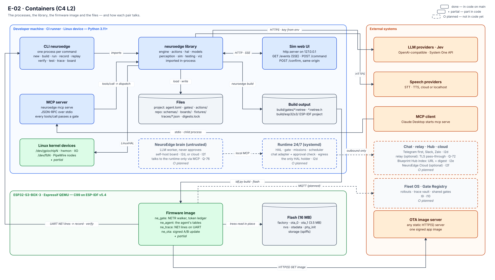
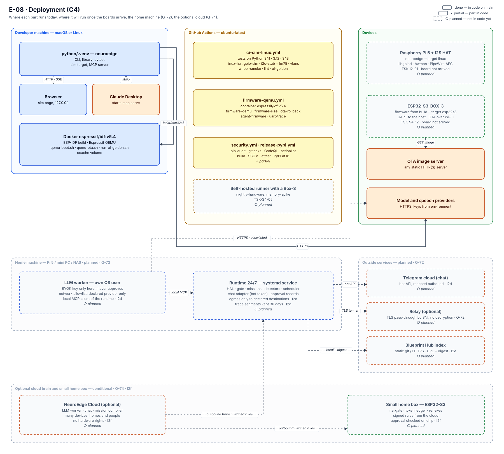

# 02 · Containers and process boundaries (C4 L2)

> **Scope:** independently running units — processes, libraries, firmware, file stores — and how each
> pair communicates. **Sources:** `python/pyproject.toml`, `python/neuroedge/cli/`, `sim/ui.py`,
> `mcp_server.py`, `targets/esp32s3/`, `.github/workflows/`.

## 1. Container diagram

*Figure E-02 — Containers on dev machines or Linux devices (top), on chip (bottom), and external systems (right). Dashed boxes labeled I2d, I2e, Q-72 represent target designs of [Q-72](../../../roadmap/neuroedge-prd.md#15-decision-log) (`planned · Q-72`): 24/7 runtime, LLM worker, chat platforms, Hub index, relay; LLM workers may run on optional NeuroEdge Cloud (Q-74, I2f, [`15`](15-target-architecture.md) §6.10).*

## 2. Container catalog

| Container | Technology | Responsibilities | Entry point | Status |
|:---|:---|:---|:---|:---|
| **`neuroedge` CLI** | Python 3.11+, Typer, Rich | Each command is a process: loads sessions, converts errors to three-part messages and exit codes; does not decide gates itself | `neuroedge.cli.main:app` | `done` |
| **`neuroedge` library** | Python (core source-available — Q-45); core dependencies: `pydantic`, `jsonschema`, `pyyaml`, `rfc8785`, `deepdiff`, `typer`, `rich` | Entire logic: gate engine, actions, HAL, models, voice, sessions, Action CI | `import neuroedge` | `done` |
| **Session Web UI** | Standard library `http.server.ThreadingHTTPServer`, 127.0.0.1 only | Displays virtual device, verdict stream; receives typed commands and confirmation buttons from present users | `run --ui`, `mcp serve --ui` | `done` (`sim` only) |
| **MCP server** | MCP Python SDK (extra `mcp`), stdio | Exposes each `@action` as a tool; all `tools/call` pass through gates | `neuroedge mcp serve` | `done` |
| **Files** | Local filesystem | Agent project (`agent.toml`, `commands.toml`, `knowledge.toml`, `gates/`, `actions/`, `traces/`); repository data (`schemas/`, `gates/`, `boards/`, `fixtures/`, `digests.lock`) | — | `done` |
| **Build outputs** | Filesystem | `build/gates/` (JSON trees, gate artifacts, `NETR`, C headers); `build/esp32s3/` (complete ESP-IDF project) | `neuroedge build` | `done` |
| **Linux device** | Linux kernel: libgpiod v2, sysfs hwmon/IIO, framebuffer, PipeWire | Real pins, sensors, display, audio for `LinuxHAL` | `--target linux` | `partial` — verified on virtual hardware, not yet on Pi |
| **Firmware image** | C99, ESP-IDF v5.4 | `NETR` walker, token ledger, agent tables, UART traces, OTA; self-tests at boot | `app_main` | `partial` — runs on QEMU, pins not yet driven |
| **Flash** | 16 MB, partition table `partitions.csv` | `factory`, `ota_0`, `ota_1` (3.5 MB each slot); `nvs`, `otadata`, `phy_init`, `storage` | — | `done` |
| **Fleet OS, Gate Registry** | Not fully chosen; Eclipse Hawkbit decided (Q-11), ORAS and Harbor | Fleet management; signed gate registry | — | `planned` (I9, I10) |
| **24/7 Runtime** (home box) | Python, systemd service | Sole trusted process holding HAL and GPIO privileges: gates, mission contract execution, scheduler, deterministic detectors, `llm_budget`, chat channel adapter and approval record verification, data egress, segment-based traces | none yet | `planned · Q-72` (I2d) |
| **NeuroClaw brain** (Profile A, Q-83) | Go (separate repository `letrongminh/neuroclaw`); dedicated OS user on a shared machine | Conversation, LLM calls, memory, reminders; calls the box only through MCP + mTLS; never holds a human source | NeuroClaw `gateway` | `partial` — demo 2026-10-13; isolation TSK-I2d-24 |

## 3. Process and threading model

**Today**, NeuroEdge has no background processes running continuously. Everything lives inside the process of the
running command. *Will change under Q-72 (`planned · Q-72`, I2d):* the operator agent adds two long-running processes on
the home box (the last two rows of the table).

| Scenario | Processes | Threads and event loops | Status |
|:---|:---|:---|:---|
| `run -c`, `run` (REPL), `record` | Single `neuroedge` process | Each turn runs in a fresh `asyncio` loop (`asyncio.run(session.handle(text))`) | today |
| `run --ui` | As above, plus HTTP server | `ThreadingHTTPServer` HTTP worker threads; each turn runs under a shared lock; SSE pushes state changes or every 1 second | today |
| `mcp serve` | Subprocess launched by MCP client | Single `anyio` loop; `turns` lock ensures one call at a time | today |
| `mcp serve --ui` | As above, plus web page | MCP calls and web turns share a single session and lock | today |
| `--target linux` | As above | Timed GPIO pulses released via `threading.Timer`; SIGTERM/SIGHUP restore all lines to idle before exit | today |
| Firmware | Single `app_main` task | Spawns no FreeRTOS tasks; all boot steps run sequentially ([`04`](04-component-device-c4l3.md) §3) | today |
| **24/7 Runtime** (trusted) | Single systemd service on home box (Pi, mini PC, NAS), restarts on crash | Long-running event loop: scheduler, detectors, chat adapter, local MCP server for worker; turn lock like `mcp serve`. Duration, approval deadlines, watchdog use monotonic clock; wall-clock time marked `unsynced` until synchronized | `planned · Q-72` (I2d) |
| **LLM worker** (untrusted) = the NeuroClaw brain (Q-83) | Separate process, dedicated OS user; runtime monitors and restarts | Calls runtime via local MCP; sources assigned by runtime per connection; network restricted to declared provider endpoints | `planned · Q-72` (I2d) |

The two processes reuse the Q-71 boundary: only one process holds HAL, and the MCP client is an untrusted party.
A worker hit by prompt injection can still only send calls that must pass through gates, unable to touch bot keys, approval
ledgers, or HAL. If the worker crashes, the runtime continues local reflexes, runs detectors, sends hardcoded template alerts, and
restarts the worker ([`06`](06-runtime-flows.md)). Decision: [Q-72](../../../roadmap/neuroedge-prd.md#15-decision-log).

Consequences today: MCP connections to external servers only survive for a single turn (`TODOS.md` #25), and a stuck I2C
bus can block the loop for approximately one second (`TODOS.md` #48). With a 24/7 runtime (`planned · Q-72`), both
become real risks: the runtime running a long loop matches the trigger milestone of #25, and detectors reading
sensors periodically on the same loop cause a stuck bus to delay both reflexes and approvals (#48). Both must be
resolved before the 24/7 runtime runs on physical hardware.

## 4. Communication matrix

Only what is in code is recorded. No latency budgets here are measured; latency thresholds are NFRs
(PRD §9.1) and their measurement status is in [PRD §9](../../../roadmap/neuroedge-prd.md#9-non-functional-requirements).

| Source → Destination | Channel | Format | Controls |
|:---|:---|:---|:---|
| CLI → library | In-process function calls | Python objects | — |
| Browser ↔ web UI | HTTP on 127.0.0.1: `GET /events` (Server-Sent Events), `GET /state`, `POST /command`, `POST /confirm` | JSON; body up to 4096 bytes | `Host` and `Origin` must be 127.0.0.1 or localhost on correct port, otherwise 403 |
| MCP client → MCP server | Subprocess stdin/stdout | JSON-RPC (MCP); results have `outputSchema` | All calls carry source `mcp` and pass through gates; `BLOCK` is not an error, `REJECTED` is an error |
| Library → LLM | HTTPS (LiteLLM) | OpenAI-standard Chat completions | Keys read only from environment variables; never entered into traces |
| Library → Jev | HTTPS, `POST {api_base}/systemone` | JSON: `model`, `state.utterance`, `questions` | HTTPS required except loopback; sends only speaker utterance; standard library client (`net.py`): no redirects, no proxy, hard deadlines |
| Library → STT/TTS | HTTPS or `http://localhost` | OpenAI-standard Audio API | `http://` to remote hosts with keys ⇒ build rejected; same `net.py` client |
| Library → Linux devices | Device characters `/dev/gpiochipN`, sysfs, `/dev/fbN`, PortAudio | libgpiod v2, text files, pixel buffers | Lines located by **name**; missing device ⇒ error before claiming any line |
| Library → build output → firmware image | `idf.py build` reads generated project | C, `.netree.h` headers, `version.txt` | Build error ⇒ prints all problems, writes no files |
| Firmware image → library | UART (log file, `tcp://`, serial port) | `NE1 {…}` lines ≤ 512 bytes, frames `device_info` … `trace_end` | Corrupted lines, missing frames, mismatched counts ⇒ `NE4001`, writes nothing |
| Firmware image → OTA server | HTTP(S) GET | RSA-3072 signed app image | No redirects; download deadline; invalid signature ⇒ erases written slot |
| Firmware image → Fleet OS | MQTT | — | `planned` (I9) — see [`15`](15-target-architecture.md) §3.1 |
| Firmware image ↔ provider *(planned)* | WebSocket (TLS 1.3) | Opus (binary 16 kHz audio) and JSON (events/results) ([`neuroedge-prd.md`](../../../roadmap/neuroedge-prd.md) Appendix D.2) | MCU-optimized audio endpoint (FR-GW-04, TSK-S5-06); per-device quotas are optional in provider layer (FR-GW-05, v1.1) — see [`15`](15-target-architecture.md) §2.3 |
| LLM worker → runtime *(`planned · Q-72`, I2d)* | Local MCP (stdio or local socket) | JSON-RPC (MCP) | Source assigned by runtime per connection, not declared by worker; all calls pass through gates; worker lacks tools to answer `ask` or approve |
| LLM worker → LLM provider *(`planned · Q-72`, I2d)* | HTTPS (LiteLLM) | OpenAI-standard Chat completions | BYOK keys stay in worker; worker network restricted at OS level to declared provider endpoints |
| Runtime → chat platform (Telegram first) *(`planned · Q-72`, I2d)* | HTTPS, bot API | Messages, approval requests `{id, nonce, expiration, digest, approval summary}` | Bot token only in runtime; sent only to paired chats; chat down ⇒ bounded queue and on-device UI alert |
| Runtime ↔ relay *(`planned · Q-72`, optional)* | Outbound TCP opened by home box; pass-through TLS | TLS bytes; relay routes destination by SNI | Relay does not decrypt; trace backups encrypted at home box; approvals do not pass through relay; relay loss does not affect safety |
| CLI → Hub index and Blueprint sources *(`planned · Q-72`, I2e)* | HTTPS or git | Static index (URL, digest), NeuroEdge Blueprint bundle | Digest covers full bundle; mismatch ⇒ installation rejected; gates in bundle still pass `gate lint` |
| MCP client ↔ network MCP server *(disabled by default: `mcp serve --http`)* | Streamable HTTP (TLS 1.3) | JSON-RPC (MCP) | OAuth 2.1 (Protected Resource Metadata RFC 9728, RFC 8414) behind mTLS (TSK-P2-04, Q-32) — see [`15`](15-target-architecture.md) §4.3 |

## 5. Planned containers

Only technologies stated in planning documents are listed; everything else is "undecided".

| Container | Increment | Stated technology | Undecided | Source | Target architecture |
|:---|:---:|:---|:---|:---|:---|
| **Fleet OS** | I9 | Eclipse Hawkbit for staged OTA campaigns; permissive-license MQTT broker (Mosquitto, NanoMQ, or VerneMQ, chosen via load benchmarks); FastAPI WebSockets for connectivity and telemetry; audio does not transit Fleet OS and terminates at self-hosted provider layer (Q-47, FR-GW-04) | Central trace store, database, gateway | Q-11, Q-47, `docs/architecture/vi/15-target-architecture.md` §3.1, roadmap §3.4, §6.1 | [`15`](15-target-architecture.md) §3.1 |
| **Gate Registry** | I10 | OCI standard with ORAS and Harbor; OpenMeter for metering | Concrete gate signing mechanism (only "OCI/ORAS" specified, TSK-W2-04) | roadmap §6, Q-5 | [`15`](15-target-architecture.md) §3.2 |
| **Robotics node (MCU node)** | I14 | Zenoh-pico on MCU and `zenohd` on Pi (micro-ROS is Plan B only); mTLS or PSK between Pi and nodes; local watchdog / black channel safety (IEC 61784-3) | Wire intent encoding, clock sync | Q-36, node RFC draft, `docs/architecture/vi/15-target-architecture.md` §4.3 | [`15`](15-target-architecture.md) §4.3 |
| **Vision Pipeline** | I2a, I3a (basic); I16–I17 (`jetson`, multimodal) | `vision.in` HAL on `sim`, `linux`, and `esp32s3` (RFC-0012, TSK-V1b-07; Q-53), then `jetson`; maker declares `bool`/`level`/`choice` facts with numeric confidence from model labels, gate bounds threshold via `numeric` criteria (Q-54; `docs/architecture/vi/15-target-architecture.md` §4.4), dedicated gate semantics for vision evidence left open (TSK-V3-04); traces do not embed raw frames, raw storage requires explicit opt-in (phase2 §2.3) | Concrete framework choice (ONNX Runtime/YOLO, HailoRT/Edge TPU, TensorRT) and models | `docs/architecture/vi/15-target-architecture.md` §4.4, TSK-V1b-07, TSK-V3-04 | [`15`](15-target-architecture.md) §4.4 |

Q-72 adds the planned containers below (`planned · Q-72`; decision: [Q-72](../../../roadmap/neuroedge-prd.md#15-decision-log)):

| Container | Increment | Stated technology | Undecided | Source | Target architecture |
|:---|:---:|:---|:---|:---|:---|
| **24/7 Runtime + LLM worker** | I2d | systemd service; LiteLLM (BYOK, local models supported); local MCP between processes | Worker network restriction mechanism (dedicated user + firewall, or runtime proxy) | Q-72, Q-71 | [`15`](15-target-architecture.md) |
| **Blueprint Hub index** | I2e | Static index repository like I2c plugin index; URL + digest; migrates to OCI Gate Registry after demand gate | Repository host, index format | Q-72 | [`15`](15-target-architecture.md), [`16`](16-ecosystem-landscape.md) |
| **Relay** (optional) | — | Pass-through TLS pipe routing destination by SNI, no decryption (Nabu Casa SniTun pattern) | Hosting location, certificates, pricing | Q-72 | [`15`](15-target-architecture.md) |

What current architecture has already prepared for these containers is in [`15`](15-target-architecture.md) §8.

## 6. Deployment (C4 deployment)

> **Scope:** which machine each container of [`02`](02-container-c4l2.md) runs on, in which environment, connected
> via what — today and when boards arrive. **Sources:** `.github/workflows/`, `scripts/`, `boards/`,
> `targets/esp32s3/components/ne_ota/Kconfig`, `python/neuroedge/models/providers/config.py`.

### 6.1 The big picture

*Figure E-08 — Three areas: engineer machine, GitHub CI runner machine, device; plus dashed area "home box" (Pi, mini PC, or NAS) running operator agent, alongside chat platforms, relay, and Hub index — `planned · Q-72`. Bottom band: optional NeuroEdge Cloud and small ESP32-S3 home box — conditional, `planned · Q-74`, I2f. Boxes labeled `○ planned` lack hardware or code.*

NeuroEdge has **no server-side services** prior to the v1.1 service tier (I0–I8): no accounts, no brokers, no
backends. Everything runs on the user's machine or on devices. The first server-side service is Fleet
OS at I9 (roadmap §0.5).

`planned · Q-72` ([Q-72](../../../roadmap/neuroedge-prd.md#15-decision-log)): Blueprint positioning adds a **home box** node running 24/7 and two items external to user
machines, both optional and **never on the safety path**: Hub index (a static git repository, not a
service, I2e) and relay (the only NeuroEdge-operated service prior to v1.1, passing TLS packets only, without
decryption). Design: [`15`](15-target-architecture.md) §6.

### 6.2 Deployment nodes

| Node | Environment | Runs what | Status |
|:---|:---|:---|:---|
| **Engineer machine** | macOS or Linux, Python 3.11+, `python/.venv` | `neuroedge` CLI and library, target `sim`, `mcp serve`, pytest | ✅ |
| **Browser** | same machine | `sim` page of `--ui`, served **only on 127.0.0.1** (`sim/ui.py`) | ✅ |
| **Claude Desktop** (or other MCP client) | same machine | launches `neuroedge mcp serve` as subprocess, talks stdio | ✅ |
| **Docker `espressif/idf:v5.4`** | same machine or CI runner | builds ESP-IDF firmware, Espressif QEMU; `scripts/qemu_boot.sh`, `qemu_ota.sh`, `run_ui_golden.sh` | ✅ |
| **GitHub Actions** | `ubuntu-latest` | five workflows in §3 | ✅ |
| **Self-hosted runner with Box-3** | label `[self-hosted, esp32s3-box-3]` | `memory-spike` job in `nightly-hardware.yml` | ○ planned (TSK-S1-10, TSK-S4-05) |
| **Raspberry Pi 5 + I2S HAT** | Linux, profile `boards/linux-rpi5.toml` | `neuroedge --target linux`: libgpiod, hwmon, audio | ○ planned (TSK-I2-01) |
| **ESP32-S3-BOX-3** | firmware from `neuroedge build --target esp32s3` | on-chip gate, UART traces to host, OTA | ○ planned (TSK-S4-12) — runs on QEMU |
| **ESP32-S3, one image** (Profile B, Q-83) | firmware from `neuroedge build --target esp32s3 --brain neuroclaw` | NeuroClaw-ESP, `ne_brain_bridge`, `ne_gate`, tokens and HAL in one image; `risk=single_chip`; requirements DP-B-* of `docs/spec/deployment_profiles.md` | ○ planned (TSK-I2f-12, TSK-I2f-14) |
| **OTA image server** | any static HTTP(S) server | serves signed application images | ✅ on QEMU (`qemu_ota.sh` uses `python3 -m http.server` on 127.0.0.1) |
| **Model and voice providers** | external services via HTTPS | language models, STT, TTS, Jev | ✅ optional; no network calls by default |
| **Home box** (Pi, mini PC, or NAS) | Linux, systemd; runs G1 `sim` or G2 `linux` on `gpio-sim` simulation before physical hardware arrives | **trusted 24/7 runtime** (systemd service, restarts on crash): HAL, gates, mission contract execution, scheduler, deterministic detectors, chat channel adapter and approval record verification, egress portal, segmented traces | ○ planned · Q-72 · I2d |
| **NeuroClaw brain** (Profile A) | same home box, **dedicated OS user**, not in `gpio`/`i2c` groups; firewall only permits outbound to declared provider endpoints | holds BYOK keys, calls runtime via local MCP like an MCP client (source assigned by runtime); never approves | ○ planned · Q-72 · I2d |
| **Chat platform** (Telegram first; Slack, Zalo later) | third-party cloud | receives proactive reports and approval requests, sends commands and approval responses back to runtime | ○ planned · Q-72 · I2d |
| **Relay** (optional) | server operated by NeuroEdge | pass-through TLS pipe routing destination by SNI, no decryption (Nabu Casa SniTun pattern); stores encrypted trace backup blobs from home box | ○ planned · Q-72 (outside I2d, I2e) |
| **Index Hub** | static git repository, read via HTTPS | lists URL, full-bundle digest, and "unsigned" evidence for each NeuroEdge Blueprint; bundles reside in seller repositories | ○ planned · Q-72 · I2e |

What currently blocks these nodes is in roadmap §0.1 ("Non-technical blockers").

### 6.3 CI: what each job proves

| Workflow | Trigger | Job | Proves |
|:---|:---|:---|:---|
| `ci-sim-linux.yml` | PR, push, manual | `frozen-artifacts` | seven valid schemas; gates match `digests.lock`; all gates resolve; broken gate corpus still fails; three valid golden traces; board profiles |
| | | `tests` | pytest on Python 3.11, 3.12, 3.13; **fails if any test is skipped** |
| | | `linux-hal` | `LinuxHAL` on virtual GPIO lines (gpio-sim), hwmon sensors (i2c-stub + lm75), virtual framebuffer (vfb or vkms — GitHub runner only has vkms); `verify --targets sim,linux` |
| | | `wheel-smoke` | wheel installation works, not just editable install |
| | | `lint` | `ruff check`, `ruff format --check` |
| | | `licence-obligations` | license obligations (`CHANGELOG.md` §3.9) |
| | | `cloud-extra` | extra `neuroedge[cloud]` (real LiteLLM) satisfies license policy Q-11, adapter runs on real response objects without network calls |
| | | `ui-golden` | each screen × language of host-built LVGL UI matches golden PNG |
| `firmware-qemu.yml` | PR and push touching firmware or engine, nightly, manual | `firmware-qemu` | firmware boots on QEMU and passes gate self-test; boot heap above Q-3 floor |
| | | `firmware-size` | static budget Q-3: image ≤ 3.5 MB, internal SRAM remaining ≥ 120 KB |
| | | `ota-rollback` | signed updates, wrong key rejection, rollback — on QEMU |
| | | `agent-firmware` | user's new agent builds firmware and boots on QEMU; agent board cannot serve yields no firmware (exit code 1) |
| | | `uart-trace` | UART traces parse into valid `trace.v1`, and `verify --targets esp32s3` passes |
| `security.yml` | PR, push, weekly, manual | `pip-audit`, `gitleaks`, `actionlint`, `codeql`, `codeql-c` | known vulnerabilities in pinned dependency set; no secrets in git history; clean workflows; Python and C static analysis |
| `release-pypi.yml` | tag `v*.*.*`, PR touching packaging, manual | `build` → `sbom` → `smoke` → `attest` → `publish-*` → `github-release` | sdist and wheel; CycloneDX SBOM; Sigstore provenance; real PyPI at I6 |
| `nightly-hardware.yml` | nightly, manual | `firmware-build`, `upstream-drift`, `drift-issue`, `memory-spike`, `report` | image fits OTA slot; upstream dependency drift (never turns red, Q-32); on-board memory benchmarks when runners available |

Concrete steps are in the workflow files themselves. Current green/red status: roadmap §0.1.

### 6.4 Configuration and secrets in deployment

| Item | Where | Rule |
|:---|:---|:---|
| Provider API keys | environment variables; `agent.toml` records only variable **name** (`api_key_env`) | keys are never in agent files, traces, or repository |
| OTA server address | `CONFIG_NEUROEDGE_OTA_URL` at build time; NVS (`ne_ota` namespace, `url` key) overrides at runtime | empty disables checks; plain HTTP permitted because image signature is an integrity check — it does not provide confidentiality |
| OTA signing key | outside repository; images carry signatures, devices verify against key that signed running app | wrong key ⇒ image rejected (`ota-rollback`) |
| Target and board selection | `--target`, `--board`, profile `boards/*.toml` | profiles declare only what has been measured, nothing more ([`10`](10-target-equivalence.md) §7.3) |
| Firmware configuration layer | `sdkconfig.defaults` + `sdkconfig.qemu` / `sdkconfig.ota` | QEMU and boards differ in configuration layers, not code |
| User LLM key (BYOK) — `planned · Q-72` · I2d | **only** in LLM worker environment | runtime does not hold it, does not log to traces; worker network only reaches declared provider endpoints |
| Chat bot token — `planned · Q-72` · I2d | in trusted runtime, not in worker | worker cannot read it; leaked token allows attackers to send messages but not approve, because approvals must match paired sender, `nonce`, expiration, and digest |
| Relay TLS certificate and key — `planned · Q-72` | on home box | relay never holds keys, cannot decrypt; trace backups encrypted before leaving box |
| 24/7 Runtime traces — `planned · Q-72` · I2d | home box disk (SD card or SSD) | daily segment sequence or on size threshold; retained **30 days** locally, old segments compressed then deleted or exported encrypted via relay; flushed periodically (about 10 seconds, configurable) and **immediately** on block verdicts or approvals; power outages lose at most trailing standard events, `replay` flags truncated segments; 30-day sizing measured on G1 `sim` before formalizing in NFR |

### 6.5 Inter-node connections

| From → To | Protocol | Notes |
|:---|:---|:---|
| `neuroedge` → browser | HTTP + SSE on 127.0.0.1 | not exposed to network |
| Claude Desktop → `mcp serve` | MCP over stdio | network transport: `--http` (TSK-P2-04), other devices via mTLS, not Claude Desktop |
| `neuroedge` → Docker IDF | `neuroedge build --target esp32s3` generates project; ESP-IDF builds inside container | |
| Box-3 → host | UART, `NE1` lines | read by `record`/`verify --port`; baud and console still open (`TODOS.md` #35) |
| Box-3 → OTA server | HTTP(S) GET of signed image | real Wi-Fi not yet connected (`TODOS.md` #50) |
| `neuroedge` → providers | HTTPS; `http://` only for servers on this exact machine | details per client: [`00`](00-overview.md) §9.3 |
| LLM worker → runtime — `planned · Q-72` · I2d | Local MCP (stdio or Unix socket) | source assigned by runtime per connection; all calls pass through gates like `mcp` |
| LLM worker → LLM provider — `planned · Q-72` · I2d | HTTPS, restricted to declared endpoints (blocked at OS level) | undeclared destinations blocked and traced |
| Runtime ↔ chat platform — `planned · Q-72` · I2d | HTTPS to platform API (long polling or webhook) | API failure ⇒ bounded queue + local on-device UI alert |
| Home box → relay — `planned · Q-72` | Outbound TLS opened by home box; relay routes by SNI | no open home network ports; approvals do not pass through relay, remotely opened pages cannot answer `ask` until relay RFC finalizes authentication ([`15`](15-target-architecture.md) §6.5); relay loss does not affect safety |
| CLI → Hub index — `planned · Q-72` · I2e | HTTPS (git) to package URL, verifies full bundle digest on install | digest mismatch ⇒ installation rejected |

### 6.6 Not yet deployed

- **No NeuroEdge servers prior to v1.1** — except the optional relay of Q-72 (`planned`, limited exception of Q-10: no decryption, not on the safety path). Q-74 (conditional, after demand gate) adds optional NeuroEdge Cloud running LLM workers; trusted runtime remains on the home box ([`15`](15-target-architecture.md) §6.10). Staged OTA orchestration (Hawkbit), MQTT broker, incident trace store, device identity reside in Fleet OS (I9); gate storage and distribution in Gate Registry (I10) — server deployment architecture details: [`15`](15-target-architecture.md) §3.1/§3.2.
- **Tiered robot cluster not yet deployed.** Layered architecture comprising Raspberry Pi 5 brain connected to dedicated ESP32-S3 and RP2350 microcontroller nodes via Zenoh-pico bus (I14, Q-32, Q-33, Q-36) — network node topology details: [`15`](15-target-architecture.md) §4.3.
- **Jetson vision inference node not yet deployed.** Target `jetson` (tier 2, I16) (tier 2 per FR-TGT-08, Q-13) running vision via JetPack and TensorRT (`docs/architecture/vi/15-target-architecture.md` §4.4, TSK-V2-01) — hardware deployment details: [`15`](15-target-architecture.md) §4.4.
- **Lab mode via MCP not yet deployed (I4a, Q-71).** When available, MCP clients (Claude Code, Claude Desktop) and the `mcp serve` process holding devices must enforce privilege separation: client not in `gpio`/`i2c` groups — primary path is stdio over SSH with `restrict,command=…` keys, or `mcp serve` under a dedicated user (`mcp serve --http` only when client presents mTLS certificates); `mcp serve` loads policies from approved checkouts that clients cannot write to; gates lock solely via PRs on protected branches — details: [`15`](15-target-architecture.md) §4.2, `docs/spec/threat_model.md` §2c.
- **24/7 Home box not yet deployed (`planned · Q-72`, I2d, I2e).** Today no background processes run continuously ([`02`](02-container-c4l2.md) §3). The 24/7 runtime, LLM worker, chat platforms, Hub index, and relay above are design: [`15`](15-target-architecture.md) §6. Runs in simulation first (G1 `sim`, G2 `linux` on `gpio-sim`, G3 ESP32 firmware on Espressif QEMU — Wokwi, Velxio pending Q-21, Q-69 reconciliation, G4 ESPHome host), physical hardware purchased later.
- **No real boards in CI.** All on-chip evidence today comes from QEMU and host C tests; silicon
  evidence awaits boards and self-hosted runners (`TODOS.md` #10).
- **Not yet released to PyPI.** Workflows exist; real release at I6.
