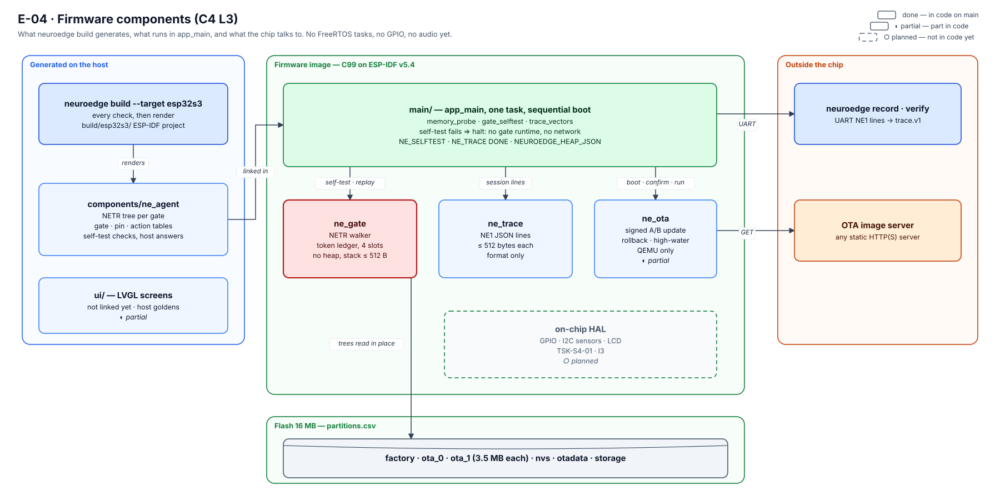
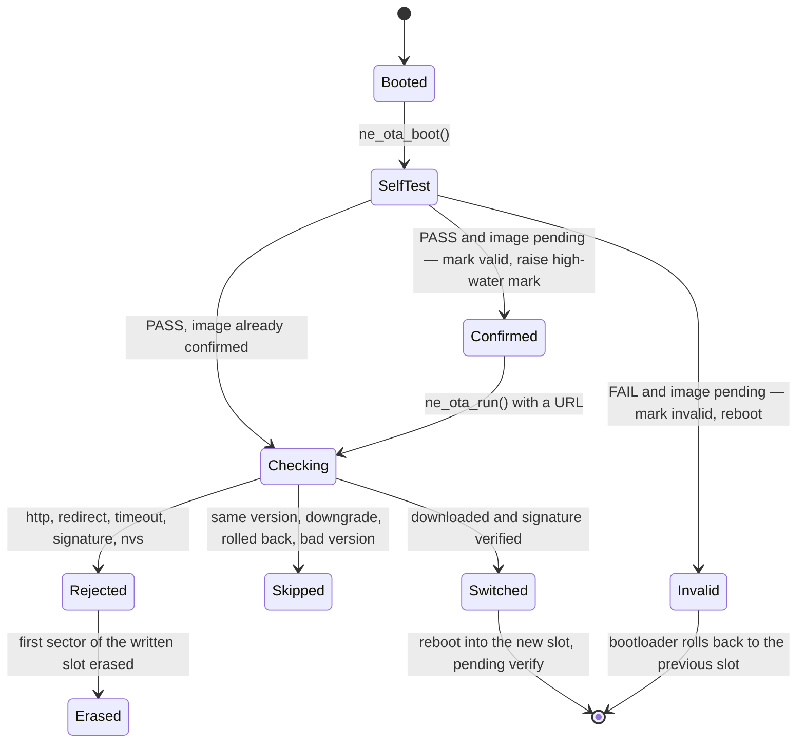

# 04 · ESP32-S3 firmware components (C4 L3)

> **Scope:** firmware in `targets/esp32s3/` — components, boot sequence, memory, OTA,
> user interface. **Sources:** C code in `targets/esp32s3/`, `python/neuroedge/engine/firmware.py`,
> `docs/spec/hal_mcu_review.md`, `docs/reports/memory_spike_report.md`.
> **Status:** `partial` — everything below runs on computers (C compiled on host) and on
> Espressif QEMU in CI; hardware boards have not arrived, and firmware **does not yet drive any pins**.

**Purpose of this chapter:** For embedded engineers and systems programmers who need to understand ESP32-S3 firmware architecture, boot flow, memory layout, and OTA mechanisms. It answers: what runs on the chip, how much memory it uses, and how it self-tests before enabling physical hardware. Read [`02`](02-container-c4l2.md) first to grasp container boundaries, and read [`05`](05-code-gate-hal-c4l4.md) next for walker and token details.

## 1. Component diagram


*Figure E-04 — Firmware components, build-time generated data, and boot sequence.*

**How to read the diagram:** Boxes represent firmware components and memory partitions on the ESP32-S3 chip; solid arrows show boot flow and direct function calls, dashed arrows show data generated at build time or emitted externally. Core takeaway: firmware executes sequentially in `app_main`, and self-tests must pass 100% before any physical action is permitted.

## 2. What firmware does **not** have today

Stated upfront so nobody reads diagrams as more than reality:

- **Virtually no FreeRTOS tasks.** Boot runs sequentially in `app_main`; only two small tasks from
  Q-79 exist: serial console (`ne_console`, 4 KB stack) and boot counter clearing task after the
  stability window (`ne_boot`). No queues or core pinning yet.
- **No audio.** No I2S, codec, AEC, VAD, Opus, or ESP-SR — only a `TODO(TSK-S1-10)`
  in `main/main.c`. On-chip voice (I5) was removed from the roadmap (Q-77), roadmap §6.
- **No GPIO control.** Agent pin tables hold pin **names**, not GPIO numbers; on-chip HAL
  is TSK-S4-01.
- **Wi-Fi initializes but never connects** (no `esp_wifi_connect`): networking is initialized
  solely to measure its memory cost (`TODOS.md` #50).
- **LVGL interface is unlinked from firmware** (§7). The `storage` partition is unmounted.

## 3. Component catalog

| Component | Path | Responsibility | Dependencies | Status |
|:---|:---|:---|:---|:---|
| `main` | `main/` | Boot sequence; memory probe (`memory_probe.c`); gate self-test (`gate_selftest.c`); canonical trace replay (`trace_vectors.c`) | all components below | `done` |
| `ne_gate` | `components/ne_gate/` | `NETR` v1 tree walker (`ne_walker.c`) and token ledger (`ne_token.c`); pure C99, non-allocating, no global variables, no recursion | — | `done` |
| `ne_trace` | `components/ne_trace/` | Formats trace line `NE1 {…}` ≤ 512 bytes; formatting only, application outputs to UART | `ne_gate` | `done` |
| `ne_agent` | `components/ne_agent/` (**generated**) | Agent-specific parts: `NETR` tree per gate, gate · pin · action tables, self-test suite with host engine ground truth | `ne_gate`, `ne_trace` | `done` |
| `ne_ota` | `components/ne_ota/` | Signed A/B updates, rollback, anti-rollback; policy is pure C99 (`ne_ota_policy.c`), ESP-IDF glue in `ne_ota.c` | ESP-IDF `app_update`, `esp_https_ota`, `nvs_flash`… | `partial` — on QEMU |
| `ne_boot` | `components/ne_boot/` | Boot guard (Q-79): counts each boot in NVS, clears after stability window, enters safe mode on `CONFIG_NEUROEDGE_BOOT_GUARD_MAX` attempt; policy is pure C99 (`ne_boot_policy.c`). Ported from zclaw | `nvs_flash` | `partial` — on QEMU |
| `ne_config` | `components/ne_config/` | Owner configuration and secrets (Wi-Fi, bot token, owner ID, LLM) in `ne_config` NVS partition; encrypted when built with `sdkconfig.secure`, never falls back to plaintext; validation and rendering rules in pure C99 (`ne_config_keys.c`) | `nvs_flash` | `partial` — on QEMU |
| `ne_console` | `components/ne_console/` | Serial console (`esp_console`): `status`, `config`, `bootguard`, `reboot`, `factory-reset`; secrets entered at hidden prompt; no command touches pins or calls tools. Framed after MimiClaw | `console`, `ne_boot`, `ne_config` | `partial` — on QEMU |
| `ne_hal` | `components/ne_hal/` (**unlinked**) | The one door from firmware to a `digital.out` pin: `ne_hal_on` writes only on a live token for that pin (`ne_token_authorize`), `ne_hal_off` (safe state) is never refused; the platform writer is a function pointer (DP-B-08, TSK-S4-01) | `ne_gate` | `partial` — host-tested (`test_c_hal.py`); the ESP-IDF writer comes with TSK-S4-01 |
| `ne_brain_bridge` | `components/ne_brain_bridge/` (**unlinked**) | Profile B (Q-83): NeuroClaw-ESP calls the gate by function call with the box's own contract — the tools `neuroedge mcp serve` lists, JSON arguments checked against their schema, facts only from on-chip sources, `tool-result.v1` results, a table of 4 questions answered by the owner's Telegram ID or the board button (`deployment_profiles.md` DP-B-03 → DP-B-07, §4.3); pure C99, no allocation | `ne_gate`, `ne_agent` | `partial` — host core, checked against the box (`test_c_bridge.py`); linked into the image with TSK-I2f-14 |
| `ne_ui` | `ui/` (**unlinked**) | Nine LVGL screens, Vietnamese and English; linked into the Profile B image for the all-in-one chip, with the approval card drawn from the bridge's pending table (Q-93, DP-B-18, TSK-I2f-18) | LVGL v9.6 | `partial` — built on host only |

`ne_gate`, `ne_trace`, `ne_agent`, `ne_brain_bridge`, `ne_hal` compile with `-std=c99 -Wall -Wextra -Wconversion -Werror`.

### Planned components

| Planned path | Task | Component (what it is) and purpose (why needed) | Target architecture |
|:---|:---|:---|:---|
| `targets/esp32s3/hal/` | TSK-S4-01 | Implementation of 5 HAL primitives on ESP-IDF; needed to control physical hardware instead of simulation | [`15`](15-target-architecture.md) §2.1 |
| `targets/esp32s3/drivers/` | TSK-S4-03 | `digital.out` and `sensor.read` drivers on real pins; needed to pulse actuators and read sensors on Box-3 board | [`15`](15-target-architecture.md) §2.1 |
| *On-chip audio, voice FSM, actuator abort, provider client* (TSK-S5-01 → S5-07, including the local fallback) | | Removed from the roadmap (Q-77), roadmap §6 | |
| `targets/esp32s3/security/` | TSK-S6-05 | Secure Boot, flash encryption, physical microphone disconnect button; needed to protect firmware integrity and privacy | [`15`](15-target-architecture.md) §2.1 |

Currently firmware has only a sequential `app_main`; FreeRTOS task models (task counts, priorities, queues, and core pinning) for a voice path remain undesigned, since on-chip voice left the roadmap (→ [`15`](15-target-architecture.md) §2.2). The RP2350 robot node (TSK-W3-07) was removed too (Q-77, roadmap §6).

### 3.1 `ne_gate` — walker and token ledger

```c
/* ne_walker.h — reads tree in place in caller's memory, no copying */
ne_status ne_tree_load(ne_tree *tree, const uint8_t *buf, uint32_t len);
ne_status ne_evaluate(const ne_tree *tree, const ne_fact *facts, const ne_arg_value *args,
                      int confirmed, ne_result *out);
ne_status ne_decide(const ne_tree *tree, const ne_fact *facts, const ne_arg_value *args,
                    int confirmed, ne_degraded degraded, ne_result *out);

/* ne_token.h — device version of actions/token.py; ledger allocated by caller */
ne_token_status ne_ledger_init(ne_ledger *ledger, uint32_t boot_id);
ne_token_status ne_token_issue(ne_ledger *ledger, const ne_tree *tree, uint32_t pin_mask,
                               uint32_t now_ms, ne_random_fn fill_random, ne_token *out);
ne_token_reason ne_token_authorize(ne_ledger *ledger, const ne_token *token, uint32_t pin,
                                   uint32_t now_ms);
void ne_token_close(ne_ledger *ledger, const ne_token *token);
```

- **Facts entering the walker are domain indices**, not strings: the chip never compares
  strings. Each `ne_fact` carries `present`, `in_domain`, `index`, and confidence if available.
- **Token ledger has four slots** (`NE_TOKEN_SLOTS`), 16-byte nonces, TTL = `p95_latency_ms × 3`, and token age
  computed as `(uint32_t)(now − issued)`, ensuring safety across millisecond counter rollovers. `boot_id` serves as
  the host's `process_instance_id`: tokens from previous boots are expired.
- **Full ledger rejects** (`NE_TOKEN_ERR_FULL`), never evicting active tokens.
- All rejection reasons map to identical host error codes: not a token, unknown token, ungranted pin
  ⇒ `NE1001`; reused, expired ⇒ `NE1002`.

Byte layout of `NETR` and walking algorithms: [`05`](05-code-gate-hal-c4l4.md).

### 3.2 `ne_agent` — generated component for each agent

`neuroedge build --target esp32s3` (`engine/firmware.py::render_component`) generates:

| File | Content |
|:---|:---|
| `gates/<key>.netree.h` | `static const uint8_t ne_tree_<key>[]` — `NETR` v1 gate bytes, resident in flash |
| `ne_agent.c` | Gate table (labels, digests, `on_block` text; `NETR` v2 also carries them, `ne_trace` still reads from this table), pin table (names), action table (gates, pin masks), and **self-test cases** |
| `include/ne_agent.h` | Data types; `NE_AGENT_VERSION`, `NE_AGENT_BOARD`, `NE_AGENT_LANGUAGE`; single symbol `ne_agent_linked` |

Self-test cases generated for each gate include: base case; for each criterion all values in domain,
missing facts, out-of-domain values, and confidence variations if thresholds exist; network loss scenario;
and the "confirmed" version for `ask` gates. **The expected outcome of every test case is computed by the Python engine
at build time** — this is what makes self-tests prove host ↔ chip equivalence.

## 4. Boot sequence

All marker lines (`NE_SELFTEST`, `NE_TRACE DONE`, `NEUROEDGE_*_JSON`, `NE_OTA`, `NE_BOOT`, `NE_CONFIG`,
`NE_STACK`, `NE_CONSOLE`) are printed at column 0,
without log prefixes, enabling CI scripts to anchor via `^`.

```mermaid
sequenceDiagram
    autonumber
    participant M as app_main
    participant P as memory_probe
    participant B as ne_boot
    participant O as ne_ota
    participant C as ne_config / ne_console
    participant S as gate_selftest
    participant V as trace_vectors
    participant N as network
    M->>P: checkpoint boot
    M->>M: init NVS (erase and retry on NO_FREE_PAGES)
    M->>P: checkpoint nvs_ready
    M->>B: ne_boot_guard_begin() — count this boot, NE_BOOT count=n max=m mode=…
    M->>O: ne_ota_boot() — running slot, rollback record, high-water mark
    M->>C: ne_config_init() — NE_CONFIG STORAGE encrypted | plaintext risk=readable_flash
    opt safe mode (count reached the limit)
        M->>C: ne_console_start(safe) — console only; no self-test, network or update; never marks valid
    end
    M->>S: neuroedge_gate_selftest(ne_agent_linked) as one NE1 session
    alt self-test fails
        S-->>M: NE_SELFTEST FAIL what name
        M->>O: ne_ota_boot_rejected() — a pending OTA image is marked invalid, reboot
        M->>M: halt: no replay, no network, no update check
    else self-test passes
        S-->>M: NE_SELFTEST PASS walker=n token=n
        M->>O: ne_ota_boot_confirmed() — a pending image is marked valid
        M->>V: replay the three canonical traces (CONFIG_NEUROEDGE_REPLAY_VECTORS)
        M->>P: NEUROEDGE_HEAP_JSON at gate_runtime_ready
        M->>M: NE_STACK task=main free_min=n, then NE_TRACE DONE sessions=n
        M->>C: ne_console_start(normal)
        M->>N: Wi-Fi STA init, never connects (skipped with CONFIG_NEUROEDGE_SKIP_NETWORK)
        M->>O: ne_ota_run() — only with CONFIG_NEUROEDGE_OTA and a URL
        M->>B: ne_boot_guard_stable_after(STABLE_MS) — NE_BOOT STABLE clears the count
        M->>P: NEUROEDGE_MEMORY_JSON — Q-3 verdict INCONCLUSIVE until audio exists
    end
```

**How to read the diagram:** Vertical lifelines represent `app_main` and internal firmware functional modules; solid arrows are synchronous function calls, dashed arrows are return values; `alt` blocks branch on self-test results. Core takeaway: if self-test fails, any pending OTA image is marked invalid and the device reboots to let the bootloader revert to the prior slot; without a pending image, firmware halts — no replay, no network, no actions.

Self-test consists of four phases: (1) each tree loads and digests match host-compiled versions; (2) walker
evaluates every test case identically to the host engine, field by field; (3) tokens for each action open only
their assigned pins exactly once, reject unassigned pins, and reject tampered tokens; (4) full ledgers reject, and closing a token
frees the slot for reuse. A failure anywhere halts the firmware: no gate runtime, no actions, no networking.

| Kconfig option | Default | Effect |
|:---|:---:|:---|
| `CONFIG_NEUROEDGE_QEMU` | n | `device_id = "qemu"` instead of `esp32s3-<MAC>` |
| `CONFIG_NEUROEDGE_SKIP_NETWORK` | n | Skips Wi-Fi initialization (`sdkconfig.qemu` enables) |
| `CONFIG_NEUROEDGE_REPLAY_VECTORS` | y | Replays three canonical traces after self-test |
| `CONFIG_NEUROEDGE_OTA` | n | Enables update path; Kconfig and `#error` reject if signature checks or rollback missing |
| `CONFIG_NEUROEDGE_OTA_ETH` | n | QEMU `open_eth` virtual Ethernet network for OTA |
| `CONFIG_NEUROEDGE_BOOT_GUARD_MAX` | 4 | Boot count threshold entering safe mode (Q-79, modeled after zclaw `MAX_BOOT_FAILURES`) |
| `CONFIG_NEUROEDGE_BOOT_GUARD_STABLE_MS` | 30000 | Stability duration after boot required to clear counter; `sdkconfig.qemu_ota` sets 0 |
| `CONFIG_NEUROEDGE_CONSOLE` | y | Serial console, active in both normal and safe mode |

## 5. Memory and flash

**Partition table** (`partitions.csv`, 16 MB flash): `nvs` 16 KiB · `otadata` 8 KiB · `phy_init` 4 KiB
· `factory`, `ota_0`, `ota_1` 3.5 MiB each slot · `storage` (spiffs) 5 MiB, unused · `ne_config` 24 KiB
(owner configuration and secrets, Q-79) · `nvs_keys` 4 KiB (NVS encryption keys, `encrypted` flag). The last two
partitions sit after `storage`, shifting no prior offsets. The 3.5 MiB slot defines the Q-3 firmware size ceiling.

**Configuration layers** layered via `SDKCONFIG_DEFAULTS`:

| Layer | Configuration |
|:---|:---|
| `sdkconfig.defaults` | 16 MB flash, custom partition table, octal 80 MHz PSRAM, FreeRTOS 1000 Hz, performance optimization |
| `sdkconfig.qemu` | Strips networking, QEMU flags, ignores missing PSRAM |
| `sdkconfig.ota` | OTA, bootloader rollback, RSA-3072 image signing and signature verification on update (pre-Secure Boot), main task stack 8 KB |
| `sdkconfig.qemu_ota` | Test server URL, `open_eth`, disables hardware AES/SHA/MPI acceleration (QEMU GDMA model incomplete), clears boot counter immediately after boot |
| `sdkconfig.secure` | Flash encryption (development mode) and encrypted NVS for `ne_config` — **blows eFuses on first boot, irreversible**; CI builds only |

**Static memory discipline**, tested on every PR (`test_c_walker.py`, `test_c_token.py`,
`test_c_trace.py`): object files for walker, token ledger, and trace formatter contain **no**
`.data`/`.bss` symbols; each function uses stack ≤ 512 bytes. State memory (token ledger, line buffers) is allocated
by the application, never resident in components.

**Stack guard** (Q-79, inspired by zclaw): firmware builds with `-fstack-usage`; all functions in `main` and
`ne_*` components must have static frames ≤ 1024 bytes, with no VLAs or `alloca`
(`scripts/check_stack_usage.py`). At runtime on QEMU, the main task must maintain ≥ 512 unused bytes
(`NE_STACK`), and console tasks do likewise after the deepest command (`config set`).

**Q-3 Budget** (SRAM ≥ 120 KB and PSRAM ≥ 2 MB for application, firmware ≤ 3.5 MB) is checked incrementally
in CI: image size, remaining static RAM of board configs, boot-time heap on QEMU. Measurements
and conditions are in [`memory_spike_report.md`](../../reports/memory_spike_report.md) §4.1 — this represents a
**floor**, not a final Q-3 verdict, pending boards and audio hardware.

## 6. `ne_ota` — signed updates



**How to read the diagram:** Rounded rectangles represent states in the OTA image update lifecycle; solid arrows denote state transitions with triggering conditions. Core takeaway: a newly flashed image is confirmed (`Confirmed`) only after passing boot-time self-tests; signature mismatch, download failure, or timeout ⇒ `Rejected`: erases first sector of written slot while device continues running current slot; only self-test failures on pending images trigger bootloader rollback to the prior slot.

- **The decision whether to install** is a pure C function, `ne_ota_should_install(running, remote,
  rolled_back, high_water)`, tested on host under ASan/UBSan and used verbatim in firmware.
  Precedence: missing version ⇒ skip; version not `MAJOR.MINOR.PATCH` ⇒ skip; identical version ⇒ skip; identical to
  recently rolled back version ⇒ skip; not higher than high-water mark ⇒ skip (downgrade); otherwise ⇒ install.
- **NVS** (`ne_ota` namespace): `url` (empty ⇒ disables OTA), `best` (high-water mark — highest version
  passing self-test), `rollback` (recently rolled back version). Unreadable NVS ⇒ reject, do not guess.
- **All rejections after bytes have been written** (invalid signature, partial download, timeout, transfer error) erase the first sector of
  the written slot, ensuring no subsequent boot falls into a rejected image.
- **Limitations:** pre-Secure Boot and no eFuse anti-rollback (TSK-S6-05); OTA does not update the
  bootloader; frozen images without auto-restart revert only on power cycle. Procedures and
  definitions for each `NE_OTA` line: [`docs/user/nap-firmware.md`](../../user/nap-firmware.md) §6.

## 7. `ne_ui` — device UI (unlinked)

Nine screens (`ne_ui_show_boot`, `idle`, `voice`, `confirm`, `verdict`, `degraded`, `sensor`, `ota`,
`fatal`) on a 320×240 RGB565 panel. Code is C99 on LVGL v9.6 APIs without ESP-IDF headers, allowing identical code
to build on computers for **golden image** comparison on each PR (33 cases × 2 languages, test harness under
ASan/UBSan). Deterministic rendering: no clocks, no randomness, no animations. Agent text is data:
strictly validated UTF-8, truncated with ellipsis `…`. Languages: `ne_ui_init` returns `false` and renders nothing if the language
lacks a font table. Specification: [`docs/spec/ui.md`](../../spec/ui.md). Connecting the interface into firmware awaits display
drivers (TSK-S4-01); projects generated for agents today do not copy `ui/`.

## 8. Build and verification

| Verification item | Mechanism | Where |
|:---|:---|:---|
| Walker, token ledger, trace formatter match host; static memory; tree file fuzzing | Host-compiled C (gcc/clang, ASan/UBSan) | `pytest` job `tests` |
| OTA policy, version rule C = Python | Host C | `pytest` job `tests` |
| Firmware boot, self-test, traces, heap | ESP-IDF v5.4 + QEMU (`scripts/qemu_boot.sh`) | job `firmware-qemu` |
| Image size, board profile static RAM | `scripts/check_firmware_size.py` | job `firmware-size` |
| Firmware generated for new agent boots, OTA image signed with matching version | `neuroedge build` + `idf.py` + QEMU + `scripts/build_ota_layer.sh` | job `agent-firmware` |
| Seven-phase OTA a–g | `scripts/qemu_ota.sh` | job `ota-rollback` |
| Boot guard, configuration policy (host C) | `test_c_boot_and_config.py` | `pytest` job `tests` |
| Stack frames ≤ 1024 B; main task retains ≥ 512 B on QEMU | `scripts/check_stack_usage.py` | job `firmware-qemu` |
| Three failed boots → safe mode, serial console secrets, factory reset | `scripts/qemu_console.py` | job `firmware-qemu` |
| Flash encryption layer builds | `idf.py` with `sdkconfig.secure` | job `firmware-size` |
| UI golden images | `scripts/run_ui_golden.sh` | job `ui-golden` |
| UART traces to `trace.v1`, on-chip `verify` | `neuroedge record --port`, `verify --targets esp32s3` | job `uart-trace` |

Full list and trigger conditions for each job: `CHANGELOG.md` §2.5.
