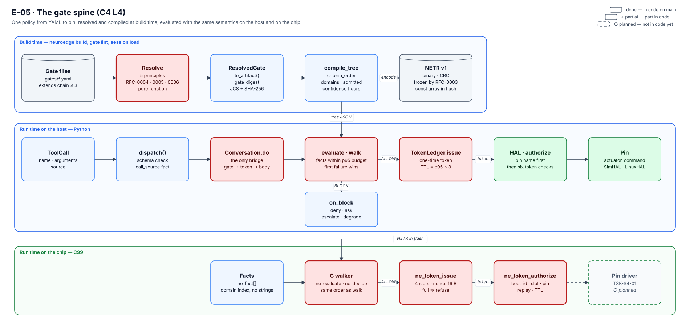
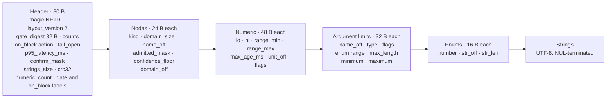
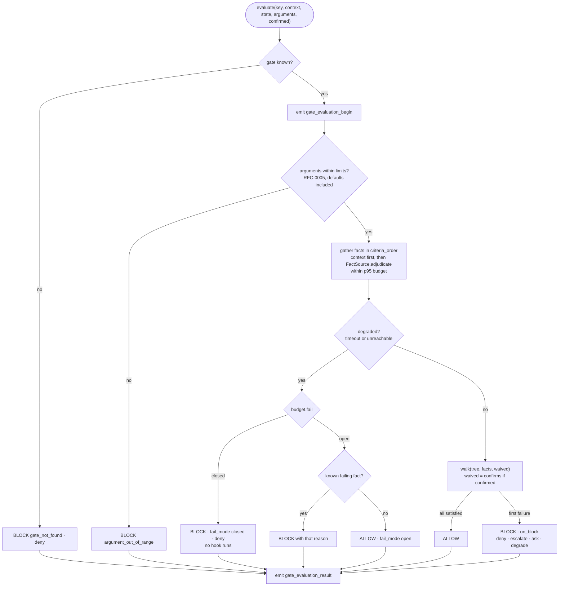
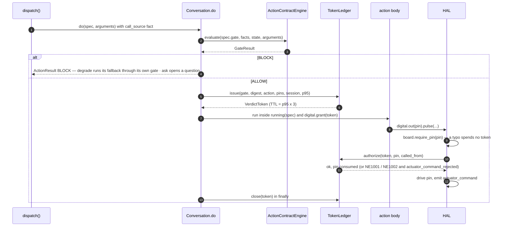
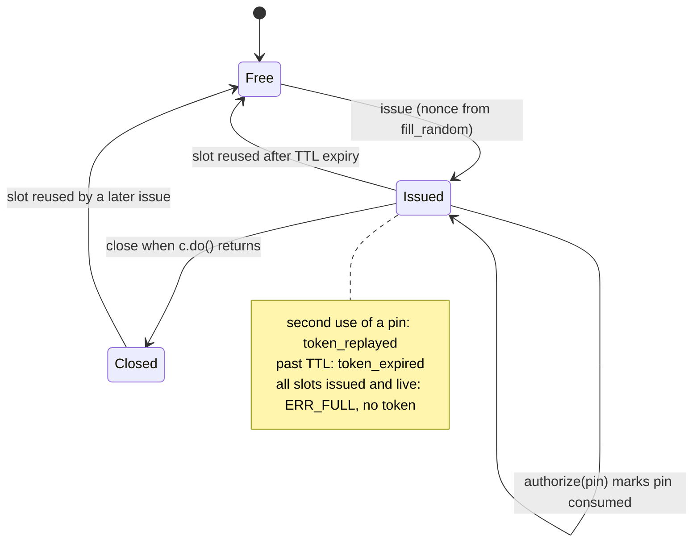
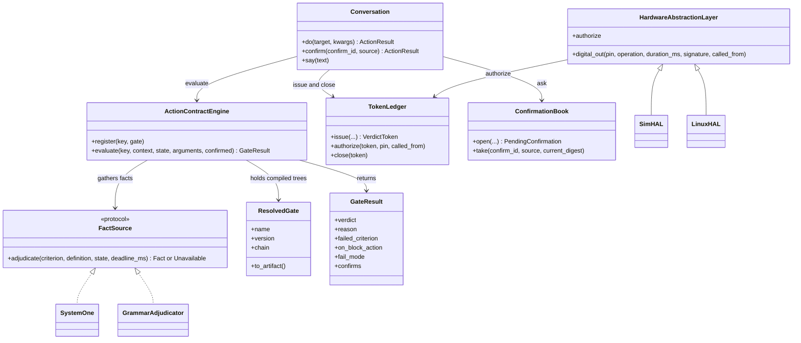

# 05 · Code level: gate → token → HAL (C4 L4)

> **Scope:** function-level safety backbone — how a gate travels from a YAML file to a pin command, on host
> (Python) and on chip (C). **Sources:** `python/neuroedge/engine/`, `python/neuroedge/actions/`,
> `python/neuroedge/hal/`, `targets/esp32s3/components/ne_gate/`; normative: `docs/spec/core_contracts.md` Appendix B,
> RFC-0001, 0003, 0004, 0005, 0006.

**Purpose of this chapter:** For software and safety engineers who need function-level details of the path from YAML gate files to hardware pin commands (C4 L4). It answers: how gates are resolved, compiled into binary `NETR` trees, evaluated, and granted one-time tokens across both Python and C. Read [`00`](00-overview.md) and [`03`](03-component-host-c4l3.md) first, and read [`06`](06-runtime-flows.md) afterward for runtime flows.

## 1. Backbone pipeline

*Figure E-05 — From gate file to pins: build-time resolution and compilation, runtime evaluation and tokens, with identical semantics on host and chip.*

**How to read the diagram:** Boxes represent stages transforming YAML policies into hardware commands; solid arrows show sequential processing flow through each step, dashed arrows link auxiliary data. Core takeaway: there is only one path from intent to hardware pins (`dispatch()` → gate → token → HAL), with no shortcuts bypassing the gate.

| Phase | When | Host (Python) | Chip (C) |
|:---|:---|:---|:---|
| Resolution | build, lint, session load | `gate_resolver.resolve_gate_file` → `ResolvedGate` | — (done on host) |
| Hashing | build | `canonical.gate_digest` (JCS + SHA-256) | digest embedded in `NETR` header |
| Compilation | build | `decision_tree.compile_tree` → JSON tree; `binary_tree.encode` → `NETR` v1 | `ne_tree_load` validates and reads in place |
| Fact gathering | each evaluation | `ActionContractEngine._gather` via `FactSource` | caller supplies `ne_fact[]` (domain indices) |
| Evaluation | each evaluation | `decision_tree.walk` | `ne_evaluate` / `ne_decide` |
| Token issuance | after `ALLOW` | `TokenLedger.issue` | `ne_token_issue` |
| Pin authorization | each pin command | `TokenLedger.authorize` via HAL | `ne_token_authorize` |
| Token closure | when `c.do()` returns | `TokenLedger.close` | `ne_token_close` |

## 2. Resolution: from multiple files to one policy

`resolve_gate_file` reads a gate, traverses `extends` via `GateRegistry` (`neuroedge://gates/<path>@<ver>` →
`<gates>/<path>@<ver>.yaml`), and merges the chain from root to leaf. Resolution is a **pure function**: no clocks,
no network, no randomness (Invariant 4).

| Rule | Content | Violation ⇒ |
|:---|:---|:---|
| Principle 1 | `evaluate` criteria are inherited; redefinitions are rejected | `NE2003` |
| Principle 2 | `allow_when` can only **tighten**: admitted value set must be subset of parent, confidence threshold ≥ parent | `NE2003` |
| Principle 3 | Adding new criteria is permitted | — |
| Principle 4 | `fail: open` is never inherited | — (reverts to `closed`) |
| Principle 5 | Maximum 3 documents in chain; no cycles | `NE2003` |
| RFC-0004 R1–R3 | Child `p95` ≤ parent; `closed` chains cannot reopen; child cannot add `degrade` or change `fallback_action` | `NE2003` |
| RFC-0005 | Argument limits can only narrow; omitted ⇒ inherited | `NE2003` |
| RFC-0006 | Child `confirms` must be subset of parent; each entry must be a criterion in `allow_when` | `NE2003` |
| String-form `allow_when` (CEL) | Rejected everywhere today (TSK-S2-06 deferred, `TODOS.md` #42) | `NE2002` |

Operators for `allow_when` depend on criterion kind (`constraints.py`): `bool` — bare value or
`{confidence_gte: x}`; `level` — bare value, `eq`, `lte`, `gte`; `choice` — bare value, `eq`, `in`,
`not_in`. Unrecognized operators ⇒ `NE2002`.

The result is a `ResolvedGate`; `to_artifact()` produces what is canonicalized and hashed: `schema`, `name`,
`version`, `resolved_from` (chain from root), `evaluate`, `allow_when`, `on_block`, `budget` (always with
explicit `fail`), and `arguments` if present. This digest (`gate_digest`) appears in traces, in
`NETR` headers, and inside tokens.

> Note the distinction between two digests: `digests.lock` hashes **the YAML document as written** (locking canonical
> gate files), whereas `gate_digest` hashes **the resolved gate** (identifying the active running policy).

## 3. Compilation: decision tree and `NETR` v1

`compile_tree` generates an internal JSON tree (`neuroedge.decision_tree/v1`, unfrozen): `criteria_order`
in root-to-leaf order, where each node carries `kind`, `domain`, `admitted` set, and `confidence_floor`. The domain of `bool`
is `false, true`; of `level` is declared levels; of `choice` is **sorted** choices.

`binary_tree.encode` writes this tree into `NETR` v1 — a binary layout frozen by RFC-0003: little-endian,
no pointers, offsets only, fixed-size records.

**How to read the diagram:** Boxes represent contiguous sections within the `NETR` v2 binary file (from 80-byte header to UTF-8 strings); solid arrows show fixed layout ordering in memory. Core takeaway: the binary layout contains no pointers but uses fixed offsets, allowing the C walker to read directly in place from flash without dynamic allocation (stack ≤ 512 bytes).

File size equals exactly `80 + 24·n + 48·m + 32·a + 16·e + strings` (`m` `numeric` criteria); limits: maximum 32 nodes, domain of 32
values, 32 numeric criteria, 16 arguments, 64 enums, 16,384 string bytes (approx. 21 KB). Gates exceeding limits are rejected **at build time**
(`NE2002`), never reaching chips. Changing layout requires an RFC and increments `layout_version`; v2 walker rejects v1
files. Full byte table: [`docs/rfc/0009-tieu-chi-so-numeric.md`](../../rfc/0009-tieu-chi-so-numeric.md) §3d (v1: RFC-0003).

`ne_tree_load` rejects corrupt files before traversal: invalid magic, version mismatch, CRC error, out-of-bounds fields, structural
errors (offsets outside file, `bool` domain not 2, NaN thresholds, `confirm_mask` when not `ask`…). Failure to
load tree ⇒ no `ALLOW`.

## 4. Evaluation

### 4.1 Host: `ActionContractEngine.evaluate`

**How to read the diagram:** Diamonds represent branch evaluation points, rectangles represent processing steps and actions; solid arrows trace paths by test outcome (yes/no, closed/open, all satisfied/first failure). Core takeaway: `walk` is a pure function; missing or out-of-domain facts ⇒ `BLOCK`; timeout or source loss ⇒ applies `budget.fail` — `closed` (default) blocks, `open` yields `ALLOW` only when no facts are known to have failed.

- **Time budget** is `budget.p95_latency_ms`, measured from start of fact gathering; each query
  to a `FactSource` is bounded by remaining budget. Timeout ⇒ `budget_exceeded`; exception from source
  ⇒ `gate_unreachable`. These two reasons are **degradations**: they invoke `budget.fail` and bypass `on_block`.
- **Tree traversal** (`walk`) is a pure function: `ALLOW` if and only if all nodes are satisfied; reason is first failure
  in `criteria_order`. Missing fact or value out of domain ⇒ `criterion_unavailable`; confidence
  not a valid probability (NaN, `True`, > 1) ⇒ `criterion_unavailable`; threshold present without confidence
  ⇒ `confidence_unavailable`; value not admitted or below threshold ⇒ `condition_not_met`.
- **`fail: open`** only excuses what *could not be decided*: a fact known to have failed still blocks
  (`known_failure`).
- **`ask` questions** are opened only when a "có" (yes) reply is sufficient to change `BLOCK` to `ALLOW` ("answerable"):
  engine re-evaluates with `confirms` criteria waived.

### 4.2 Chip: `ne_evaluate` and `ne_decide`

Identical ordering: argument limits first, then nodes in order, first failure wins; `confirm_mask`
waives confirmed criteria. `ne_decide` adds degradation paths: with `NE_DEGRADED_UNREACHABLE` or
`NE_DEGRADED_BUDGET`, argument limit violations still hold; `fail_open` forgives only when no facts are
known to be failing; otherwise blocks with `fail_mode` closed. Reason codes are shared with host
(`engine/firmware.py::REASONS`): 0 none, 1 `condition_not_met`, 2 `criterion_unavailable`,
3 `confidence_unavailable`, 4 `argument_out_of_range`, 5 `gate_unreachable`, 6 `budget_exceeded`.

## 5. From verdict to pins

**How to read the diagram:** Vertical lifelines represent layers from dispatch (`dispatch()`), conversation (`Conversation`), engine (`Engine`), token ledger (`TokenLedger`), action function body to HAL; solid arrows are function calls, dashed arrows are return values; `alt` block branches between `BLOCK` and `ALLOW`. Core takeaway: HAL must receive a valid `VerdictToken` from `TokenLedger` before emitting actuator control pulses, and each token can be consumed exactly once.

**Check order of `authorize`** (identical on host and chip):

| # | Check | Rejection with |
|:---:|:---|:---|
| 1 | Is a token (`VerdictToken`; on chip: non-`NULL` pointer) | `not_a_token` · `NE1001` |
| 2 | Same process (`process_instance_id`); on chip: same `boot_id` | `token_expired` · `NE1002` |
| 3 | Issued by this exact ledger (on chip: matches a slot by nonce and digest, constant-time compare) | `unknown_token` · `NE1001` |
| 4 | Pin is in token's granted pin set | `pin_not_granted` · `NE1001` |
| 5 | Token not closed, pin unused | `token_replayed` · `NE1002` |
| 6 | TTL not expired | `token_expired` · `NE1002` |

Every rejection emits `actuator_command_rejected {pin, reason, code}` **before** raising an error, and pins
remain unchanged. Nonces never enter traces.

**Implemented (TSK-N2-01):** physical safety envelope hooks (physical envelope hook — total on-time and frequency limits per pin, declared in `board.v1` — RFC-0007) reside in `HAL.digital_out` between pin validation (`require_pin`) and `authorize` (`hal/envelope.py`; tokens are unconsumed upon rejection) → [`15`](15-target-architecture.md) §4.2. Time-bounded lease tokens (`feat/motion` branch, TSK-I2a-05): (lease token — short-lived motion control authority, automatically extended with new gated commands, self-expiring to safe stop upon lost communication) for `motion.*` (Q-37) → [`15`](15-target-architecture.md) §4.3.

**Today**, all timing guarantees at this layer are directed toward `off`: envelopes shut off automatically at
`min(command duration, max_continuous_ms)`, `off` commands bypass envelopes and `authorize` (RFC-0007 §3d,
Q-62 gate exemption), and levels L0–L3 for remote actuators represent promises regarding who brings actuators to `off` (RFC-0018 §3d).
Specifically, `motion.*` has `safe_state` `stop`/`hold` (RFC-0011).

*Will change under Q-72 (pending conditional safety RFC, `planned · Q-72`, I2d):* symmetric **`safe_state`
model**. All actuators have `safe_state` declared in `board.v1`, defaulting to `off`. Envelopes, token ledgers, and HAL read
all guarantees as "return to `safe_state`":

| Guarantee | Today | Under Q-72 (planned) |
|:---|:---|:---|
| Auto-off at `min(duration, max_continuous_ms)` | To `off` | To `safe_state` |
| Commands bypassing envelope, requiring no token (Q-62) | Commands to `off`, `duty = 0`, `safe_state` of `motion.*`, autonomous HAL commands | All commands **toward** `safe_state` |
| Commands constrained by gate, envelope, and token | Turn-on commands | All commands **away from** `safe_state` |
| Lease, levels L0–L3 (RFC-0018) | Who returns actuator to `off` | Who returns actuator to `safe_state` |

A `safe_state` differing from `off` can only be declared in `board.v1`, not in contracts, gates, or Blueprints, and only
when hardware guarantees it: `safe_state: on` is implemented via normally-on wiring (normally-closed relays) declared as
hardware interlocks, not by software actively driving it on. No external bypasses around gates are added. Existing profiles
(`off`; `motion.*` `stop`/`hold`) retain their behavior. `TODOS.md` #58 must be fixed first (older `board.v1`
parsers silently dropped unknown keys, including safety keys). Decision: [Q-72](../../../roadmap/neuroedge-prd.md#15-decision-log).

**How to read the diagram:** Nodes represent lifecycle states of a token slot in `TokenLedger` (`Free`, `Issued`, `Closed`); solid arrows denote state transition events. Core takeaway: each pin in a token can be used only once; reuse attempts yield `token_replayed`, exceeding TTL yields `token_expired`, and when all slots are full new issuances are rejected rather than evicting existing tokens.

## 6. Primary classes (host)

**How to read the diagram:** Boxes represent primary classes and protocols on the Python host; hollow solid arrows denote inheritance (`SimHAL`, `LinuxHAL`); hollow dashed arrows denote protocol implementations (`SystemOne`, `GrammarAdjudicator` implementing `FactSource`); regular arrows denote reference or invocation. Core takeaway: `Conversation` is the sole class connecting the engine to the token ledger; HAL only knows `TokenLedger` via `authorize`, with no knowledge of the engine or `FactSource`.

## 7. Python ↔ C reconciliation

Two implementations of the same specification (Q-8). Equivalence is proven through tests, not promises.

| Concept | Python | C | Proof |
|:---|:---|:---|:---|
| Tree | `compile_tree` + `encode` | `ne_tree_load` | `test_c_walker.py` compares C walker to engine across all gates and `fixtures/decision_trees/` truth tables, fuzzes tree files |
| Evaluation | `walk`, `known_failure` | `ne_evaluate`, `ne_decide` | as above; boot self-test compares against build-time engine ground truth |
| Token | `TokenLedger` | `ne_token_*` | `test_c_token.py`: identical rejection reasons across identical operation sequences, plus mutation tests |
| Trace | `EventLog.emit` | `ne_trace_*` | `test_c_trace.py`; `verify --targets esp32s3` compares against golden |
| OTA Version | `firmware.py::_RELEASE` | `ne_ota_parse_version` | `test_ota_version_rule.py` runs identical test case list against both |
