# 06 · Luồng lúc chạy (Dynamic views)

> **Phạm vi:** các luồng quan trọng, mỗi luồng một sơ đồ trình tự hoặc trạng thái, gọi đúng tên hàm
> trong mã. **Nguồn:** `sim/session.py`, `actions/`, `engine/gate.py`, `mcp_server.py`, `mcp_host.py`,
> `models/system.py`, `perception/`, `testing/`, `docs/spec/voice_fsm.md`, `docs/spec/tool_calling.md`.

Mọi luồng dưới đây, dù bắt đầu từ đâu, đều gặp nhau ở cùng một đoạn: `dispatch()` → `Conversation.do`
→ `ActionContractEngine.evaluate` → `TokenLedger` → HAL ([`05`](05-code-gate-hal-c4l4.md) §5). Sơ đồ
chỉ vẽ đoạn đó một lần trong §1 và gọi tên nó ở các luồng khác.

## 1. Một lượt gõ lệnh

`neuroedge run -c "mở cửa phòng 101"` trên `sim`.

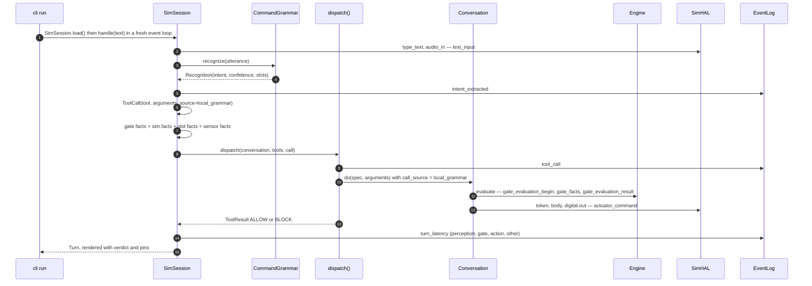

Câu không khớp ngữ pháp: có `[system_two]` thì đi luồng §4; không thì `command_not_recognized` và
thiết bị nói những lệnh cục bộ còn dùng được (`offline_help`).

## 2. Hỏi lại và xác nhận (`on_block: ask`, RFC-0006)

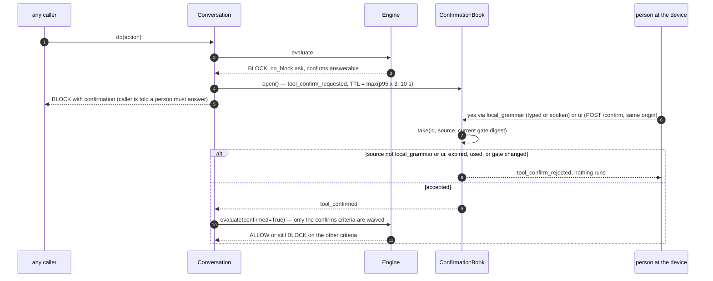

- System 2 và client MCP **không có công cụ xác nhận** nào; câu hỏi do chính lời gọi của System 2 tạo
  ra thì System 2 không trả lời được (Q-26).
- Câu "có" nói ra chỉ trả lời câu hỏi của **chính lượt đó** (Q-46).

## 3. Lời gọi MCP

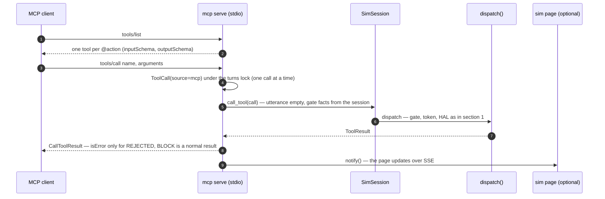

Lời gọi MCP không có lời người nói, nên `[system_one]` không gửi gì lên model: tiêu chí đó rơi về ngữ
pháp hoặc chặn. Một gate có thể từ chối riêng nguồn `mcp` qua tiêu chí `call_source`.

## 4. Lượt System 2 (LLM), kèm MCP server bên ngoài

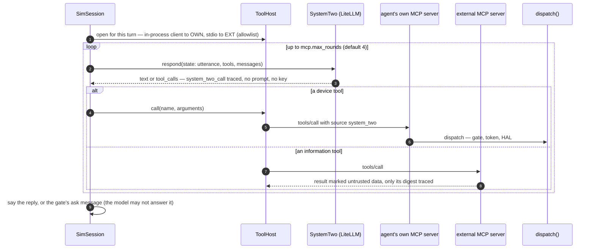

Nhà cung cấp không trả lời được ⇒ `system_two_unavailable`, thiết bị nói câu offline. Nội dung từ MCP
server bên ngoài có chèn lệnh (prompt injection) thì lời gọi nó dẫn tới vẫn phải qua gate
(`test_mcp_host.py::test_prompt_injection_in_the_news_still_meets_the_gate`).

## 5. Model của System 1 và khi mất mạng

`SystemOne` là `FactSource` của engine. Với `[system_one]`, nó hỏi model chính (Jev qua System One API)
cho các tiêu chí được giao, trong phần ngân sách còn lại trừ 50 ms dự phòng; model không dùng được thì
ngữ pháp lệnh quyết.

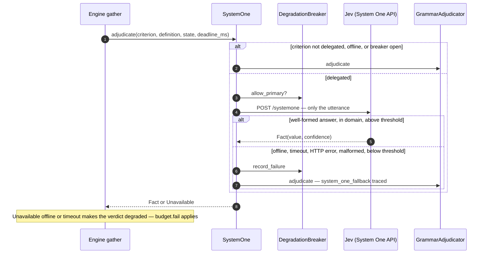

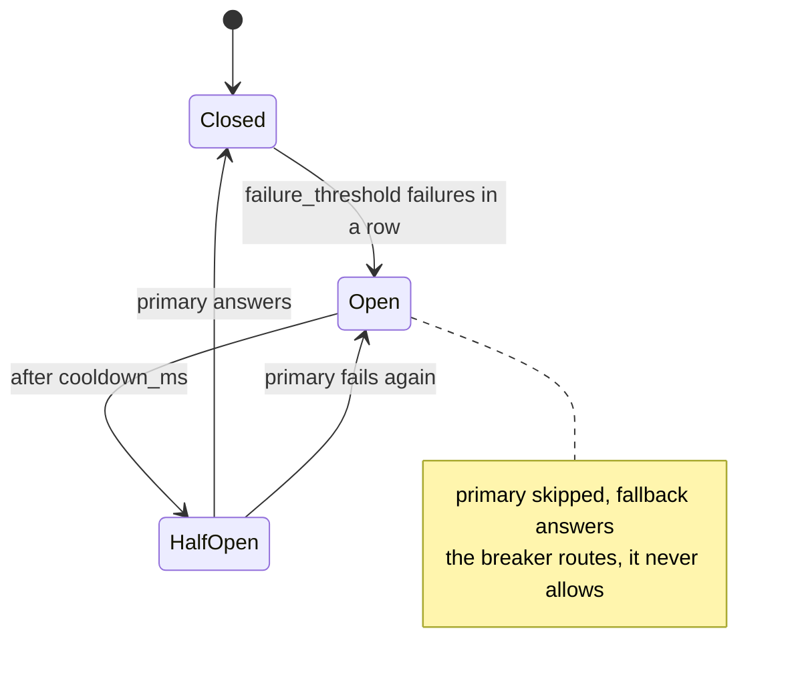

Không có fallback nào chạy được cho một tiêu chí do model quyết ⇒ `BLOCK` với `gate_unreachable`
(Q-14, tiêu chí ra I4 số 3).

## 6. Thoại

### 6.1 Máy trạng thái hội thoại

Quy phạm ở `docs/spec/voice_fsm.md` §4 (T01–T14). Mọi lần đổi trạng thái ghi `voice_state_changed`.
Máy trạng thái không bao giờ lượng giá gate hay chạm chân.

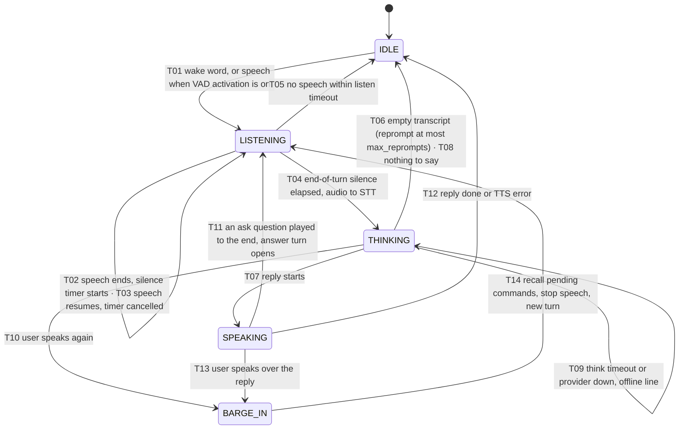

### 6.2 Một lượt thoại từ tệp WAV

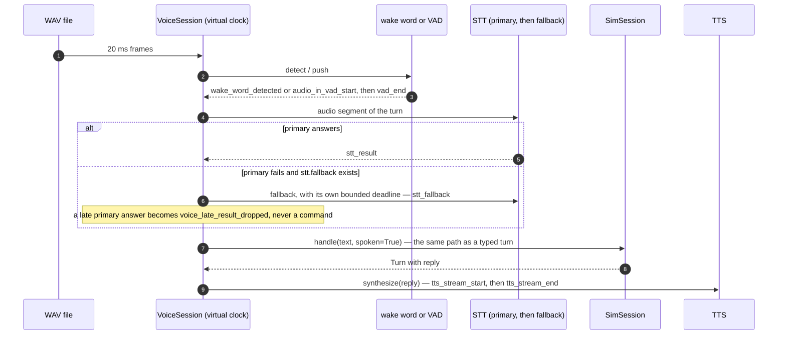

**Cắt lời** (`docs/spec/voice_fsm.md` §5): người dùng nói khi thiết bị đang nghĩ hoặc đang nói ⇒ loa
dừng, mọi lệnh **chưa giao** tới chân bị huỷ (`actuator_aborted`, lý do
`ACTUATOR_ABORTED_BY_BARGE_IN`) và token của chúng bị đóng. Lệnh đã giao (một xung đang chạy) chạy hết.

**Từ đánh thức hỏng** (mô hình không nạp được, adapter ném lỗi) ⇒ `wake_word_unavailable`, không lượt
nào mở, phiên vẫn chạy.

Phiên thoại hôm nay chạy trong **thời gian ảo** từ tệp WAV; phiên thời gian thực với micro thật chưa có
(`TODOS.md` #45).

## 7. Vòng bằng chứng: ghi, phát lại, so sánh


*Hình E-06 — Một phiên thành vết ghi; vết ghi được tính lại trên từng target và so với bản gốc.*

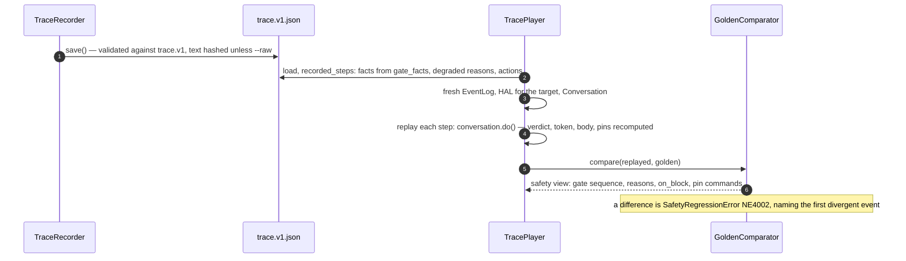

- Phát lại **không gọi model và không đọc máy**: dữ kiện đã ghi được đưa vào lại, còn phán quyết, token
  và lệnh chân được **tính lại**.
- So sánh theo **quyết định** (phán quyết, lý do, `on_block`, lệnh chân), bỏ qua thời gian và chữ nói.
- `neuroedge verify --targets sim,linux,esp32s3` làm việc này cho mọi vết ghi chuẩn mực trên từng target;
  trên `esp32s3`, chính firmware phát lại ba vết ghi chuẩn mực lúc khởi động và gửi kết quả qua UART.

## 8. Từ agent tới chip

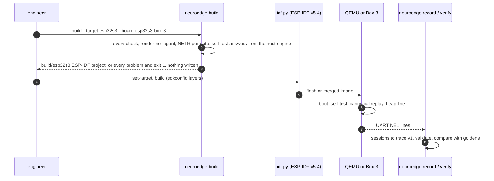

## 9. Vòng đời một phiên `linux`

1. `SimSession.load(target="linux")` dựng `TypedLinuxHAL` và gọi `preflight`: mọi cảm biến, màn hình,
   thiết bị âm thanh agent cần được kiểm **trước khi** giữ line GPIO nào. Thiếu thứ gì ⇒ lỗi ba phần,
   mã 1, không line nào bị giữ.
2. Lệnh chân tới line của kernel qua libgpiod v2, tìm theo tên. Xung có thời lượng được thả bằng một
   bộ hẹn giờ; `run -c` chờ xung chạy hết trước khi thoát.
3. Thoát — bình thường, Ctrl-D, SIGTERM (client MCP dừng máy chủ), SIGHUP (đóng terminal) — ⇒ mọi line
   về trạng thái nghỉ và được thả. SIGKILL thì không bắt được: đó là lý do an toàn phần cứng vẫn cần
   (`docs/spec/threat_model.md` §3b).

## 10. Luồng quy hoạch

| Luồng | Increment | Kiến trúc đích |
|:---|:---|:---|
| Lượt thoại trên chip | I5 | [`15`](15-target-architecture.md) §2.2 |
| Từ chối do phong bì an toàn vật lý | I2a | [`15`](15-target-architecture.md) §4.2 |
| Nguồn gọi kích hoạt từ sự kiện (`call_source = "trigger"`, TSK-N6-*) | I2d (dời từ I4a theo Q-72) | [`15`](15-target-architecture.md) §4.2 |
| Ý định đa node và mất liên lạc | I14 | [`15`](15-target-architecture.md) §4.3 |
| Dữ kiện thị giác | I2a, I3a | [`15`](15-target-architecture.md) §4.4 |
| Vòng đời hợp đồng nhiệm vụ, báo chủ động, lệnh và lời duyệt qua chat (`planned · Q-72`) | I2d | §11 dưới đây; [`15`](15-target-architecture.md) |
| Cài một NeuroEdge Blueprint (`planned · Q-72`) | I2e | §11.5 dưới đây; [`15`](15-target-architecture.md) |

## 11. Luồng quy hoạch theo Q-72 (`planned · Q-72`)

Chưa có mã cho luồng nào trong mục này. Chúng ghi thiết kế đích của [Q-72](../../../roadmap/neuroedge-prd.md#15-sổ-quyết-định)
cho increment I2d (nhiệm vụ và agent vận hành) và I2e (NeuroEdge Blueprint tối thiểu); tiến độ ở
roadmap §0.2. Phần nào cần RFC thì ghi "chờ RFC".

Hai tiến trình trên máy nhà ([`02`](02-container-c4l2.md)):

- **runtime tin cậy** (24/7, systemd): HAL, gate, thực thi hợp đồng nhiệm vụ, lập lịch, bộ phát hiện
  tất định, adapter kênh chat và kiểm lời duyệt, cửa ra egress;
- **LLM worker không tin cậy**: giữ key LLM của người dùng (BYOK), gọi runtime qua MCP cục bộ như mọi
  client MCP, nguồn do runtime gán, **không bao giờ duyệt** — cùng ranh giới với client MCP ở Q-71.

Mọi lệnh tới chân, dù sinh từ chat, lập lịch hay bộ phát hiện, vẫn đi đúng một đoạn của §1:
`dispatch()` → `Conversation.do` → gate → token → HAL. Adapter chat chỉ gọi tới `dispatch()`, không
import `hal`. Thời lượng, hạn duyệt, watchdog và phản xạ dùng **đồng hồ đơn điệu**; dữ kiện giờ tường
mang trạng thái `unsynced` khi máy chưa đồng bộ giờ, và điều khoản khung giờ coi `unsynced` là thiếu
dữ kiện (fail-closed).

### 11.1 Vòng đời một hợp đồng nhiệm vụ (I2d)

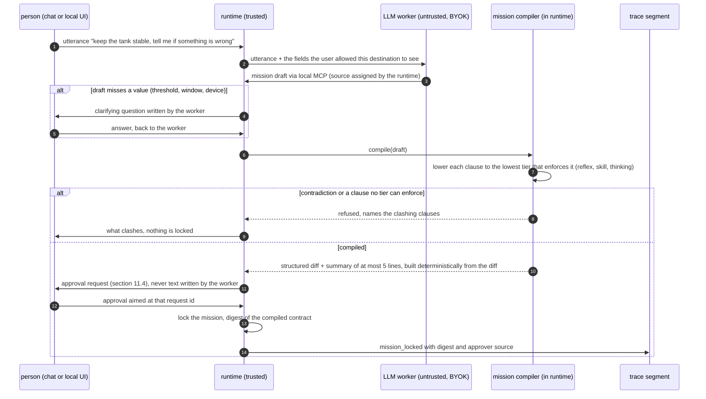

- Chỉ thiết bị có `ne_gate` mới có tầng phản xạ; thiết bị Home Assistant dừng ở tầng host và bản duyệt
  nói rõ điều đó.
- Bản duyệt là đầu ra của trình biên dịch, không phải chữ của LLM: worker bị lừa không viết được dòng
  nào trong tin duyệt.

### 11.2 Trigger, bộ phát hiện và báo chủ động (I2d)

Mở rộng luồng trigger của Khối N6 (I2d, dời từ I4a theo Q-72; [`15`](15-target-architecture.md) §4.2: chạy không cần phiên
client, `call_source = "trigger"`, `trigger ∉ HUMAN_SOURCES`, debounce, trần tần suất), không phải một
đường song song: lập lịch và bộ phát hiện của hợp đồng nhiệm vụ là nguồn kích hoạt mới của cùng đường đó.

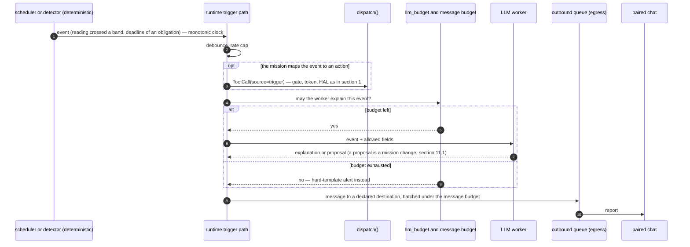

Bộ phát hiện chạy trước, LLM chỉ được gọi sau khi có sự kiện: phản xạ và cảnh báo mẫu cứng không phụ
thuộc LLM. Bộ phát hiện đọc cảm biến theo chu kỳ trong runtime 24/7 làm `TODOS.md` #48 (đọc cảm biến
chặn event loop) thành rủi ro thật ([`02`](02-container-c4l2.md)).

### 11.3 Lệnh vào từ chat (I2d)

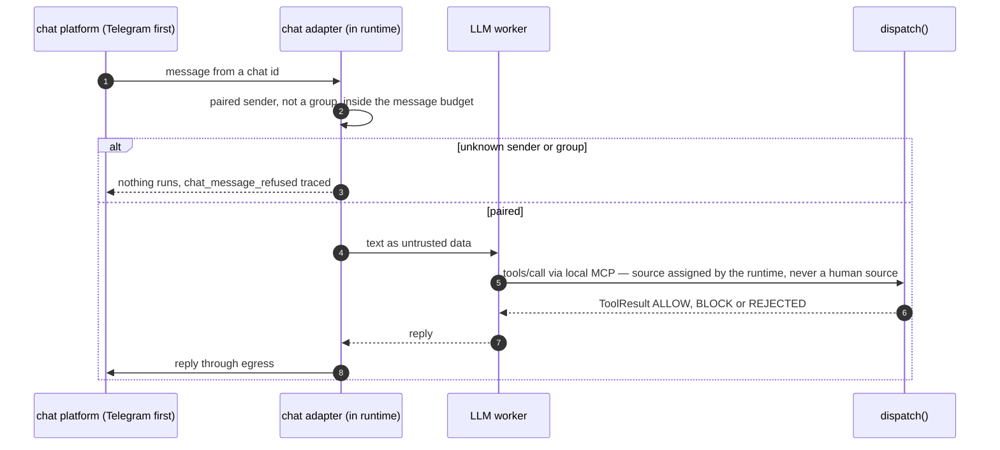

Adapter chat không import `hal` và không gọi thẳng `Conversation.do`: mọi lệnh có tác động vật lý đi
qua `dispatch()` như lời gọi MCP ở §3. Một lời gọi bị gate chặn với `on_block: ask` không được worker
trả lời; nó thành yêu cầu duyệt ở §11.4.

### 11.4 Yêu cầu và trả lời duyệt qua chat (I2d, chờ RFC nguồn `chat:<id>`)

Mở rộng §2: hôm nay chỉ `local_grammar` và `ui` trả lời được câu hỏi `ask` (Q-26). Q-72 thêm một đường
qua chat bằng **bản ghi duyệt**, không bằng một tên nguồn mới trong `HUMAN_SOURCES` cho tin "có" tự do.

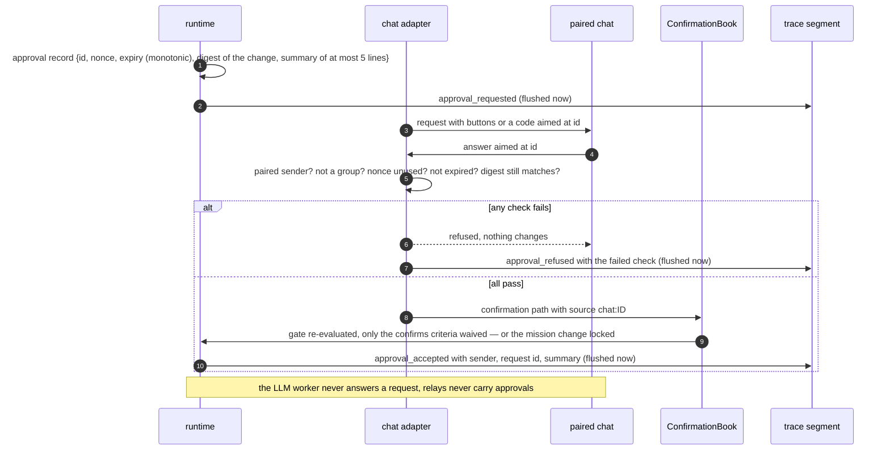

Ghép đôi làm tại chỗ; thu hồi, hạn ghép đôi và trần số lời duyệt còn hoãn (`TODOS.md` #62).

### 11.5 Cài một NeuroEdge Blueprint (I2e)

```mermaid
sequenceDiagram
    autonumber
    participant U as installer
    participant CLI as neuroedge blueprint install
    participant IDX as Hub index (static git repository)
    participant SRC as package URL (git or HTTPS)
    participant RT as runtime
    U->>CLI: install by name or by URL
    opt by name
        CLI->>IDX: look up URL, digest, evidence (marked unsigned)
    end
    CLI->>SRC: fetch the whole package
    CLI->>CLI: digest over the whole package: kit, firmware, mission templates, detectors, evidence traces
    alt digest does not match
        CLI-->>U: three-part error (where, why, how), nothing installed
    else match
        CLI->>CLI: validate blueprint.v1, board check, safe_state other than off only from board.v1
        CLI-->>U: install summary; missions start as drafts that still need approval (section 11.1)
        U->>CLI: replay the evidence traces locally (optional)
        CLI->>RT: load the approved missions
    end
```

NeuroEdge Blueprint chỉ khai báo, không mang mã chạy trong runtime. Nó khác Home Assistant Blueprint
(mẫu automation của HA), và có thể mang kèm một HA blueprint.

### 11.6 Nhánh lỗi

| Đường | Lỗi | Xử lý trong thiết kế | Người dùng thấy |
|:---|:---|:---|:---|
| Runtime ↔ LLM worker | worker chết hoặc treo | runtime vẫn chạy phản xạ, bộ phát hiện, cảnh báo mẫu cứng; khởi động lại worker | tin "phân tích tạm ngưng"; cảnh báo vẫn tới |
| Runtime → kênh chat | API của nền tảng chat lỗi | hàng đợi có hạn + cảnh báo tại chỗ trên UI | cảnh báo trên UI; tin tới trễ, có dấu thời gian |
| LLM provider | hết `llm_budget` | phản xạ + cảnh báo mẫu cứng | tin "đã hết ngân sách phân tích" |
| Duyệt qua chat | yêu cầu hết hạn | không duyệt, ghi vết | tin "yêu cầu đã hết hạn" |
| Duyệt qua chat | trả lời từ tài khoản lạ hoặc nhóm | từ chối, ghi vết | không có gì thay đổi |
| Relay (`planned · Q-72`, ngoài I2d/I2e) | relay sập | không ảnh hưởng an toàn; mất truy cập từ xa | không mở được trang từ xa |
| Đồng hồ | mất điện, chưa có NTP/RTC | dữ kiện giờ `unsynced` ⇒ điều khoản khung giờ thiếu dữ kiện ⇒ chặn | bản duyệt, UI báo đồng hồ chưa đồng bộ |
| Vết ghi | mất điện giữa một đoạn | mất tối đa phần đuôi sự kiện thường; chặn và duyệt đã flush | `replay` báo đoạn cụt |
| Cài NeuroEdge Blueprint | digest không khớp | từ chối cài | lỗi ba phần |

