# 06 · Runtime Flows (Dynamic views)

> **Scope:** key flows, each with a sequence or state diagram, using exact function names
> in code. **Sources:** `sim/session.py`, `actions/`, `engine/gate.py`, `mcp_server.py`, `mcp_host.py`,
> `models/system.py`, `perception/`, `testing/`, `docs/spec/voice_fsm.md`, `docs/spec/tool_calling.md`.

All flows below, regardless of where they start, converge at the same section: `dispatch()` → `Conversation.do`
→ `ActionContractEngine.evaluate` → `TokenLedger` → HAL ([`05`](05-code-gate-hal-c4l4.md) §5). The diagram
draws that section only once in §1 and refers to it in other flows.

## 1. A Typed Command Turn

`neuroedge run -c "mở cửa phòng 101"` (unlock room 101) on `sim`.

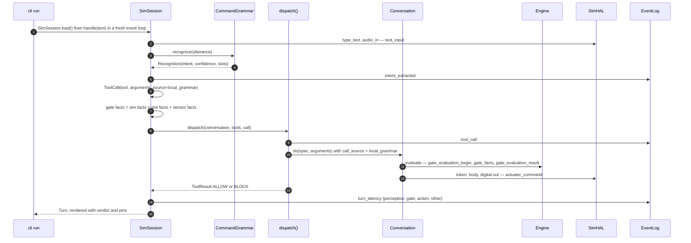

Utterance not matching grammar: if `[system_two]` exists, take the §4 flow; otherwise `command_not_recognized` and
the device speaks the local commands that remain available (`offline_help`).

## 2. Ask and Confirmation (`on_block: ask`, RFC-0006)

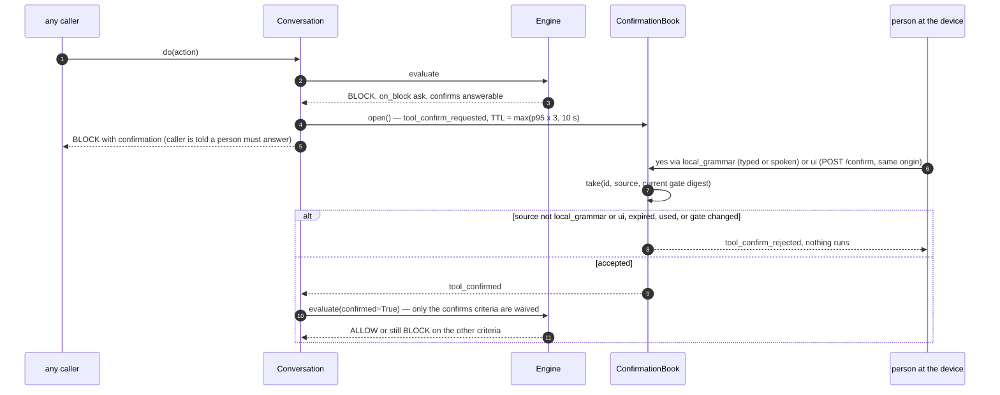

- System 2 and MCP clients have **no confirmation tools**; a question created by System 2's own call
  cannot be answered by System 2 (Q-26).
- A spoken "có" (yes) only answers the question of **that exact turn** (Q-46).

## 3. An MCP Call

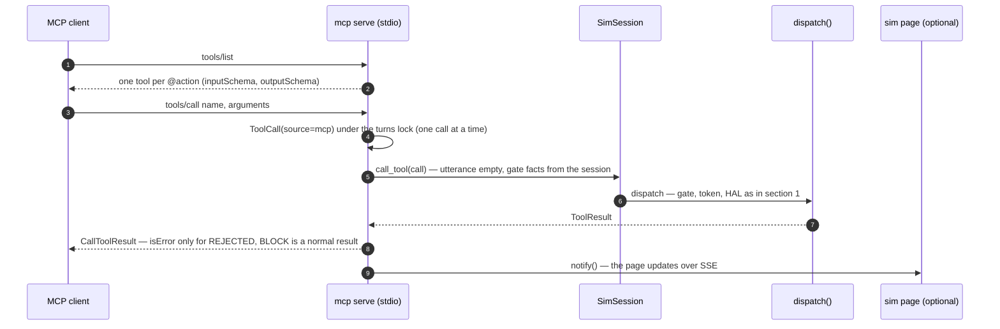

An MCP call has no speaker utterance, so `[system_one]` sends nothing to the model: that criterion falls
back to grammar or blocks. A gate can deny the `mcp` source specifically via the `call_source` criterion.

### 3.1 One contract, two transports (Q-83)

The call above is Profile A. In Profile B the same tools and the same `tool-result.v1` objects
travel through `nc_gate` function calls inside one ESP32-S3 image (§8.1); an `ask` is answered
from the board button or the owner's Telegram callback, never over MCP. The mapping, step by
step, and the requirements: [`docs/spec/deployment_profiles.md`](../../spec/deployment_profiles.md) §4.1.

## 4. A System 2 (LLM) Turn, with an External MCP Server

> **Legacy path, off by default (Q-83, DP-A-08).** In the product the LLM agent is the NeuroClaw
> brain calling the box as in §3. The flow below stays for simulation and replay of older traces.

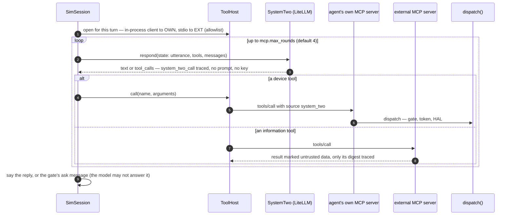

Provider cannot answer ⇒ `system_two_unavailable`, device speaks the offline line. If content from an external
MCP server contains prompt injection, the call it leads to must still pass through the gate
(`test_mcp_host.py::test_prompt_injection_in_the_news_still_meets_the_gate`).

## 5. The System 1 Model and Network Outages

`SystemOne` is the engine's `FactSource`. With `[system_one]`, it queries the primary model (Jev via the System One API)
for its assigned criteria, within the remaining budget minus a 50 ms margin; if the model is unavailable,
command grammar decides.

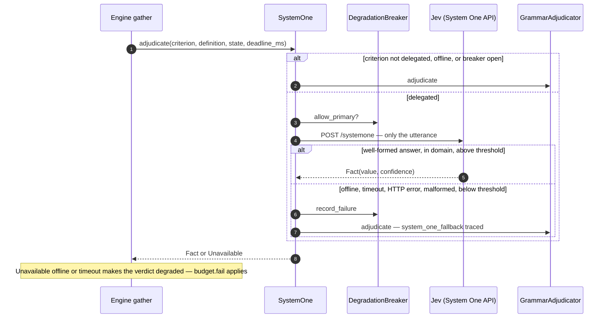

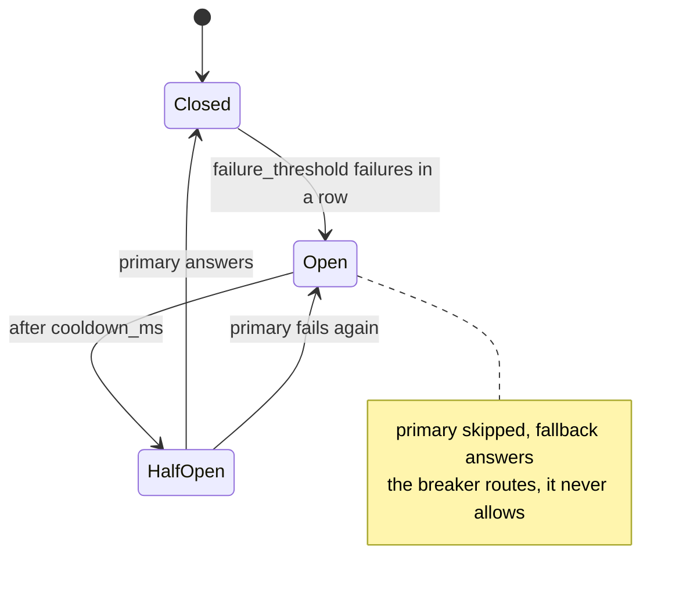

No fallback can run for a model-decided criterion ⇒ `BLOCK` with `gate_unreachable`
(Q-14).

## 6. Voice

### 6.1 Conversational State Machine

Normative in `docs/spec/voice_fsm.md` §4 (T01–T14). Every state transition logs `voice_state_changed`.
The state machine never evaluates gates or touches pins.

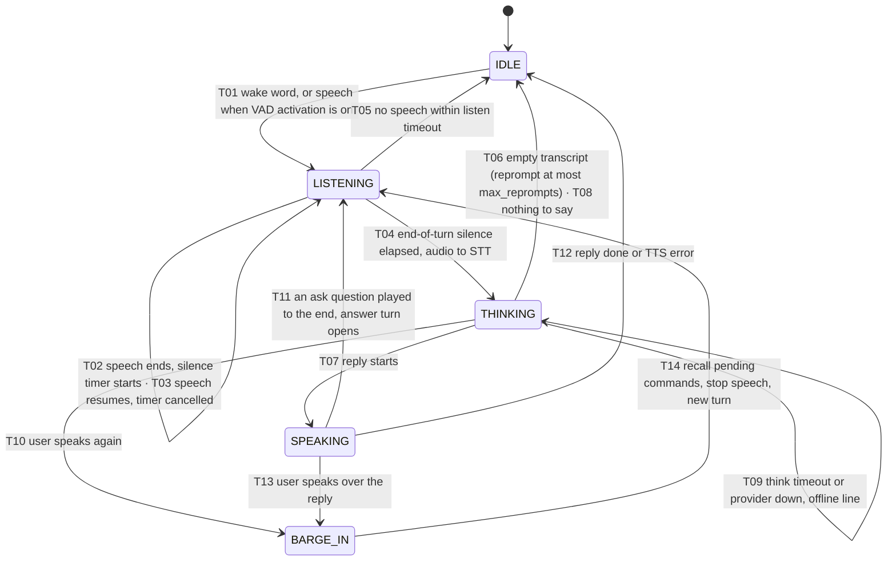

### 6.2 A Voice Turn from a WAV File

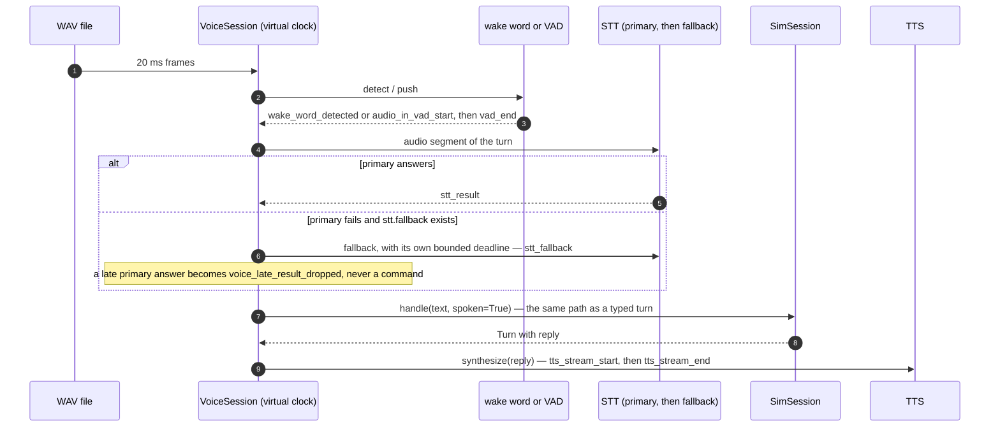

**Barge-in** (`docs/spec/voice_fsm.md` §5): user speaks while the device is thinking or speaking ⇒ speaker
stops, all commands **not yet delivered** to pins are aborted (`actuator_aborted`, reason
`ACTUATOR_ABORTED_BY_BARGE_IN`) and their tokens are closed. Already-delivered commands (a pulse currently running) run to completion.

**Broken wake word** (model fails to load, adapter throws error) ⇒ `wake_word_unavailable`, no turn
opens, session keeps running.

Voice sessions today run in **virtual time** from a WAV file; real-time sessions with a real microphone are not yet available
(`TODOS.md` #45).

## 7. Evidence Loop: Record, Replay, Compare

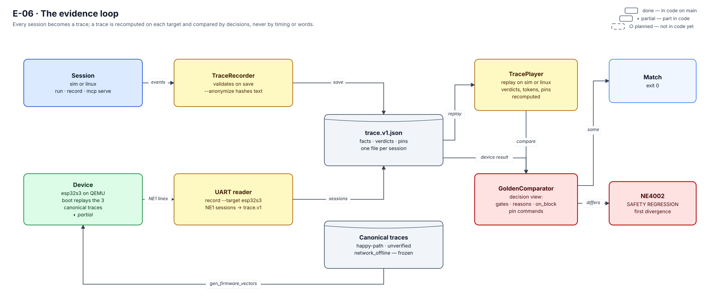
*Figure E-06 — A session becomes a trace; the trace is recomputed on each target and compared to the golden.*

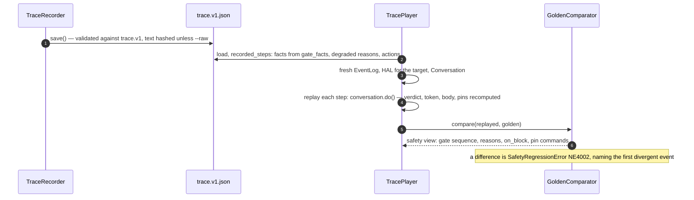

- Replay **does not call models and does not read hardware**: recorded facts are re-injected, while verdicts, tokens,
  and pin commands are **recomputed**.
- Compares by **decision** (verdict, reasons, `on_block`, pin commands), ignoring timing and spoken words.
- `neuroedge verify --targets sim,linux,esp32s3` does this for every canonical trace on each target;
  on `esp32s3`, the firmware itself replays the three canonical traces at boot and sends the results over UART.

## 8. From Agent to Chip

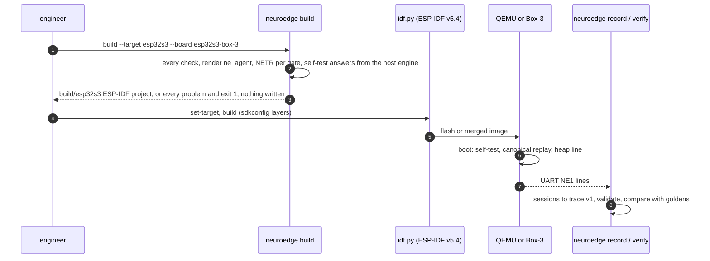

### 8.1 One command on Profile B: brain and gate in one image (on QEMU · Q-83)

On the all-in-one chip (Q-93) the owner may also speak or touch the screen: speech enters NeuroClaw-ESP as one more channel, so the flow below is unchanged up to the gate; an `ask` is then answered by a touch on the card or an on-chip command word (DP-B-19, DP-B-21) in place of the Telegram button. Planned: TSK-I2f-18, TSK-I2f-19.

```mermaid
sequenceDiagram
    autonumber
    participant O as owner (Telegram)
    participant N as NeuroClaw-ESP (brain)
    participant W as ne_brain_bridge
    participant G as ne_gate (walker, ledger)
    participant H as HAL (pins)
    O->>N: "open the door"
    N->>N: LLM call over HTTPS (the only TLS on the chip is outbound)
    N->>W: nc_gate.call("front_door_unlock", arguments JSON)
    W->>W: JSON to ne_arg_value; facts from on-chip sources only
    W->>G: ne_decide(tree, facts, args, confirmed=0)
    G-->>W: BLOCK, answerable (on_block ask)
    W-->>N: tool-result.v1 BLOCK with confirmation id
    N->>O: approve / refuse buttons
    O->>N: callback "approve" (user ID)
    N->>W: nc_gate.answer(id, approve, user ID)
    W->>W: user ID equals telegram.owner, id pending and unexpired
    W->>G: ne_decide(..., confirmed=1) then ne_token_issue
    G-->>W: ALLOW and a single-use token
    W->>H: drive pin with ne_token_authorize, then ne_token_close
    W-->>N: tool-result.v1 ALLOW
```

Each step is a requirement of [`docs/spec/deployment_profiles.md`](../../spec/deployment_profiles.md)
(DP-B-02 → DP-B-08, DP-B-12 for the `NE1` trace lines).

## 9. Lifecycle of a `linux` Session

1. `SimSession.load(target="linux")` constructs `TypedLinuxHAL` and calls `preflight`: every sensor, display,
   and audio device the agent requires is checked **before** claiming any GPIO line. Missing anything ⇒ three-part error,
   exit code 1, no line claimed.
2. Pin commands reach kernel lines via libgpiod v2, looked up by name. Pulses with duration are released by a
   timer; `run -c` waits for pulses to finish before exiting.
3. Exit — normal, Ctrl-D, SIGTERM (MCP client stops the server), SIGHUP (terminal closes) — ⇒ all lines
   return to idle state and are released. SIGKILL cannot be caught: this is why hardware safety is still required
   (`docs/spec/threat_model.md` §3b).

## 10. Planned Flows

On-chip voice and multi-node flows left the roadmap (Q-77): roadmap §6.

| Flow | Increment | Target Architecture |
|:---|:---|:---|
| Physical safety envelope rejection | I2a | [`15`](15-target-architecture.md) §4.2 |
| Event-triggered call source (`call_source = "trigger"`, TSK-N6-*) | I2d (moved from I4a per Q-72) | [`15`](15-target-architecture.md) §4.2 |
| Vision facts | I2a, I3a | [`15`](15-target-architecture.md) §4.4 |
| Mission contract lifecycle, proactive alerts, commands and approval via chat (`planned · Q-72`) | I2d | §11 below; [`15`](15-target-architecture.md) |
| Install a NeuroEdge Blueprint (`planned · Q-72`) | I2e | §11.5 below; [`15`](15-target-architecture.md) |

## 11. Planned Flows Under Q-72 (`planned · Q-72`)

There is no code yet for any flow in this section. They document the target design of [Q-72](../../../roadmap/neuroedge-prd.md#15-decision-log)
for increment I2d (missions and operator agents) and I2e (minimal NeuroEdge Blueprint); progress is in
roadmap §0.2. Sections requiring an RFC are noted as "pending RFC".

Two processes on the home machine ([`02`](02-container-c4l2.md)):

- **trusted runtime** (24/7, systemd): HAL, gate, mission contract execution, scheduler, deterministic
  detectors, chat channel adapters and approval checks, egress port;
- **untrusted LLM worker**: holds the user's LLM keys (BYOK), calls the runtime via local MCP like any
  MCP client, source assigned by the runtime, **never approves** — sharing the same boundary as MCP clients in Q-71.

All commands to pins, whether originating from chat, scheduler, or detectors, still follow the exact section from §1:
`dispatch()` → `Conversation.do` → gate → token → HAL. Chat adapters only call `dispatch()`, never
importing `hal`. Durations, approval deadlines, watchdogs, and reflexes use the **monotonic clock**; wall-clock facts
carry the `unsynced` state when the machine has not synced time, and time-window clauses treat `unsynced` as missing
facts (fail-closed).

### 11.1 Lifecycle of a Mission Contract (I2d)

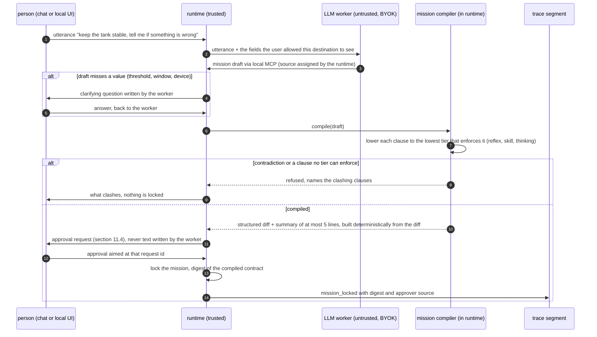

- Only devices with `ne_gate` have a reflex tier; Home Assistant devices stop at the host tier, and the
  approval document states that clearly.
- The approval document is the compiler's output, not LLM text: a compromised worker cannot write a single
  line of the approval message.

### 11.2 Triggers, Detectors, and Proactive Alerts (I2d)

Extends Block N6's trigger flow (I2d, moved from I4a per Q-72; [`15`](15-target-architecture.md) §4.2: runs without a client
session, `call_source = "trigger"`, `trigger ∉ HUMAN_SOURCES`, debounce, rate cap), not as a parallel
path: mission contract schedulers and detectors are new trigger sources for the same path.

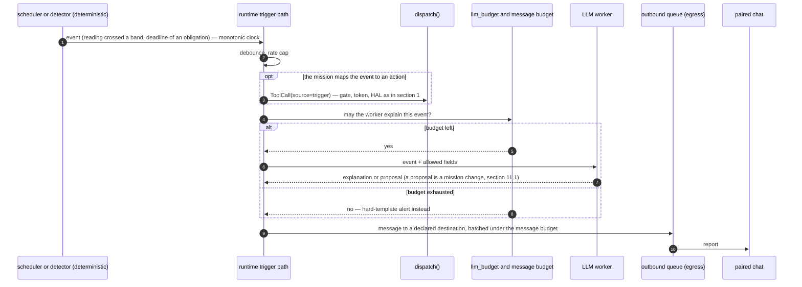

Detectors run first, LLM is only called after an event occurs: reflexes and hard-template alerts do not
depend on the LLM. Periodic sensor reading by detectors in the 24/7 runtime turns `TODOS.md` #48 (sensor reads
blocking the event loop) into a real risk ([`02`](02-container-c4l2.md)).

### 11.3 Incoming Commands from Chat (I2d)

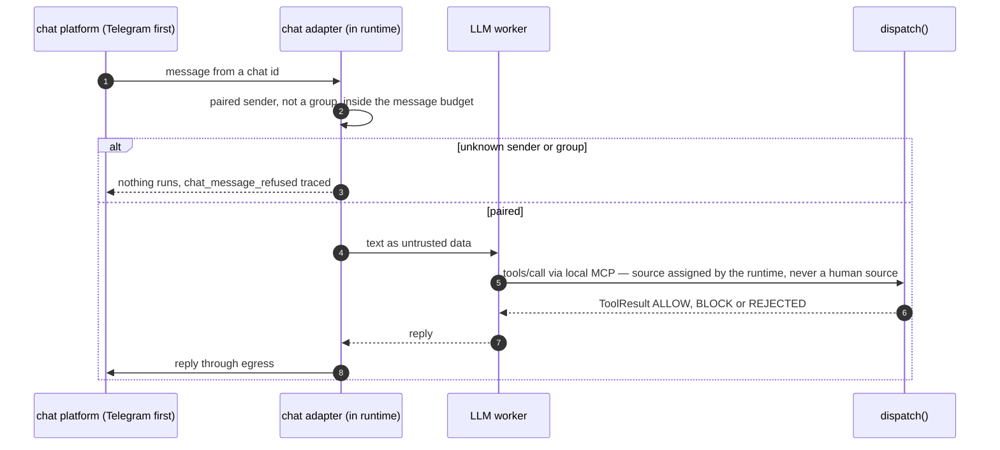

The chat adapter does not import `hal` and never calls `Conversation.do` directly: all commands with physical
effects pass through `dispatch()` like the MCP calls in §3. A call blocked by a gate with `on_block: ask` is not
answered by the worker; it becomes an approval request in §11.4.

### 11.4 Approval Requests and Responses via Chat (I2d, Pending RFC for Source `chat:<id>`)

Extends §2: today only `local_grammar` and `ui` can answer an `ask` question (Q-26). Q-72 adds a path
via chat using an **approval record**, not a new source name in `HUMAN_SOURCES` for unconstrained "có" (yes) messages.

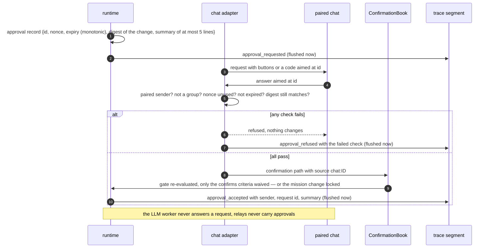

Pairing is done locally; revocation, pairing expiry, and approval rate caps are deferred (`TODOS.md` #62).

### 11.5 Installing a NeuroEdge Blueprint (I2e)

```mermaid
sequenceDiagram
    autonumber
    participant U as installer
    participant CLI as neuroedge blueprint install
    participant IDX as Hub index (static git repository)
    participant SRC as package URL (git or HTTPS)
    participant RT as runtime
    U->>CLI: install by name or by URL
    opt by name
        CLI->>IDX: look up URL, digest, evidence (marked unsigned)
    end
    CLI->>SRC: fetch the whole package
    CLI->>CLI: digest over the whole package: kit, firmware, mission templates, detectors, evidence traces
    alt digest does not match
        CLI-->>U: three-part error (where, why, how), nothing installed
    else match
        CLI->>CLI: validate blueprint.v1, board check, safe_state other than off only from board.v1
        CLI-->>U: install summary; missions start as drafts that still need approval (section 11.1)
        U->>CLI: replay the evidence traces locally (optional)
        CLI->>RT: load the approved missions
    end
```

A NeuroEdge Blueprint is declarative only, carrying no executable code in the runtime. It differs from a
Home Assistant Blueprint (an HA automation template), and may bundle an HA blueprint alongside it.

### 11.6 Error Paths

| Path | Error | Design Handling | User Visibility |
|:---|:---|:---|:---|
| Runtime ↔ LLM worker | Worker dies or hangs | Runtime still runs reflexes, detectors, hard-template alerts; restarts worker | message "phân tích tạm ngưng" ("analysis temporarily paused"); alerts still arrive |
| Runtime → chat channel | Chat platform API error | Bounded queue + local alert on UI | Alert on UI; messages arrive delayed with timestamps |
| LLM provider | `llm_budget` exhausted | Reflexes + hard-template alerts | message "đã hết ngân sách phân tích" ("analysis budget exhausted") |
| Approval via chat | Request expired | Deny approval, logged to trace | message "yêu cầu đã hết hạn" ("request has expired") |
| Approval via chat | Reply from unknown account or group | Reject, logged to trace | Nothing changes |
| Relay (`planned · Q-72`, outside I2d/I2e) | Relay down | No safety impact; remote access lost | Cannot open page remotely |
| Clock | Power outage, NTP/RTC not yet available | Time fact `unsynced` ⇒ time-window clause lacks facts ⇒ block | Approval sheet, UI reports clock not synchronized |
| Trace | Power outage mid-segment | Loses at most the tail of normal events; blocks and approvals already flushed | `replay` reports truncated segment |
| Install NeuroEdge Blueprint | Digest mismatch | Reject installation | Three-part error |

