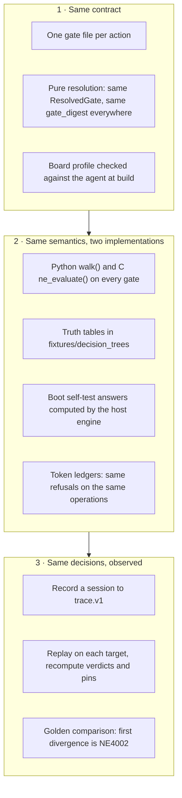
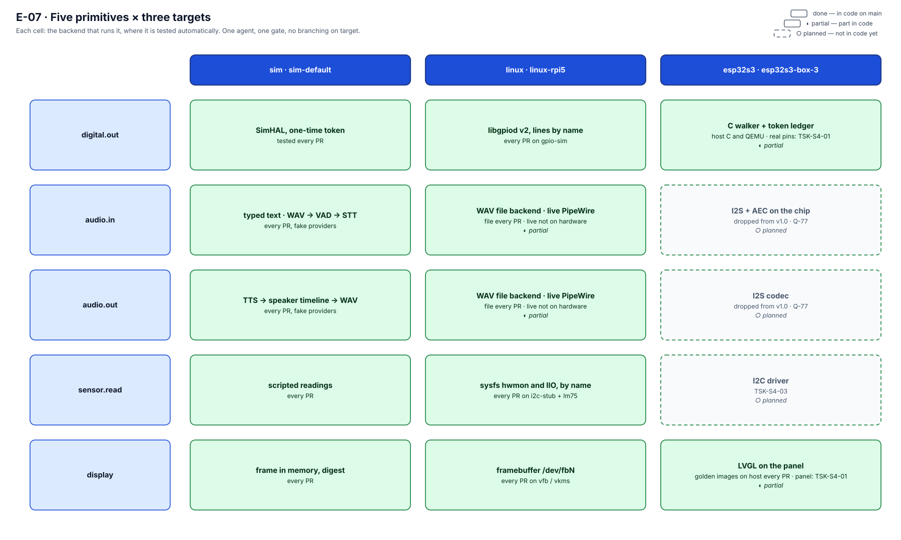

# 10 · Tương đương giữa các target

> **Phạm vi:** vì sao cùng một agent và cùng một gate cho cùng quyết định trên `sim`, `linux` và
> `esp32s3`, điều đó được chứng minh thế nào, và nó **không** hứa gì. **Nguồn:** P-2 (PRD §1.5),
> FR-TGT, `docs/spec/simulation_coverage.md`, `python/neuroedge/testing/`, `targets/esp32s3/main/`.

**Đọc chương này để làm gì:** Dành cho kỹ sư hệ thống, đối tác OEM và đội QA. Chương này trả lời câu hỏi: *vì sao cùng một agent và gate lại đưa ra chuỗi quyết định an toàn giống hệt nhau trên cả trình mô phỏng, máy tính Linux và vi điều khiển ESP32-S3, điều đó được bảo vệ thế nào và giới hạn ở đâu*. Đọc sau [`00-overview.md`](00-overview.md) và [`05-code-gate-hal-c4l4.md`](05-code-gate-hal-c4l4.md); đọc trước khi thực hiện port HAL tại [`10-target-equivalence.md`](10-target-equivalence.md).

## 1. Tương đương nghĩa là gì

Hai lần chạy **tương đương** khi, với cùng dữ kiện đầu vào, chúng cho cùng **chuỗi quyết định**: cùng
gate, cùng phán quyết, cùng lý do, cùng hành động `on_block`, cùng lệnh chân (chân, thao tác, thời
lượng). Không so: thời gian, chữ nói, âm thanh, khung hình.

Mã agent **không được rẽ nhánh theo target** (P-2). Khác biệt giữa môi trường nằm trọn trong HAL và
profile bo mạch.

### 1.1 Cam kết tương đương theo bậc target (target tiers)

Tương đương không được hứa cào bằng cho mọi phần cứng. NeuroEdge phân định cam kết rõ ràng theo ba bậc (Q-13, FR-TGT-08, `simulation_coverage.md` §7):

- **Bậc 1 (`sim`, `linux`, `esp32s3`):** `neuroedge verify` đạt 100%; kiểm trên mỗi PR (`sim`, gpio-sim; QEMU cho PR đụng `targets/**`) và cam kết kiểm thử hằng đêm trên bo mạch thật (TSK-S4-05, TSK-I2-01 — chưa chạy).
- **Bậc 2 (do đội lõi bảo trì, ví dụ `jetson` ở I16):** `neuroedge verify` trên miền phán quyết; kiểm thử phần cứng theo đợt phát hành, không hằng đêm.
- **Bậc 3 (do cộng đồng port, ví dụ `stm32`, `rp2350` ngoài vai node robot):** bên đóng góp tự kiểm chứng qua Bộ kiểm thử tuân thủ; đội lõi không cam kết chất lượng và không chặn phát hành vì bậc này.

Chi tiết phân tầng target và lộ trình mở rộng: [`15`](15-target-architecture.md) §4.1.

## 2. Ba lớp bảo vệ



| Lớp | Bảo đảm | Bằng |
|:---|:---|:---|
| **1 · Cùng hợp đồng** | Mọi target nạp cùng một chính sách đã phân giải | Phân giải là hàm thuần (bất biến 4); `gate_digest` giống nhau trong vết ghi, trong `NETR`, trong token |
| **2 · Cùng ngữ nghĩa** | Python và C quyết giống nhau trên mọi dữ kiện | `test_c_walker.py` (mọi gate, mọi dòng bảng sự thật, fuzz); `test_c_token.py`; self-test lúc khởi động của chính firmware |
| **3 · Cùng quyết định, quan sát được** | Một phiên thật cho cùng quyết định khi phát lại ở target khác | `neuroedge verify --targets sim,linux,esp32s3`; `GoldenComparator` |

## 3. Ma trận năm nguyên thủy × ba target


*Hình E-07 — Mỗi ô: backend chạy nó, nơi nó được kiểm tự động, trạng thái.*

| Nguyên thủy | `sim` (`sim-default`) | `linux` (`linux-rpi5`) | `esp32s3` (`esp32s3-box-3`) |
|:---|:---|:---|:---|
| `digital.out` | `SimHAL`, token dùng một lần — PR | libgpiod v2, tìm line theo tên — PR trên gpio-sim | walker + sổ token C — host và QEMU; chân thật `planned` (TSK-S4-01) |
| `audio.in` | chữ gõ vào ngữ pháp; WAV → VAD → STT — PR | tệp WAV — PR; micro thật qua PipeWire — mới mở thiết bị | `planned` (I5) |
| `audio.out` | câu cần nói; TTS → dòng thời gian loa → WAV — PR | tệp WAV — PR; loa thật — chưa kiểm trên phần cứng | `planned` (I5) |
| `sensor.read` | số đọc giả lập — PR | sysfs hwmon/IIO — PR trên `i2c-stub` + `lm75` | `planned` (TSK-S4-03) |
| `display` | khung trong bộ nhớ, digest — PR | framebuffer — PR trên `vfb`/`vkms` | giao diện LVGL: ảnh golden trên host — PR; panel thật `planned` |

Ba ô chỉ kiểm được trên bo mạch: `audio.in` và `audio.out` của `esp32s3`, và phần âm học của `linux`.
Chúng chờ runner hằng đêm trên phần cứng thật (TSK-S4-05, TSK-I2-01).

## 4. Luật của profile bo mạch

- **`sim` không được giàu hơn bo mạch tham chiếu** (bất biến 7). `sim-default` sao đúng năng lực của
  Box-3: một agent chạy trên `sim` thì cũng khai được cho `esp32s3`.
- **Build đối chiếu hai chiều**: mỗi nguyên thủy agent cần (`[requires]`, mỗi `@action(requires=…)`) phải
  có trên bo mạch, đúng tên chân, đúng cảm biến, đủ tần số lấy mẫu, có khử vang nếu agent đòi.
  Thiếu ⇒ `NE3001`, build dừng, không ghi gì. Ví dụ: `villa-concierge` đòi `aec = true` nên bị từ chối
  trên `linux-rpi5` cho tới khi Pi đo đạt khử vang (`simulation_coverage.md` §6.2).
- **Tên chân là logic** (`door_lock`, `porch_light`, `gate_relay`); số GPIO thuộc về HAL của từng target.
- Danh sách target đóng băng ở ba target bậc 1 cho tới khi phần mã của RFC-0002 (đã ký 2026-10-04) vào ở I2c.

## 5. `verify` làm gì trên từng target

| Target | Cách phát lại | Cần gì |
|:---|:---|:---|
| `sim` | `TracePlayer` trên `SimHAL` | không gì |
| `linux` | `TracePlayer` trên `LinuxHAL`, line GPIO thật | line thật hoặc gpio-sim (`scripts/setup_gpio_sim.sh`) |
| `esp32s3` | **Chính firmware** phát lại ba vết ghi chuẩn mực lúc khởi động (`trace_vectors.c`) và gửi kết quả qua UART; host đọc (`--port`) và so với golden | firmware đang chạy, trên QEMU hoặc bo mạch |

Firmware phát lại một vết ghi hay một gate **cũ hơn** checkout ⇒ `NE4003` (firmware cũ), không so.
Trên `sim`/`linux`, một vết ghi chuẩn mực ghi `gate_digest` khác gate checkout biên dịch ra cũng
⇒ `NE4003`, không so (RFC-0008): vết ghi chuẩn mực phải được quyết bởi đúng gate nó được ghi cùng.
`neuroedge replay` trên vết ghi của người dùng thì **không lỗi**: gate có thể được siết có chủ ý
(quickstart, giờ 3) — phát lại vẫn tính lại phán quyết, báo `SAFETY REGRESSION` như cũ khi lệch
golden, và thêm cảnh báo nêu gate đã đổi (digest cũ → digest mới). Vết ghi không mang
`gate_digest` (ghi trước RFC-0008) phát lại đúng như trước.
Một loại artifact quét được 0 tệp ⇒ `NE4004`, mã 1: không có "PASS" rỗng.

> [!NOTE]
> **Kế hoạch kiểm chứng cho robot phân tầng (planned):** `neuroedge verify` sẽ mở rộng cho cụm node (Pi 5 + ESP32-S3 + RP2350, TSK-W3-06): so phán quyết và trạng thái actuator giữa các node trên miền phán quyết; lệch → `NE4002` (RFC-node nháp §3.6). Chi tiết: [`15`](15-target-architecture.md) §4.3.

## 6. Tương đương không hứa gì

- **Thời gian.** `verify` so quyết định, chưa so thời gian (TSK-S4-04).
- **Thao tác và thời lượng trên chip.** Trên `esp32s3`, `operation` và `duration_ms` của lệnh chân hôm nay
  lấy từ bảng dựng trên host; chip chỉ quyết có phát không và chân nào (`TODOS.md` #37).
- **Chất lượng âm thanh** trong âm học thật.
- **Target bậc 2 và 3** (`simulation_coverage.md` §7, Q-13; xem cam kết thu hẹp ở §1.1).

## 7. Hướng dẫn port HAL cho đối tác OEM

> **Phạm vi:** đưa NeuroEdge lên một bo mạch hoặc một chip mới — hợp đồng phải giữ, mã tái dùng được,
> mã phải viết, và cách chứng minh port đúng. **Nguồn:** `python/neuroedge/hal/`, `boards/`,
> `targets/esp32s3/components/`, `targets/esp32s3/main/`, `docs/spec/hal_mcu_review.md`, RFC-0002, Q-13.

### 7.1 Hôm nay port được gì

| Loại port | Làm được hôm nay? | Ghi chú |
|:---|:---|:---|
| **Bo mạch mới cho target có sẵn** (một SBC Linux khác, một bo ESP32-S3 khác) | Về kỹ thuật có; nhưng `boards/` chỉ nhận **profile bo tham chiếu của ba target bậc 1** (bốn tệp kể từ `sim-rpi5`, RFC-0013) cho tới khi phần mã của RFC-0002 vào ở I2c (`test_boards.py`), và bo mạch tham chiếu của `esp32s3` chỉ là Box-3 (bất biến 6) | Dùng để thử nghiệm nội bộ; chưa công bố được. Từ I2c (`planned`), bo của cộng đồng ngoài kho nạp bằng `--board <đường dẫn>`, tự chứng nhận bằng `board validate`, không bao giờ là bo tham chiếu (TSK-I2c-05) |
| **Target mới** (`stm32`, `rp2350`, `jetson`) | **Chưa**: danh sách target đóng ở `sim`, `linux`, `esp32s3` trong `schemas/` và `hal/board.py` | RFC-0002 (đã ký 2026-10-04) mở danh sách theo bậc — phần mã ở I2c ([`neuroedge-roadmap.md`](../../../roadmap/neuroedge-roadmap.md) §4.3.3, trước là I11); bộ công cụ port cộng đồng ở I13 |
| **Bậc 3 do cộng đồng tự kiểm** (Q-13) | Quy trình quy hoạch ở I13 (`TSK-P1-01…05`) | Chương này mô tả phần đã có mã và phần sẽ đổi |

Phần còn lại mô tả **hợp đồng** — nó không đổi khi danh sách target mở — và mã có thể tái dùng ngay.

### 7.2 Hợp đồng port

Một port đúng khi nó giữ đủ các điều sau. Mỗi điều đã có kiểm tự động trên ba target bậc 1.

| # | Hợp đồng | Nghĩa là | Kiểm bằng |
|:---:|:---|:---|:---|
| 1 | **Năm nguyên thủy của v1.x — tập đóng** | `audio.in`, `audio.out`, `digital.out`, `sensor.read`, `display` (FR-HAL-01, KL-1). Bậc 3 được thiếu một số nguyên thủy tuỳ năng lực bo mạch, nhưng không được tự ý thêm. Mọi nguyên thủy mới chỉ qua RFC (RFC-0007: `digital.in`; RFC-0010: PWM; RFC-0011: `motion.*`; RFC-0012: `vision.in`; RFC-0013: tuỳ chọn theo bo mạch — Q-53; xem [`15`](15-target-architecture.md) §4) | `board.v1`, `PRIMITIVES` |
| 2 | **Chân theo tên** | Mã agent dùng tên logic (`door_lock`); số chân vật lý chỉ nằm trong HAL (KL-2) | build đối chiếu tên |
| 3 | **Không chân nào động mà không có token** | Lệnh chân kiểm tên chân, rồi gọi hàm `authorize` được lắp vào, rồi mới lái chân. HAL chưa được lắp sổ token thì từ chối mọi lệnh | `test_hal_sim.py`, `tests_linux/test_gpio_sim.py`, self-test token trên chip |
| 4 | **Thiếu thiết bị thì báo lỗi, không giả vờ** | Không có `/dev/gpiochip*`, không có cảm biến, không mở được micro ⇒ lỗi ba phần **trước khi** giữ chân nào (Q-16); không bao giờ trả giá trị mặc định | `preflight` của `LinuxHAL` |
| 5 | **Mọi lệnh đều để lại sự kiện** | `actuator_command`, `actuator_aborted`, `sensor_read`, `display_frame`… với đúng tên và trường (`simulation_coverage.md` §3) | golden comparator |
| 6 | **Huỷ được lệnh đang chờ** | Cắt lời phải huỷ được xung chưa giao trong ≤ 1 khung âm thanh (RB-3) | `test_voice_fsm.py` |
| 7 | **Khai báo là dữ liệu** | Năng lực bo mạch là một tệp `board.toml` (trên chip: bảng `const` trong flash — RB-4), không phải mã (KL-4) | `schemas/board.v1.json` |
| 8 | **Cùng quyết định** | Phát lại ba vết ghi chuẩn mực cho đúng phán quyết và lệnh chân như golden | `neuroedge verify --targets …` |

### 7.3 Khai báo bo mạch

Profile của bo mạch tham chiếu, làm mẫu:

```toml
schema = "neuroedge.board/v1"   # tuỳ chọn; vắng thì là v1, phiên bản khác bị từ chối (RFC-0015 §3c)

[board]
id     = "esp32s3-box-3"
name   = "Espressif ESP32-S3-BOX-3"
target = "esp32s3"
mcu    = "esp32s3"

[capabilities.audio_in]
channels       = 2
sample_rate_hz = 16000
aec            = true
vad            = true

[capabilities.audio_out]
channels       = 1
sample_rate_hz = 16000

[capabilities.digital_out]
pins    = ["door_lock", "porch_light", "gate_relay"]
backend = "esp_driver_gpio"

[capabilities.sensor_read]
sensors = ["temperature", "humidity", "door_contact", "motion"]

[capabilities.display]
width  = 320
height = 240
color  = "rgb565"
```

Chỉ khai những gì HAL **chạy được và đã đo**. Ví dụ `linux-rpi5` giữ `aec = false` cho tới khi phép đo
khử vang trên Pi đạt (`simulation_coverage.md` §6.2): khai `true` sớm là hứa điều chưa chứng minh.

### 7.4 Port phía host (Python)

Một HAL host là một lớp con của `HardwareAbstractionLayer`. `SimHAL` và `LinuxHAL` là hai mẫu hoàn
chỉnh.

```python
from neuroedge import BoardProfile, HardwareAbstractionLayer

class MyBoardHAL(HardwareAbstractionLayer):
    def __init__(self, board: BoardProfile, *, events, authorize, **options) -> None:
        super().__init__(target="linux", board=board, authorize=authorize)
        self.events = events
        # open nothing yet: devices are checked in preflight(), before any line is held

    def preflight(self, sensors=(), display=False, audio=(), where="") -> None:
        ...  # open or probe every device the agent needs; raise BoardCapabilityError on the first gap

    def digital_out(self, pin, operation, duration_ms=0, signature="", called_from="<unknown>"):
        super().digital_out(pin, operation, duration_ms, signature, called_from)  # name check, authorize, record
        ...  # drive the physical line only after the base call returned
        self.events.emit("actuator_command", {"pin": pin, "operation": operation, "duration_ms": duration_ms})

    def sensor_read(self, sensor, called_from="<unknown>", use=None):
        ...  # read the device every time; raise, never return a default reading

    def close(self) -> None:
        ...  # every line back to inactive and released, on every exit path
```

Luật khi viết:
- **Gọi `super().digital_out` trước** khi lái chân: nó kiểm tên chân (gõ sai không tốn token) và gọi
  `authorize`. Đừng tự kiểm token.
- **Không import `engine`, `actions`, `models`** từ HAL: `hal` là lá của đồ thị phụ thuộc
  (`test_architecture_layers.py::test_the_hal_is_a_leaf`).
- **Thư viện ngoài import muộn** trong hàm cần nó, kèm lỗi ba phần chỉ ra phần mở rộng cần cài
  (mẫu: `hal/linux.py::_import_gpiod`). Thư viện copyleft chỉ được là phần mở rộng tuỳ chọn (Q-11).
- **Thả mọi tài nguyên ở mọi lối ra**, kể cả SIGTERM và SIGHUP.

### 7.5 Port phía chip (C)

Phần lõi của firmware đã là **C99 thuần, không phụ thuộc ESP-IDF**, nên dùng lại nguyên trên chip khác:

| Mã | Phụ thuộc | Tái dùng |
|:---|:---|:---|
| `components/ne_gate/` (walker `NETR`, sổ token) | không có | nguyên văn |
| `components/ne_trace/` (định dạng dòng `NE1`) | `ne_gate` | nguyên văn |
| `components/ne_agent/` (sinh cho từng agent) | `ne_gate`, `ne_trace` | sinh lại bằng `neuroedge build` |
| `main/gate_selftest.c`, `main/trace_vectors.c` | không có ESP-IDF | nguyên văn |
| `components/ne_ota/src/ne_ota_policy.c` | không có | nguyên văn; `ne_ota.c` là phần ESP-IDF phải viết lại |
| `main/main.c`, `main/memory_probe.c` | ESP-IDF | viết lại cho nền tảng mới |

Nền tảng mới chỉ cần cấp **bốn điểm nối** — đó là toàn bộ bề mặt mà lõi C đòi:

```c
/* 1. entropy for token nonces — the shape of esp_fill_random */
typedef void (*ne_random_fn)(void *buf, size_t len);

/* 2 and 3. where trace lines go, and the device clock in milliseconds */
typedef struct {
    void (*emit)(void *ctx, const char *line);   /* one line to the UART, no newline */
    uint32_t (*now_ms)(void *ctx);
    void *ctx;
    char *buf;                                   /* at least NE_TRACE_LINE_MAX + 1 bytes */
    size_t cap;
    uint32_t t0_ms;
    uint32_t lines;
    uint32_t dropped;
} ne_trace_sink;

/* 4. run the boot self-test against the linked agent before anything else */
int neuroedge_gate_selftest(const ne_agent *agent, ne_random_fn fill_random, uint32_t boot_id,
                            uint32_t now_ms, char *line, size_t cap, ne_trace_sink *sink);
```

Trình tự khởi động phải giữ như `esp32s3` ([`04`](04-component-device-c4l3.md) §4): self-test **trước**
mọi thứ khác, và thất bại thì dừng — không runtime gate, không action, không mạng.

**Chưa có:** giao diện C cho việc lái chân, đọc cảm biến, âm thanh (HAL trên chip là TSK-S4-01). Khi nó
có, nó phải gọi `ne_token_authorize` trước khi lái chân, đúng như HAL host gọi `authorize`. Ràng buộc bộ
nhớ bắt buộc cho nó: RB-1…RB-4 (`docs/spec/hal_mcu_review.md` §2) — không cấp phát trên đường âm thanh,
đệm tĩnh đo được, huỷ lệnh trong ≤ 1 khung, bảng năng lực `const`.

### 7.6 Chứng minh port đúng

| Bước | Lệnh | Đạt khi |
|:---:|:---|:---|
| 1 | `neuroedge board show <id>` và `neuroedge build --target <t> --board <id>` với từng agent mẫu | agent hợp bo mạch build được; agent đòi thứ bo mạch thiếu bị từ chối với `NE3001` |
| 2 | Test C của lõi trên host: `make -C targets/esp32s3/components/ne_gate` và `make … check-static` | mọi test đạt dưới ASan/UBSan; không có `.data`/`.bss`; stack mỗi hàm ≤ 512 byte |
| 3 | Khởi động firmware | dòng `NE_SELFTEST PASS walker=<n> token=<n>` ở cột 0 trên UART |
| 4 | `neuroedge record --target <t> --port <nguồn>` rồi `neuroedge trace validate` | mọi phiên `NE1` thành `trace.v1` hợp lệ |
| 5 | `neuroedge verify --targets <t> --port <nguồn>` (chip) hoặc `neuroedge verify --targets sim,<t>` (host) | ba vết ghi chuẩn mực cho cùng quyết định; lệch ⇒ `NE4002` |
| 6 | Corpus tool call và thoại trên HAL mới | khớp `expected_results.yaml` |

Công cụ đóng gói bộ vector để chạy **ngoài** kho, và lệnh `board check`, là việc của I13 (`TSK-P1-01`,
`TSK-P1-05`).

### 7.7 Tài sản và giấy phép của một port

- Driver HAL của đối tác là **của đối tác**; nó chỉ cần giữ hợp đồng ở §2.
- Mọi phụ thuộc, mô hình, phông chữ đi kèm phải nằm trong danh sách cho phép của Q-11 và được ghi ở
  `NOTICE`. Không gì phi thương mại được đi kèm (Q-45).
- Chuẩn — `schemas/`, `docs/spec/`, `fixtures/compliance/` — theo Apache-2.0 để ai cũng hiện thực được;
  mã của NeuroEdge theo PolyForm Noncommercial (`LICENSING.md`).
