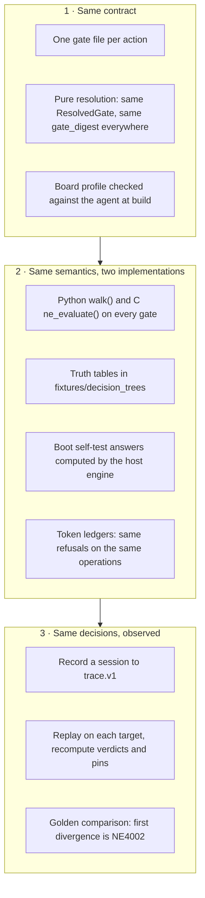

# 10 · Target Equivalence

> **Scope:** why the same agent and the same gate produce the same decisions on `sim`, `linux`, and
> `esp32s3`, how that is proven, and what it does **not** promise. **Source:** P-2 (PRD §1.5),
> FR-TGT, `docs/spec/simulation_coverage.md`, `python/neuroedge/testing/`, `targets/esp32s3/main/`.

**Why read this chapter:** For systems engineers, OEM partners, and QA teams. This chapter answers the question: *why the same agent and gate produce the exact same sequence of safety decisions across the simulator, a Linux computer, and an ESP32-S3 microcontroller, how that is protected, and where the limits lie*. Read after [`00-overview.md`](00-overview.md) and [`05-code-gate-hal-c4l4.md`](05-code-gate-hal-c4l4.md); read before implementing a HAL port in [`10-target-equivalence.md`](10-target-equivalence.md).

## 1. What Equivalence Means

Two runs are **equivalent** when, given the same input facts, they produce the same **decision sequence**: same
gate, same verdict, same reason, same `on_block` action, same pin command (pin, operation,
duration). Not compared: timing, spoken words, audio, display frames.

Agent code **must not branch by target** (P-2). Differences between environments reside entirely within the HAL and
the board profile.

### 1.1 Equivalence Commitments by Target Tier (Target Tiers)

Equivalence is not promised equally across all hardware. NeuroEdge clearly defines commitments across three tiers (Q-13, FR-TGT-08, `simulation_coverage.md` §7):

- **Tier 1 (`sim`, `linux`, `esp32s3`):** `neuroedge verify` achieves 100%; tested on every PR (`sim`, gpio-sim; QEMU for PRs touching `targets/**`) and nightly testing commitment on real boards (TSK-S4-05, TSK-I2-01 — not yet running).
- **Tier 2 (maintained by the core team; `jetson`, its example, was removed from the roadmap by Q-77):** `neuroedge verify` on the verdict domain; hardware testing per release cycle, not nightly.
- **Tier 3 (ported by community, e.g. `stm32`, `rp2350` ):** contributors self-verify via the Compliance Test Suite; the core team does not commit to quality and does not block releases for this tier.

Details on target tiering and expansion roadmap: [`15`](15-target-architecture.md) §4.1.

## 2. Three Layers of Defense



| Layer | Guarantee | Through |
|:---|:---|:---|
| **1 · Same contract** | Every target loads the same resolved policy | Resolution is a pure function (invariant 4); `gate_digest` matches across traces, in `NETR`, in tokens |
| **2 · Same semantics** | Python and C decide identically on all facts | `test_c_walker.py` (every gate, every truth table row, fuzz); `test_c_token.py`; boot self-test of the firmware itself |
| **3 · Same decisions, observed** | A real session yields the same decisions when replayed on another target | `neuroedge verify --targets sim,linux,esp32s3`; `GoldenComparator` |

## 3. Five Primitives × Three Targets Matrix


*Figure E-07 — Each cell: backend running it, where it is automated-tested, status.*

| Primitive | `sim` (`sim-default`) | `linux` (`linux-rpi5`) | `esp32s3` (`esp32s3-box-3`) |
|:---|:---|:---|:---|
| `digital.out` | `SimHAL`, single-use tokens — PR | libgpiod v2, find line by name — PR on gpio-sim | C walker + token ledger — host and QEMU; real pins `planned` (TSK-S4-01) |
| `audio.in` | typed text to grammar; WAV → VAD → STT — PR | WAV file — PR; real microphone via PipeWire — newly opened device | removed (Q-77), roadmap §6 |
| `audio.out` | sentence to speak; TTS → speaker timeline → WAV — PR | WAV file — PR; real speaker — not yet tested on hardware | removed (Q-77), roadmap §6 |
| `sensor.read` | emulated readings — PR | sysfs hwmon/IIO — PR on `i2c-stub` + `lm75` | `planned` (TSK-S4-03) |
| `display` | in-memory buffer, digest — PR | framebuffer — PR on `vfb`/`vkms` | LVGL interface: golden image on host — PR; real panel `planned` |

Three cells can only be tested on boards: `audio.in` and `audio.out` of `esp32s3`, and the acoustic part of `linux`.
They await nightly runners on real hardware (TSK-S4-05, TSK-I2-01).

## 4. Board Profile Rules

- **`sim` must not be richer than the reference board** (invariant 7). `sim-default` mirrors the exact capabilities of
  Box-3: an agent running on `sim` can also be deployed to `esp32s3`.
- **Two-way build reconciliation**: every primitive the agent needs (`[requires]`, each `@action(requires=…)`) must
  exist on the board, with matching pin names, matching sensors, sufficient sampling rate, and AEC if the agent requires it.
  Missing ⇒ `NE3001`, build halts, nothing is written. Example: `villa-concierge` requires `aec = true`, so it is rejected
  on `linux-rpi5` until the Pi measurements achieve echo cancellation (`simulation_coverage.md` §6.2).
- **Pin names are logical** (`door_lock`, `porch_light`, `gate_relay`); GPIO numbers belong to each target's HAL.
- The target list is closed at the three tier-1 targets (`sim`, `linux`, `esp32s3`; enum in `schemas/board.v1.json`). The code portion of RFC-0002 was removed from the roadmap (Q-77, TSK-V1a-02); roadmap §6.

## 5. What `verify` Does on Each Target

| Target | Replay Method | Requirements |
|:---|:---|:---|
| `sim` | `TracePlayer` on `SimHAL` | nothing |
| `linux` | `TracePlayer` on `LinuxHAL`, real GPIO line | real line or gpio-sim (`scripts/setup_gpio_sim.sh`) |
| `esp32s3` | **Firmware itself** replays three canonical traces at boot (`trace_vectors.c`) and sends results over UART; host reads (`--port`) and compares against golden | running firmware, on QEMU or real board |

Firmware replaying a trace or gate **older than** checkout ⇒ `NE4003` (outdated firmware), no comparison.
On `sim`/`linux`, a canonical trace recording a `gate_digest` different from what checkout gate compiles to also
⇒ `NE4003`, no comparison (RFC-0008): a canonical trace must be decided by the exact gate it was recorded with.
`neuroedge replay` on user traces is **not an error**: gates may be intentionally tightened
(quickstart, hour 3) — replay still recomputes verdicts, reports `SAFETY REGRESSION` as usual when diverging from
golden, and adds a warning indicating the gate has changed (old digest → new digest). Traces without
a `gate_digest` (recorded prior to RFC-0008) replay exactly as before.
An artifact type matching 0 files ⇒ `NE4004`, exit code 1: no empty "PASS".

> [!NOTE]
## 6. What Equivalence Does Not Promise

- **Timing.** `verify` compares decisions, not timing yet (TSK-S4-04).
- **Operations and duration on-chip.** On `esp32s3`, `operation` and `duration_ms` of pin commands today
  come from a table built on the host; the chip only decides whether to emit and on which pin (`TODOS.md` #37).
- **Audio quality** in real acoustics.
- **Tier-2 and tier-3 targets** (`simulation_coverage.md` §7, Q-13; see narrowed commitments in §1.1).

## 7. HAL Porting Guide for OEM Partners

> **Scope:** bringing NeuroEdge to a new board or a new chip — contracts to preserve, reusable code,
> code to write, and how to prove a port is correct. **Source:** `python/neuroedge/hal/`, `boards/`,
> `targets/esp32s3/components/`, `targets/esp32s3/main/`, `docs/spec/hal_mcu_review.md`, RFC-0002, Q-13.

### 7.1 What Can Be Ported Today

| Port Type | Possible Today? | Notes |
|:---|:---|:---|
| **New board for an existing target** (another Linux SBC, another ESP32-S3 board) | Technically yes; but `boards/` only accepts **reference board profiles for the three tier-1 targets** (four files since `sim-rpi5`, RFC-0013) while the target list stays closed (Q-77; `test_boards.py`), and the reference board for `esp32s3` is strictly Box-3 (invariant 6) | Used for internal experimentation; not publishable yet. From I2c (`planned`), community boards outside the repo are loaded via `--board <path>`, self-certified via `board validate`, and never serve as reference boards (TSK-I2c-05) |
| **New target** (`stm32`, `rp2350`, `jetson`) | **No**: the target list is closed at `sim`, `linux`, `esp32s3` in `schemas/` and `hal/board.py` (Q-77) | RFC-0002 is approved but its code was removed from the roadmap ([`neuroedge-roadmap.md`](../../../roadmap/neuroedge-roadmap.md) §6) |
| **Tier 3 self-tested by community** (Q-13) | No process: the porting kit (I13) was removed from the roadmap (Q-77) | This chapter describes what code exists today and what will change |

The remainder describes the **contract** — which does not change when the target list opens — and immediately reusable code.

### 7.2 Porting Contract

A port is correct when it fulfills all of the following conditions. Each condition is already covered by automated testing across the three tier-1 targets.

| # | Contract | Meaning | Verified By |
|:---:|:---|:---|:---|
| 1 | **Five primitives of v1.x — closed set** | `audio.in`, `audio.out`, `digital.out`, `sensor.read`, `display` (FR-HAL-01, KL-1). Tier 3 may omit some primitives depending on board capabilities, but must not add primitives arbitrarily. Any new primitive goes strictly through RFC (RFC-0007: `digital.in`; RFC-0010: PWM; RFC-0011: `motion.*`; RFC-0012: `vision.in`; RFC-0013: optional by board — Q-53; see [`15`](15-target-architecture.md) §4) | `board.v1`, `PRIMITIVES` |
| 2 | **Pins by name** | Agent code uses logical names (`door_lock`); physical pin numbers exist only inside HAL (KL-2) | build name reconciliation |
| 3 | **No pin moves without a token** | Pin commands check the pin name, invoke the plugged-in `authorize` function, and only then drive the pin. A HAL without an attached token ledger rejects all commands | `test_hal_sim.py`, `tests_linux/test_gpio_sim.py`, on-chip token self-test |
| 4 | **Missing devices raise errors, no pretending** | No `/dev/gpiochip*`, no sensor, failure to open microphone ⇒ three-part error **before** holding any pin (Q-16); never return default values | `LinuxHAL`'s `preflight` |
| 5 | **Every command leaves an event** | `actuator_command`, `actuator_aborted`, `sensor_read`, `display_frame`… with exact names and fields (`simulation_coverage.md` §3) | golden comparator |
| 6 | **Pending commands can be cancelled** | Barging in must cancel undelivered pulses within ≤ 1 audio frame (RB-3) | `test_voice_fsm.py` |
| 7 | **Declarations are data** | Board capabilities are a `board.toml` file (on-chip: `const` table in flash — RB-4), not code (KL-4) | `schemas/board.v1.json` |
| 8 | **Same decisions** | Replaying three canonical traces yields the exact same verdicts and pin commands as golden | `neuroedge verify --targets …` |

### 7.3 Board Declarations

Reference board profile, for reference:

```toml
schema = "neuroedge.board/v1"   # optional; omitted means v1, other versions rejected (RFC-0015 §3c)

[board]
id     = "esp32s3-box-3"
name   = "Espressif ESP32-S3-BOX-3"
target = "esp32s3"
mcu    = "esp32s3"

[capabilities.audio_in]
channels       = 2
sample_rate_hz = 16000
aec            = true
vad            = true

[capabilities.audio_out]
channels       = 1
sample_rate_hz = 16000

[capabilities.digital_out]
pins    = ["door_lock", "porch_light", "gate_relay"]
backend = "esp_driver_gpio"

[capabilities.sensor_read]
sensors = ["temperature", "humidity", "door_contact", "motion"]

[capabilities.display]
width  = 320
height = 240
color  = "rgb565"
```

Only declare what the HAL **can run and has measured**. For example, `linux-rpi5` keeps `aec = false` until echo
cancellation measurements on the Pi pass (`simulation_coverage.md` §6.2): declaring `true` prematurely promises what has not been proven.

### 7.4 Host-Side Porting (Python)

A host HAL is a subclass of `HardwareAbstractionLayer`. `SimHAL` and `LinuxHAL` are two complete
examples.

```python
from neuroedge import BoardProfile, HardwareAbstractionLayer

class MyBoardHAL(HardwareAbstractionLayer):
    def __init__(self, board: BoardProfile, *, events, authorize, **options) -> None:
        super().__init__(target="linux", board=board, authorize=authorize)
        self.events = events
        # open nothing yet: devices are checked in preflight(), before any line is held

    def preflight(self, sensors=(), display=False, audio=(), where="") -> None:
        ...  # open or probe every device the agent needs; raise BoardCapabilityError on the first gap

    def digital_out(self, pin, operation, duration_ms=0, signature="", called_from="<unknown>"):
        super().digital_out(pin, operation, duration_ms, signature, called_from)  # name check, authorize, record
        ...  # drive the physical line only after the base call returned
        self.events.emit("actuator_command", {"pin": pin, "operation": operation, "duration_ms": duration_ms})

    def sensor_read(self, sensor, called_from="<unknown>", use=None):
        ...  # read the device every time; raise, never return a default reading

    def close(self) -> None:
        ...  # every line back to inactive and released, on every exit path
```

Rules when writing:
- **Call `super().digital_out` before** driving the pin: it verifies the pin name (typos do not consume tokens) and invokes
  `authorize`. Do not check tokens yourself.
- **Do not import `engine`, `actions`, `models`** from HAL: `hal` is a leaf in the dependency graph
  (`test_architecture_layers.py::test_the_hal_is_a_leaf`).
- **External libraries are imported lazily** inside the function that needs them, accompanied by a three-part error pointing to the extension to install
  (pattern: `hal/linux.py::_import_gpiod`). Copyleft libraries may only be optional extensions (Q-11).
- **Release all resources on all exit paths**, including SIGTERM and SIGHUP.

### 7.5 Chip-Side Porting (C)

The core firmware is already **pure C99, independent of ESP-IDF**, so it can be reused verbatim on other chips:

| Code | Dependencies | Reuse |
|:---|:---|:---|
| `components/ne_gate/` (`NETR` walker, token ledger) | none | verbatim |
| `components/ne_trace/` (`NE1` line format) | `ne_gate` | verbatim |
| `components/ne_agent/` (generated per agent) | `ne_gate`, `ne_trace` | regenerated via `neuroedge build` |
| `main/gate_selftest.c`, `main/trace_vectors.c` | no ESP-IDF | verbatim |
| `components/ne_ota/src/ne_ota_policy.c` | none | verbatim; `ne_ota.c` is the ESP-IDF part that must be rewritten |
| `main/main.c`, `main/memory_probe.c` | ESP-IDF | rewrite for new platform |

A new platform only needs to provide **four connection points** — this constitutes the entire surface required by the C core:

```c
/* 1. entropy for token nonces — the shape of esp_fill_random */
typedef void (*ne_random_fn)(void *buf, size_t len);

/* 2 and 3. where trace lines go, and the device clock in milliseconds */
typedef struct {
    void (*emit)(void *ctx, const char *line);   /* one line to the UART, no newline */
    uint32_t (*now_ms)(void *ctx);
    void *ctx;
    char *buf;                                   /* at least NE_TRACE_LINE_MAX + 1 bytes */
    size_t cap;
    uint32_t t0_ms;
    uint32_t lines;
    uint32_t dropped;
} ne_trace_sink;

/* 4. run the boot self-test against the linked agent before anything else */
int neuroedge_gate_selftest(const ne_agent *agent, ne_random_fn fill_random, uint32_t boot_id,
                            uint32_t now_ms, char *line, size_t cap, ne_trace_sink *sink);
```

The boot sequence must match `esp32s3` ([`04`](04-component-device-c4l3.md) §4): self-test **before**
everything else, and halt on failure — no runtime gate, no action, no network.

**Not yet available:** C interface for driving pins, reading sensors, audio (on-chip HAL is TSK-S4-01). Once
available, it must call `ne_token_authorize` before driving pins, exactly as the host HAL calls `authorize`. Mandatory
memory constraints for it: RB-1…RB-4 (`docs/spec/hal_mcu_review.md` §2) — zero allocation on the audio path,
measurable static buffers, command cancellation within ≤ 1 frame, `const` capability tables.

### 7.6 Proving a Correct Port

| Step | Command | Passes When |
|:---:|:---|:---|
| 1 | `neuroedge board show <id>` and `neuroedge build --target <t> --board <id>` with each sample agent | board-compatible agents build successfully; agents requiring features the board lacks are rejected with `NE3001` |
| 2 | Host-side core C tests: `make -C targets/esp32s3/components/ne_gate` and `make … check-static` | all tests pass under ASan/UBSan; no `.data`/`.bss`; stack per function ≤ 512 bytes |
| 3 | Boot firmware | line `NE_SELFTEST PASS walker=<n> token=<n>` at column 0 on UART |
| 4 | `neuroedge record --target <t> --port <source>` then `neuroedge trace validate` | all `NE1` sessions convert to valid `trace.v1` |
| 5 | `neuroedge verify --targets <t> --port <source>` (chip) or `neuroedge verify --targets sim,<t>` (host) | three canonical traces yield identical decisions; divergence ⇒ `NE4002` |
| 6 | Tool call and voice corpus on the new HAL | matches `expected_results.yaml` |

Tools for packaging the vector suite to run **outside** the repo, and the `board check` command, were part of I13 (`TSK-P1-01`,
`TSK-P1-05`), removed from the roadmap (Q-77).

### 7.7 Assets and Licensing of a Port

- Partner HAL drivers belong **to the partner**; they only need to preserve the contract in §2.
- All bundled dependencies, models, and fonts must be on the allowlist in Q-11 and recorded in
  `NOTICE`. Nothing non-commercial may be bundled (Q-45).
- Standards — `schemas/`, `docs/spec/`, `fixtures/compliance/` — use Apache-2.0 so anyone can implement them;
  NeuroEdge code uses PolyForm Noncommercial (`LICENSING.md`).
