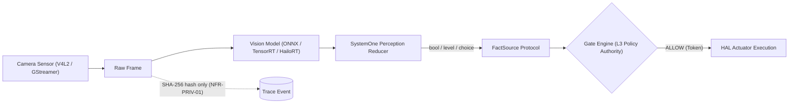
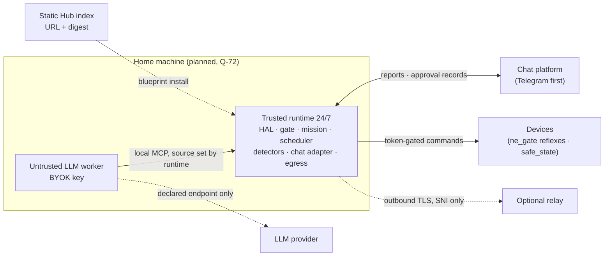

# 15 · Target Architecture by Horizon

> **Scope:** to-be architecture of NeuroEdge across three development horizons. **Source of truth:**
> [`neuroedge-roadmap.md`](../../../roadmap/neuroedge-roadmap.md) §2.1, §3, §4.3–§4.8, §5, §6, §7, Appendix D;
> [`neuroedge-prd.md`](../../../roadmap/neuroedge-prd.md) §15, Appendix D.2;
> `docs/architecture/vi/00-overview.md` §5.1;
> [`lab_mcp.md`](../../spec/lab_mcp.md);
> [`draft-rfc-node-giao-thuc-dieu-phoi.md`](../../rfc/draft-rfc-node-giao-thuc-dieu-phoi.md) §3;
> Q-72 band: [`proposal-blueprint-2026-10-11.md`](../../business/proposal-blueprint-2026-10-11.md) and Q-72 in PRD §15.
> **Status conventions:** `done` / `partial` / `planned`.

**Why read this chapter:** For software architects, embedded engineers, and systems engineers who need to understand the target architecture (to-be architecture) of NeuroEdge across each stage of completion. This document answers: *Which components, drivers, protocols, and services does each horizon introduce? How are safety boundaries and fail-closed mechanisms ([fail-closed](../../user/thuat-ngu.md): if a gate cannot be evaluated, block; if network is lost, the gate still evaluates via local fallback, blocking only when fallback is absent or fails to run — Q-14) preserved when scaling from a single chip to multi-node robot systems and cloud computing?* Before reading, readers should understand the high-level picture in [`00`](00-overview.md) and the current evolution status in roadmap §0.5. After this chapter, continue to [`16`](16-ecosystem-landscape.md) for the complete picture of participants across the extended ecosystem.

---

## 1. Three Horizons

> **Q-77 (2026-10-12):** horizons 2 and 3 have been dropped from the roadmap; their sections remain as single-line placeholders. Current plan: horizon 1 (v1.0) and the Q-72 → Q-76 band in §6.

NeuroEdge's architectural evolution roadmap is divided into three **horizons** (architectural development stages with defined capability boundaries and execution environments):

| Horizon | Increments | Architectural Changes (What & Why Needed) | Design Location |
|:---|:---|:---|:---|
| **Q-72 band** — run and share (`planned · Q-72`) | I2d, I2e | Blueprint positioning ([`Q-72`](../../../roadmap/neuroedge-prd.md#15-sổ-quyết-định)) placed **before** the rest of H1: mission contracts, operator agents running 24/7 on a home machine (trusted runtime + untrusted LLM worker), chat channels with approval records, leak-proof data flows, segmented traces (I2d); then minimal NeuroEdge Blueprint — `blueprint pack`/`install`, full-package digest, static Hub index (I2e). Optional relay lies outside these two increments. Simulation first (G1–G4), real hardware purchased later. Voice, Studio, and `jetson` paused; v1.0 scope is not cut but reassessed at the 8-week demand gate (Q-52 reordered by Q-72). Needed for loop ② run and loop ③ share, selling with a safety architecture before code exists. | §6 below; [`proposal-blueprint-2026-10-11.md`](../../business/proposal-blueprint-2026-10-11.md); roadmap [§0.2](../../../roadmap/neuroedge-roadmap.md#02-bảng-increment-increment-matrix) |
| **Horizon 1 (H1)** — v1.0 = on-device MVP | I2a–I7 | Complete firmware on ESP32-S3 chip: bring 5 HAL primitives to real silicon, hardware drivers (I2S codec, ST7789 LCD, GPIO), real-time voice pipeline (AEC, VAD, Opus streaming), C99 conversational state machine, actuator command abort mechanism on barge-in (`actuator_abort.c`), WebSocket streaming client to cloud, offline fixed command recognition fallback when network is lost ([`Q-14`](../../../roadmap/neuroedge-prd.md#15-sổ-quyết-định)), hardware security (Secure Boot, flash encryption, physical microphone disconnect, anti-rollback eFuse), LVGL interface bound to display drivers. In the same horizon are four mandatory extension primitive packs across all three tier-1 targets — sensors, PWM, vision, motion ([`Q-53`](../../../roadmap/neuroedge-prd.md#15-sổ-quyết-định), I2a and I3a) — **open platform** ([`Q-67`](../../../roadmap/neuroedge-prd.md#15-sổ-quyết-định), I2c: standalone core, Extension SDK, proxy, remote actuators, community index, tiered open target list; see [`16`](16-ecosystem-landscape.md) §3, §8) — and **NeuroEdge Lab over MCP** ([`Q-55`](../../../roadmap/neuroedge-prd.md#15-sổ-quyết-định), [`Q-71`](../../../roadmap/neuroedge-prd.md#15-sổ-quyết-định), I4a on host, I5a on chip); single launch, reschedule if slipping rather than cut scope ([`Q-52`](../../../roadmap/neuroedge-prd.md#15-sổ-quyết-định)). Premise for "talking to a $5 chip" demo (roadmap §6): voice on Box-3, gates on-chip. | Roadmap [§4.3.1](../../../roadmap/neuroedge-roadmap.md#431-i2a--nguyên-thủy-mở-rộng-trên-sim-và-linux), [§4.3.3](../../../roadmap/neuroedge-roadmap.md#433-i2c--nền-tảng-mở), [§4.4–§4.8](../../../roadmap/neuroedge-roadmap.md#44-i3--gate-trên-box-3-thật), PRD [Appendix D.2](../../../roadmap/neuroedge-prd.md#d2-giao-thức-truyền-dẫn--định-dạng-vết-ghi-wire-protocol), [`04`](04-component-device-c4l3.md) |
| **Horizon 2 (H2)** — Service tier v1.1 | I9–I10 | Introduction of two new server-side containers: **Fleet OS** (identity provisioning, inventory ledger, health monitoring, remote config and gate sync, canary rollout campaign orchestration via Eclipse Hawkbit, centralized incident trace repository, certificate revocation) and **Gate Registry** (public OCI repository via CNCF ORAS/Harbor, stable identifiers, metering via OpenMeter, sandboxed authorization, manifest `schemas/manifest.v1.json`, signed gates with on-chip signature verification, `extends` pinned by digest). Complete self-hosted provider abstraction layer (multi-provider routing, failover, quota). Necessary for managing large fleets of devices without compromising each device's safety autonomy. | Roadmap [§6](../../../roadmap/neuroedge-roadmap.md#6-tầng-dịch-vụ-v11-i9i10), PRD [`Q-6`](../../../roadmap/neuroedge-prd.md#15-sổ-quyết-định), [`Q-28`](../../../roadmap/neuroedge-prd.md#15-sổ-quyết-định), [`02`](02-container-c4l2.md) §5 |
| **Horizon 3 (H3)** — Post-Beta extensions | I13, I14, I16–I18 | Community port kit (I13) based on 3 [target tiers](../../user/thuat-ngu.md); opening target list (formerly I11) merged into I2c in H1 ([`Q-67`](../../../roadmap/neuroedge-prd.md#15-sổ-quyết-định)); **Layered robot** (I14) coordinating Pi 5 brain and multiple MCU nodes (ESP32-S3, RP2350) over Zenoh-pico [black channel](../../user/thuat-ngu.md), each node evaluating gates autonomously, [leased tokens](../../user/thuat-ngu.md) (lease) for `motion.*`, safe state on loss of comms, ROS 2/Nav2 bridge; **Vision on `jetson` and multimodal** (I16, I17) extending L2 perception to Jetson GPU (basic vision on `sim`, `linux`, `esp32s3` landed in v1.0 — Q-53, Q-54); **Ecosystem** (I18) sharing adapters and HAL ports on Registry. Necessary for NeuroEdge to expand to complex motion systems, robotic arms, and multisensory perception. NeuroEdge Lab (I4a, I5a; formerly NeuroBrain), `vision.in` (I2a, I3a), and opening target list (I2c) moved to H1; §4.2 and §4.4 below preserve their designs. | Roadmap [§7](../../../roadmap/neuroedge-roadmap.md#7-hướng-mở-rộng-sau-beta-i13-i14-i16i18), `docs/spec/lab_mcp.md`, §4.4, §4.3, [`draft-rfc-node-giao-thuc-dieu-phoi.md`](../../rfc/draft-rfc-node-giao-thuc-dieu-phoi.md) |


*Figure E-10 — Six bands: current status on main, three horizons, the Q-72 band (I2d, I2e), and the Q-73 / Q-74 band (verification step, cloud brain, multi-node mesh — I2d, I2f, §6.10); dashed blocks are planned. Generated by scripts/gen_architecture_diagrams.py.*

*How to read Figure E-10:* The figure illustrates horizontal bands corresponding to current codebase status on the `main` branch, the Q-72 band (`planned · Q-72`, §6), and three planned consecutive horizons. Solid blocks have existing code (◐ indicates partial), dashed blocks are planned. Connector labels between bands (same walker + ledger, verify on chip, no paid safety) show that subsequent horizons reuse the walker, token ledger, and gates of earlier horizons.

Evolution relationship diagram across three horizons:

```mermaid
flowchart LR
    subgraph H1["Horizon 1: On-Device v1.0 = MVP (I2a-I7)"]
        H1_HAL["On-chip HAL and Drivers (TSK-S4-01, S4-03)"]
        H1_VOICE["On-chip Voice Pipeline and FSM (TSK-S5-01..03)"]
        H1_ABORT["Actuator Abort on Barge-in (TSK-S5-04)"]
        H1_FALLBACK["Local Offline Fallback (TSK-S5-07, Q-14)"]
        H1_SEC["Hardware Security (TSK-S6-05) and Signed OTA (TSK-S6-03)"]
        H1_PACKS["Extension Packs: Sensors, PWM, Vision, Motion (I2a, I3a)"]
        H1_BRAIN["NeuroEdge Lab over MCP: lab tools, lab check, Envelope (I4a, I5a)"]
        H1_OPEN["Open Platform: SDK, Proxies, Open Target List (I2c)"]
    end

    subgraph Q72["Q-72 band, planned: Run and Share (I2d, I2e)"]
        Q_MSN["Mission contracts and operating agent: runtime + LLM worker (I2d)"]
        Q_CH["Chat channel and approval records (I2d)"]
        Q_BP["NeuroEdge Blueprint: pack, install, static Hub index (I2e)"]
        Q_RELAY["Optional relay: TLS pass-through, no decryption (Q-72)"]
    end

    subgraph H2["Horizon 2: Service Tier v1.1 (I9-I10)"]
        H2_FLEET["Fleet OS: Provisioning, Canary, Traces (TSK-K2-04..09)"]
        H2_REG["Gate Registry: OCI, Metering, Sandbox (TSK-K3-01..06)"]
        H2_GW["Self-hosted Provider Layer: Routing and Quotas (TSK-K2-01..03)"]
        H2_VERIF["Signed Gate On-Device Verification (TSK-W2-04)"]
    end

    subgraph H3["Horizon 3: Post-Beta Extensions (I13-I18, without I15)"]
        H3_TIERS["Community Port Kit on the Open Tier List (I13)"]
        H3_ROBOT["Layered Robot: Zenoh, Node Gates, Leases (I14)"]
        H3_VISION["Perception: Vision on jetson, Fusion (I16, I17)"]
        H3_ECO["Ecosystem: Registry Adapters and Ports (I18)"]
    end

    H1 --> H2
    H1 --> H3
    Q72 -.->|"Hub moves to the Registry once it charges"| H2
```



*How to read the diagram:* The Q-72 band (dashed, `planned · Q-72`) builds upon the H1 foundation up to I2c and precedes the remainder of H1; once the Hub monetizes, Blueprint distribution moves to H2's Gate Registry (§6.4). The other three rectangular blocks represent the three architectural horizons. Arrows from H1 to H2 and H3 signify that all Horizon 1 on-device safety mechanisms and target equivalence guarantees are strict prerequisites before enabling cloud service tiers (H2) or multi-node/Jetson expansion (H3). The core takeaway: adding management services or layered robots never degrades or violates the safety guarantees packaged on the H1 device.

---


*Figure E-09 — Eight release milestones post-Q-77 (milestone 8 is conditional I2f, Q-74), each milestone grouping its increments; status, progress, and forecast date.*

## 2. Horizon 1 — On-Device v1.0 (I2a–I7)

### 2.1 Planned Firmware Components

On the ESP32-S3 microcontroller, components with existing code on `main` include the `components/ne_gate/` walker, the `components/ne_trace/` trace formatter, the agent-specific generator `components/ne_agent/`, and the update module `components/ne_ota/` (already running on Espressif QEMU, details in [`04`](04-component-device-c4l3.md) §3). The table below plans the components that need to be added and completed on real hardware from tasks I3–I7 (extension primitive packs and NeuroEdge Lab: I2a, I3a, I4a, I5a):

| Component (Planned Path) | What & Why Needed | Governing Task | Open Source Reuse (Roadmap §3) | Status |
|:---|:---|:---|:---|:---:|
| `targets/esp32s3/hal/` | Implementation of 5 HAL primitives on ESP-IDF; necessary to provide standard physical pin interfaces equivalent to `sim` and `linux`. | [`TSK-S4-01`](../../../roadmap/neuroedge-roadmap.md#44-i3--gate-trên-box-3-thật) | ESP-IDF (toolchain) — roadmap §4.4 | `planned` |
| `targets/esp32s3/hal/` (four extension packs) | `digital.in`, read-only I2C bus, `analog.in`, PWM, `motion.*`, and `vision.in` on ESP32-S3 camera boards, alongside safety envelope enforcement in firmware; necessary for the four packs to run on-chip on par with `sim` and `linux` (Q-53, Q-55). | [`TSK-I3a-02`](../../../roadmap/neuroedge-roadmap.md#441-i3a--nguyên-thủy-mở-rộng-trên-esp32s3), [`TSK-I3a-03`](../../../roadmap/neuroedge-roadmap.md#441-i3a--nguyên-thủy-mở-rộng-trên-esp32s3), [`TSK-W1-04`](../../../roadmap/neuroedge-roadmap.md#441-i3a--nguyên-thủy-mở-rộng-trên-esp32s3), [`TSK-I3a-04`](../../../roadmap/neuroedge-roadmap.md#441-i3a--nguyên-thủy-mở-rộng-trên-esp32s3), [`TSK-N7-02`](../../../roadmap/neuroedge-roadmap.md#441-i3a--nguyên-thủy-mở-rộng-trên-esp32s3) | Per RFC-0007, RFC-0010 → RFC-0013 contracts | `planned` |
| `targets/esp32s3/drivers/` | Real peripheral drivers: I2S ES8311/ES7210 codec, ST7789 LCD, GPIO; necessary to directly control Box-3 hardware registers. | [`TSK-S4-03`](../../../roadmap/neuroedge-roadmap.md#44-i3--gate-trên-box-3-thật) | Direct driver port from XiaoZhi ESP32 (roadmap [§3.4](../../../roadmap/neuroedge-roadmap.md#34-ma-trận-tích-hợp-theo-khối), [§3.5](../../../roadmap/neuroedge-roadmap.md#35-năm-dự-án-port-trực-tiếp)) | `planned` |
| `targets/esp32s3/drivers/audio_path.c` | Audio capture/playback path; necessary to pipe I2S streams from codec into circular buffers without running STT/TTS on-device. | [`TSK-S5-02`](../../../roadmap/neuroedge-roadmap.md#46-i5--thoại-trên-box-3) | Codec configuration and I2S clock port from XiaoZhi ESP32 (roadmap [§3.5](../../../roadmap/neuroedge-roadmap.md#35-năm-dự-án-port-trực-tiếp)) | `planned` |
| `targets/esp32s3/audio/` | WebRTC AEC, libfvad (VAD), Opus streaming integration; necessary for echo cancellation, silence suppression, and real-time audio compression. | [`TSK-S5-01`](../../../roadmap/neuroedge-roadmap.md#46-i5--thoại-trên-box-3) | WebRTC AEC, libfvad, Opus; pipeline port from Pipecat (roadmap [§3.4](../../../roadmap/neuroedge-roadmap.md#34-ma-trận-tích-hợp-theo-khối), [§3.5](../../../roadmap/neuroedge-roadmap.md#35-năm-dự-án-port-trực-tiếp)) | `planned` |
| `targets/esp32s3/fsm/voice_fsm.c` | C/C++ implementation of the 5-state conversational state machine; necessary to synchronize conversation behavior precisely with Python host version. | [`TSK-S5-03`](../../../roadmap/neuroedge-roadmap.md#46-i5--thoại-trên-box-3) | Canonical specification [`voice_fsm.md`](../../spec/voice_fsm.md), passing compliance vector suite TSK-S3-10 (roadmap [§3.8](../../../roadmap/neuroedge-roadmap.md#38-bảo-toàn-tương-đương-target-khi-có-hai-ngôn-ngữ)) | `planned` |
| `targets/esp32s3/fsm/actuator_abort.c` | Mechanism to revoke unexecuted actuator commands on barge-in (≤ 20 ms, close token); necessary to prevent physical command leaks when users change their mind. | [`TSK-S5-04`](../../../roadmap/neuroedge-roadmap.md#46-i5--thoại-trên-box-3) | Barge-in mechanism from Pipecat (roadmap [§3.5](../../../roadmap/neuroedge-roadmap.md#35-năm-dự-án-port-trực-tiếp)), contract [`voice_fsm.md`](../../spec/voice_fsm.md) §5 | `planned` |
| `targets/esp32s3/audio/provider_client.c` | Audio streaming client pushing Opus frames to STT, receiving TTS stream over WebSocket; necessary for low-latency network communication with cloud provider. | [`TSK-S5-06`](../../../roadmap/neuroedge-roadmap.md#46-i5--thoại-trên-box-3) | Binary WebSocket streaming loop from XiaoZhi ESP32 (roadmap [§3.5](../../../roadmap/neuroedge-roadmap.md#35-năm-dự-án-port-trực-tiếp)) | `planned` |
| `targets/esp32s3/fallback/` | Local offline fixed command recognizer; necessary to maintain safe commanding capabilities when Internet connection is lost ([`Q-14`](../../../roadmap/neuroedge-prd.md#15-sổ-quyết-định)). | [`TSK-S5-07`](../../../roadmap/neuroedge-roadmap.md#46-i5--thoại-trên-box-3) | ESP-SR MultiNet or TFLite Micro / ESP-NN (roadmap [§4.6](../../../roadmap/neuroedge-roadmap.md#46-i5--thoại-trên-box-3)) | `planned` |
| `targets/esp32s3/security/` | Hardware security block: Secure Boot, flash encryption, physical microphone disconnect button, eFuse; necessary to prevent pirated firmware loading and eavesdropping. | [`TSK-S6-05`](../../../roadmap/neuroedge-roadmap.md#48-i7--v10) | ESP-IDF (specific components not yet selected) | `planned` |
| `targets/esp32s3/ui/` | 9 screens built and golden-image compared on host (TSK-S4-10 done); not yet linked into firmware, awaiting display driver (TSK-S4-01). Necessary to display status and confirmation prompts. | [`TSK-S4-01`](../../../roadmap/neuroedge-roadmap.md#44-i3--gate-trên-box-3-thật), [`TSK-S4-10`](../../../roadmap/neuroedge-roadmap.md#44-i3--gate-trên-box-3-thật) | LVGL v9 embedded graphics library (roadmap [§3.4](../../../roadmap/neuroedge-roadmap.md#34-ma-trận-tích-hợp-theo-khối)) | `partial` |
| `targets/esp32s3/sdkconfig.defaults` | Configuration file already in repo; memory optimization tuning to meet SRAM ≥ 120 KB, PSRAM ≥ 2 MB budget ([`Q-3`](../../../roadmap/neuroedge-prd.md#15-sổ-quyết-định)) for voice path is planned. | [`TSK-S5-05`](../../../roadmap/neuroedge-roadmap.md#46-i5--thoại-trên-box-3) | ESP-IDF Kconfig | `planned` |

### 2.2 On-Chip Voice Pipeline — Dropped from v1.0 (Q-77)

Q-77 dropped voice from the roadmap (roadmap §6). Host voice code remains intact; for on-chip voice design refer to pre-Q-77 revisions (`git show f7278fc:docs/architecture/vi/15-target-architecture.md`).

### 2.3 Planned Protocols

Transport protocols are planned according to open standards and optimized for microcontroller resources (PRD [Appendix D.2](../../../roadmap/neuroedge-prd.md#d2-giao-thức-truyền-dẫn--định-dạng-vết-ghi-wire-protocol), roadmap [Appendix D](../../../roadmap/neuroedge-roadmap.md#phụ-lục-d--giao-thức-truyền-dẫn)):

1. **Wi-Fi / LAN Network Protocol:**
   - **Transport channel:** Secure `WebSocket` (WSS).
   - **Binary Frame:** transports Opus Voice Mode audio stream (16 kbps, 16 kHz mono, frame size 20 ms = 320 samples). All targets adhere to this exact format. `sim` replays WAV files through this exact encoding path to preserve equivalence with real silicon. Status: `planned`.
   - **Text Frame:** transports JSON trace events (PRD Appendix D.2). Status: `planned`.
2. **UART Serial Port Protocol:**
   - **Baud rate:** **not yet decided** — PRD Appendix D.2 states 921600, but `sdkconfig.defaults` does not specify it (ESP-IDF defaults to 115200) and Box-3 can route console over USB-Serial-JTAG; to be decided when hardware arrives ([`TODOS.md`](../../../TODOS.md) #35, [`TSK-S4-12`](../../../roadmap/neuroedge-roadmap.md#44-i3--gate-trên-box-3-thật)).
   - **Trace format:** JSON Lines, each line prefixed with fixed `NE1 ` to separate from firmware logs. `NE1 ` line trace format is completed on host and QEMU ([`TSK-S4-09`](../../../roadmap/neuroedge-roadmap.md#44-i3--gate-trên-box-3-thật), `docs/spec/simulation_coverage.md` §4).
   - **Binary encapsulation:** When binary transport is needed, frame encapsulation uses `SLIP` (Serial Line Internet Protocol) per PRD Appendix D.2. Status: `planned`.

### 2.4 Device Security

Hardware security architecture at Horizon 1 establishes an integrity defense perimeter for the device:

- **Secure Boot:** enable Secure Boot on ESP32-S3 ([`TSK-S6-05`](../../../roadmap/neuroedge-roadmap.md#48-i7--v10), NFR-SEC-02); signature algorithm not yet selected (NFR-SEC-02 does not specify algorithm; RSA-3072 today is used for OTA image signatures per FR-OTA-03, [`TSK-S6-03`](../../../roadmap/neuroedge-roadmap.md#48-i7--v10)). Without Secure Boot, anyone with a cable can alter firmware (roadmap [`TSK-S6-03`](../../../roadmap/neuroedge-roadmap.md#48-i7--v10)).
- **Flash encryption:** enable flash encryption on ESP32-S3 ([`TSK-S6-05`](../../../roadmap/neuroedge-roadmap.md#48-i7--v10), NFR-SEC-02); algorithm and key management not yet designed.
- **Physical microphone disconnect button:** reference board includes a physical microphone disconnect button ([`TSK-S6-05`](../../../roadmap/neuroedge-roadmap.md#48-i7--v10), NFR-SEC-03); power cut vs. signal cut not yet designed.
- **Anti-rollback eFuse:** anti-downgrade via eFuse paired with Secure Boot ([`TSK-S6-05`](../../../roadmap/neuroedge-roadmap.md#48-i7--v10); roadmap [`TSK-S6-03`](../../../roadmap/neuroedge-roadmap.md#48-i7--v10)). Today downgrades are only prevented by milestones in NVS — i.e., software protection.
- **OTA update mechanism:** Device-level OTA updates — dual A/B partitions (`ota_0`, `ota_1`), RSA-3072 signature verification on downloaded images, and automatic rollback upon bootloop detection or self-test failure — are implemented on QEMU and described in detail in [`04`](04-component-device-c4l3.md) §6.

---

## 3. Horizon 2 — Service Tier v1.1 (Dropped, Q-77; §3.4 Preserved)

### 3.1 Fleet OS — Dropped (Q-75, Q-77)

Fleet management is not implemented before user demand; reopening milestones in roadmap §6.

### 3.2 Gate Registry — Dropped (Q-77)

Blueprint Hub (I2e, §6.4) serves as the distribution channel; reopening milestones in roadmap §6.

### 3.3 Self-Hosted Provider Layer — Dropped (Q-77)

LiteLLM in core and NeuroEdge brain (Q-76, §6.10) handle LLM calls.

### 3.4 Boundary: Core ↔ Commercial Services

To ensure transparency and avoid "open-core" ambiguity, the boundary between the source-available Core and the commercial Fleet OS Service is fixed invariantly according to:

| Criterion | Source-Available Core ([`Q-45`](../../../roadmap/neuroedge-prd.md#15-sổ-quyết-định)) | Commercial Fleet OS Service (Cloud) |
|:---|:---|:---|
| **Core feature definition** | Entire on-device logic, safety mechanisms, perception runtime, and CI testing | Remote orchestration infrastructure, centralized storage, and fleet management dashboard |
| **OTA update mechanism** | **Device-level (On-device OTA Agent):**<br>• Self-fetches firmware via open HTTP endpoint<br>• Dual-partition scheme (A/B)<br>• Local automatic rollback on bootloop detection<br>• On-chip cryptographic signature verification (RSA/ECDSA) | **Fleet-level (Fleet Rollout Orchestration):**<br>• Phased rollouts (Canary 1% → 10% → 100%)<br>• Campaign management<br>• Automatic campaign halt and recovery if fleet error rate exceeds threshold<br>• Centralized firmware repository |
| **Error capture & reproduction** | Logs traces to local JSON files (`traces/*.json`); runs `neuroedge replay` command on personal computers | Automatic remote trace JSON upload on incidents; centralized trace store and cloud regression analysis tools |
| **Offline operation** | Safety functions (gates, state machines, fail-closed) run 100% offline; degraded perception falls back to local fixed-command recognizer ([`Q-14`](../../../roadmap/neuroedge-prd.md#15-sổ-quyết-định)) — STT, TTS, and LLM inference require connection to cloud provider | Requires connectivity to synchronize telemetry and receive orchestration commands |
| **Account requirements** | None whatsoever, installs and runs immediately | Requires organizational authentication account |
| **Self-hosting capability** | Fully supported via open interfaces (pluggable backend) | Customers maintain their own infrastructure or use turnkey cloud services |
| **AI provider connectivity layer** | Self-hosted abstraction layer: users configure providers, manage keys, and pay inference costs directly to providers | Non-commercialized — NeuroEdge does not resell tokens |
| **Third-party adapters and HAL ports** | Authors retain full copyright and choose their own licenses; code resides in authors' repositories, NeuroEdge only indexes in Registry. Safety responsibility rests with device operators. Quality gates are Compliance Test Suite, sandboxed permissions, and build-time capability checks | Non-commercialized. Fleet OS displays compliance status of adapters running across the fleet, but does not sell, endorse, or gatekeep any adapter behind a paywall |
| **NeuroEdge Blueprint distribution** (`planned · Q-72`, I2e) | `blueprint pack`/`install`, full-package digest verification, no account required; Hub index is a static git repository, not a service (§6.4) | Monetized Hub and revenue sharing for sellers only after the 8-week demand gate, then transitioning to OCI Gate Registry (§3.2); selling Blueprints or devices constitutes commercial use per Q-45 |
| **Remote access relay** (`planned · Q-72`) | Not needed: local UI, chat channels talk directly to chat platforms; all safety guarantees run without a relay | Optional paid relay: TLS pass-through tunnel by SNI, no decryption, backup of encrypted traces on home machine (§6.5) |
| **Gate & trace format licensing** | Apache-2.0 open standards ([`Q-45`](../../../roadmap/neuroedge-prd.md#15-sổ-quyết-định)) via RFC process, neutral transfer commitment | Inherits open standards, no closed variants created |

**Non-goals:**
1. **No account required for safety:** All safety functionality — gate evaluation, single-use token issuance, and HAL fail-closed enforcement — operates 100% independently on-device without creating an account or connecting to NeuroEdge servers (§3.4; [`P-3`](../../../roadmap/neuroedge-prd.md#15-năm-nguyên-tắc-thiết-kế-bất-biến): safety features are never unbundled into paid tiers).
2. **No reselling of inference tokens:** NeuroEdge never acts as an AI token reseller (PRD §1.4 N4); users pay model providers directly based on actual usage.

---

## 4. Horizon 3 — Post-Beta Extensions (Dropped, Q-77; §4.4 Preserved)

> **Note:** I11 (opening target list) merged into I2c ([`Q-67`](../../../roadmap/neuroedge-prd.md#15-sổ-quyết-định)); I12 (NeuroBrain) and I15 (vision) are no longer increments. NeuroEdge Lab (formerly NeuroBrain) belongs to MVP in I4a and I5a ([`Q-55`](../../../roadmap/neuroedge-prd.md#15-sổ-quyết-định), [`Q-71`](../../../roadmap/neuroedge-prd.md#15-sổ-quyết-định)); basic vision belongs to MVP in I2a and I3a ([`Q-53`](../../../roadmap/neuroedge-prd.md#15-sổ-quyết-định), [`Q-54`](../../../roadmap/neuroedge-prd.md#15-sổ-quyết-định)). §4.1, §4.2, and the beginning of §4.4 remain here so as not to decouple design from adjacent sections; dates and dependencies reside solely in roadmap §0.2.

### 4.1 Target Tiers and Open Target List — Dropped (Q-77)

The three tier-1 targets remain unchanged. Common ESP32-S3 boards and the Arduino library (I3a, Q-75) replace opening the target list to third parties.

### 4.2 NeuroEdge Lab over MCP — Dropped (Q-77)

The standard MCP toolset (TSK-I2d-23) and the user's existing brain or MCP client (Q-76) replace the Lab's build loop. The Lab design remains in `docs/spec/lab_mcp.md` for reference.

### 4.3 Layered Robot — Dropped (Q-77)

Minimal Pi ↔ ESP32 link (heartbeat, `safe_state` on loss of comms) in I3a (Q-75); multi-node home mesh in §6.10. Multi-node robot design remains in draft RFC node.

### 4.4 Vision (I2a, I3a; `jetson` I16, Multimodal I17)

Vision expands NeuroEdge's perceptual capabilities from audio to imagery; `vision.in` on `sim`, `linux`, and `esp32s3` belongs to v1.0 (Roadmap [§4.3.1](../../../roadmap/neuroedge-roadmap.md#431-i2a--nguyên-thủy-mở-rộng-trên-sim-và-linux), [§4.4.1](../../../roadmap/neuroedge-roadmap.md#441-i3a--nguyên-thủy-mở-rộng-trên-esp32s3), [§7.6–§7.7](../../../roadmap/neuroedge-roadmap.md#76-i16--thị-giác-trên-jetson), §4.4–§8):



*How to read the diagram:* Solid arrows represent the data pipeline: camera sensors capture frames, vision models run inference, and the SystemOne reducer converts tensors into discrete facts (`bool`, `level`, `choice`) fed into FactSource for the Gate Engine. Dashed arrows denote privacy preservation. The core takeaway: vision models serve strictly as L2 perception fact sources; Gate Engine L3 retains independent action verdict authority; traces never contain raw frames.

- **L2 vs. L3 Authority Principle:** Vision is an L2 perception input, strictly **never an L3 verdict authority** (§4.4). Under [`Q-54`](../../../roadmap/neuroedge-prd.md#15-sổ-quyết-định), makers define facts (`bool`, `level`, or `choice`, with numeric confidence) from vision model labels and write `@action` and gates as with any other facts; gates threshold confidence via `numeric` criteria (RFC-0009), without vision-specific gate semantics. If camera or model is lost, facts remain undecided and gates block (§4.4). The gate engine preserves its determinism and never receives image tensors.
- **Software Components:** The vision module resides in the package `python/neuroedge/perception/vision/` ([`TSK-V1b-03`](../../../roadmap/neuroedge-roadmap.md#431-i2a--nguyên-thủy-mở-rộng-trên-sim-và-linux)). The `sim` environment provides a virtual camera replaying image sequences for Action CI regression testing without physical cameras ([`TSK-V1b-02`](../../../roadmap/neuroedge-roadmap.md#431-i2a--nguyên-thủy-mở-rộng-trên-sim-và-linux), [`TSK-V1b-04`](../../../roadmap/neuroedge-roadmap.md#431-i2a--nguyên-thủy-mở-rộng-trên-sim-và-linux)).
- **Hardware Accelerators:**
  - On `linux` (Raspberry Pi 5): uses GStreamer and V4L2 for frame capture pipeline; Ultralytics YOLO and ONNX Runtime for models; discrete NPU connection via HailoRT (Hailo-8) and Edge TPU runtime (Coral) ([`TSK-V1b-05`](../../../roadmap/neuroedge-roadmap.md#431-i2a--nguyên-thủy-mở-rộng-trên-sim-và-linux)).
  - On `jetson` (Tier 2, I16): integrates JetPack and TensorRT for GPU acceleration; DeepStream processes multi-camera real-time pipelines ([`TSK-V2-01`](../../../roadmap/neuroedge-roadmap.md#76-i16--thị-giác-trên-jetson), [`TSK-V2-02`](../../../roadmap/neuroedge-roadmap.md#76-i16--thị-giác-trên-jetson)).
  - Multimodal (I17): fuses voice, vision, and sensor perception in a single state machine (`perception/fusion/`, [`TSK-V3-01`](../../../roadmap/neuroedge-roadmap.md#77-i17--đa-phương-thức)); multimodal gates require `RFC visual-evidence gate semantics` ([`TSK-V3-04`](../../../roadmap/neuroedge-roadmap.md#77-i17--đa-phương-thức)).
- **Data Privacy:** Strictly complies with NFR-PRIV-01 and NFR-PRIV-03 (§4.4, [`TSK-V1b-08`](../../../roadmap/neuroedge-roadmap.md#431-i2a--nguyên-thủy-mở-rộng-trên-sim-và-linux)). Trace files **never embed raw frames**. Traces by default store only SHA-256 hashes (`vision_ref`) and frame dimensions. Raw image capture is only activated with explicit flag `metadata.raw_capture`.

### 4.5 Ecosystem — Dropped (Q-77)

The current ecosystem landscape is in chapter [`16`](16-ecosystem-landscape.md).

## 5. Invariants Across All Horizons

Whether the architecture expands from a single microcontroller to multi-node tiered robot systems or adds vision and cloud services, the following six principles (synthesized from invariants and architectural properties) are preserved across all horizons:

1. **Single path to a physical pin (Single path to a pin):** Every physical action must traverse the closed chain: `dispatch()` → `c.do()` → gate evaluate → single-use token → HAL `authorize()`. There are zero shortcuts to actuators ([`Q-24`](../../../roadmap/neuroedge-prd.md#15-sổ-quyết-định)).
2. **Fail-closed by default:** If a gate cannot be evaluated — timeout, network loss without local fallback, camera disconnect, missing or mistyped facts — then `BLOCK`; only gates explicitly declaring `fail: open` permit passage ([`00`](00-overview.md) §2, CHANGELOG §3.3 #2). On inter-node heartbeat loss, actuators revert to safe state (Q-35). *Modified per [`Q-72`](../../../roadmap/neuroedge-prd.md#15-sổ-quyết-định) (`planned`, awaiting conditional safety RFC):* this rule remains strictly intact for **commands**; with a second clause added — all actuators autonomously return to the `safe_state` declared in `board.v1` (defaults to `off`, so today's behavior is unchanged). Details: §6.3.
3. **Gate is versioned data (Gate is data):** Safety gates are always versioned data, canonically identified as `neuroedge://`, hashed via JCS SHA-256, compiled into deterministic decision trees, and inheritance rules may only tighten policies ([`Q-18`](../../../roadmap/neuroedge-prd.md#15-sổ-quyết-định)).
4. **Replay recomputes:** Trace files contain sufficient facts to recompute the entire decision sequence in Action CI test environments without invoking AI models again and without touching physical hardware.
5. **One trace per session:** Each interaction session generates exactly one complete trace file (NFR-OBS-01, FR-ACE-06). *Modified per [`Q-72`](../../../roadmap/neuroedge-prd.md#15-sổ-quyết-định) (`planned`, awaiting `trace.v1` RFC):* for 24/7 runtimes, a session is **a sequence of trace segments**, each independently replayable. Details: §6.7.
6. **Same decision on every target:** Environmental equivalence ensures agent source code never branches by target; identical fact scenarios yield strictly consistent verdicts and responses across `sim`, `linux`, and `esp32s3` ([`Q-8`](../../../roadmap/neuroedge-prd.md#15-sổ-quyết-định), P-2, `docs/architecture/vi/00-overview.md` §5.2).

Sources for each: [`00`](00-overview.md) §2, §4; [`CHANGELOG.md`](../../../CHANGELOG.md) §3.3 (ten invariants — a different, more detailed list; Q-72 modifications recorded there, not duplicated here).

---

## 6. Q-72 Band — Operator Agent and NeuroEdge Blueprint (I2d, I2e)

> **Entire section `planned · Q-72`: no code yet.** Decision: [`Q-72`](../../../roadmap/neuroedge-prd.md#15-sổ-quyết-định).
> Increments, ordering, and dates: roadmap [§0.2](../../../roadmap/neuroedge-roadmap.md#02-bảng-increment-increment-matrix)
> (I2d — missions and operator agents; I2e — minimal NeuroEdge Blueprint). Any touches to `schemas/`, canonical
> traces, or safety semantics **await RFC** (`CONTRIBUTING.md` §3); planned RFC list in [PRD §15](../../../roadmap/neuroedge-prd.md#15-sổ-quyết-định).
> Proposal: [`proposal-blueprint-2026-10-11.md`](../../business/proposal-blueprint-2026-10-11.md).

Q-72 positions NeuroEdge across three loops: ① **build** (NeuroEdge Lab over MCP, §4.2), ② **run** (operator agent), ③
**share and sell** (NeuroEdge Blueprint). This section is the target design for loops ② and ③. It builds on what
already exists or is planned through I2c: single-path gate execution, runtime-assigned call sources (RFC-0017), remote actuators and
auto-off tiers (RFC-0018), triggers running without client sessions (§4.2, block N6), community plugin index (I2c).



*How to read the diagram:* two processes on the home machine; only the trusted runtime touches hardware, holds bot tokens, and verifies approvals.
The LLM worker invokes runtime like any MCP client and connects externally only to declared provider endpoints. Relay and Hub index are
optional, dashed, not on the safety path.

### 6.1 Operator Agent: Two Processes (I2d)

Today there is no background process that runs indefinitely ([`02`](02-container-c4l2.md) §3). Q-72 requires a 24/7 process that simultaneously
holds GPIO permissions, user LLM keys, chat bot tokens, and reads text sent by external parties. Bundling these into a single
process would give a prompt injection via chat messages equal privileges to HAL. Therefore, the operator agent consists of **two
processes**, reusing the boundary from Q-71 (only one process holds HAL; MCP clients are untrusted):

| Process | Holds | Never |
|:---|:---|:---|
| **Trusted runtime** (systemd, 24/7) | HAL and `gpio`/`i2c` permissions; gates, token ledgers, envelopes; executes **mission contracts**; scheduling; **deterministic detectors**; `llm_budget`; chat channel adapter, bot tokens, and approval record verification; egress gateway; segmented traces | calls LLMs; allows LLM approval |
| **LLM worker** (dedicated OS user) | BYOK keys (via LiteLLM, optional local models); explanation, suggestions, report drafting | touches HAL; holds bot tokens; approves; accesses external networks outside declared provider endpoints |

- **Mission contracts** (`mission.v1`, awaiting RFC) group multiple devices: permitted/prohibited, frequency, time windows, obligations
  (bounded watchdog), data flows, failure handling, expiration, LLM cost ceilings. The mission compiler compiles each
  clause down to the lowest capable layer: devices with `ne_gate` have a **reflex layer** on the MCU; Home
  Assistant devices stop at the host, and the approval summary states this explicitly.
- **Deterministic detectors run before LLMs.** They extend N6 triggers (§4.2): running without client sessions,
  `trigger ∉ HUMAN_SOURCES`, with debouncing and rate limits. Only when a detector fires and `llm_budget` remains
  does the runtime provide context to the worker for analysis; reports are aggregated according to message budgets.
- **Clocks.** Durations, approval deadlines, watchdogs, and reflexes use monotonic clocks. Wall-clock facts have an
  `unsynced` state (home machine power loss, missing NTP/RTC); time-window clauses treat `unsynced` as missing facts,
  i.e. fail-closed.
- **Error branches.** Worker crashes or hangs: runtime continues running reflexes, detectors, and hardcoded template alerts, then restarts
  the worker. Depleted LLM budget: reflexes and hardcoded template alerts still run. Network loss: safety features run
  locally as they do today.
- **Debt becomes real risk.** An event loop living for months elevates `TODOS.md` #25 (MCP connections live only for a single turn)
  and #48 (`linux` sensor reads block the event loop — detectors read sensors periodically) into issues that must be resolved before the 24/7
  runtime runs in production ([`15`](15-target-architecture.md) §9).

### 6.2 Chat Channels and Approval Records (I2d)

Chat channels (Telegram first, then Slack, Zalo) are adapters inside the runtime. They only call `dispatch()`, without importing
`hal`. Incoming messages from chat are commands like any other source: passed through gates.

Q-72 allows humans to **approve via chat** — both `ask` and contract modifications, except modifications expanding data permissions (approved only locally, FR-MSN-14). Today only `local_grammar` and `ui` can
confirm (`HUMAN_SOURCES`, Q-26). The target design does not add a source name to that tuple, but uses **approval records**:

1. Runtime emits request `{id, nonce, deadline, change digest, approval text ≤ 5 lines}` to paired chat. The **approval
   text is generated deterministically by runtime and compiler from structured diffs**, not from LLM prose.
2. Responses must target the exact `id` (button or code).
3. Runtime checks: sender paired locally; not a group chat; `nonce` unused; not expired (monotonic
   clock); digest matches pending change. If all five pass, approval enters the confirmation path with source `chat:<id>` (same
   syntax as `bridge:<id>` in RFC-0017) and the gate re-evaluates; if any fails, rejected and traced.
4. LLMs and group chats **never** approve. Approvals do not pass through relays.

Error branches: expired requests are not approved; if chat API errors, queues are bounded and local alerts show on UI.
Pairing is strictly local; revocation, pairing expiry, and hourly approval limits are deferred (`TODOS.md` #62). Accepted risk
in Q-72: compromised chat account can approve on behalf of owner.

### 6.3 Conditional Safety: Symmetric `safe_state` (Awaiting RFC)

Core today implicitly treats `off` as safe: commands returning to `off` are not blocked (Q-62), turn-on commands have durations and auto-off. For an aquarium aerator, safe means *on*. The target design generalizes the entire core around **`safe_state`**, without adding exceptions:

- Every actuator has a `safe_state` declared in `board.v1`, defaulting to `off`. Durations, `max_continuous_ms`, leases,
  L0–L3 levels in RFC-0018, and gate exemptions in Q-62 all refer to "**returning to `safe_state`**". The direction **leaving** `safe_state`
  is gated and bounded.
- `safe_state: on` is implemented via default-on wiring (normally closed relay), declared as hardware
  interlock; software only issues bounded commands to leave that state. On power loss, hardware, not software, maintains the
  safe state.
- `safe_state` values other than `off` are declared solely in `board.v1` — not in contracts, gates, or Blueprints. `TODOS.md` #58
  (`board.v1` ignores unrecognized keys) must be resolved first.
- Existing profiles (`off`; `motion.*` `stop`/`hold`) preserve their behavior; the corpus is re-run to verify.

### 6.4 NeuroEdge Blueprint and Hub Index (I2e)

**NeuroEdge Blueprint** is the sharing unit of loop ③: kit (BOM with purchase links), firmware, sample mission
contracts, detectors, and trace files as evidence. It differs from **Home Assistant Blueprint** — automation blueprints shared via
Blueprint Exchange and imported via URL; a NeuroEdge Blueprint can bundle an HA blueprint for single-step installation.
The first Blueprint is the aquarium.

- `blueprint pack` packages; `blueprint install` downloads via **URL (git or HTTPS) + digest**. The digest covers the **entire
  package** (kit, firmware, sample contract, detectors, evidence trace); if mismatched, installation is rejected.
- **The Hub in MVP is a static index repository**, following the same model as I2c plugin index: listing URLs, digests, and evidence. Packages
  reside in seller repositories. Zero NeuroEdge servers exist prior to the demand gate.
- Evidence explicitly states **"unsigned"**: trace signatures return when the Hub monetizes for sellers (`TODOS.md` #1).
- Once the Hub monetizes, distribution transitions to OCI Gate Registry (§3.2). The relationship between `blueprint.v1` and
  `manifest.v1` will be decided in a planned RFC.
- Sample contracts in Blueprints never declare `safe_state` (§6.3); installers lock contracts on their own machines.

### 6.5 Optional Relay (Outside I2d, I2e)

The relay enables opening remote management dashboards, pushing messages, and backing up traces without opening home network ports. It is a **TLS pass-through tunnel**
(Nabu Casa's SniTun model): the home machine initiates outbound connections; the relay routes by SNI and **never decrypts**; TLS keys remain strictly
on the home machine. Trace backups are encrypted client-side by the home machine; the relay stores only opaque blobs. Approvals do not pass through relays; remote management pages opened via relay are **not yet** permitted to answer `ask` or approvals until the relay RFC decides how to authenticate dashboard viewers (today the UI assumes the viewer is physically at the device — `docs/spec/threat_model.md` §2h). A compromised
relay can only block traffic or inspect metadata; if the relay crashes, remote access is lost while safety continues running. This is a
bounded exception to "zero servers operated by NeuroEdge" (Q-10).

### 6.6 Leak-Proof Data Flows (I2d)

Data flow rules aim to **prevent data leaks** (attacks, prompt injection, exfiltration), without restricting user-configured
pipelines. All destinations declared by the user (LLM providers, chat channels, relays, webhooks) receive data permitted by the user,
including images sent to LLMs. Enforced by:

- the runtime decides what the worker **sees**;
- the LLM worker's network is blocked at OS level, restricted strictly to declared provider endpoints;
- the runtime only transmits to declared destinations; undeclared destinations are blocked and traced.

Remaining risk: a duped worker can still send permitted data to permitted destinations. Content policies (e.g. "photos
never leave the home") are optional user-toggled contract clauses, not defaults.

### 6.7 Segmented Traces (I2d)

A single trace file for a process running for months would grow indefinitely and risk total loss on power failure. Traces for 24/7
runtimes are **segmented sequences** (`trace.v1`, awaiting RFC):

- rotated daily or when exceeding size limits; each segment carries **initial segment state** (gate digest, token ledger, envelope
  counters, leases) and the preceding segment's digest, ensuring that `replay` of a single segment reproduces the correct verdicts and detects missing segments;
- append-only logging, time-flushed (approximately every 10 seconds, configurable) and flushed **immediately** upon block verdicts or approvals;
  power outages lose at most the tail of ordinary events, with `replay` reporting a truncated segment;
- retained for **30 days** locally — sufficient for Blueprint evidence; older segments are compressed and deleted or exported encrypted via relay.
  The 30-day size is measured on G1 `sim` before committing numbers to NFRs.

The "one trace per session" invariant (§5 #5) becomes "one session is a sequence of trace segments, each independently replayable".

### 6.8 Simulation First: Four Tiers G1–G4

Real hardware purchased later. Four simulation tiers (distinct from market milestones G1–G4 in PRD §11.2 (8-week gate, Q-72)):

| Tier | Runs | Catches |
|:---|:---|:---|
| **G1** | `sim` with physical model (e.g. aquarium temperature and dissolved oxygen), fast-forwarded 30 days | contract logic, detectors, budgets, 30-day trace size |
| **G2** | `linux` on `gpio-sim` | real `linux` HAL, 24/7 runtime under systemd |
| **G3** | ESP32 firmware on Espressif QEMU (main track, Q-21); Wokwi, Velxio awaiting Q-21, Q-69 comparison | MCU reflexes, `ne_gate` |
| **G4** | ESPHome host platform | Home Assistant-style device integration |

Simulation does not catch wiring errors, electrical noise, or Wi-Fi flakiness (accepted consequences under Q-72).

### 6.9 8-Week Demand Gate

Q-72 reinstates an effective demand gate (reversing Q-56), 8 weeks after decision: ≥ 3 external users independently install a
NeuroEdge Blueprint and get it running; ≥ 1 user runs continuously for 2 weeks on G2 or G3 simulation; ≥ 1 maker wants to package
and sell their Blueprint. Achieving ① ② while failing ③ means NeuroEdge remains a personal tool. Paid Hub, paid relay,
and any monetization platforms arrive strictly after this gate ([`16`](16-ecosystem-landscape.md) §7).

---

### 6.10 Optional Cloud Brain, Multi-Node Mesh, and Verification Steps (`planned · Q-73, Q-74, Q-76`)

[`Q-74`](../../../roadmap/neuroedge-prd.md#15-sổ-quyết-định) leverages the exact boundary of §6.1 to move the **LLM worker** (chat, suggestions, mission
contract compilation) to the **optional NeuroEdge Cloud**; the **trusted runtime always stays at home**. No code yet; phase 2 of Q-74 only
opens after the demand gate (§6.9) if metrics justify it.

```
 📱 single chat box (multi-user, role-based — FR-CH-07)
        │
 ☁️ NeuroEdge Cloud (optional): LLM worker, conversation, planning, rule compilation
        │  home box opens outbound connection; no home network ports opened
 🏠 home box — trusted runtime (Pi / Home Assistant add-on) or ESP32-S3 for single tasks
        │  signed rules; approvals verified at the node
 ESP32 with `ne_gate` · Pi · devices via Home Assistant — each node holds rules locally, autonomously reverts to `safe_state`
```

- **Cloud coordinates, never sovereign.** Each node only enforces signed rules; approvals (FR-CH-04) are verified
  at the node; irreversible actions in any home always require human confirmation; a single command cannot exceed pre-declared ceilings
  on device counts or homes touched (FR-AGT-11). If the cloud is compromised, doors still do not open.
- **Two tiers of home boxes.** *Full* — Pi or Home Assistant add-on (cameras, multi-vendor, 30-day traces §6.7, optional
  local LLMs). *Small* — ESP32-S3: `NETR` walker, token ledger, reflexes, on-chip approval verification; rules compiled in
  the cloud and loaded with signatures (requires real Wi-Fi, `TODOS.md` #50); traces pushed to cloud encrypted or stored on SD card.
- **Cloud disconnection** ⇒ reflexes, gates, and local alerts continue running; only chat and summarization are lost.
- **User-declared verification steps** ([`Q-73`](../../../roadmap/neuroedge-prd.md#15-sổ-quyết-định), FR-CH-06, awaiting RFC TSK-I2d-20): read code, voice,
  face, keypad, fingerprint on phone… via verifier plugins; each carries a risk label. LLMs, MCP
  clients, and automated sources never answer verification steps.
- **NeuroEdge Brain: NeuroClaw, three run modes** ([`Q-76`](../../../roadmap/neuroedge-prd.md#15-sổ-quyết-định),
  [`Q-78`](../../../roadmap/neuroedge-prd.md#15-sổ-quyết-định), [`Q-79`](../../../roadmap/neuroedge-prd.md#15-sổ-quyết-định),
  [`Q-80`](../../../roadmap/neuroedge-prd.md#15-sổ-quyết-định)). The brain is **NeuroClaw**, dedicated repository
  [`letrongminh/neuroclaw`](https://github.com/letrongminh/neuroclaw) (MIT, hard fork of PicoClaw v0.3.1, with releases).
  It acts as the home's LLM worker: chat channels, LLMs with fallback and call budgets, file-based memory, schedules and heartbeats, MCP
  client; shell, hardware buses, skill installs enabled or disabled by users, each active feature carrying a risk label (Q-80). Home
  devices are accessed exclusively through the box's MCP toolset; the box holds gates, approvals, and traces. Three run modes:
  - **Self-hosted** — NeuroClaw (Go) on cheap Linux boards, servers, or the runtime Pi itself (under a separate user without
    hardware privileges, TSK-I2d-24). Speaks MCP over HTTP with TLS 1.3, mTLS, and tokens to `neuroedge mcp serve --http`.
  - **NeuroEdge Cloud** (conditional, I2f) — same NeuroClaw, isolated instance per user, communicating with the box over the box's
    outbound connection.
  - **Single chip** — **NeuroClaw-ESP**, ESP-IDF component inside `esp32/` of that repo, co-located on a single ESP32-S3 with gates; tool
    calls pass through `ne_gate`, labeled `risk=single_chip` (`threat_model.md` §2l, TSK-I2f-10 → I2f-13).

  Other workers (upstream PicoClaw, Claude Desktop, OpenClaw) plug into the same MCP toolset; workers unable to present certificates
  use demo mTLS bridges. Capabilities per run mode, risk labels, and feature gap vs. zclaw, MimiClaw:
  `docs/reference/capabilities.md` in the `neuroclaw` repo.

- **Contract between the two repos.** `neuroedge-init` provides runtime, gates, and the MCP server; `neuroclaw` provides the brain.
  They meet at three points, and strictly three points:
  - **The box's MCP toolset** — tool schemas generated from agents and `ALLOW`, `BLOCK`, `REJECTED` results
    ([`tool_calling.md`](../../spec/tool_calling.md) §3, §4). NeuroClaw reads these results to communicate with the LLM when the box asks the owner.
  - **Networked MCP channel** — TLS 1.3, mTLS, certificate-bound tokens (`neuroedge mcp serve --http`,
    [`tool_calling.md`](../../spec/tool_calling.md) §8.1); on the NeuroClaw side, the
    `tls` block for the MCP server in `config.json` (`docs/guides/neuroedge.md` in that repo).
  - **Single-chip firmware** — `targets/esp32s3/` embeds the `neuroclaw` component pinned to a fixed release; pinning strategy and
    invocation paths for `nc_gate` → `ne_gate` decided in TSK-I2f-11, TSK-I2f-12.

  Modifying any of these three points requires updating both repos in tandem; the rest of each repository evolves independently.

```
 self-hosted: 📱 chat ── NeuroClaw (board / Pi, separate user) ══MCP, mTLS══► home runtime ──► hardware
 cloud:       📱 chat ── shared channel gateway ── NeuroClaw instance (microVM) ══MCP via outbound conn══► home runtime
 approval:    📱 approve button ── passkey signature on phone ───────────────────────────────► box verifies signature locally
```

- **Third run mode: Standalone ESP32-S3 ([`Q-79`](../../../roadmap/neuroedge-prd.md#15-sổ-quyết-định), risk-labeled).** Brain
  (Telegram client, LLM loop) and gates co-exist on a single multi-dollar chip, no Linux board, no cloud. Microcontrollers lack
  process isolation, so §6.1 boundaries between untrusted brain and gates **do not exist** here; instead: all LLM
  tool calls pass through a typed queue into `ne_gate`, with zero direct LLM → GPIO paths; irreversible actions require on-board
  buttons or Telegram callbacks from the verified owner ID (chip talks directly to Telegram API, without relays); chip carries label
  `risk=single_chip`. Phase 1 already running on QEMU: boot guard and safe mode, secrets in isolated NVS partition (encrypted
  under `sdkconfig.secure`), serial console, stack guard ([`04`](04-component-device-c4l3.md) §3). The chip's
  brain, NeuroClaw-ESP (Telegram, LLM loop, memory, scheduler), runs on QEMU with mock gates; firmware embedding,
  real Wi-Fi, `ne_gate` call paths, and initial Wi-Fi provisioning await DevKitC hardware (TSK-I2f-11 → I2f-13).

```
 single-chip: 📱 Telegram ──TLS──► ESP32-S3 [ brain ─tool call queue─► ne_gate ] ──► pins
              approving irreversible actions: on-board button, or callback from owner ID
```

- **Approvals never route through the brain** (FR-CH-08): irreversible actions are approved via passkey signatures on phone
  or locally within the home network; the cloud's shared channel gateway forwards messages but cannot forge approvals.
- **Follow-up tasks:** easy-install box TSK-I2e-12, TSK-I2e-13; verification steps TSK-I2d-20, TSK-I2d-21; NeuroEdge brain and worker isolation TSK-I2d-22 → TSK-I2d-24; cloud dedicated instances, passkey approvals, ESP32 tier, mesh network, and user roles: increment I2f (conditional, roadmap §4.3.6); standalone ESP32-S3 (Q-79): TSK-I2f-10 → I2f-12.

## 7. Sources

1. **Development Roadmap:**
   - [`neuroedge-roadmap.md`](../../../roadmap/neuroedge-roadmap.md) (§2.1 Dependency Graph, §3 OSS Reuse Strategy, §3.8 Preserving Target Equivalence, §4.4–§4.8 Task Tables I3–I7, §5 I8 Developer Beta, §4.3.3 I2c Open Platform, §6 I9–I10 Service Tier v1.1, §7 I13–I18 Post-Beta Extensions, Appendix D Wire Protocol).
2. **Product Requirements Document:**
   - [`neuroedge-prd.md`](../../../roadmap/neuroedge-prd.md) (§1.4 Non-goals N4; §9 Non-functional Requirements; §15 Decision Log: `Q-3`, `Q-6`, `Q-8`, `Q-10`, `Q-11`, `Q-12`, `Q-13`, `Q-14`, `Q-18`, `Q-24`, `Q-26`, `Q-28`, `Q-31`, `Q-32`, `Q-33`, `Q-34`, `Q-35`, `Q-36`, `Q-37`, `Q-45`, `Q-52`, `Q-53`, `Q-54`, `Q-55`, `Q-62`, `Q-71`, `Q-72`; Appendix D.2 Wire protocol).
   - [`proposal-blueprint-2026-10-11.md`](../../business/proposal-blueprint-2026-10-11.md) (Blueprint positioning, three loops, demand gate — source for §6).
3. **Format Specifications:**
   - [`core_contracts.md`](../../spec/core_contracts.md) (APIs, `board.toml`, `agent.toml`, gates, HAL, traces)
4. **Detailed Design Notes:**
   - `docs/spec/lab_mcp.md` (NeuroEdge Lab over MCP design notes — Q-71, invariant B-1, physical safety envelope hook, Appendix A ESP-Claw).
   - [`draft-rfc-node-giao-thuc-dieu-phoi.md`](../../rfc/draft-rfc-node-giao-thuc-dieu-phoi.md) (§3 Proposed changes for node coordination protocol, black channel, lease tokens).
5. **Related Architecture Chapters:**
   - [`00 · Overview`](00-overview.md) (§2 System in One Picture, §4 Architectural Properties).
   - [`02 · Container Architecture`](02-container-c4l2.md) (§5 Planned Containers).
   - [`04 · ESP32-S3 Firmware Components`](04-component-device-c4l3.md) (§3 Component Catalog, §6 Signed OTA Updates).
   - [`05 · Detailed Design of Gate and HAL`](05-code-gate-hal-c4l4.md) (§5 From Verdict to Pin).
   - [`16 · Ecosystem Landscape`](16-ecosystem-landscape.md).

## 8. Existing Extension Points

Points where today's architecture is intentionally left open, so upcoming milestones avoid tearing up foundations:

| Extension Point | Location | Enables |
|:---|:---|:---|
| Fact source | `FactSource` protocol (`engine/gate.py`) | adding decision models, sensors, vision as fact sources without modifying the engine |
| Model and voice providers | `models/providers/`, `perception/providers/`, `python:` adapter | switching providers via configuration |
| HAL | `HardwareAbstractionLayer` subclass + `boards/` profile | new targets (RFC-0002 signed; code portion in I2c) |
| Registry backend | `GateRegistry` (`gate_resolver.py`) — docstring explicitly notes replacement with OCI lookup | Gate Registry (I10) |
| Trace events | `type` is a free string in `trace.v1`; `metadata` accepts arbitrary fields | new events, multi-node traces, without needing `trace.v2` |
| Firmware configuration layers | layered `SDKCONFIG_DEFAULTS` | toggling board features without code branching |
| On-device tree | `NETR` has `layout_version` | layout v2 (RFC-0009 §3d: `numeric` table, gate labels) implemented in TSK-W1-02; walker rejects foreign layouts instead of misreading |

## 9. Known Architectural Debt

Each item is an intentional trade-off, with an activation milestone in `TODOS.md`:

| Debt | Why Accepted Today | `TODOS.md` |
|:---|:---|:---|
| Unsigned traces | requires device keys; belongs to Fleet OS; NeuroEdge Blueprint evidence marked "unsigned" until Hub monetizes (Q-72) | #1 |
| Tokens are in-memory `(nonce, digest)`, unsigned | in-scope threat model is accidental bypass | #2 |
| `extends` not yet pinned by digest | registry not yet available; `digests.lock` covers CI; scheduled for I2c (TSK-S3-21, Q-67) | #15 |
| MCP connections live for only one turn | each REPL turn has its own event loop; **becomes a real risk** when 24/7 runtime and LLM worker keep an MCP connection alive for months (I2d, `planned · Q-72`) | #25 |
| On-chip pin command operation and duration taken from host-built table | how actions run on MCU is not yet decided | #37 |
| `linux` sensor reads block the event loop | no agent yet speaks while simultaneously reading sensors; **becomes a real risk** when 24/7 runtime detectors read sensors periodically (I2d, `planned · Q-72`) | #48 |
| `board.v1` silently ignores unrecognized keys | today only one parser exists; must be fixed **before** `safe_state` other than `off` enters `board.v1` (Q-72) | #58 |
| Chat pairing lacks revocation, expiry, and approval rate limits | approval via chat has no code yet; milestone: prior to I2d chat approval task (Q-72) | #62 |
