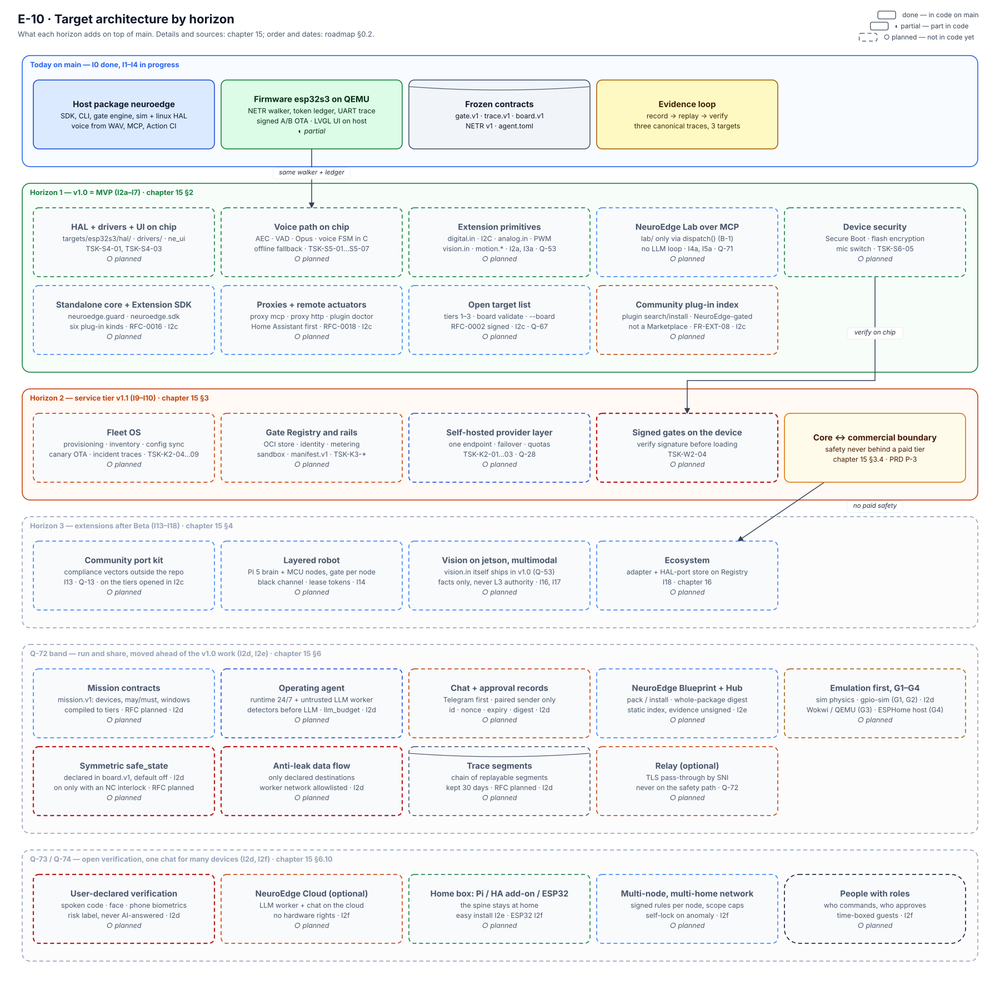
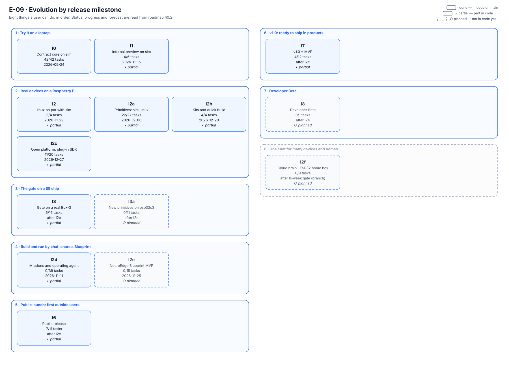
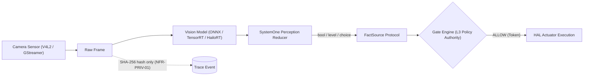
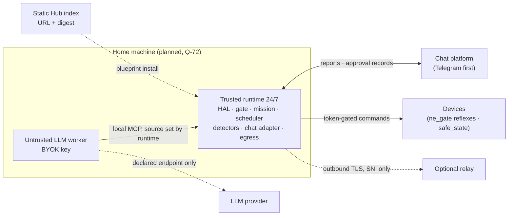

```mermaid
flowchart LR
    subgraph H1["Horizon 1: On-Device v1.0 = MVP (I2a-I7)"]
        H1_HAL["On-chip HAL and Drivers (TSK-S4-01, S4-03)"]
        H1_VOICE["On-chip Voice Pipeline and FSM (TSK-S5-01..03)"]
        H1_ABORT["Actuator Abort on Barge-in (TSK-S5-04)"]
        H1_FALLBACK["Local Offline Fallback (TSK-S5-07, Q-14)"]
        H1_SEC["Hardware Security (TSK-S6-05) and Signed OTA (TSK-S6-03)"]
        H1_PACKS["Extension Packs: Sensors, PWM, Vision, Motion (I2a, I3a)"]
        H1_BRAIN["NeuroEdge Lab over MCP: lab tools, lab check, Envelope (I4a, I5a)"]
        H1_OPEN["Open Platform: SDK, Proxies, Open Target List (I2c)"]
    end

    subgraph Q72["Q-72 band, planned: Run and Share (I2d, I2e)"]
        Q_MSN["Mission contracts and operating agent: runtime + LLM worker (I2d)"]
        Q_CH["Chat channel and approval records (I2d)"]
        Q_BP["NeuroEdge Blueprint: pack, install, static Hub index (I2e)"]
        Q_RELAY["Optional relay: TLS pass-through, no decryption (Q-72)"]
    end

    subgraph H2["Horizon 2: Service Tier v1.1 (I9-I10)"]
        H2_FLEET["Fleet OS: Provisioning, Canary, Traces (TSK-K2-04..09)"]
        H2_REG["Gate Registry: OCI, Metering, Sandbox (TSK-K3-01..06)"]
        H2_GW["Self-hosted Provider Layer: Routing and Quotas (TSK-K2-01..03)"]
        H2_VERIF["Signed Gate On-Device Verification (TSK-W2-04)"]
    end

    subgraph H3["Horizon 3: Post-Beta Extensions (I13-I18, without I15)"]
        H3_TIERS["Community Port Kit on the Open Tier List (I13)"]
        H3_ROBOT["Layered Robot: Zenoh, Node Gates, Leases (I14)"]
        H3_VISION["Perception: Vision on jetson, Fusion (I16, I17)"]
        H3_ECO["Ecosystem: Registry Adapters and Ports (I18)"]
    end

    H1 --> H2
    H1 --> H3
    Q72 -.->|"Hub moves to the Registry once it charges"| H2
```

# 15 · Kiến trúc mục tiêu theo chân trời

> **Phạm vi:** kiến trúc mục tiêu (to-be architecture) của NeuroEdge qua ba chân trời phát triển. **Nguồn sự thật:**
> [`neuroedge-roadmap.md`](../../../roadmap/neuroedge-roadmap.md) §2.1, §3, §4.3–§4.8, §5, §6, §7, Phụ lục D;
> [`neuroedge-prd.md`](../../../roadmap/neuroedge-prd.md) §15, Phụ lục D.2;
> `docs/architecture/vi/00-overview.md` §5.1;
> [`lab_mcp.md`](../../spec/lab_mcp.md);
> [`draft-rfc-node-giao-thuc-dieu-phoi.md`](../../rfc/draft-rfc-node-giao-thuc-dieu-phoi.md) §3;
> dải Q-72: [`proposal-blueprint-2026-10-11.md`](../../business/proposal-blueprint-2026-10-11.md) và Q-72 ở PRD §15.
> **Quy ước trạng thái:** `done` / `partial` / `planned`.

**Đọc chương này để làm gì:** Chương này dành cho kiến trúc sư phần mềm, kỹ sư nhúng và kỹ sư hệ thống cần nắm rõ hình thái kiến trúc đích (to-be architecture) của NeuroEdge qua từng giai đoạn hoàn thiện. Tài liệu trả lời các câu hỏi: *Mỗi chân trời bổ sung những thành phần, driver, giao thức và dịch vụ nào? Ranh giới an toàn và cơ chế an toàn theo mặc định ([fail-closed](../../user/thuat-ngu.md): không thẩm định được gate thì chặn; mất mạng thì gate vẫn lượng giá bằng fallback cục bộ, chỉ chặn khi fallback không có hoặc không chạy — Q-14) được duy trì ra sao khi mở rộng quy mô từ một chip đơn lẻ tới hệ thống robot nhiều node và điện toán đám mây?* Trước khi đọc, người đọc nên nắm bức tranh tổng quan tại [`00`](00-overview.md) và hiện trạng tiến hoá tại roadmap §0.5. Sau chương này, đọc tiếp [`16`](16-ecosystem-landscape.md) để thấy toàn cảnh các bên tham gia trong hệ sinh thái mở rộng.

---

## 1. Ba chân trời

> **Q-77 (2026-10-12):** chân trời 2 và 3 đã bỏ khỏi roadmap; mục của chúng còn lại một dòng chỉ chỗ. Kế hoạch hiện hành: chân trời 1 (v1.0) và dải Q-72 → Q-76 ở §6.

Lộ trình tiến hoá kiến trúc của NeuroEdge được phân chia thành ba **chân trời** (horizons — các giai đoạn phát triển kiến trúc với ranh giới năng lực và môi trường thực thi xác định):

| Chân trời | Increments | Thay đổi trong kiến trúc (Là gì & Vì sao cần) | Nơi thiết kế |
|:---|:---|:---|:---|
| **Dải Q-72** — chạy và chia sẻ (`planned · Q-72`) | I2d, I2e | Định vị Blueprint ([`Q-72`](../../../roadmap/neuroedge-prd.md#15-sổ-quyết-định)) đặt **trước** phần còn lại của H1: hợp đồng nhiệm vụ, agent vận hành chạy 24/7 trên máy nhà (runtime tin cậy + LLM worker không tin cậy), kênh chat có bản ghi duyệt, luồng dữ liệu chống rò rỉ, vết ghi theo đoạn (I2d); rồi NeuroEdge Blueprint tối thiểu — `blueprint pack`/`install`, digest toàn gói, index Hub tĩnh (I2e). Relay tuỳ chọn nằm ngoài hai increment này. Giả lập trước (G1–G4), phần cứng thật mua sau. Thoại, Studio và `jetson` tạm dừng; phạm vi v1.0 không cắt mà xét lại ở cổng nhu cầu 8 tuần (Q-52 đổi thứ tự bởi Q-72). Cần để vòng ② chạy và vòng ③ chia sẻ, bán có một kiến trúc an toàn trước khi có mã. | §6 dưới đây; [`proposal-blueprint-2026-10-11.md`](../../business/proposal-blueprint-2026-10-11.md); roadmap [§0.2](../../../roadmap/neuroedge-roadmap.md#02-bảng-increment-increment-matrix) |
| **Chân trời 1 (H1)** — v1.0 = MVP trên thiết bị | I2a–I7 | Hoàn thiện firmware trên chip ESP32-S3: đưa HAL 5 nguyên thủy lên chip thật, driver phần cứng (codec I2S, LCD ST7789, GPIO), đường thoại thời gian thực (AEC, VAD, Opus streaming), máy trạng thái hội thoại C99, cơ chế cắt lời thu hồi lệnh actuator (`actuator_abort.c`), client streaming WebSocket lên cloud, fallback nhận diện lệnh cố định offline khi mất mạng ([`Q-14`](../../../roadmap/neuroedge-prd.md#15-sổ-quyết-định)), bảo mật thiết bị (Secure Boot, mã hoá flash, ngắt micro vật lý, anti-rollback eFuse), giao diện LVGL nối driver hiển thị. Cùng chân trời này là bốn gói nguyên thủy mở rộng bắt buộc trên cả ba target bậc 1 — cảm biến, PWM, thị giác, chuyển động ([`Q-53`](../../../roadmap/neuroedge-prd.md#15-sổ-quyết-định), I2a và I3a) — **nền tảng mở** ([`Q-67`](../../../roadmap/neuroedge-prd.md#15-sổ-quyết-định), I2c: lõi dùng độc lập, Extension SDK, proxy, cơ cấu chấp hành từ xa, index cộng đồng, danh sách target mở theo bậc; xem [`16`](16-ecosystem-landscape.md) §3, §8) — và **NeuroEdge Lab qua MCP** ([`Q-55`](../../../roadmap/neuroedge-prd.md#15-sổ-quyết-định), [`Q-71`](../../../roadmap/neuroedge-prd.md#15-sổ-quyết-định), I4a trên host, I5a trên chip); một lần ra mắt, trượt thì dời ngày chứ không cắt phạm vi ([`Q-52`](../../../roadmap/neuroedge-prd.md#15-sổ-quyết-định)). Tiền đề của demo "nói chuyện với con chip $5" (roadmap §6): thoại trên Box-3, gate trên chip. | Roadmap [§4.3.1](../../../roadmap/neuroedge-roadmap.md#431-i2a--nguyên-thủy-mở-rộng-trên-sim-và-linux), [§4.3.3](../../../roadmap/neuroedge-roadmap.md#433-i2c--nền-tảng-mở), [§4.4–§4.8](../../../roadmap/neuroedge-roadmap.md#44-i3--gate-trên-box-3-thật), PRD [Phụ lục D.2](../../../roadmap/neuroedge-prd.md#d2-giao-thức-truyền-dẫn--định-dạng-vết-ghi-wire-protocol), [`04`](04-component-device-c4l3.md) |
| **Chân trời 2 (H2)** — Tầng dịch vụ v1.1 | I9–I10 | Xuất hiện hai container mới phía máy chủ: **Fleet OS** (cấp phát danh tính, sổ kiểm kê, giám sát sức khỏe, đồng bộ cấu hình và gate từ xa, điều phối chiến dịch canary rollout (phát hành theo đợt nhỏ dần lên toàn đội) qua Eclipse Hawkbit, kho thu thập vết ghi sự cố tập trung, thu hồi chứng chỉ) và **Gate Registry** (kho OCI (chuẩn đóng gói artifact của Open Container Initiative) công khai qua CNCF ORAS/Harbor, định danh ổn định, hệ đo lường qua OpenMeter, sandbox phân quyền, manifest (tệp mô tả gói) `schemas/manifest.v1.json`, gate có ký và kiểm chữ ký trên chip, ghim `extends` bằng digest). Lớp trừu tượng provider tự vận hành hoàn thiện (định tuyến đa nhà cung cấp, failover, quota). Cần thiết để quản trị đội thiết bị quy mô lớn mà không làm mất tính tự chủ an toàn của từng thiết bị. | Roadmap [§6](../../../roadmap/neuroedge-roadmap.md#6-tầng-dịch-vụ-v11-i9i10), PRD [`Q-6`](../../../roadmap/neuroedge-prd.md#15-sổ-quyết-định), [`Q-28`](../../../roadmap/neuroedge-prd.md#15-sổ-quyết-định), [`02`](02-container-c4l2.md) §5 |
| **Chân trời 3 (H3)** — Mở rộng sau Beta | I13, I14, I16–I18 | Bộ port cộng đồng (I13) dựa trên 3 [bậc target](../../user/thuat-ngu.md); việc mở danh sách target (trước là I11) đã gộp vào I2c ở H1 ([`Q-67`](../../../roadmap/neuroedge-prd.md#15-sổ-quyết-định)); **Robot phân tầng** (I14) phối hợp não Pi 5 và nhiều node MCU (ESP32-S3, RP2350) qua [black channel](../../user/thuat-ngu.md) Zenoh-pico, mỗi node tự lượng giá gate, [token thuê có hạn](../../user/thuat-ngu.md) (lease) cho `motion.*`, trạng thái an toàn khi mất liên lạc, cầu ROS 2/Nav2; **Thị giác trên `jetson` và đa phương thức** (I16, I17) mở rộng nhận thức L2 sang GPU Jetson (thị giác cơ bản trên `sim`, `linux`, `esp32s3` đã vào v1.0 — Q-53, Q-54); **Hệ sinh thái** (I18) chia sẻ adapter và port HAL trên Registry. Cần thiết để NeuroEdge mở rộng ra các hệ thống chuyển động phức tạp, tay máy và đa giác quan. NeuroEdge Lab (I4a, I5a; trước là NeuroBrain), `vision.in` (I2a, I3a) và việc mở danh sách target (I2c) đã chuyển vào H1; §4.2 và §4.4 dưới đây giữ nguyên thiết kế của chúng. | Roadmap [§7](../../../roadmap/neuroedge-roadmap.md#7-hướng-mở-rộng-sau-beta-i13-i14-i16i18), `docs/spec/lab_mcp.md`, §4.4, §4.3, [`draft-rfc-node-giao-thuc-dieu-phoi.md`](../../rfc/draft-rfc-node-giao-thuc-dieu-phoi.md) |


*Hình E-10 — Sáu dải: hiện trạng trên main, ba chân trời, dải Q-72 (I2d, I2e) và dải Q-73 / Q-74 (bước xác minh, não trên cloud, mạng lưới đa nút — I2d, I2f, §6.10); khối nét đứt là planned. Sinh bởi scripts/gen_architecture_diagrams.py.*

*Cách đọc hình E-10:* Hình biểu diễn các dải ngang tương ứng với hiện trạng mã nguồn trên nhánh `main`, dải Q-72 (`planned · Q-72`, §6) và ba chân trời quy hoạch nối tiếp nhau. Khối nét liền đã có mã (◐ là một phần), khối nét đứt là planned. Các nhãn nối giữa dải (same walker + ledger, verify on chip, no paid safety) cho thấy chân trời sau dùng lại walker, sổ token và gate của chân trời trước.

Sơ đồ quan hệ phát triển giữa ba chân trời:



*Cách đọc sơ đồ:* Dải Q-72 (nét đứt, `planned · Q-72`) dựng trên phần H1 đã có tới I2c và đi trước phần còn lại của H1; khi Hub thu tiền, phân phối Blueprint chuyển sang Gate Registry của H2 (§6.4). Ba khối chữ nhật còn lại đại diện cho ba chân trời kiến trúc. Mũi tên từ H1 trỏ sang H2 và H3 thể hiện rằng toàn bộ cơ chế an toàn và tương đương target của Chân trời 1 là điều kiện tiên quyết bắt buộc trước khi kích hoạt tầng dịch vụ đám mây (H2) hoặc mở rộng đa node/Jetson (H3). Điểm cốt lõi cần nhớ: việc bổ sung dịch vụ quản trị hay robot phân tầng không bao giờ làm suy giảm hoặc phá vỡ các bảo đảm an toàn đã đóng gói trên thiết bị của H1.

---


*Hình E-09 — Tám mốc phát hành sau Q-77 (mốc 8 là I2f có điều kiện, Q-74), mỗi mốc gom các increment của nó; trạng thái, tiến độ và ngày dự báo

## 2. Chân trời 1 — v1.0 trên thiết bị (I2a–I7)

### 2.1 Thành phần firmware quy hoạch

Trên vi điều khiển ESP32-S3, các thành phần đã có mã ở `main` gồm walker `components/ne_gate/`, bộ định dạng vết ghi `components/ne_trace/`, phần sinh riêng của agent `components/ne_agent/`, và module cập nhật `components/ne_ota/` (đã chạy trên Espressif QEMU, chi tiết tại [`04`](04-component-device-c4l3.md) §3). Bảng dưới đây quy hoạch các thành phần cần bổ sung và hoàn thiện trên phần cứng thật từ các task I3–I7 (các gói nguyên thủy mở rộng và NeuroEdge Lab: I2a, I3a, I4a, I5a):

| Thành phần (đường dẫn quy hoạch) | Là gì & Vì sao cần | Task chi phối | Tái sử dụng mã nguồn mở (Roadmap §3) | Trạng thái |
|:---|:---|:---|:---|:---:|
| `targets/esp32s3/hal/` | Hiện thực 5 nguyên thủy HAL trên ESP-IDF; cần thiết để cung cấp giao tiếp chân vật lý chuẩn mực tương đương với `sim` và `linux`. | [`TSK-S4-01`](../../../roadmap/neuroedge-roadmap.md#44-i3--gate-trên-box-3-thật) | ESP-IDF (toolchain) — roadmap §4.4 | `planned` |
| `targets/esp32s3/hal/` (bốn gói mở rộng) | `digital.in`, bus I2C chỉ đọc, `analog.in`, PWM, `motion.*` và `vision.in` trên bo camera ESP32-S3, cùng cưỡng chế phong bì an toàn trong firmware; cần thiết để bốn gói chạy trên chip ngang `sim` và `linux` (Q-53, Q-55). | [`TSK-I3a-02`](../../../roadmap/neuroedge-roadmap.md#441-i3a--nguyên-thủy-mở-rộng-trên-esp32s3), [`TSK-I3a-03`](../../../roadmap/neuroedge-roadmap.md#441-i3a--nguyên-thủy-mở-rộng-trên-esp32s3), [`TSK-W1-04`](../../../roadmap/neuroedge-roadmap.md#441-i3a--nguyên-thủy-mở-rộng-trên-esp32s3), [`TSK-I3a-04`](../../../roadmap/neuroedge-roadmap.md#441-i3a--nguyên-thủy-mở-rộng-trên-esp32s3), [`TSK-N7-02`](../../../roadmap/neuroedge-roadmap.md#441-i3a--nguyên-thủy-mở-rộng-trên-esp32s3) | Theo hợp đồng RFC-0007, RFC-0010 → RFC-0013 | `planned` |
| `targets/esp32s3/drivers/` | Driver ngoại vi thật: codec I2S ES8311/ES7210, LCD ST7789, GPIO; cần thiết để điều khiển trực tiếp thanh ghi phần cứng của Box-3. | [`TSK-S4-03`](../../../roadmap/neuroedge-roadmap.md#44-i3--gate-trên-box-3-thật) | Port trực tiếp driver từ XiaoZhi ESP32 (roadmap [§3.4](../../../roadmap/neuroedge-roadmap.md#34-ma-trận-tích-hợp-theo-khối), [§3.5](../../../roadmap/neuroedge-roadmap.md#35-năm-dự-án-port-trực-tiếp)) | `planned` |
| `targets/esp32s3/drivers/audio_path.c` | Đường dẫn âm thanh thu/phát; cần thiết để kết nối luồng I2S từ codec vào bộ đệm vòng mà không chạy STT/TTS trên thiết bị. | [`TSK-S5-02`](../../../roadmap/neuroedge-roadmap.md#46-i5--thoại-trên-box-3) | Port cấu hình codec và I2S clock từ XiaoZhi ESP32 (roadmap [§3.5](../../../roadmap/neuroedge-roadmap.md#35-năm-dự-án-port-trực-tiếp)) | `planned` |
| `targets/esp32s3/audio/` | Tích hợp WebRTC AEC, libfvad (VAD), Opus streaming; cần thiết để khử tiếng vọng, lọc khoảng lặng và nén luồng âm thanh thời gian thực. | [`TSK-S5-01`](../../../roadmap/neuroedge-roadmap.md#46-i5--thoại-trên-box-3) | WebRTC AEC, libfvad, Opus; port pipeline từ Pipecat (roadmap [§3.4](../../../roadmap/neuroedge-roadmap.md#34-ma-trận-tích-hợp-theo-khối), [§3.5](../../../roadmap/neuroedge-roadmap.md#35-năm-dự-án-port-trực-tiếp)) | `planned` |
| `targets/esp32s3/fsm/voice_fsm.c` | Hiện thực C/C++ của máy trạng thái hội thoại 5 trạng thái; cần thiết để đồng bộ chuẩn xác hành vi hội thoại với bản Python trên host. | [`TSK-S5-03`](../../../roadmap/neuroedge-roadmap.md#46-i5--thoại-trên-box-3) | Đặc tả chuẩn tắc [`voice_fsm.md`](../../spec/voice_fsm.md), vượt bộ vector tuân thủ TSK-S3-10 (roadmap [§3.8](../../../roadmap/neuroedge-roadmap.md#38-bảo-toàn-tương-đương-target-khi-có-hai-ngôn-ngữ)) | `planned` |
| `targets/esp32s3/fsm/actuator_abort.c` | Cơ chế thu hồi lệnh actuator chưa thực thi khi bị cắt lời (≤ 20 ms, đóng token); cần thiết để chặn rò rỉ lệnh vật lý khi người dùng đổi ý. | [`TSK-S5-04`](../../../roadmap/neuroedge-roadmap.md#46-i5--thoại-trên-box-3) | Cơ chế barge-in từ Pipecat (roadmap [§3.5](../../../roadmap/neuroedge-roadmap.md#35-năm-dự-án-port-trực-tiếp)), hợp đồng [`voice_fsm.md`](../../spec/voice_fsm.md) §5 | `planned` |
| `targets/esp32s3/audio/provider_client.c` | Client streaming âm thanh đẩy khung Opus lên STT, nhận luồng TTS qua WebSocket; cần thiết để giao tiếp mạng độ trễ thấp với cloud provider. | [`TSK-S5-06`](../../../roadmap/neuroedge-roadmap.md#46-i5--thoại-trên-box-3) | Vòng lặp streaming WebSocket nhị phân từ XiaoZhi ESP32 (roadmap [§3.5](../../../roadmap/neuroedge-roadmap.md#35-năm-dự-án-port-trực-tiếp)) | `planned` |
| `targets/esp32s3/fallback/` | Bộ nhận diện lệnh cố định cục bộ offline; cần thiết để duy trì năng lực ra lệnh an toàn khi mất kết nối Internet ([`Q-14`](../../../roadmap/neuroedge-prd.md#15-sổ-quyết-định)). | [`TSK-S5-07`](../../../roadmap/neuroedge-roadmap.md#46-i5--thoại-trên-box-3) | ESP-SR MultiNet hoặc TFLite Micro / ESP-NN (roadmap [§4.6](../../../roadmap/neuroedge-roadmap.md#46-i5--thoại-trên-box-3)) | `planned` |
| `targets/esp32s3/security/` | Khối an toàn phần cứng: Secure Boot, mã hóa flash, nút ngắt micro vật lý, eFuse; cần thiết để chống nạp firmware lậu và chống nghe lén. | [`TSK-S6-05`](../../../roadmap/neuroedge-roadmap.md#48-i7--v10) | ESP-IDF (chưa chọn thành phần cụ thể) | `planned` |
| `targets/esp32s3/ui/` | 9 màn hình build và so ảnh golden trên host (TSK-S4-10 xong); chưa link vào firmware, chờ driver màn hình (TSK-S4-01). Cần thiết để hiển thị trạng thái và thông báo xác nhận. | [`TSK-S4-01`](../../../roadmap/neuroedge-roadmap.md#44-i3--gate-trên-box-3-thật), [`TSK-S4-10`](../../../roadmap/neuroedge-roadmap.md#44-i3--gate-trên-box-3-thật) | Thư viện đồ hoạ nhúng LVGL v9 (roadmap [§3.4](../../../roadmap/neuroedge-roadmap.md#34-ma-trận-tích-hợp-theo-khối)) | `partial` |
| `targets/esp32s3/sdkconfig.defaults` | Tệp cấu hình đã có sẵn trong kho; cấu hình tối ưu bộ nhớ đạt ngân sách SRAM ≥ 120 KB, PSRAM ≥ 2 MB ([`Q-3`](../../../roadmap/neuroedge-prd.md#15-sổ-quyết-định)) cho đường thoại là phần quy hoạch. | [`TSK-S5-05`](../../../roadmap/neuroedge-roadmap.md#46-i5--thoại-trên-box-3) | ESP-IDF Kconfig | `planned` |

### 2.2 Đường thoại trên chip — đã bỏ khỏi v1.0 (Q-77)

Q-77 bỏ thoại khỏi roadmap (roadmap §6). Mã thoại trên host giữ nguyên; thiết kế thoại trên chip đọc ở bản trước Q-77 (`git show f7278fc:docs/architecture/vi/15-target-architecture.md`).

### 2.3 Giao thức quy hoạch

Các giao thức truyền dẫn được quy hoạch theo chuẩn mở và tối ưu cho tài nguyên vi điều khiển (PRD [Phụ lục D.2](../../../roadmap/neuroedge-prd.md#d2-giao-thức-truyền-dẫn--định-dạng-vết-ghi-wire-protocol), roadmap [Phụ lục D](../../../roadmap/neuroedge-roadmap.md#phụ-lục-d--giao-thức-truyền-dẫn)):

1. **Giao thức mạng Wi-Fi / LAN:**
   - **Kênh truyền:** `WebSocket` bảo mật (WSS).
   - **Khung nhị phân (Binary Frame):** truyền luồng âm thanh Opus Voice Mode (16 kbps, 16 kHz mono, kích thước khung 20 ms = 320 mẫu). Mọi target tuân thủ cùng định dạng này. `sim` phát lại tệp WAV qua đúng đường mã hóa này để giữ tương đương với chip thật. Trạng thái: `planned`.
   - **Khung văn bản (Text Frame):** truyền sự kiện vết ghi JSON (PRD Phụ lục D.2). Trạng thái: `planned`.
2. **Giao thức cổng nối tiếp UART:**
   - **Tốc độ baud:** **chưa chốt** — PRD Phụ lục D.2 ghi 921600, nhưng `sdkconfig.defaults` không đặt (ESP-IDF mặc định 115200) và Box-3 có thể đưa console qua USB-Serial-JTAG; chốt khi bo mạch về ([`TODOS.md`](../../../TODOS.md) #35, [`TSK-S4-12`](../../../roadmap/neuroedge-roadmap.md#44-i3--gate-trên-box-3-thật)).
   - **Định dạng vết ghi:** JSON Lines, mỗi dòng mang tiền tố `NE1 ` cố định để tách biệt với log firmware. Định dạng vết ghi dòng `NE1 ` đã hoàn thành trên host và QEMU ([`TSK-S4-09`](../../../roadmap/neuroedge-roadmap.md#44-i3--gate-trên-box-3-thật), `docs/spec/simulation_coverage.md` §4).
   - **Đóng gói nhị phân:** Khi cần truyền dữ liệu nhị phân, giao thức đóng gói khung sử dụng `SLIP` (Serial Line Internet Protocol) theo PRD Phụ lục D.2. Trạng thái: `planned`.

### 2.4 Bảo mật thiết bị

Kiến trúc bảo mật phần cứng tại Chân trời 1 tạo thành vành đai bảo vệ toàn vẹn cho thiết bị:

- **Secure Boot:** bật Secure Boot trên ESP32-S3 ([`TSK-S6-05`](../../../roadmap/neuroedge-roadmap.md#48-i7--v10), NFR-SEC-02); thuật toán chữ ký chưa chọn (NFR-SEC-02 không nêu thuật toán; RSA-3072 hôm nay là chữ ký ảnh OTA theo FR-OTA-03, [`TSK-S6-03`](../../../roadmap/neuroedge-roadmap.md#48-i7--v10)). Chưa có Secure Boot thì người có cáp vẫn đổi được firmware (roadmap [`TSK-S6-03`](../../../roadmap/neuroedge-roadmap.md#48-i7--v10)).
- **Mã hoá flash:** bật mã hoá flash trên ESP32-S3 ([`TSK-S6-05`](../../../roadmap/neuroedge-roadmap.md#48-i7--v10), NFR-SEC-02); thuật toán và cách quản lý khoá chưa thiết kế.
- **Nút ngắt micro vật lý:** bo mạch tham chiếu có nút ngắt micro vật lý ([`TSK-S6-05`](../../../roadmap/neuroedge-roadmap.md#48-i7--v10), NFR-SEC-03); ngắt nguồn hay ngắt tín hiệu chưa thiết kế.
- **Anti-rollback eFuse:** chống hạ cấp bằng eFuse đi cùng Secure Boot ([`TSK-S6-05`](../../../roadmap/neuroedge-roadmap.md#48-i7--v10); roadmap [`TSK-S6-03`](../../../roadmap/neuroedge-roadmap.md#48-i7--v10)). Hôm nay hạ cấp chỉ bị chặn bằng mốc trong NVS — tức là bảo vệ bằng phần mềm.
- **Cơ chế cập nhật OTA:** Cập nhật OTA cấp thiết bị — phân vùng kép A/B (`ota_0`, `ota_1`), kiểm tra chữ ký RSA-3072 trên ảnh tải về, và tự động rollback khi phát hiện bootloop hoặc self-test thất bại — đã có hiện thực trên QEMU và được mô tả chi tiết tại [`04`](04-component-device-c4l3.md) §6.

---

## 3. Chân trời 2 — tầng dịch vụ v1.1 (đã bỏ, Q-77; giữ §3.4)

### 3.1 Fleet OS — đã bỏ (Q-75, Q-77)

Không làm quản lý đội thiết bị trước khi người dùng đòi; mốc mở lại ở roadmap §6.

### 3.2 Gate Registry — đã bỏ (Q-77)

Blueprint Hub (I2e, §6.4) là kênh phân phối; mốc mở lại ở roadmap §6.

### 3.3 Lớp provider tự vận hành — đã bỏ (Q-77)

LiteLLM trong lõi và bộ não NeuroEdge (Q-76, §6.10) lo phần gọi LLM.

### 3.4 Ranh giới lõi ↔ dịch vụ thương mại

Để bảo đảm tính minh bạch và tránh sự mập mờ "open-core", ranh giới giữa Lõi source-available và Dịch vụ thương mại Fleet OS được ấn định bất biến theo :

| Tiêu chí | Lõi source-available ([`Q-45`](../../../roadmap/neuroedge-prd.md#15-sổ-quyết-định)) | Dịch vụ thương mại Fleet OS (Cloud) |
|:---|:---|:---|
| **Định nghĩa tính năng cốt lõi** | Toàn bộ logic chạy trên thiết bị, cơ chế an toàn, runtime nhận thức và kiểm thử CI | Hạ tầng điều phối từ xa, lưu trữ tập trung và bảng điều khiển quản trị đội thiết bị |
| **Cơ chế cập nhật OTA** | **Cấp thiết bị (On-device OTA Agent):**<br>• Tự nạp firmware qua HTTP endpoint mở<br>• Phân vùng kép A/B (Dual-partition scheme)<br>• Tự động rollback cục bộ khi phát hiện bootloop<br>• Kiểm tra chữ ký mật mã (RSA/ECDSA) trên chip | **Cấp đội thiết bị (Fleet Rollout Orchestration):**<br>• Phân phối theo từng đợt (Canary 1% → 10% → 100%)<br>• Quản lý chiến dịch phát hành (Campaign management)<br>• Tự động dừng chiến dịch và khôi phục khi tỷ lệ lỗi toàn fleet vượt ngưỡng<br>• Kho lưu trữ firmware tập trung |
| **Ghi nhận & Tái hiện lỗi** | Ghi vết ra tệp JSON cục bộ (`traces/*.json`); chạy lệnh `neuroedge replay` trên máy tính cá nhân | Tự động tải tệp vết ghi JSON khi có sự cố từ xa; kho lưu trữ vết tập trung và công cụ phân tích hồi quy đám mây |
| **Vận hành ngoại tuyến (Offline)** | Chức năng an toàn (gate, máy trạng thái, fail-closed) chạy 100% ngoại tuyến; nhận thức suy giảm về bộ nhận diện lệnh cố định cục bộ ([`Q-14`](../../../roadmap/neuroedge-prd.md#15-sổ-quyết-định)) — STT, TTS và suy luận LLM cần kết nối tới provider cloud | Yêu cầu kết nối để đồng bộ viễn trắc và nhận lệnh điều phối |
| **Yêu cầu tài khoản** | Hoàn toàn không, cài đặt và chạy ngay | Yêu cầu tài khoản xác thực tổ chức |
| **Khả năng tự dựng hạ tầng** | Hỗ trợ đầy đủ qua các interface mở (pluggable backend) | Khách hàng tự duy trì hạ tầng riêng hoặc sử dụng dịch vụ đám mây trọn gói |
| **Lớp kết nối nhà cung cấp AI** | Lớp trừu tượng tự vận hành: người dùng tự cấu hình provider, tự giữ khóa, tự trả phí suy luận cho nhà cung cấp | Không thương mại hóa — NeuroEdge không bán lại token |
| **Adapter và HAL port bên thứ ba** | Tác giả giữ nguyên bản quyền và chọn giấy phép của mình; mã nằm ở kho riêng của tác giả, NeuroEdge chỉ lập chỉ mục trong Registry. Trách nhiệm an toàn thuộc về bên vận hành thiết bị. Cổng kiểm soát là Bộ kiểm thử tuân thủ, sandbox phân quyền và đối chiếu năng lực lúc build | Không thương mại hóa. Fleet OS hiển thị trạng thái tuân thủ của adapter đang chạy trên đội thiết bị, nhưng không bán, không bảo chứng và không khóa adapter nào sau tường phí |
| **Phân phối NeuroEdge Blueprint** (`planned · Q-72`, I2e) | `blueprint pack`/`install`, kiểm digest toàn gói, không cần tài khoản; index Hub là kho git tĩnh, không phải dịch vụ (§6.4) | Hub thu phí và chia doanh thu cho người bán chỉ sau cổng nhu cầu 8 tuần, khi đó chuyển sang Gate Registry OCI (§3.2); bán Blueprint hay thiết bị là dùng thương mại theo Q-45 |
| **Relay truy cập từ xa** (`planned · Q-72`) | Không cần: UI tại chỗ, kênh chat nói thẳng với nền tảng chat; mọi bảo đảm an toàn chạy khi không có relay | Relay tuỳ chọn trả phí: ống TLS xuyên theo SNI, không giải mã, sao lưu vết ghi đã mã hoá phía máy nhà (§6.5) |
| **Bản quyền định dạng gate & trace** | Chuẩn mở Apache-2.0 ([`Q-45`](../../../roadmap/neuroedge-prd.md#15-sổ-quyết-định)) theo quy trình RFC, cam kết chuyển giao trung lập | Kế thừa chuẩn mở, không tạo biến thể đóng |

**Nguyên tắc không mục tiêu (Non-goals):**
1. **Không yêu cầu tài khoản để an toàn:** Toàn bộ chức năng an toàn — lượng giá gate, cấp token một lần, và cưỡng chế fail-closed tại HAL — vận hành 100% độc lập trên thiết bị mà không cần tạo tài khoản hay kết nối tới máy chủ của NeuroEdge (§3.4; [`P-3`](../../../roadmap/neuroedge-prd.md#15-năm-nguyên-tắc-thiết-kế-bất-biến): tính năng an toàn không tách thành gói trả thêm).
2. **Không bán lại token suy luận:** NeuroEdge không đóng vai trò làm đại lý bán lại token AI (PRD §1.4 N4); người dùng trực tiếp thanh toán cho nhà cung cấp mô hình theo mức sử dụng thực tế.

---

## 4. Chân trời 3 — mở rộng sau Beta (đã bỏ, Q-77; giữ §4.4)

> **Lưu ý:** I11 (mở danh sách target) đã gộp vào I2c ([`Q-67`](../../../roadmap/neuroedge-prd.md#15-sổ-quyết-định)); I12 (NeuroBrain) và I15 (thị giác) không còn là increment. NeuroEdge Lab (trước là NeuroBrain) thuộc MVP ở I4a và I5a ([`Q-55`](../../../roadmap/neuroedge-prd.md#15-sổ-quyết-định), [`Q-71`](../../../roadmap/neuroedge-prd.md#15-sổ-quyết-định)); thị giác cơ bản thuộc MVP ở I2a và I3a ([`Q-53`](../../../roadmap/neuroedge-prd.md#15-sổ-quyết-định), [`Q-54`](../../../roadmap/neuroedge-prd.md#15-sổ-quyết-định)). §4.1, §4.2 và phần đầu §4.4 vẫn ở đây để không tách thiết kế khỏi các mục liền kề; ngày và phụ thuộc chỉ ở roadmap §0.2.

### 4.1 Bậc target và danh sách target mở — đã bỏ (Q-77)

Ba target bậc 1 giữ nguyên. Bo ESP32-S3 phổ thông và thư viện Arduino (I3a, Q-75) thay cho mở danh sách target cho bên thứ ba.

### 4.2 NeuroEdge Lab qua MCP — đã bỏ (Q-77)

Bộ tool MCP chuẩn (TSK-I2d-23) và bộ não hay client MCP người dùng đang có (Q-76) thay cho vòng dựng của Lab. Thiết kế Lab còn ở `docs/spec/lab_mcp.md` để tham chiếu.

### 4.3 Robot phân tầng — đã bỏ (Q-77)

Liên kết tối thiểu Pi ↔ ESP32 (nhịp tim, `safe_state` khi mất liên lạc) ở I3a (Q-75); mạng lưới nhiều nút cho nhà ở §6.10. Thiết kế robot nhiều node còn ở bản nháp RFC node.

### 4.4 Thị giác (I2a, I3a; `jetson` I16, đa phương thức I17)

Thị giác mở rộng khả năng nhận thức của NeuroEdge từ âm thanh sang hình ảnh; `vision.in` trên `sim`, `linux` và `esp32s3` thuộc v1.0 (Roadmap [§4.3.1](../../../roadmap/neuroedge-roadmap.md#431-i2a--nguyên-thủy-mở-rộng-trên-sim-và-linux), [§4.4.1](../../../roadmap/neuroedge-roadmap.md#441-i3a--nguyên-thủy-mở-rộng-trên-esp32s3), [§7.6–§7.7](../../../roadmap/neuroedge-roadmap.md#76-i16--thị-giác-trên-jetson), §4.4–§8):



*Cách đọc sơ đồ:* Mũi tên nét liền biểu diễn đường ống xử lý dữ liệu: cảm biến camera thu nhận khung hình, mô hình thị giác tính toán, và bộ rút gọn SystemOne chuyển đổi tensor thành dữ kiện rời rạc (`bool`, `level`, `choice`) nạp vào FactSource cho Gate Engine. Mũi tên nét đứt thể hiện việc bảo vệ quyền riêng tư. Điểm cốt lõi cần nhớ: mô hình thị giác chỉ là nguồn cung cấp dữ kiện nhận thức L2; Gate Engine L3 giữ quyền phán quyết hành động độc lập; vết ghi tuyệt đối không chứa khung hình thô.

- **Nguyên tắc thẩm quyền L2 so với L3:** Thị giác là đầu vào nhận thức tầng L2, tuyệt đối **không bao giờ là thẩm quyền phán quyết tầng L3** (§4.4). Theo [`Q-54`](../../../roadmap/neuroedge-prd.md#15-sổ-quyết-định), maker tự định nghĩa dữ kiện (`bool`, `level` hoặc `choice`, kèm độ tin cậy dạng số) từ nhãn của model thị giác và tự viết `@action` cùng gate như với mọi dữ kiện khác; gate khoá ngưỡng tin cậy bằng tiêu chí `numeric` (RFC-0009), không có ngữ nghĩa gate riêng cho thị giác. Mất camera hoặc model thì dữ kiện chưa quyết và gate chặn (§4.4). Gate engine giữ nguyên tính xác định và không bao giờ nhận tensor hình ảnh.
- **Thành phần phần mềm:** Module thị giác nằm trong package `python/neuroedge/perception/vision/` ([`TSK-V1b-03`](../../../roadmap/neuroedge-roadmap.md#431-i2a--nguyên-thủy-mở-rộng-trên-sim-và-linux)). Môi trường `sim` cung cấp camera ảo phát lại chuỗi ảnh để kiểm thử hồi quy Action CI mà không cần camera vật lý ([`TSK-V1b-02`](../../../roadmap/neuroedge-roadmap.md#431-i2a--nguyên-thủy-mở-rộng-trên-sim-và-linux), [`TSK-V1b-04`](../../../roadmap/neuroedge-roadmap.md#431-i2a--nguyên-thủy-mở-rộng-trên-sim-và-linux)).
- **Tăng tốc phần cứng (Accelerators):**
  - Trên `linux` (Raspberry Pi 5): sử dụng GStreamer và V4L2 cho đường ống thu nhận khung hình; Ultralytics YOLO và ONNX Runtime cho mô hình; kết nối NPU rời qua HailoRT (Hailo-8) và Edge TPU runtime (Coral) ([`TSK-V1b-05`](../../../roadmap/neuroedge-roadmap.md#431-i2a--nguyên-thủy-mở-rộng-trên-sim-và-linux)).
  - Trên `jetson` (Bậc 2, I16): tích hợp JetPack và TensorRT tăng tốc GPU; DeepStream xử lý đường ống đa camera thời gian thực ([`TSK-V2-01`](../../../roadmap/neuroedge-roadmap.md#76-i16--thị-giác-trên-jetson), [`TSK-V2-02`](../../../roadmap/neuroedge-roadmap.md#76-i16--thị-giác-trên-jetson)).
  - Đa phương thức (I17): hợp nhất nhận thức thoại, thị giác và cảm biến trong một máy trạng thái (`perception/fusion/`, [`TSK-V3-01`](../../../roadmap/neuroedge-roadmap.md#77-i17--đa-phương-thức)); gate đa phương thức cần có `RFC visual-evidence gate semantics` ([`TSK-V3-04`](../../../roadmap/neuroedge-roadmap.md#77-i17--đa-phương-thức)).
- **Quyền riêng tư dữ liệu:** Tuân thủ nghiêm ngặt NFR-PRIV-01 và NFR-PRIV-03 (§4.4, [`TSK-V1b-08`](../../../roadmap/neuroedge-roadmap.md#431-i2a--nguyên-thủy-mở-rộng-trên-sim-và-linux)). Tệp vết ghi **không bao giờ nhúng khung hình thô**. Vết ghi mặc định chỉ lưu trữ giá trị băm SHA-256 (`vision_ref`) và kích thước khung hình. Việc ghi lại hình ảnh thô chỉ được kích hoạt khi bật cờ tường minh `metadata.raw_capture`.

### 4.5 Hệ sinh thái — đã bỏ (Q-77)

Bức tranh hệ sinh thái hiện hành ở chương [`16`](16-ecosystem-landscape.md).

## 5. Điều không đổi qua mọi chân trời

Dù kiến trúc mở rộng từ một vi điều khiển đơn lẻ lên hệ thống robot phân tầng đa node hay bổ sung thị giác và dịch vụ đám mây, sáu điều sau (tổng hợp từ các bất biến và đặc tính kiến trúc) được giữ ở mọi chân trời:

1. **Đường duy nhất tới chân vật lý (Single path to a pin):** Mọi hành động vật lý đều phải đi qua chuỗi khép kín: `dispatch()` → `c.do()` → gate evaluate → token dùng một lần → HAL `authorize()`. Không có bất kỳ đường tắt nào tới cơ cấu chấp hành ([`Q-24`](../../../roadmap/neuroedge-prd.md#15-sổ-quyết-định)).
2. **Không chắc thì chặn (Fail-closed by default):** Không thẩm định được gate — timeout, mất mạng mà không có fallback cục bộ, mất camera, dữ kiện thiếu hay sai kiểu — thì `BLOCK`; chỉ gate tự khai `fail: open` mới cho qua ([`00`](00-overview.md) §2, CHANGELOG §3.3 #2). Mất nhịp tim giữa node thì cơ cấu về trạng thái an toàn (Q-35). *Sửa theo [`Q-72`](../../../roadmap/neuroedge-prd.md#15-sổ-quyết-định) (`planned`, chờ RFC an toàn có điều kiện):* luật này giữ nguyên cho **lệnh**; thêm vế thứ hai — mọi cơ cấu tự về `safe_state` đã khai trong `board.v1` (mặc định `off`, nên hành vi hôm nay không đổi). Chi tiết: §6.3.
3. **Gate là dữ liệu có phiên bản (Gate is data):** Gate an toàn luôn là dữ liệu có phiên bản, được định danh chuẩn tắc `neuroedge://`, băm JCS SHA-256, biên dịch thành cây quyết định tất định, và quy tắc kế thừa chỉ được phép siết chặt chính sách ([`Q-18`](../../../roadmap/neuroedge-prd.md#15-sổ-quyết-định)).
4. **Vết ghi tự tính lại và phát lại được (Replay recomputes):** Tệp vết ghi mang đầy đủ dữ kiện để tính toán lại toàn bộ chuỗi phán quyết trong môi trường kiểm thử Action CI mà không cần gọi lại mô hình AI và không cần chạm vào thiết bị vật lý.
5. **Một vết ghi cho mỗi phiên (One trace per session):** Mỗi phiên tương tác sinh đúng một tệp vết ghi hoàn chỉnh (NFR-OBS-01, FR-ACE-06). *Sửa theo [`Q-72`](../../../roadmap/neuroedge-prd.md#15-sổ-quyết-định) (`planned`, chờ RFC `trace.v1`):* với runtime chạy 24/7, một phiên là **một chuỗi vết ghi**, mỗi đoạn replay được. Chi tiết: §6.7.
6. **Cùng một quyết định trên mọi môi trường (Same decision on every target):** Nguyên tắc tương đương môi trường bảo đảm mã nguồn agent không rẽ nhánh theo target; cùng một kịch bản dữ kiện cho ra phán quyết và phản ứng hoàn toàn nhất quán trên `sim`, `linux`, và `esp32s3` ([`Q-8`](../../../roadmap/neuroedge-prd.md#15-sổ-quyết-định), P-2, `docs/architecture/vi/00-overview.md` §5.2).

Nguồn từng điều: [`00`](00-overview.md) §2, §4; [`CHANGELOG.md`](../../../CHANGELOG.md) §3.3 (mười bất biến — một danh sách khác, chi tiết hơn; phần sửa theo Q-72 ghi ở đó, không chép lại ở đây).

---

## 6. Dải Q-72 — agent vận hành và NeuroEdge Blueprint (I2d, I2e)

> **Toàn bộ mục này `planned · Q-72`: chưa có mã.** Quyết định: [`Q-72`](../../../roadmap/neuroedge-prd.md#15-sổ-quyết-định).
> Increment, thứ tự và ngày: roadmap [§0.2](../../../roadmap/neuroedge-roadmap.md#02-bảng-increment-increment-matrix)
> (I2d — nhiệm vụ và agent vận hành; I2e — NeuroEdge Blueprint tối thiểu). Mọi chỗ chạm `schemas/`, vết ghi chuẩn
> mực hay ngữ nghĩa an toàn **chờ RFC** (`CONTRIBUTING.md` §3); danh sách RFC dự kiến ở [PRD §15](../../../roadmap/neuroedge-prd.md#15-sổ-quyết-định).
> Proposal: [`proposal-blueprint-2026-10-11.md`](../../business/proposal-blueprint-2026-10-11.md).

Q-72 định vị NeuroEdge theo ba vòng: ① **dựng** (NeuroEdge Lab qua MCP, §4.2), ② **chạy** (agent vận hành), ③
**chia sẻ và bán** (NeuroEdge Blueprint). Mục này là thiết kế đích của vòng ② và ③. Nó dựng trên những gì
đã có hoặc đã quy hoạch tới I2c: đường gate một lối, nguồn gọi do runtime gán (RFC-0017), cơ cấu từ xa và
mức tự tắt (RFC-0018), trigger chạy không cần phiên client (§4.2, khối N6), index plugin cộng đồng (I2c).



*Cách đọc sơ đồ:* hai tiến trình trên máy nhà; chỉ runtime tin cậy chạm thiết bị, giữ token bot và kiểm lời
duyệt. LLM worker gọi runtime như mọi client MCP và chỉ ra mạng tới provider đã khai. Relay và index Hub là
tuỳ chọn, nét đứt, không nằm trên đường an toàn.

### 6.1 Agent vận hành: hai tiến trình (I2d)

Hôm nay không có tiến trình nền nào chạy mãi ([`02`](02-container-c4l2.md) §3). Q-72 cần một thứ chạy 24/7 giữ
cùng lúc quyền GPIO, key LLM của người dùng, token bot chat và đọc văn bản do người ngoài gửi. Gộp vào một
tiến trình thì một prompt injection qua tin chat có cùng quyền với HAL. Nên agent vận hành là **hai tiến
trình**, dùng lại ranh giới của Q-71 (chỉ một tiến trình giữ HAL; client MCP là bên không tin cậy):

| Tiến trình | Giữ gì | Không bao giờ |
|:---|:---|:---|
| **Runtime tin cậy** (systemd, 24/7) | HAL và quyền `gpio`/`i2c`; gate, sổ token, phong bì; thực thi **hợp đồng nhiệm vụ**; lập lịch; **bộ phát hiện tất định**; `llm_budget`; adapter kênh chat, token bot và kiểm bản ghi duyệt; cửa ra egress; vết ghi theo đoạn | gọi LLM; cho LLM duyệt |
| **LLM worker** (user hệ điều hành riêng) | key BYOK (qua LiteLLM, có mô hình tại chỗ); giải thích, đề xuất, soạn báo cáo | chạm HAL; giữ token bot; duyệt; ra mạng ngoài endpoint provider đã khai |

- **Hợp đồng nhiệm vụ** (`mission.v1`, chờ RFC) gom nhiều thiết bị: được/cấm, tần suất, khung giờ, nghĩa vụ
  (watchdog có cận), luồng dữ liệu, khi hỏng, hết hạn, trần chi phí LLM. Trình biên dịch nhiệm vụ hạ từng
  điều khoản xuống tầng thấp nhất làm được: thiết bị có `ne_gate` có **tầng phản xạ** trên MCU; thiết bị Home
  Assistant dừng ở host, và bản duyệt nói rõ điều đó.
- **Bộ phát hiện tất định chạy trước LLM.** Chúng mở rộng trigger N6 (§4.2): chạy không cần phiên client,
  `trigger ∉ HUMAN_SOURCES`, có debounce và trần tần suất. Chỉ khi một bộ phát hiện bắn và `llm_budget` còn
  thì runtime mới đưa ngữ cảnh cho worker phân tích; báo cáo gom lại theo ngân sách tin nhắn.
- **Đồng hồ.** Thời lượng, hạn duyệt, watchdog và phản xạ dùng đồng hồ đơn điệu. Dữ kiện giờ tường có trạng
  thái `unsynced` (máy nhà mất điện, chưa có NTP/RTC); điều khoản khung giờ coi `unsynced` là thiếu dữ kiện,
  tức fail-closed.
- **Nhánh lỗi.** Worker chết hoặc treo: runtime vẫn chạy phản xạ, bộ phát hiện và cảnh báo mẫu cứng, rồi khởi
  động lại worker. Hết ngân sách LLM: phản xạ và cảnh báo mẫu cứng vẫn chạy. Mất mạng: phần an toàn chạy
  tại chỗ như hôm nay.
- **Nợ thành rủi ro thật.** Một event loop sống nhiều tháng làm `TODOS.md` #25 (kết nối MCP chỉ sống một lượt)
  và #48 (đọc cảm biến `linux` chặn vòng lặp — bộ phát hiện đọc cảm biến định kỳ) phải xử lý trước khi runtime
  24/7 chạy thật ([`15`](15-target-architecture.md) §9).

### 6.2 Kênh chat và bản ghi duyệt (I2d)

Kênh chat (Telegram trước, rồi Slack, Zalo) là một adapter trong runtime. Nó chỉ đi `dispatch()`, không import
`hal`. Tin vào từ chat là lệnh như mọi nguồn khác: qua gate.

Q-72 cho người **duyệt qua chat** — cả `ask` lẫn sửa đổi hợp đồng, trừ sửa đổi mở rộng quyền dữ liệu (chỉ duyệt tại chỗ, FR-MSN-14). Hôm nay chỉ `local_grammar` và `ui` xác nhận
được (`HUMAN_SOURCES`, Q-26). Thiết kế đích không thêm một tên nguồn vào tuple đó mà dùng **bản ghi duyệt**:

1. Runtime phát yêu cầu `{id, nonce, hạn, digest thay đổi, bản duyệt ≤ 5 dòng}` tới chat đã ghép đôi. **Bản
   duyệt do runtime và trình biên dịch sinh tất định từ diff có cấu trúc**, không từ chữ của LLM.
2. Câu trả lời phải nhắm đúng `id` (nút bấm hoặc mã).
3. Runtime kiểm: người gửi đã ghép đôi tại chỗ; không phải nhóm; `nonce` chưa dùng; còn hạn (đồng hồ đơn
   điệu); digest khớp thay đổi đang chờ. Đủ cả năm thì lời duyệt vào đường xác nhận với nguồn `chat:<id>` (cùng
   văn phạm với `bridge:<id>` của RFC-0017) và gate lượng giá lại; thiếu một thì từ chối và ghi vết.
4. LLM và nhóm chat **không bao giờ** duyệt. Lời duyệt không đi qua relay.

Nhánh lỗi: yêu cầu hết hạn thì không duyệt; API chat lỗi thì hàng đợi có hạn và cảnh báo tại chỗ trên UI.
Ghép đôi chỉ tại chỗ; thu hồi, hạn ghép đôi và trần số lời duyệt mỗi giờ để sau (`TODOS.md` #62). Rủi ro đã
chấp nhận ở Q-72: tài khoản chat bị chiếm là duyệt được thay chủ.

### 6.3 An toàn có điều kiện: `safe_state` đối xứng (chờ RFC)

Lõi hôm nay ngầm coi `off` là an toàn: lệnh về `off` không bị chặn (Q-62), lệnh bật có hạn và tự tắt. Với máy sục
khí của bể cá, an toàn là *bật*. Thiết kế đích tổng quát hoá cả lõi quanh **`safe_state`**, không thêm ngoại lệ:

- Mọi cơ cấu có `safe_state` khai trong `board.v1`, mặc định `off`. Thời lượng, `max_continuous_ms`, lease,
  mức L0–L3 của RFC-0018 và miễn gate của Q-62 đều nói về "**trở về `safe_state`**". Hướng **rời** `safe_state`
  là hướng bị gate và giới hạn.
- `safe_state: on` hiện thực bằng đấu dây mặc định bật (rơ-le thường đóng), khai làm khoá liên động phần
  cứng; phần mềm chỉ lệnh rời trạng thái đó, có hạn. Mất điện thì phần cứng, không phải phần mềm, giữ trạng
  thái an toàn.
- `safe_state` khác `off` chỉ khai trong `board.v1` — không trong hợp đồng, gate hay Blueprint. `TODOS.md` #58
  (`board.v1` bỏ qua khoá lạ) phải sửa trước.
- Profile hiện có (`off`; `motion.*` `stop`/`hold`) giữ nguyên hành vi; corpus chạy lại để chứng minh.

### 6.4 NeuroEdge Blueprint và index Hub (I2e)

**NeuroEdge Blueprint** là đơn vị chia sẻ của vòng ③: kit (BOM có liên kết mua), firmware, hợp đồng nhiệm vụ
mẫu, bộ phát hiện và vết ghi làm bằng chứng. Nó khác **Home Assistant Blueprint** — mẫu automation chia sẻ qua
Blueprint Exchange và nhập bằng URL; một NeuroEdge Blueprint có thể mang kèm một HA blueprint để cài một lần.
Blueprint đầu tiên là bể cá.

- `blueprint pack` đóng gói; `blueprint install` tải bằng **URL (git hoặc HTTPS) + digest**. Digest phủ **toàn
  gói** (kit, firmware, hợp đồng mẫu, bộ phát hiện, vết ghi bằng chứng); không khớp thì từ chối cài.
- **Hub ở MVP là một kho index tĩnh**, cùng kiểu index plugin của I2c: liệt kê URL, digest và bằng chứng. Gói
  nằm ở kho của người bán. Không có máy chủ NeuroEdge nào trước cổng nhu cầu.
- Bằng chứng ghi rõ **"chưa ký"**: ký vết ghi quay lại khi Hub thu tiền cho người bán (`TODOS.md` #1).
- Khi Hub thu tiền, phân phối chuyển sang Gate Registry OCI (§3.2). Quan hệ giữa `blueprint.v1` và
  `manifest.v1` chốt ở RFC dự kiến.
- Hợp đồng mẫu trong Blueprint không bao giờ khai `safe_state` (§6.3); người cài khoá hợp đồng trên máy mình.

### 6.5 Relay tuỳ chọn (ngoài I2d, I2e)

Relay cho mở trang quản lý từ xa, đẩy tin và sao lưu vết ghi mà không mở cổng mạng nhà. Nó là **ống TLS xuyên**
(mẫu SniTun của Nabu Casa): máy nhà mở kết nối ra; relay chọn đích theo SNI và **không giải mã**; khoá TLS chỉ
ở máy nhà. Sao lưu vết ghi mã hoá phía máy nhà, relay chỉ giữ blob. Lời duyệt không đi qua relay; trang quản lý mở từ xa qua relay **chưa** được trả lời `ask` hay duyệt cho tới khi RFC relay chốt cách xác thực người mở trang (hôm nay UI coi người mở trang là người tại thiết bị — `docs/spec/threat_model.md` §2h). Relay bị
chiếm chỉ chặn được hoặc thấy siêu dữ liệu; relay sập thì mất truy cập từ xa, phần an toàn vẫn chạy. Đây là
ngoại lệ có giới hạn cho "không có máy chủ nào do NeuroEdge vận hành" (Q-10).

### 6.6 Luồng dữ liệu chống rò rỉ (I2d)

Luật luồng dữ liệu nhằm **chống rò rỉ** (hack, prompt injection, đánh cắp), không hạn chế luồng người dùng tự
dựng. Mọi đích người dùng khai (nhà cung cấp LLM, kênh chat, relay, webhook) nhận dữ liệu người dùng cho phép,
kể cả ảnh tới LLM. Cưỡng chế:

- runtime quyết định worker **thấy** gì;
- mạng của LLM worker bị chặn ở mức hệ điều hành, chỉ tới endpoint provider đã khai;
- runtime chỉ gửi ra đích đã khai; đích không khai bị chặn và ghi vết.

Rủi ro còn lại: worker bị lừa vẫn gửi được dữ liệu đã cho phép tới đích đã cho phép. Luật nội dung (ví dụ "ảnh
không rời nhà") là tuỳ chọn người dùng bật trong hợp đồng, không phải mặc định.

### 6.7 Vết ghi theo đoạn (I2d)

Một tệp vết ghi cho một tiến trình chạy nhiều tháng sẽ lớn mãi và mất hết khi mất điện. Vết ghi của runtime
24/7 là **chuỗi đoạn** (`trace.v1`, chờ RFC):

- cắt mỗi ngày hoặc khi vượt cỡ; mỗi đoạn mang **trạng thái đầu đoạn** (gate digest, sổ token, bộ đếm phong
  bì, lease) và digest đoạn trước, nên `replay` một đoạn vẫn ra đúng phán quyết và chuỗi lộ đoạn bị thiếu;
- ghi nối tiếp, flush theo thời gian (khoảng 10 giây, khai được) và **ngay** khi có phán quyết chặn hay lời duyệt;
  mất điện mất tối đa phần đuôi sự kiện thường, `replay` báo đoạn cụt;
- giữ **30 ngày** tại chỗ — đủ cho bằng chứng Blueprint; đoạn cũ nén rồi xoá hoặc xuất qua relay đã mã hoá.
  Cỡ 30 ngày đo trên G1 `sim` rồi mới ghi số vào NFR.

Bất biến "một vết ghi mỗi phiên" (§5 #5) đọc thành "một phiên một chuỗi vết ghi, mỗi đoạn replay được".

### 6.8 Giả lập trước: bốn tầng G1–G4

Phần cứng thật mua sau. Bốn tầng giả lập (khác các cột mốc thị trường G1–G4 của PRD §11.2 (cổng 8 tuần, Q-72)):

| Tầng | Chạy gì | Bắt được gì |
|:---|:---|:---|
| **G1** | `sim` có mô hình vật lý (ví dụ nhiệt độ và oxy của bể cá), tua nhanh 30 ngày | logic hợp đồng, bộ phát hiện, ngân sách, cỡ vết ghi 30 ngày |
| **G2** | `linux` trên `gpio-sim` | HAL `linux` thật, runtime 24/7 dưới systemd |
| **G3** | firmware ESP32 trên QEMU của Espressif (đường chính, Q-21); Wokwi, Velxio chờ đối chiếu Q-21, Q-69 | phản xạ trên MCU, `ne_gate` |
| **G4** | ESPHome host platform | đường thiết bị kiểu Home Assistant |

Giả lập không bắt lỗi đấu dây, nhiễu hay Wi-Fi (hệ quả đã chấp nhận ở Q-72).

### 6.9 Cổng nhu cầu 8 tuần

Q-72 khôi phục một cổng nhu cầu có hiệu lực (đảo Q-56), 8 tuần sau khi chốt: ≥ 3 người ngoài đội tự cài một
NeuroEdge Blueprint và chạy được; ≥ 1 người chạy liên tục 2 tuần trên giả lập G2 hoặc G3; ≥ 1 maker muốn đóng
gói và bán Blueprint của mình. Đạt ① ② mà trượt ③ thì NeuroEdge là công cụ cá nhân. Hub thu tiền, relay trả
phí và mọi sàn có thu phí chỉ đến sau cổng này ([`16`](16-ecosystem-landscape.md) §7).

---

### 6.10 Não trên cloud tuỳ chọn, mạng lưới đa nút và bước xác minh (`planned · Q-73, Q-74, Q-76`)

[`Q-74`](../../../roadmap/neuroedge-prd.md#15-sổ-quyết-định) dùng đúng ranh giới của §6.1 để dời **LLM worker** (trò chuyện, đề xuất, biên dịch hợp
đồng nhiệm vụ) lên **NeuroEdge Cloud tuỳ chọn**; **runtime tin cậy luôn ở nhà**. Chưa có mã; bước 2 của Q-74 chỉ
mở sau cổng nhu cầu (§6.9) nếu số đo cần.

```
 📱 một ô chat (nhiều người, có vai trò — FR-CH-07)
        │
 ☁️ NeuroEdge Cloud (tuỳ chọn): LLM worker, trò chuyện, lập kế hoạch, biên dịch luật
        │  hộp tại nhà mở kết nối ra; không mở cổng mạng nhà
 🏠 hộp tại nhà — runtime tin cậy (Pi / add-on Home Assistant) hoặc ESP32-S3 cho một việc
        │  luật có chữ ký; lời duyệt kiểm tại nút
 ESP32 có `ne_gate` · Pi · thiết bị qua Home Assistant — mỗi nút tự giữ luật, tự về `safe_state`
```

- **Cloud điều phối, không có quyền tối cao.** Mỗi nút chỉ thi hành luật có chữ ký; lời duyệt (FR-CH-04) kiểm
  tại nút; việc không hoàn tác ở bất kỳ nhà nào luôn cần người xác nhận; một lệnh không chạm quá trần số thiết
  bị hay số nhà khai sẵn (FR-AGT-11). Cloud bị chiếm thì cửa vẫn không mở.
- **Hai bậc hộp tại nhà.** *Đầy đủ* — Pi hoặc add-on Home Assistant (camera, nhiều hãng, vết ghi 30 ngày §6.7, LLM
  tại chỗ tuỳ chọn). *Nhỏ* — ESP32-S3: walker `NETR`, sổ token, phản xạ, kiểm lời duyệt trên chip; luật biên dịch ở
  cloud và nạp có ký (cần Wi-Fi thật, `TODOS.md` #50); vết ghi đẩy lên cloud đã mã hoá hoặc thẻ SD.
- **Mất kết nối cloud** ⇒ phản xạ, gate và cảnh báo tại chỗ vẫn chạy; chỉ mất trò chuyện và tóm tắt.
- **Bước xác minh do người dùng khai** ([`Q-73`](../../../roadmap/neuroedge-prd.md#15-sổ-quyết-định), FR-CH-06, chờ RFC TSK-I2d-20): đọc mã, giọng
  nói, khuôn mặt, bàn phím, vân tay trên điện thoại… qua plugin bộ kiểm; mỗi cách mang nhãn rủi ro. LLM, client
  MCP và nguồn tự động không bao giờ trả lời bước xác minh.
- **Bộ não NeuroEdge ([`Q-76`](../../../roadmap/neuroedge-prd.md#15-sổ-quyết-định)): một phần mềm, hai cách chạy.** LLM worker là một bản rút gọn của
  PicoClaw: kênh chat, LLM, trí nhớ dạng tệp, lịch và heartbeat, MCP client; không lệnh shell, không công cụ phần
  cứng. Tự host trên board Linux rẻ (hoặc cùng Pi với runtime, dưới user riêng không có quyền phần cứng), hoặc dùng
  NeuroEdge Cloud: cổng kênh chung chỉ định tuyến, mỗi người một instance cách ly (microVM), ngủ khi rảnh. Cả hai
  nói với hộp tại nhà qua cùng bộ tool MCP; worker khác (PicoClaw gốc, Claude Desktop, OpenClaw) cắm được như nhau.
  Demo nội bộ 2026-10-13 ([`demo/i2f-chat-den-cua/`](../../../demo/i2f-chat-den-cua/kich-ban.md)) chạy đúng hình này với PicoClaw
  v0.3.1 và hộp `mcp serve --http --ui`. Rút ra hai điều cho bản thật: client MCP của PicoClaw không trình được chứng
  chỉ client, nên tới khi có relay (TSK-I2f-02) bộ não cần một cầu nối mTLS bên cạnh; và "tắt shell" phải tính cả lệnh
  trong cron, hook tiến trình và biến môi trường ghi đè cấu hình, không chỉ `exec`
  ([`threat_model.md`](../../spec/threat_model.md) §2k).

```
 tự host:  📱 chat ── bộ não (board $10 / Pi, user riêng) ──MCP──► runtime tại nhà ──► phần cứng
 cloud:    📱 chat ── cổng kênh chung ── instance của bạn (microVM) ──MCP qua kết nối ra──► runtime tại nhà
 duyệt:    📱 nút duyệt ── ký passkey trên điện thoại ─────────────────────────────► hộp tự kiểm chữ ký
```

- **Lời duyệt không đi qua não** (FR-CH-08): việc không hoàn tác được duyệt bằng chữ ký passkey trên điện thoại
  hoặc tại chỗ trong mạng nhà; cổng kênh chung của cloud chuyển tin nhưng không giả được lời duyệt.
- **Việc theo dõi:** hộp dễ cài TSK-I2e-12, TSK-I2e-13; bước xác minh TSK-I2d-20, TSK-I2d-21; bộ não NeuroEdge và cô lập worker TSK-I2d-22 → TSK-I2d-24; cloud mỗi người một instance, lời duyệt passkey, bậc ESP32, mạng lưới và vai trò theo người: increment I2f (có điều kiện, roadmap §4.3.6).

## 7. Nguồn

1. **Lộ trình phát triển:**
   - [`neuroedge-roadmap.md`](../../../roadmap/neuroedge-roadmap.md) (§2.1 Đồ thị phụ thuộc, §3 Chiến lược tái sử dụng OSS, §3.8 Bảo toàn tương đương target, §4.4–§4.8 Bảng task I3–I7, §5 I8 Developer Beta, §4.3.3 I2c Nền tảng mở, §6 I9–I10 Tầng dịch vụ v1.1, §7 I13–I18 Mở rộng sau Beta, Phụ lục D Giao thức truyền dẫn).
2. **Tài liệu yêu cầu sản phẩm:**
   - [`neuroedge-prd.md`](../../../roadmap/neuroedge-prd.md) (§1.4 Non-goals N4; §9 Nhóm yêu cầu phi chức năng; §15 Sổ quyết định: `Q-3`, `Q-6`, `Q-8`, `Q-10`, `Q-11`, `Q-12`, `Q-13`, `Q-14`, `Q-18`, `Q-24`, `Q-26`, `Q-28`, `Q-31`, `Q-32`, `Q-33`, `Q-34`, `Q-35`, `Q-36`, `Q-37`, `Q-45`, `Q-52`, `Q-53`, `Q-54`, `Q-55`, `Q-62`, `Q-71`, `Q-72`; Phụ lục D.2 Wire protocol).
   - [`proposal-blueprint-2026-10-11.md`](../../business/proposal-blueprint-2026-10-11.md) (định vị Blueprint, ba vòng, cổng nhu cầu — nguồn của §6).
3. **Đặc tả định dạng:**
   - [`core_contracts.md`](../../spec/core_contracts.md) (API, `board.toml`, `agent.toml`, gate, HAL, vết ghi)
4. **Các ghi chú thiết kế chi tiết:**
   - `docs/spec/lab_mcp.md` (Ghi chú thiết kế NeuroEdge Lab qua MCP — Q-71, bất biến B-1, hook phong bì an toàn vật lý, Phụ lục A ESP-Claw).
   - [`draft-rfc-node-giao-thuc-dieu-phoi.md`](../../rfc/draft-rfc-node-giao-thuc-dieu-phoi.md) (§3 Thay đổi đề xuất cho giao thức điều phối node, black channel, lease tokens).
5. **Các chương kiến trúc liên quan trong cùng tài liệu:**
   - [`00 · Tổng quan kiến trúc`](00-overview.md) (§2 Hệ thống trong một hình, §4 Đặc tính kiến trúc).
   - [`02 · Kiến trúc Container`](02-container-c4l2.md) (§5 Container quy hoạch).
   - [`04 · Thành phần firmware ESP32-S3`](04-component-device-c4l3.md) (§3 Danh mục component, §6 Cập nhật OTA có ký).
   - [`05 · Thiết kế chi tiết Gate và HAL`](05-code-gate-hal-c4l4.md) (§5 Từ phán quyết tới chân).
   - [`16 · Toàn cảnh hệ sinh thái`](16-ecosystem-landscape.md).

## 8. Điểm biến thiên đã có sẵn

Những chỗ kiến trúc hôm nay đã cố ý để mở, để các chặng trên không phải đập lại nền:

| Điểm | Ở đâu | Cho phép |
|:---|:---|:---|
| Nguồn dữ kiện | giao thức `FactSource` (`engine/gate.py`) | thêm model quyết định, cảm biến, thị giác làm nguồn dữ kiện mà không đổi engine |
| Nhà cung cấp model và giọng nói | `models/providers/`, `perception/providers/`, adapter `python:` | đổi nhà cung cấp bằng cấu hình |
| HAL | lớp con `HardwareAbstractionLayer` + profile `boards/` | target mới (RFC-0002 đã ký; phần mã ở I2c) |
| Backend registry | `GateRegistry` (`gate_resolver.py`) — docstring ghi rõ sẽ thay bằng tra cứu OCI | Gate Registry (I10) |
| Sự kiện vết ghi | `type` là chuỗi tự do trong `trace.v1`; `metadata` nhận trường thêm | sự kiện mới, vết ghi nhiều node, mà không cần `trace.v2` |
| Lớp cấu hình firmware | `SDKCONFIG_DEFAULTS` nhiều lớp | bật tính năng theo bo mạch mà không rẽ nhánh mã |
| Cây trên thiết bị | `NETR` có `layout_version` | bố cục v2 (RFC-0009 §3d: bảng `numeric`, nhãn gate) đã hiện thực ở TSK-W1-02; walker từ chối bố cục khác thay vì đọc sai |

## 9. Nợ kiến trúc đã biết

Mỗi mục là một lựa chọn có chủ đích, có mốc kích hoạt trong `TODOS.md`:

| Nợ | Vì sao chấp nhận hôm nay | `TODOS.md` |
|:---|:---|:---|
| Vết ghi chưa ký | cần khoá thiết bị; thuộc Fleet OS; bằng chứng của NeuroEdge Blueprint ghi "chưa ký" tới khi Hub thu tiền (Q-72) | #1 |
| Token là `(nonce, digest)` trong bộ nhớ, không ký | mối đe doạ trong phạm vi là bỏ qua do nhầm lẫn | #2 |
| `extends` chưa ghim theo digest | chưa có registry; `digests.lock` phủ CI; đã lên lịch ở I2c (TSK-S3-21, Q-67) | #15 |
| Kết nối MCP chỉ sống một lượt | mỗi lượt REPL một vòng lặp sự kiện; **thành rủi ro thật** khi runtime 24/7 và LLM worker giữ một kết nối MCP sống nhiều tháng (I2d, `planned · Q-72`) | #25 |
| Thao tác và thời lượng lệnh chân trên chip lấy từ bảng dựng trên host | cách action chạy trên MCU chưa chốt | #37 |
| Đọc cảm biến `linux` chặn vòng lặp sự kiện | chưa có agent vừa nói vừa đọc cảm biến; **thành rủi ro thật** khi bộ phát hiện của runtime 24/7 đọc cảm biến định kỳ (I2d, `planned · Q-72`) | #48 |
| `board.v1` lặng lẽ bỏ qua khoá lạ | hôm nay chỉ một bộ đọc; phải sửa **trước** khi `safe_state` khác `off` vào `board.v1` (Q-72) | #58 |
| Ghép đôi chat chưa có thu hồi, hạn, trần lời duyệt | duyệt qua chat chưa có mã; mốc: trước task duyệt qua chat của I2d (Q-72) | #62 |
