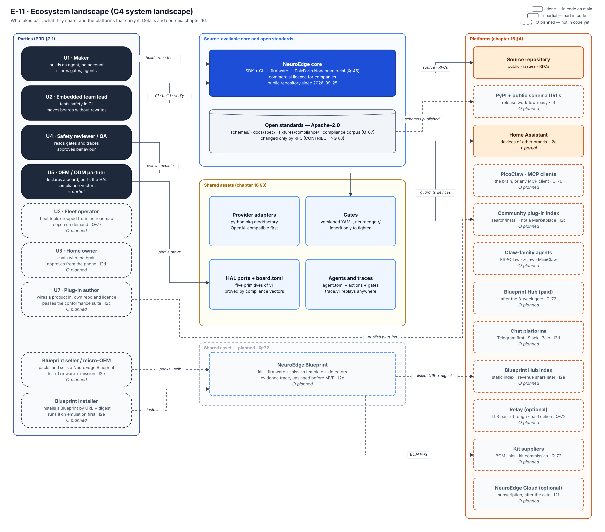
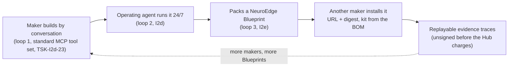

# 16 · Ecosystem (C4 System Landscape)

> **Scope:** panoramic view of the ecosystem (C4 system landscape) — all participating parties, shared assets, distribution and operation platforms, and the value flows between them in the current state and future planning. **Sources:** PRD §8, §14, Q-72; [`neuroedge-roadmap.md`](../../../roadmap/neuroedge-roadmap.md) §4.3.3 (I2c), §6 (removed items), §8; [`neuroedge-prd.md`](../../../roadmap/neuroedge-prd.md) §1.4, §1.5 (P-3, P-5), §2.1 (U1–U7), §3, §7.3 (FR-EXT), §14, §15 (Q-11, Q-13, Q-32..Q-38, Q-45, Q-67); `docs/architecture/vi/15-target-architecture.md` §4.4; §4; [`thi-truong-tich-hop-2026-10-04.md`](../../reports/thi-truong-tich-hop-2026-10-04.md); [`LICENSING.md`](../../../LICENSING.md); [`TODOS.md`](../../../TODOS.md) #32, #33; Q-72 range: [`proposal-blueprint-2026-10-11.md`](../../business/proposal-blueprint-2026-10-11.md) and Q-72 in PRD §15. Label conventions for `done` / `partial` / `planned`: [`README.md`](../README.md).

**Why read this chapter:** This chapter is for all participants in the NeuroEdge ecosystem — from independent developers (makers), embedded engineers, OEM partners, safety audit experts, third-party plugin authors to investors and commercial partners. The document answers core architectural questions: Who are all the parties in the NeuroEdge ecosystem? What types of assets are shared and protected? Which platforms distribute those assets? How does value circulate between the community and enterprises? And where does the boundary lie between the source-available core (free for non-commercial purposes, enterprises require a commercial license — Q-45) and the commercial Fleet OS service?

- **Prerequisites:** [`00`](00-overview.md) (system overview), [`00`](00-overview.md) §9 (C4 L1 context), and [`07`](07-data-contracts.md) (data contracts).
- **Subsequent reading:** roadmap §0.5 (phases) and §6 (removed items) and the corresponding target architecture design sections in [`15`](15-target-architecture.md) (§3.4 core ↔ commercial boundary, §6 operator agent and NeuroEdge Blueprint).

> **Q-77 (2026-10-12):** Fleet OS, Gate Registry, AURA, Marketplace, community port kit, robot, and Jetson have been dropped from the roadmap (roadmap §6). Wherever this chapter still mentions them, it is market context, not planned. The new player family to watch is the "Claw" family (ESP-Claw, PicoClaw, zclaw, MimiClaw): NeuroEdge acts as their spinal cord, not competing to be the brain (Q-76).

## 1. The Landscape

*Figure E-11 — Parties, shared assets, and platforms; dashed lines are planned. NeuroEdge Blueprint sellers and installers, Hub index, chat platforms, relay, and kit suppliers are `planned · Q-72`. Subscription NeuroEdge Cloud is `planned · Q-74`, conditional (I2f). Generated by scripts/gen_architecture_diagrams.py.*

**How to read diagram E-11:** Figure E-11 outlines all participating entities around central distribution and operational platforms. The diagram has four columns: parties (PRD §2.1), source-available core and Apache-2.0 open standards, shared assets (§3), and platforms (§4). Solid lines represent interactions already implemented and running in the current codebase (`done`); dashed lines represent planned expansion interactions (`planned`). Core takeaway: The NeuroEdge safety core serves as the central enforcement point for all physical hardware control commands, completely independent of where the assets originate. Detailed to-be designs are laid out in [`15`](15-target-architecture.md) (§3.1 Fleet OS, §3.2 Registry, §3.4 core ↔ commercial services boundary, §4.1 port kit, §4.5 device ecosystem).

The diagram below details the shared asset flows circulating among parties and platforms:

```mermaid
flowchart TD
    subgraph Parties["Ecosystem Parties"]
        DEV["Maker / App Developer (U1, U2)"]
        OEM["OEM Partner (U5)"]
        QA["Safety Reviewer / QA (U4)"]
        PLUG["Plug-in Author, third party (U7)"]
        PROVIDERS["Model / Speech Providers"]
        SELLER["Blueprint seller / micro-OEM (planned Q-72)"]
        BUYER["Blueprint installer (planned Q-72)"]
        KIT["Kit suppliers (planned Q-72)"]
    end

    subgraph Platforms["Platforms & Distribution"]
        REPO["Public source repo (done) · schema URLs (planned I6)"]
        PYPI["PyPI Package (planned I6)"]
        IDX["Community Plug-in Index (planned I2c)"]
        HUB["Blueprint Hub index (planned I2e)"]
        CHAT["Chat platforms: Telegram first (planned I2d)"]
        RELAY["Optional relay (planned Q-72)"]
    end

    %% Today flows (solid)
    DEV -->|"reads schemas & specs"| REPO
    OEM -->|"declares board capability (board.toml)"| REPO
    OEM -->|"runs compliance vectors"| REPO
    QA -->|"audits gates & trace replays"| REPO
    PROVIDERS -->|"OpenAI-compatible & decision endpoints"| DEV

    %% Planned flows (dashed)
    DEV -.->|"installs SDK & CLI (planned I6)"| PYPI





    PLUG -.->|"reads public SDK docs & runs compliance suite (planned I2c)"| REPO
    PLUG -.->|"publishes plug-ins with conformance result (planned I2c)"| IDX
    DEV -.->|"searches & installs plug-ins (planned I2c)"| IDX

    SELLER -.->|"publishes a Blueprint: URL + digest (planned I2e)"| HUB
    BUYER -.->|"blueprint install (planned I2e)"| HUB
    BUYER -.->|"buys the kit from the BOM (planned I2e)"| KIT
    BUYER -.->|"approves and gets reports (planned I2d)"| CHAT
    BUYER -.->|"remote access, encrypted backup (planned Q-72)"| RELAY

```

**How to read the flow diagram:** Boxes in the Parties group are entities creating or receiving value; boxes in the Platforms group are channels for distributing code, data, and coordinating operations. Solid lines only apply to workflows actively running today on the source repository and simulation environments (`sim`/`linux`). Dashed lines are planned: I2c, I6, I9, I10, I13, I14, I18, along with Block 4 (AURA) and Block 5 (Marketplace) which are outside the roadmap. Three flows of I2c: plugin authors (U7) read public documentation and run the compliance test suite, publishing plugins to the community index; users search and install plugins from there — this index is not a Marketplace (PRD §14). Five `planned · Q-72` flows (I2d, I2e): sellers publish a NeuroEdge Blueprint to the Hub index with a URL and digest; installers fetch it using `blueprint install`, purchase kits according to the BOM, approve and receive reports via chat channels, and optionally use a relay. Core takeaway: All extension assets (gates, adapters, ports, plugins, Blueprints) must pass verification gates before being deployed to physical devices.

## 2. Participating Parties

Comparison table for each participant, products built or used, value received, and how NeuroEdge serves them from present to future (mapped to user personas `U1`–`U7` in [`neuroedge-prd.md`](../../../roadmap/neuroedge-prd.md) §2.1):

| Participant | Builds or Uses | Value Received | How NeuroEdge Serves: Today → Planned |
|:---|:---|:---|:---|
| **Independent Maker & Inventor** (`U1`) | Builds first agent (`agent.toml`, action, gate YAML); uses simulation environment (`sim`) or personal board | Sub-10-minute time-to-first-value (TTFV < 10'), no account barriers, no advance hardware purchase needed; *fail-closed* mechanism (default block on error or uncertainty) protects actuators safely | **Today (`done`):** Source library `neuroedge`, CLI (`new`, `run`, `test`, `record`, `replay`), `sim` and `linux` (`gpio-sim`) targets, QEMU for `esp32s3`. → **Planned (`planned`):** One-command installation via PyPI (I6, [`neuroedge-roadmap.md`](../../../roadmap/neuroedge-roadmap.md) §4.7); rich sample gate library on Registry (I10). |
| **Embedded Tech Lead / App Developer** (`U2`) | Develops commercial products; configures gates, connects sensors/actuators; runs Action CI in CI/CD pipeline | Automates safety testing before flashing chips; switches boards without rewriting business logic (principle P-2); reuses verified safety policies | **Today (`done`):** Action CI test suite, gate truth table, two-way closed counterexample corpus, Python/C equivalent targets. → **Planned (`planned`):** Pull gates via `gate add` from cryptographically signed Gate Registry (I10, [`15`](15-target-architecture.md) §3.2); pin `extends` with JCS SHA-256 digest (TSK-S3-21); purchase commercial license for enterprise (Q-45). |
| **Safety Reviewer / QA** (`U4`) | Audits and approves gate conditions; investigates incident traces and reconciles compliance | Reads and understands YAML safety policies without reading source code; guarantees invariance (inheritance only tightens); deterministic fault replay from traces | **Today (`done`):** CLI commands `neuroedge gate lint`, `gate explain`, `trace validate`, `trace view`, `replay`. → **Planned (`planned`):** Verify OCI/ORAS cryptographic signatures on gates and traces (TSK-W2-04, I10); display compliance status of running adapters on device fleet (TSK-P2-02, I18). |
| **Hardware Manufacturing Partner (OEM / ODM)** (`U5`) | Manufactures boards and hardware modules; declares board capability profile (`board.toml`); pin-level safety envelopes `done` on `sim` and `linux` (RFC-0007, I2a), and `esp32s3` in I3a | Brings hardware into the agent ecosystem without being locked into a single chip family; standardizes actuation capabilities | **Today (`partial`):** Schema `board.v1.json` (with envelope block and extended primitives), four reference board profiles for three Tier 1 targets (`boards/sim-default.toml`, `sim-rpi5.toml`, `linux-rpi5.toml`, `esp32s3-box-3.toml`), porting guide ([`10`](10-target-equivalence.md) §7). → **Planned (`planned`):** Open `target` enum by *tiering* via RFC-0002 — signed 2026-10-04, code part moved into I2c ([`neuroedge-roadmap.md`](../../../roadmap/neuroedge-roadmap.md) §4.3.3; I11 merged into I2c, Q-67); `neuroedge board validate` and `board show` tools (TSK-V1a-05); `--board <path>` for out-of-tree community boards, self-certified, never reference boards (TSK-I2c-05). |
| **Third-party Plugin Author (Plug-in Author)** (`U7`) | New AI device companies, community of an ecosystem (Muse Gadgets, Home Assistant, xiaozhi…) or makers writing bridges for products they use; writes plugins in own repository under own license | Connects own product to safety layer through public documentation alone, without modifying core or waiting for core team; self-proves correctness via compliance test suite (Q-67) | **Today (`planned`):** No extension points available for this group yet — contracts are open (schemas, specifications, and compliance corpus under Apache-2.0) and the only open extension point is model provider (`python:pkg.mod:factory`, FR-MDL-08). → **Planned (`planned`):** I2c ([`neuroedge-roadmap.md`](../../../roadmap/neuroedge-roadmap.md) §4.3.3, §4): `neuroedge.guard`, Extension SDK `neuroedge.sdk` with six extension point types, `neuroedge conformance`, `proxy mcp` and `proxy http`, `plugin search/install` on community index; checkpoint test A13 is `neuroedge-muse` bridge (TSK-I2c-17). |
| **NeuroEdge Blueprint Seller, Small Manufacturer (Blueprint seller / micro-OEM)** — `planned · Q-72` | Maker packages a working product (kit, firmware, sample mission contract, detector, evidence traces) into a NeuroEdge Blueprint; self-hosts package in own repo | Sells Blueprint or hardware without writing a custom safety layer; `replay` evidence replaces promotional claims | **Today:** None. → **Planned (`planned`, I2e):** `blueprint pack`, package-wide digest, entry in Hub index ([`15`](15-target-architecture.md) §6.4); selling is commercial use, requiring a license (Q-45); Hub monetizes only after the 8-week demand gate ([`Q-72`](../../../roadmap/neuroedge-prd.md#15-decision-log)). |
| **NeuroEdge Blueprint Installer (Blueprint installer)** — `planned · Q-72` | Home Assistant / ESPHome community maker: installs a Blueprint, locks mission contract on local home machine, runs operator agent 24/7 | A working physical AI product operational from a single prompt; approves and receives reports via chat; pays for own LLM via BYOK | **Today:** None. → **Planned (`planned`, I2d, I2e):** `blueprint install` checks digest; 24/7 runtime + LLM worker; Telegram channel with approval records ([`15`](15-target-architecture.md) §6.1, §6.2). Free for individuals (Q-45). |
| **Kit Suppliers** (External) — `planned · Q-72` | Sells components according to Blueprint BOM (aquarium first) | Pre-defined orders matching BOM | **Today:** Five sample kits with BOM in repo (I2b). → **Planned (`planned`, I2e):** Blueprint BOM includes purchase links; kit affiliate commissions are first trial revenue ([`Q-72`](../../../roadmap/neuroedge-prd.md#15-decision-log)). |
| **AI Model & Speech Providers (Model / Speech Providers)** (External) | Provides LLM inference services (System 2, called by the NeuroClaw brain — Q-83), System One (Jev), ASR, and TTS | NeuroEdge customers connect directly, paying token/inference costs directly to providers (NeuroEdge does not resell tokens, PRD §1.4 N4) | **Today (`done`):** *FactSource* interface (fact source only provides observations, does not issue ALLOW), standard OpenAI API integration (`models/providers/openai_chat.py`, `perception/providers/openai_audio.py`), System One API on OpenRouter (`systemone_api.py`), LiteLLM library (`litellm_provider.py`, Q-10). → **Planned (`planned`):** Complete provider abstraction layer for device fleet (FR-GW, v1.1, TSK-K2-01..03); community-contributed provider adapter sharing repository (TSK-K3-06, I10). |

## 3. Shared Assets

Inventory table of all data and source code assets circulating between ecosystem parties:

| Shared Asset | Defining Contract | How Shared Today | How Shared in the Future (Signing, Digest Pinning) | Asset License (Q-45, Q-11) |
|:---|:---|:---|:---|:---|
| **Safety Gate** (`gate.v1`) | [`07`](07-data-contracts.md) §2, [`schemas/gate.v1.json`](../../../schemas/gate.v1.json), RFC-0001, RFC-0004, RFC-0005, RFC-0006 | Local copy available: resolved from `gates/`, RFC 8785 + SHA-256 digest; unsigned, not fetched remotely (`python/neuroedge/cli/main.py`) | Signed, fetched from Gate Registry (I10); cryptographically signed per *OCI (Open Container Initiative)* standard and verified on-device (TSK-W2-04); inheritance pinned with JCS SHA-256 digest via `@<ver>#sha256:...` syntax (TSK-S3-21) | Format and schema under **Apache-2.0** (Q-45). Files in repo's `gates/` under PolyForm Noncommercial 1.0.0 ([`LICENSING.md`](../../../LICENSING.md)); third-party gate license: **unsourced** |
| **Provider Adapter** (`python:`) | `FactSource` / `Provider` protocol ([`03`](03-component-host-c4l3.md) §3.4), [`docs/spec/tool_calling.md`](../../spec/tool_calling.md) specification, `agent.toml` configuration | Python source in repo (`neuroedge.models.providers`), adapter loaded via `provider = "python:pkg.mod:factory"` (Python module import) | Shared adapter repository using common OCI Registry infrastructure (TSK-K3-06, I10; TSK-P2-01, I18); executed via permission-isolated sandbox (TSK-K3-05) and compliance test suite; compliance status displayed on Fleet Dashboard (TSK-P2-02) | Author retains copyright and chooses license (`docs/architecture/vi/15-target-architecture.md` §3.4); if integrated into distribution package, must be within Q-11 allowlist (MIT, BSD, Apache-2.0, ISC, PSF, CNRI-Python, MPL-2.0, Zlib, CC0-1.0; GPL, SSPL, BSL prohibited) |
| **HAL Port + Board Profile** (HAL port + `board.toml`) | [`07`](07-data-contracts.md) §4, [`schemas/board.v1.json`](../../../schemas/board.v1.json), contract of 5 baseline HAL primitives ([`10`](10-target-equivalence.md) §7.2), RFC-0002 | C/Python code in `python/neuroedge/hal/` and `targets/esp32s3/`, configuration files in `boards/*.toml` | Standalone port kit (TSK-P1-01..05, I13); community-contributed HAL port repository on Registry infrastructure (TSK-P2-01, I18); self-verified via `neuroedge board check` and free self-certification results published (TSK-P2-03) | Port author retains copyright and chooses license (`docs/architecture/vi/15-target-architecture.md` §3.4, `LICENSING.md` citing `NOTICE`); must comply with Q-11 allowlist if bundled with core source code |
| **Third-Party Plugins** (bridge, fact source, actuator, board, template, exporter) | RFC-0016 (Extension SDK `neuroedge.sdk`), RFC-0017 (namespaced `source`), RFC-0018 (remote actuators) — drafts; §4 | None yet: only open extension point is model provider (`python:`) | Python package in author's repo, declared via entry points, loaded only when explicitly enabled by operator; `neuroedge conformance <package>` produces machine-readable output; searched and installed via `neuroedge plugin search/install` from community index (I2c). Plugins are in-process executable code, trusted by the operator (NFR-SEC-10); safety remains enforced by core — bridges have no HAL handles, actuators drive only after tokens and envelopes (FR-EXT-03) | Plugin code in author's repo, **under author's license**; NeuroEdge claims no copyright (Q-67, [`LICENSING.md`](../../../LICENSING.md)). *Using* the shared runtime remains subject to runtime terms |
| **Complete Agent** (`agent.toml` + logic) | [`07`](07-data-contracts.md) §3 (`agent.toml`), agent directory structure (actions, gates, prompts) | Sample projects in repo (`fixtures/agents/home-voice/`, `python/neuroedge/templates/`), distributed via git repos | Shared as a git repository or as a Blueprint (I2e); no registry or marketplace is planned (Q-77) | Unsourced for third-party agents; sample agents in repo under PolyForm Noncommercial 1.0.0 (Q-45), except `fixtures/agents/` used by compliance corpus: Apache-2.0 (Q-67) |
| **NeuroEdge Blueprint** — `planned · Q-72`, I2e | `blueprint.v1` (planned RFC; requirements `docs/spec/blueprint.md`, Q-86) — [`15`](15-target-architecture.md) §6.4 | None yet | Downloaded via URL (git/HTTPS) + package-wide digest (kit, firmware, sample contract, detector, evidence traces); static Hub index; the paid Hub waits for the demand gate (Q-85). Differs from Home Assistant Blueprints (automation templates); may bundle an HA blueprint | Under seller's license; selling Blueprints is commercial use of the runtime, requiring a license (Q-45) |
| **Sample Mission Contract & Detector** — `planned · Q-72`, I2d | `mission.v1` (planned RFC) | None yet | Bundled in Blueprint; installer locks contract on local machine; never declares `safe_state` (declared only in `board.v1`) | Same as containing Blueprint |
| **Evidence Traces** — `planned · Q-72` | Segmented `trace.v1` (planned RFC), [`15`](15-target-architecture.md) §6.7 | None yet | Segment chains, e.g., 30 days run in simulation, `replay`-able; explicitly marked **"unsigned"** until Hub charges (`TODOS.md` #1) | Apache-2.0 schema; data per seller |
| **Execution Traces** (`trace.v1`) | [`07`](07-data-contracts.md) §7, [`schemas/trace.v1.json`](../../../schemas/trace.v1.json), RFC-0008 (carries `gate_digest`) | Local JSON files (`traces/*.json`, `fixtures/traces/`), reconciled via Action CI | Devices automatically push incident traces to centralized Fleet OS storage via WebSocket/MQTT (FR-FLT-05, TSK-K2-08, I9); cryptographic trace signing (TSK-W2-04, `TODOS.md` #1); multi-node merged traces (TSK-W3-04, I14) | Schema under **Apache-2.0** (Q-45). Trace data records decisions only, no raw data (NFR-PRIV-03, Q-6) |
| **Compliance Vectors** | [`docs/spec/voice_fsm.md`](../../spec/voice_fsm.md) §9, [`docs/spec/tool_calling.md`](../../spec/tool_calling.md) §9, gate truth table | Directories `fixtures/compliance/voice/`, `fixtures/tool_calls/`, `fixtures/contracts/`, `fixtures/traces/` run in pytest; only `fixtures/traces/` runs on both host and QEMU | Packaged into language-independent test suite runnable outside repo (`fixtures/compliance/portable/`, TSK-P1-01, I13); "NeuroEdge-gated" self-verification corpus for third-party runtimes (TSK-P2-06, moved to I2c) | `fixtures/compliance/`, `fixtures/tool_calls/`, `fixtures/contracts/`, `fixtures/traces/`, and `fixtures/agents/` used by corpus: **Apache-2.0** (Q-45, Q-67; [`LICENSING.md`](../../../LICENSING.md)) |
| **Standard Data Schemas** (Schemas) | Seven schemas in `schemas/` — `gate.v1`, `trace.v1`, `board.v1`, `tool-call.v1`, `tool-result.v1`, `error.v1`, `error-codes.v1` (RFC-0015) | JSON Schema files in git repo `schemas/` directory | Published at official public URL (`https://schema.neuroedge.dev/...`) at I6 (Q-39); registered in global public SchemaStore (FR-TRC-10) for automatic IDE recognition; commitment to transfer governance to neutral foundation at G1 (§6) | **Apache-2.0** (Q-45, [`LICENSING.md`](../../../LICENSING.md)) |

## 4. Platforms

The ecosystem operates on the following platforms and distribution channels (each row specifies nature and rationale):

| Platform | Nature & Why Needed in Ecosystem | Status | Increment | Future Architecture Details |
|:---|:---|:---:|:---:|:---|
| **Public Source Repo & Schemas URL** | Public source code repo (source-available, Q-45) and documentation publishing point; needed for specification transparency, receiving RFCs, and distributing industry standards | `partial` | I6 | Open to the public since 2026-09-25 (Q-45); `schema.neuroedge.dev` URL at I6 (TSK-I6-02, [`neuroedge-roadmap.md`](../../../roadmap/neuroedge-roadmap.md) §4.7); SchemaStore registration at I7 (TSK-S6-07, FR-TRC-10) |
| **PyPI Distribution Package (`neuroedge`)** | Official Python library distribution channel; needed for developers to install SDK and CLI with frictionless one-liner (`pip install neuroedge`) | `planned` | I6 | Complete once voice demos succeed across all three Tier 1 targets ([`neuroedge-roadmap.md`](../../../roadmap/neuroedge-roadmap.md) §4.7, Q-39) |
| **Extension SDK (`neuroedge.sdk`) and Plugin Compliance Suite** | Versioned extension points with distinct stability commitment, tighter than package `0.x`: six types (bridge, fact source, actuator, board, template, exporter) loaded via entry points, `neuroedge conformance <package>` produces machine-readable output; needed for third parties to connect NeuroEdge to new products without modifying core | `planned` | I2c | RFC-0016 → RFC-0018 (drafts); [`neuroedge-roadmap.md`](../../../roadmap/neuroedge-roadmap.md) §4.3.3; §4 |
| **Community Plug-in Index** | Dedicated index repository (Apache-2.0) for `neuroedge plugin search/install`, showing compliance results; "NeuroEdge-gated" badge granted only when plugin passes compliance suite. **Not a Marketplace:** no fees, no paid ranking, no warranty (PRD §14, FR-EXT-08); needed to discover and install plugins without waiting for core team | `planned` | I2c | TSK-I2c-18 ([`neuroedge-roadmap.md`](../../../roadmap/neuroedge-roadmap.md) §4.3.3); index repo resides outside this repo |
| **NeuroEdge Blueprint Hub Index** | Static index repository (similar to I2c plugin index) listing URLs, package-wide digests, and "unsigned" evidence of each Blueprint; not a service, no fees at MVP; needed for installers to discover Blueprints and sellers to publish | `planned · Q-72` | I2e | [`15`](15-target-architecture.md) §6.4; monetization and revenue share only after 8-week demand gate, then moves to OCI Gate Registry |
| **Chat Platforms (Telegram first; Slack, Zalo)** | Channel for operator agents to report proactively and request approvals; human responds via approval records targeting specific `id`; needed for users to run products without opening a management dashboard | `planned · Q-72` | I2d | [`15`](15-target-architecture.md) §6.2 |
| **Optional Relay** | TLS tunnel via SNI, no decryption; remote access, push notifications, encrypted trace backup; outside the safety path; optional paid service | `planned · Q-72` | outside I2d, I2e | [`15`](15-target-architecture.md) §6.5 |

Fleet OS, the Gate Registry, the community port kit, the device ecosystem (I18), the paid marketplace and the AURA vertical app are no longer platforms of this plan: they were removed from the roadmap (Q-77, roadmap §6). Commercial boundaries: PRD §8, Q-45, Q-85 and [`docs/business/brd-ambient-intelligence.md`](../../business/brd-ambient-intelligence.md).

## 5. Value Flywheel

The seven-step flywheel of the earlier plan ended in Fleet OS and a public Gate Registry (I9, I10); both were removed from the roadmap (Q-77, roadmap §6). What remains from it: steps 1–3 (try on `sim`, write a first gate, record traces and test in CI) are `done` or `partial` and generate the differentiated technical value; the loop that replaces it is the Blueprint loop below.

### Blueprint Loop (`planned · Q-72`)

Q-72 adds a loop with a return arrow, differing from the seven linear steps above: each installed and running Blueprint produces
more evidence, and evidence attracts more makers.

*How to read the diagram:* dashed arrow is the flywheel — evidence from previous installers attracts subsequent builders.
Commercial boundaries of the loop: PRD §8, Q-45, Q-85. The 8-week demand gate measures precisely three stages B3, B4, and continuous operation in B2
([`15`](15-target-architecture.md) §6.9).

### Properties of Shared Assets

1. **Steps 2 and 3 generate differentiated technical value that other solutions have not addressed:** safety contracts tested in CI before flashing chips.
2. **Safety gates are ideal resources for sharing:** lightweight (YAML files), transparent, free of legal risk. The verification gate is `neuroedge gate lint`. A public Gate Registry is not planned (Q-77).

**Adapters and HAL ports are executable code,** running directly on physical actuator devices, so the rationale for sharing gates does not transfer. The compliance suite for ports (TSK-P1-01, I13) and the permission-isolated sandbox (TSK-K3-05, I10) were removed from the roadmap (Q-77); the build-time capability reconciliation (`neuroedge build`, TSK-S2-02) remains. Core invariant: regardless of where an adapter or HAL port originates, **all actuator commands must still pass through gates**, and gates continue to run inside the core. A flawed port may prevent a device from functioning; it cannot make a device act when the gate says no.

From Q-67, **third-party plugins** (bridge, fact source, actuator, board, template, exporter — I2c, `planned`) are of the same executable code asset type: Python packages in author repositories, under author licenses, executing in-process as operator-trusted code (NFR-SEC-10). Their verification gate is the type-specific compliance test suite (`neuroedge conformance`) alongside the structural invariants of FR-EXT-03; plugin signing arrives with the registry (I10).

## 6. Open Standards and Governance

NeuroEdge strategy: public source code is the distribution funnel, data formats are the industry standard (§6).

### What Open Standards Mean

Per decision **Q-45** ([`neuroedge-prd.md`](../../../roadmap/neuroedge-prd.md) §15, [`LICENSING.md`](../../../LICENSING.md)):
- NeuroEdge source code (Python runtime, CLI, firmware, services, tooling, tests) is released under **PolyForm Noncommercial 1.0.0** (source-available); third-party plugins and adapters remain in author repositories under author licenses (Q-67).
- All **open standards retain the Apache-2.0 license**:
  - `schemas/`: seven schemas `gate.v1`, `trace.v1`, `board.v1`, `tool-call.v1`, `tool-result.v1`, `error.v1`, `error-codes.v1` (RFC-0015).
  - `docs/spec/` (entire directory): [`tool_calling.md`](../../spec/tool_calling.md), [`voice_fsm.md`](../../spec/voice_fsm.md), [`simulation_coverage.md`](../../spec/simulation_coverage.md), [`threat_model.md`](../../spec/threat_model.md), [`ui.md`](../../spec/ui.md), [`hal_mcu_review.md`](../../spec/hal_mcu_review.md).
  - `fixtures/compliance/`: compliance vectors and canonical test corpus.
  - Compliance corpus `fixtures/tool_calls/`, `fixtures/contracts/`, `fixtures/traces/`, and `fixtures/agents/` used by the corpus (Q-67, [`LICENSING.md`](../../../LICENSING.md)).
This guarantees third parties are free to implement the standards and run compliance suites without requiring a commercial license from NeuroEdge.

### Standards Modification Process (RFCs and Semantic Versioning)

All changes to open standards must strictly adhere to a transparent RFC process and freeze rules per [`CONTRIBUTING.md`](../../../CONTRIBUTING.md) §3:
- **Changes strictly requiring an RFC:**
  1. Modifying any file in `schemas/*.json`;
  2. Modifying gate resolution semantics (`engine/gate_resolver.py`, `engine/constraints.py`);
  3. Modifying the three canonical traces in `fixtures/traces/*.json`;
  4. Modifying or deleting locked gates in `digests.lock` (`gates/`, `fixtures/gates/valid/`, `fixtures/gates/registry/`);
  5. Changing the on-device tree `NETR` binary layout (bumping layout version number, RFC-0003).
- **Status of RFCs:** the register with each RFC's status is [`docs/rfc/README.md`](../../rfc/README.md); in-flight and planned RFCs are listed there too. Not repeated here (CONTRIBUTING §8.1).
- **Backward compatibility commitment:** Strictly adhere to SemVer 2.0; never break backward compatibility of published safety gates.

### Publishing Schema `$id` URLs and SchemaStore Integration

- Standard JSON Schemas are identified by fixed URIs:
  - `gate.v1`: `$id = "https://schema.neuroedge.dev/gate/v1.json"`
  - `board.v1`: `$id = "https://schema.neuroedge.dev/board/v1.json"`
  - `trace.v1`: `$id = "https://schema.neuroedge.dev/trace/v1.json"`
- Published to public hosting at I6 (TSK-I6-02, not yet started; [`neuroedge-roadmap.md`](../../../roadmap/neuroedge-roadmap.md) §4.7).
- **Public SchemaStore registration** (FR-TRC-10, PRD §6; TSK-S6-07, I7): Schemas registered in SchemaStore so VS Code and other IDEs automatically recognize them, supporting auto-complete and real-time linting when users edit gate/board/trace files without installing NeuroEdge CLI tools.

### Commitment to Transfer Governance to a Neutral Foundation

The earlier commitment to hand the gate specification and trace schemas to a neutral foundation was tied to milestone G1 (10,000 active devices) and to Fleet OS revenue. Q-72 replaced G1–G4 with the demand gate and Q-77 removed Fleet OS, so the trigger no longer exists. The commitment stays an intent without a trigger until a new decision (PRD §15) sets one; no foundation has been selected.

## 7. Commercial Model and Boundaries

Removed from this chapter: the Fleet OS tiers, the marketplace and the Registry revenue streams, which left the roadmap with Q-77 (roadmap §6). Current references:

- Business scope and boundaries: PRD §8 and §14; non-goals PRD §1.4 (N4: no resale of inference tokens).
- Licensing of the core and the Apache-2.0 standards: Q-45, [`LICENSING.md`](../../../LICENSING.md).
- Business requirements, KPIs and what waits for the 2026-12-06 demand gate (paid Hub, NeuroEdge Cloud, wearables, commercial-licence terms): Q-85 and [`docs/business/brd-ambient-intelligence.md`](../../business/brd-ambient-intelligence.md).
- The safety core is never behind a paywall (PRD P-3): boundary in [`15`](15-target-architecture.md) §3.4.

## 8. External Ecosystems

Third-party ecosystems that NeuroEdge connects with or tracks:

| Ecosystem | Connection Role | Integration Protocol / Mechanism | Status |
|:---|:---|:---|:---:|
| **Model & Speech Providers** | Provides System 2 language capabilities (Claude, GPT) to the NeuroClaw brain (Q-83), *SystemOne* (structured response models returning `bool`/`level`/`choice`, e.g., Jev), ASR recognition, and TTS synthesis | Standard OpenAI API (`/chat/completions`, `/audio/transcriptions`, `/audio/speech`), OpenRouter System One API (`POST {api_base}/systemone`), LiteLLM routing library (Q-10, Q-12) | `done` (host, `sim`, `linux`); `planned` (I5: TSK-S5-01, TSK-S5-06 for audio streaming on `esp32s3`) |
| **MCP Client & Server (Model Context Protocol)** | Exposes hardware actions externally as gate-protected tools (Gated Tool Profile, Q-24); the NeuroClaw brain consumes them over MCP (Q-83); the box's own System 2 reading external MCP servers (Q-27) is legacy, off by default | JSON-RPC over local stdio (`mcp_server.py`, `mcp_host.py`); network MCP with authentication (`mcp_http.py`: Streamable HTTP + mTLS + OAuth 2.1, disabled by default, TSK-P2-04) and MCU MCP via gateway (TSK-P2-05) in I14 | `done` (stdio; network, untried on two physical machines); `planned` (MCU gateway in I14) |
| **Espressif & ESP-IDF** | Official v1.0 edge microcontroller ecosystem. ESP32-S3-Box-3 reference board (Q-2). ESP-IDF v5.4 framework. Audio processing via ESP-SR (WakeNet/MultiNet) or TFLite Micro / ESP-NN (Q-14, `TODOS.md` #17). Espressif QEMU runner in CI (TSK-S4-08) | Firmware components (`ne_agent`, `ne_gate` including token ledger `ne_token.c`, `ne_ota`, `ne_trace`), `NETR` v1 binary flash layout (RFC-0003) | `partial` (runs on QEMU; physical Box-3 hardware in I3, I5, I7) |
| **Model Hardware Standard (MHS — Anthropic)** | Anthropic hardware connection standard (research preview 2026-08-27, Q-29, `TODOS.md` #32, #33). Device property tags and safety limits are potential data sources for gates | Prepare host HAL adapter on `linux` via MCP when MHS open-sources and stabilizes; not Tier 1, does not modify `schemas/`, requires no RFC-0002; when available, adapter is a plugin (Q-67). NeuroEdge is positioned as the on-device safety/testing layer for MHS | `planned` (tracking, no v1.0 investment) |
| **Device Context Protocol (DCP)** | Single-author MCU protocol (arXiv, MIT): DCP↔MCP bridge intercepting before device, HMAC capability token; lacks inheritance policy, Action CI, or traces (§8) | Track; re-evaluate when DCP publishes spec v0.4 altering safety semantics (`TODOS.md` #32) | `planned` (tracking) |
| **Emerging Physical AI Safety Layers** | Emerging runtime guardrails and Physical AI protection tools: OneDiagonal ("release gate"), AI Safety Gate, STATE16 (runtime guardrails), Peridio/Avocado OS ("OS for Physical AI") | Track specifications and competitive landscape before I6, following interview question C7 (Q-56) (`TODOS.md` #32, §8) | `planned` (tracking) |

Three integration shapes cover the majority of the AI agent device market (market report [`thi-truong-tich-hop-2026-10-04.md`](../../reports/thi-truong-tich-hop-2026-10-04.md) §1–§2; design: §4). NeuroEdge plans to build adapters for each shape; new ecosystems only require a thin plugin on top of their shape. **All adapters below are `planned` — none have been built yet:**

| # | Integration Shape | Market Examples | NeuroEdge Adapter (`planned`) | Where Gate Resides | Increment |
|:---:|:---|:---|:---|:---|:---:|
| 1 | Agent calls tool via MCP | Home Assistant (`/api/mcp`), Alexa+ (MCP Toolkit), ESP-Claw, xiaozhi (MCP wrapped in WebSocket or MQTT), Anthropic MHS | `neuroedge proxy mcp` alongside `neuroedge guard init --mcp` (generates default blocking gates for each tool from `inputSchema`) | MCP proxy sits in front of real server; real server only listens on path reachable by proxy, verified by `plugin doctor` | I2c |
| 2 | Device calls vendor cloud | Muse Gadgets (ESP32 and Linux SDK, Apache-2.0; device maintains connection out to Muse), xiaozhi | Plugin bridge running on device, replacing vendor SDK command executor and stripping raw commands like Muse's `system.run`; checkpoint test A13 is `neuroedge-muse` bridge in dedicated repo (TSK-I2c-17) | On-device orchestrator, between transport and driver | I2c |
| 3 | Local Hub / HTTP, pub/sub | Home Assistant, ESPHome, Muse Home Link, Matter, MQTT | `neuroedge proxy http`; Home Assistant-style remote actuators with explicit auto-off levels (RFC-0018, TSK-I2c-16) | Reverse proxy before API, or bridge acting as controller replaying only gated commands | I2c |

Code generated by LLMs and executed directly on devices (ESP-Claw, Muse's `system.run`) is a special case: the tool boundary is too late, so gates must reside at the HAL layer invoked by that code (report §2). Market examples reflect a snapshot as of 2026-10-04, and the market evolves rapidly; MHS is still in research preview (announced 2026-08-27), lacking a repository or license (`TODOS.md` #33).

## 9. Sources

This document synthesizes and references the following sources of truth:
- **Execution plan and exit criteria:** [`neuroedge-roadmap.md`](../../../roadmap/neuroedge-roadmap.md) §0.2 (increment matrix), §4.3.3 (I2c open platform: TSK-I2c-01..19), §4.7 (I6 PyPI public release), §6 (removed items, Q-77), §8 (outside roadmap).
- **Requirements and decision log:** [`neuroedge-prd.md`](../../../roadmap/neuroedge-prd.md) §1.4 (non-goals N1–N4), §1.5 (principles P-1–P-5), §2.1 (user personas U1–U7), §2.2 (JTBD J1–J7), §3 (release scope), §7.3 (FR-EXT-01→09), §9.4 (NFR-SEC-10), §11.1 (A13), §14 (out of scope), §15 (decisions: Q-2 board, Q-6 trace storage, Q-10 LiteLLM, Q-11 dependency licenses, Q-12 AI connection, Q-13 target tiering, Q-14 local fallback, Q-24 tool calling, Q-27 MCP, Q-29 MHS positioning, Q-45 license change to PolyForm Noncommercial and Apache-2.0 standards, public repository since 2026-09-25, Q-67 open platform, Q-72 Blueprint positioning).
- **Blueprint positioning:** [`proposal-blueprint-2026-10-11.md`](../../business/proposal-blueprint-2026-10-11.md) (three loops, Blueprint, cash flow, demand gate); target architecture in [`15`](15-target-architecture.md) §6.
- **Open platform:** market report [`thi-truong-tich-hop-2026-10-04.md`](../../reports/thi-truong-tich-hop-2026-10-04.md); RFC-0016, RFC-0017, RFC-0018 (`docs/rfc/`, approved — Q-68).
- **License policies and contribution conventions:** [`LICENSING.md`](../../../LICENSING.md) (distinction table between PolyForm Noncommercial, Apache-2.0, NOTICE); [`CONTRIBUTING.md`](../../../CONTRIBUTING.md) §2 (CLA), §3 (catalog of changes requiring RFC), §8.1 (single source of truth principle).
- **Intentional deferrals:** [`TODOS.md`](../../../TODOS.md) #1 (trace signing), #11 (registry-side version invariants), #15 (pinning `extends` by digest, TSK-S3-21; scheduled for I2c), #17 (verifying ESP-SR license), #25 (MCP connection), #32 (tracking MHS, DCP, and emerging Physical AI safety layers), #33 (MHS adapter), #43 (CLA), #44 (commercial license terms), #55 (remote actuators; design scheduled for I2c).
