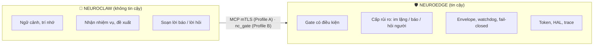

# TÀI LIỆU YÊU CẦU KINH DOANH (BRD)
## Quản gia tĩnh lặng: NeuroClaw (bộ não) + NeuroEdge (hộp giữ luật), một sản phẩm

> **Định vị (Q-82):** *"The Physical AI that really does things, safely by design."*
> **Phiên bản:** 1.1.0 · **Ngày:** 15 tháng 10, 2026
> **Trạng thái:** **Đã duyệt** (chủ sản phẩm, 15/10/2026) — quyết định **Q-85** trong PRD §15. Các yêu
> cầu chảy vào SRS (§12); phần hoãn mở lại chỉ với `Q-N` mới.
> **Tài liệu liên quan:** `roadmap/neuroedge-prd.md` (Q-45, Q-72, Q-73, Q-74, Q-77, Q-82, Q-83),
> `docs/spec/deployment_profiles.md`, `docs/business/cong-nhu-cau-2026-10-25/`,
> `docs/business/proposal-blueprint-2026-10-11.md`.

---

## 0. Thay đổi so với bản 1.0

Bản 1.0 (vào repo cùng commit `c0b5b9e`) được rà lại ngày 15/10/2026 và nghiên cứu thị trường bổ sung
(Phụ lục B). Thay đổi:

1. **Quyết định hỏi người thuộc về hộp, không thuộc về bộ não.** Bộ lọc rủi ro 3 cấp của bản 1.0 nằm
   trong NeuroClaw; NeuroClaw là phần không tin cậy, nên cấp rủi ro giờ khai báo trong gate của từng
   hành động (BR-3), bộ não chỉ soạn lời.
2. **Gia đình là khách hàng đích của trải nghiệm; maker ra mắt trước** (chủ sản phẩm, 15/10/2026).
   BRD mô tả điều gia đình nhận được; thứ tự ra mắt giữ đúng Q-72: maker làm Blueprint trước, gia đình
   dùng qua sản phẩm của maker. Người dùng kính thông minh dời sang Phụ lục A (Q-77 đã bỏ voice; bộ công
   cụ của Meta còn ở dạng developer preview).
3. **KPI gắn với cổng nhu cầu 8 tuần** (Q-72) và các NFR đã có. Bỏ "≥ 90% thao tác im lặng" (đo cấu
   hình, và thưởng cho việc nới luật) và "giữ chân 90 ngày" (không đo kịp trước cổng).
4. **Chi phí:** theo NFR-COST-01 (kịch bản bể cá 30 ngày < 2 USD), không phải 3 USD/tháng.
5. **Mô hình kinh doanh là giả thuyết**, mở theo đúng điều kiện đã chốt (Q-72, Q-74), không ghi giá.
6. **Lộ trình theo roadmap:** I2d (2026-11-11), I2e (2026-11-25), cổng nhu cầu (2026-12-06).
7. **Thêm:** đối thủ (§2.2), bằng chứng và mức tin cậy cho từng nỗi đau (§2.1), rủi ro mới (§11),
   các câu hỏi chờ duyệt (§12). Bỏ cách nói tuyệt đối ("an toàn tuyệt đối", "chặn đứng").
8. **Chỉnh ngày 17/10/2026 (Q-90):** token theo Q-74 (§5, §9 H3); BNFR-2 là trần chi phí mỗi kỳ; BR-3 trỏ tới
   `docs/spec/missions.md` MS-RT-09.

---

## 1. Tóm tắt

AI hiện nay giỏi nói nhưng chưa được giao làm việc thật trong nhà, vì hai lỗi trái ngược: tự động hoá
cứng nhắc, không hiểu ngữ cảnh; hoặc trợ lý LLM làm sai, hay hỏi xin phép đến mức người dùng tắt thông
báo. Sản phẩm này tách hai việc:

* **NeuroClaw (bộ não, không tin cậy):** hiểu ngữ cảnh, nhớ thói quen, nhận nhiệm vụ theo mục tiêu, nói
  chuyện qua chat.
* **NeuroEdge (hộp, tin cậy):** mọi lệnh ra thiết bị đi qua gate có điều kiện; việc nhạy cảm hỏi một
  người thật; mọi quyết định có trace phát lại được; chạy tại nhà, kể cả trên một chip ESP32-S3.

Khách hàng chính là **gia đình**: muốn nhà tự lo việc (bể cá, cây, không khí) mà không bị làm phiền,
chỉ nói chuyện qua chat, không cấu hình. **Maker** là bên cung cấp: đóng gói thiết bị ngách cùng luật và
bộ não thành NeuroEdge Blueprint để gia đình cài một lần. **Thứ tự ra mắt theo Q-72:** maker trước,
gia đình đến qua Blueprint của maker.

---

## 2. Bối cảnh thị trường

### 2.1 Nỗi đau và mức bằng chứng

Mọi nỗi đau dưới đây là **giả thuyết của đội**; chưa có cuộc phỏng vấn nào xác nhận (premise P1,
`cong-nhu-cau-2026-10-25/README.md`). Cột "Bằng chứng" ghi những gì nghiên cứu ngày 15/10 tìm được.

| Mã | Nỗi đau | Bằng chứng hiện có | Mức tin cậy | Lời giải |
|:---:|:---|:---|:---:|:---|
| **P-1** | Mệt vì cảnh báo: hệ thống hỏi hoặc báo quá nhiều, người dùng tắt thông báo | Nielsen Norman Group: quá nhiều thông báo khiến người dùng bỏ qua hoặc tắt chúng (định tính). Không tìm được số đo riêng cho nhà thông minh. | Trung bình | Cấp rủi ro theo hành động, khai báo trong gate; ngân sách tin nhắn (NFR-COST-02) |
| **P-2** | Mù ngữ cảnh: lệnh chỉ là từ khoá, không biết giờ, thời tiết, ai ở nhà | Alexa+ và Gemini for Home đang thêm ngữ cảnh (hiện diện, camera) — thị trường coi đây là vấn đề thật. | Trung bình | Ngữ cảnh nhiều cảm biến trong bộ não (BR-1); dữ kiện cho gate do hộp đọc |
| **P-3** | Phải tự lên lịch, tự canh từng thiết bị | Bộ điều khiển bể cá phổ biến (Neptune Apex ~250–700 USD, Inkbird ~36 USD) vẫn dựa vào ngưỡng và lịch người dùng tự đặt; hiếm sản phẩm có "AI". | Trung bình | Hợp đồng nhiệm vụ theo mục tiêu (BR-4) |
| **P-4** | Để LLM điều khiển thiết bị thì đáng sợ | Google Home MCP (09/2026) cho agent điều khiển nhà nhưng tự cấm mở khoá cửa và giới hạn tần suất; Spatial OS (08/2026) xây lớp an toàn tất định trên Home Assistant. Thị trường đã thấy vấn đề. | Cao | Gate có điều kiện, hỏi người, trace (lõi NeuroEdge) |
| **P-5** | Maker khó biến thiết bị DIY thành sản phẩm bán được | Kênh tồn tại: Tindie (phí 5%), chương trình *Made for ESPHome*. Chưa có dữ liệu maker muốn trả tiền cho phần "quản gia". | Thấp | Blueprint đóng gói thiết bị + luật + bộ não (BR-5); kiểm bằng điều kiện ③ của cổng |

### 2.2 Đối thủ và thay thế

| Đối thủ / thay thế | Làm được gì | Khoảng trống NeuroEdge nhắm vào |
|:---|:---|:---|
| **Alexa+** (Amazon) | Routine theo nhiệt độ, hiện diện; cảnh báo chủ động; tổng hợp camera Ring | Đám mây, hệ sinh thái đóng; không cho maker đóng gói luật riêng; không có trace phát lại |
| **Gemini for Home** (Google) | Tạo tự động hoá bằng lời; tự động hoá theo camera (I/O 2026); tính năng mạnh sau gói trả phí | Như trên; chỉ thiết bị trong hệ sinh thái Google |
| **Google Home MCP** (09/2026, early access, Mỹ, gói trả phí) | Agent bên ngoài (Claude, OpenClaw) đọc trạng thái, gọi lệnh; cấm mở khoá cửa, giới hạn tần suất | Luật của nền tảng là danh sách cấm thô; không có điều kiện theo cảm biến, không có "hỏi người tại nhà", không chạy offline |
| **Home Assistant + LLM** (Assist, Ollama) | LLM cục bộ hoặc đám mây điều khiển thiết bị được chọn (còn ghi "experimental"); cộng đồng lớn | Agent chỉ phản hồi rồi chờ, chưa có chế độ chủ động; không có gate có điều kiện. NeuroEdge nên **đi cùng** HA (RFC-0018, add-on I2e-12), không thay thế |
| **Spatial OS** (beta, 08/2026, trên HA) | Hành động có kiểu, mô phỏng trước, duyệt từng lần, kiểm trạng thái sau, phòng thí nghiệm ảo | **Đối thủ trực tiếp nhất về luận điểm.** Khác biệt của NeuroEdge: luật chạy trên chip 5 USD, hỏi người chỉ khi luật yêu cầu (không phải mọi lần), Blueprint cho maker |
| **Bộ điều khiển chuyên ngách** (Neptune Apex, Inkbird, AC Infinity) | Ngưỡng, lịch, cảnh báo; phần cứng hoàn chỉnh | Không hiểu mục tiêu, không chủ động đề xuất; maker không đóng gói lại được |
| **DIY** (ESPHome, Blynk, Arduino) | Maker tự làm mọi thứ | Không có bộ não, không có luật an toàn kiểm chứng được; NeuroEdge dùng lại phần cứng ESP32 của họ |

### 2.3 Tín hiệu thị trường

* **Thị trường bộ điều khiển bể cá:** các báo cáo ước tính từ ~98 triệu USD đến ~0,4 tỷ USD năm 2025, tăng
  7–8%/năm (độ tin cậy thấp: báo cáo thương mại, hai nguồn lệch nhau 4 lần). Đủ để là thị trường ngách
  đầu tiên, không đủ để là luận điểm đầu tư.
* **Chi phí LLM:** mô hình nhỏ thế hệ hiện tại khoảng 0,10 USD / 1 triệu token vào và 0,50 USD / 1 triệu
  token ra (10/2026). Mục tiêu < 2 USD cho 30 ngày bể cá (NFR-COST-01) là khả thi nếu bộ phát hiện tất
  định lọc trước và LLM chỉ được gọi khi có chuyện.
* **Kênh của maker:** Tindie, *Made for ESPHome* (yêu cầu ESP32 và cấu hình công khai — khớp với kit
  ESP32-S3 của NeuroEdge).

---

## 3. Mục tiêu và chỉ số

### 3.1 Trước cổng nhu cầu (đến 2026-12-06)

| Mã | Chỉ số | Ngưỡng | Nguồn đã chốt | Đo bằng |
|:---:|:---|:---|:---|:---|
| **K1** | Người ngoài đội tự cài một Blueprint và chạy được | ≥ 3 người | Q-72 điều kiện ① | Phiên đo A14 (TSK-I2e-09) |
| **K2** | Chạy liên tục trên giả lập G2/G3 | ≥ 1 người, 2 tuần | Q-72 điều kiện ② | Trace phân đoạn |
| **K3** | Maker muốn đóng gói và bán Blueprint của mình | ≥ 1 maker | Q-72 điều kiện ③ | Phỏng vấn `phong-van.md` §5b |
| **K4** | Chi phí LLM kịch bản bể cá 30 ngày | < 2 USD | NFR-COST-01 | G1 tua nhanh |
| **K5** | Tin nhắn không khẩn trong ngày nằm trong ngân sách; không hành động nào ra thiết bị mà không qua gate | 100% | NFR-COST-02, bất biến của hộp | Trace 30 ngày G1 |

### 3.2 Sau cổng (chỉ đo khi cổng đạt)

Tỷ lệ còn dùng sau 90 ngày, số lần hỏi người / ngày / hộ, số Blueprint bán, doanh thu mỗi Blueprint.
Ngưỡng đặt sau khi có dữ liệu từ K1–K3.

---

## 4. Khách hàng mục tiêu

| Phân khúc | Vai trò | Thứ tự ra mắt | Cần gì trước tiên |
|:---|:---|:---|:---|
| **Gia đình** có nhiều thiết bị thông minh, không có thời gian cấu hình kịch bản | **Khách hàng đích của trải nghiệm** (chủ sản phẩm, 15/10/2026): người hưởng "quản gia tĩnh lặng" | Thứ hai: đến qua Blueprint của maker | Cài không cần CLI: add-on Home Assistant, ảnh thẻ nhớ cho Pi, ghép đôi bằng QR (TSK-I2e-12, I2e-13, Q-74 bước 1, theo lịch roadmap); duyệt qua Telegram |
| **Maker / micro-OEM ngách** (bể cá, ấp trứng, nhà nấm, sấy nông sản) | Bên làm và bán Blueprint cho gia đình | **Đầu tiên** (Q-72); điều kiện ③ của cổng đo nhóm này | Kit, `neuroedge add`, giả lập, `blueprint pack` |
| Người dùng kính thông minh | — | Hoãn (Phụ lục A) | — |

---

## 5. Phạm vi

| | Đến cổng nhu cầu | Sau cổng (nếu đạt) | Ngoài phạm vi |
|:---|:---|:---|:---|
| **NeuroClaw** | Hội thoại qua Telegram; nhận nhiệm vụ theo mục tiêu; ngữ cảnh từ cảm biến của hộp; trí nhớ ngắn hạn và tóm tắt ngày | Trí nhớ dài hạn có tìm kiếm; thời tiết, giá điện | Thiết bị đeo (Phụ lục A) |
| **NeuroEdge** | Gate có điều kiện, hỏi người, trace; hợp đồng nhiệm vụ → envelope + watchdog; runtime 24/7; Blueprint pack/install | Hub có thu phí, Cloud | Bán lại token (N4); Cloud chỉ kèm token nếu Q-74 bước 2 mở và một `Q-N` mới sửa N4 (Q-90) |

Nguyên tắc không đổi: NeuroClaw không chạm chân GPIO và không tự cấp quyền; mọi lệnh vật lý qua gate.

---

## 6. Yêu cầu kinh doanh

Mã `BR-n` để không trùng với `FR-*` của PRD. Cột cuối là nơi yêu cầu được đặc tả chi tiết.

| Mã | Yêu cầu | Ai làm | Đặc tả ở đâu |
|:---:|:---|:---|:---|
| **BR-1** | **Ngữ cảnh nhiều cảm biến:** quyết định dựa trên nhiều cảm biến cùng lúc (cửa mở + gió lớn), nhịp sinh hoạt (dậy, đi làm, về, ngủ) từ hiện diện và lịch sử | NeuroClaw (suy luận); NeuroEdge (dữ kiện cho gate) | Repo NeuroClaw; FR-AGT-03 |
| **BR-2** | **Trí nhớ nhiều tầng:** trạng thái tức thời (không tốn token), tóm tắt ngày, ký ức dài hạn cục bộ | NeuroClaw | Repo NeuroClaw (Q-83: trí nhớ thuộc bộ não) |
| **BR-3** | **Tương tác tĩnh lặng:** mỗi hành động có một trong ba cách xử lý — làm im lặng, làm rồi báo, hỏi trước — **khai báo theo từng hành động** (hỏi trước: `ask` trong gate; làm rồi báo: nghĩa vụ `notify` trong hợp đồng nhiệm vụ; im lặng: mặc định — Q-90) và do hộp quyết định; NeuroClaw chỉ soạn lời báo. Một thông số vượt ngưỡng kéo dài chỉ báo một lần kèm xu hướng | NeuroEdge (quyết định); NeuroClaw (lời) | RFC-0006 (`ask`), NFR-COST-02; `docs/spec/missions.md` MS-RT-09 |
| **BR-4** | **Nhiệm vụ theo mục tiêu:** giao việc bằng lời ("giữ bể cá ổn định"); hộp biên dịch thành giới hạn và watchdog; bộ não phát hiện suy giảm nhiều ngày và đề xuất, người duyệt một chạm | NeuroEdge (hợp đồng); NeuroClaw (đề xuất) | FR-MSN-01 → 14, TSK-I2d-04 → 06 |
| **BR-5** | **Đóng gói cho maker:** một thiết bị + luật + cấu hình bộ não thành một Blueprint cài bằng một lệnh, có mã băm cả gói | NeuroEdge | FR-BP-01 → 07, TSK-I2e-01 → 03 |

---

## 7. Yêu cầu phi chức năng

| Mã | Hạng mục | Yêu cầu | Đã có trong PRD |
|:---:|:---|:---|:---|
| **BNFR-1** | Độ trễ | Quyết định của gate trên thiết bị tính bằng mili giây; câu trả lời bằng lời trong vài giây | NFR-PERF-* |
| **BNFR-2** | Trần chi phí | Có trần chi phí LLM mỗi kỳ, khai báo trong hợp đồng; chạm trần thì về phản xạ tất định, không phát sinh chi phí ngoài dự kiến | FR-AGT-05, NFR-COST-01 |
| **BNFR-3** | Cục bộ trước | Trí nhớ và nhật ký ở máy nhà; chạy được hoàn toàn offline với mô hình cục bộ (Ollama) | FR-AGT-02, N4 |
| **BNFR-4** | Sẵn sàng | Bộ não và hộp chạy như dịch vụ hệ thống, tự khởi động lại | NFR-REL-06, TSK-I2d-16 |

---

## 8. Ranh giới bộ não và hộp

NeuroClaw chịu trách nhiệm **hiểu và nói**; NeuroEdge chịu trách nhiệm **cho phép, hỏi, ghi lại**. Hai
profile triển khai: `docs/spec/deployment_profiles.md` (Q-83).

---

## 9. Mô hình kinh doanh (giả thuyết)

Không ghi giá trước cổng nhu cầu. Mỗi nguồn thu mở theo điều kiện đã chốt:

| Giả thuyết | Mở khi | Ràng buộc |
|:---|:---|:---|
| **H1 — Hoa hồng kit** (BOM có liên kết affiliate) | Đã trong kế hoạch | FR-BP-07, trang riêng ngoài kit |
| **H2 — Hub Blueprint có thu phí** | Sau cổng, nếu điều kiện ③ đạt | Q-72; Hub tối thiểu (miễn phí, tĩnh) có trước (FR-BP-05) |
| **H3 — NeuroEdge Cloud** (bộ não chạy sẵn cho người không muốn tự vận hành) | Q-74 bước 2, khi số liệu cổng cho phép | BYOK là mặc định, không bán lại token (N4). Gói Cloud chỉ được kèm token nếu Q-74 bước 2 mở và một `Q-N` mới sửa N4 (Q-90); khoá BYOK không rời hộp (NFR-SEC-13) |
| **H4 — Giấy phép thương mại** cho doanh nghiệp nhúng vào sản phẩm | Sau cổng (chủ sản phẩm, 15/10/2026) | Loại giấy phép của lõi **đã chốt**: PolyForm Noncommercial (Q-45, Q-72); bán Blueprint hay thiết bị là dùng thương mại, cần giấy phép thương mại. Điều khoản và giá của giấy phép thương mại để sau cổng. NeuroClaw là fork của PicoClaw (MIT) — giữ thông báo bản quyền gốc |

---

## 10. Lộ trình

| Mốc | Ngày (roadmap) | Kết quả cho BRD này |
|:---|:---|:---|
| I2d — Nhiệm vụ, runtime 24/7 | roadmap §0.2 | BR-3, BR-4; K4, K5 trên G1 |
| I2e — Blueprint tối thiểu | roadmap §0.2 | BR-5; K1; add-on HA và ảnh thẻ nhớ (TSK-I2e-12, I2e-13) theo lịch roadmap |
| **Cổng nhu cầu 8 tuần** | **2026-12-06** | K1–K3 quyết định nhánh: tiếp tục, đổi hướng, hoặc dừng thương mại |
| Sau cổng | Theo nhánh | BR-1 mở rộng (thời tiết, giá điện), BR-2 dài hạn, H2–H4, Phụ lục A |

---

## 11. Rủi ro

| # | Rủi ro | Mức | Giảm thiểu |
|:---:|:---|:---:|:---|
| 1 | **Nhu cầu chưa được chứng minh:** chưa phỏng vấn được maker nào | Cao | Cổng nhu cầu (K1–K3); phỏng vấn `phong-van.md` §5b trước khi viết thêm tính năng |
| 2 | **Nền tảng lớn tự thêm lớp an toàn** (Google Home MCP đã cấm mở khoá, giới hạn tần suất); với phân khúc gia đình, đây là cạnh tranh trực tiếp với Alexa+ và Gemini for Home | Rất cao | Khác biệt ở điều mà nền tảng không làm: luật có điều kiện theo cảm biến, hỏi người tại nhà, trace phát lại, chạy offline trên chip, maker tự đóng gói |
| 3 | **Đối thủ cùng luận điểm** (Spatial OS trên Home Assistant) | Trung bình | Đi cùng HA thay vì cạnh tranh (add-on, RFC-0018); tốc độ ra kit bể cá chạy được |
| 4 | **Trùng tên "Blueprint"** với *Home Assistant Blueprints* (từ 12/2020, có Blueprint Exchange) | Trung bình | Quyết định đổi tên hoặc giữ (§12 câu 5) trước khi công bố Hub |
| 5 | AI suy luận sai do cảm biến nhiễu | Cao | Mọi lệnh qua gate; cảm biến lỗi → không đọc được → gate chặn (fail-closed) |
| 6 | Chi phí token tăng | Trung bình | Trần chi phí mỗi kỳ (BNFR-2), bộ phát hiện tất định lọc trước |
| 7 | Lo ngại riêng tư | Cao | Cục bộ trước, chạy offline được (BNFR-3) |
| 8 | **Bộ não dựa trên dự án thượng nguồn còn sớm** (PicoClaw khuyến cáo chưa dùng production trước v1.0) | Trung bình | NeuroClaw là hard fork có CI riêng; hộp không tin bộ não nên lỗi bộ não không thành lỗi an toàn |
| 9 | Nguồn lực: một người + AI | Cao | Phạm vi §5 cắt theo cổng; mọi thứ sau cổng chỉ mở với `Q-N` mới |
| 10 | **Gia đình chưa cài được:** sản phẩm hôm nay cần CLI; add-on HA và ảnh thẻ nhớ chưa làm | Cao | Gia đình đến qua Blueprint của maker; TSK-I2e-12, I2e-13 theo lịch; Q-74 bước 2 nếu người thử kẹt ở cài đặt |
| 11 | **Hai phân khúc kéo hai hướng:** gia đình cần cài đặt dễ, maker cần công cụ đóng gói | Trung bình | Một Blueprint chung (bể cá) phục vụ cả hai: maker đóng gói, gia đình cài |

---

## 12. Quyết định của chủ sản phẩm (15/10/2026)

| # | Câu hỏi | Trả lời |
|:---:|:---|:---|
| 1 | Phân khúc chính | **Gia đình là khách hàng đích của BRD; maker ra mắt trước theo Q-72** (§4). Không đổi roadmap hay cổng nhu cầu. |
| 2 | Hoãn đến sau cổng | **Thiết bị đeo, Hub thu phí, NeuroEdge Cloud, điều khoản giấy phép thương mại** |
| 3 | KPI trước cổng | **K1–K5** (§3.1) |
| 4 | Tên "Blueprint" | **Giữ trong I2e, quyết trước khi công bố Hub**, dựa trên phản hồi của maker |

Đã ghi thành Q-85 (PRD §15). BR-3 và BR-4 vào SRS nhiệm vụ; BR-5 vào SRS Blueprint; BR-1, BR-2 là việc
của repo NeuroClaw.

---

## Phụ lục A — Thiết bị đeo (hoãn)

Bản 1.0 đặt kính thông minh (Ray-Ban Meta) là phân khúc thứ ba và giai đoạn 3. Hoãn vì:

* Q-77 đã bỏ voice khỏi roadmap; đưa lại cần `Q-N` mới có số liệu.
* Bộ công cụ *Wearables Device Access Toolkit* của Meta ra developer preview 12/2025; cuối 2025 chỉ đối
  tác được chọn mới phát hành công khai, phát hành rộng nhắm cho 2026; truy cập màn hình kính có từ
  05/2026 (preview). Chưa xác nhận được đã mở phát hành rộng.
* Giá trị an toàn vẫn đúng (lệnh nghe nhầm từ kính vẫn phải qua gate), nên khi mở lại, kính chỉ là một
  kênh vào của NeuroClaw, không đổi gì ở hộp.

## Phụ lục B — Nguồn (nghiên cứu ngày 15/10/2026)

* Alexa+: [Amazon — Echo Show với Alexa+](https://www.aboutamazon.com/news/devices/getting-started-echo-show-8-11-alexa-plus-features)
* Gemini for Home: [Google blog](https://blog.google/products-and-platforms/devices/google-nest/gemini-for-home-launch/), [TechInsights — I/O 2026](https://www.techinsights.com/blog/google-io-2026-gemini-home-takes-center-stage)
* Google Home MCP: [9to5Google](https://9to5google.com/2026/09/16/google-home-mcp/), [xenospectrum — giới hạn an toàn](https://xenospectrum.com/en/google-home-mcp-ai-agents/)
* Home Assistant + LLM: [AI in Home Assistant (2025-09)](https://www.home-assistant.io/blog/2025/09/11/ai-in-home-assistant), [Ollama integration](https://home-assistant.io/integrations/ollama)
* Spatial OS: [Home Assistant Community, 18/08/2026](https://community.home-assistant.io/t/a-deterministic-safety-layer-for-home-assistant-looking-for-5-real-home-beta-testers/1021621)
* Lớp an toàn cho LLM điều khiển thiết bị (học thuật): [Device Context Protocol](https://arxiv.org/html/2605.26159), [AegisMCP](https://arxiv.org/html/2510.19462)
* Mệt vì thông báo: [Nielsen Norman Group](https://www.nngroup.com/articles/smart-home-notifications/)
* Bộ điều khiển bể cá: [Intel Market Research](https://www.intelmarketresearch.com/aquarium-controllers-market-58890), [Marketintelo](https://marketintelo.com/report/aquarium-controller-market)
* Giá LLM 10/2026: [benchlm.ai](https://benchlm.ai/llm-pricing), [developersdigest](https://www.developersdigest.tech/blog/frontier-model-api-pricing-june-2026)
* Kênh maker: [Made for ESPHome](https://esphome.io/guides/made_for_esphome/), [Tindie](https://www.tindie.com/stores/Makerfabs/)
* Trùng tên: [Home Assistant Blueprints](https://home-assistant.io/docs/blueprint/)
* PicoClaw: [pkg.go.dev (MIT)](https://pkg.go.dev/github.com/sipeed/picoclaw@v0.2.4)
* Meta wearables: [Auganix — developer preview](https://www.auganix.org/?p=17923), [Meta display access docs](https://wearables.developer.meta.com/docs/develop/dat/display-overview/)
* Tỷ lệ bỏ dùng (chỉ có số cho thiết bị đeo): [Computerworld — Gartner](https://www.computerworld.com/article/1681349/smartwatch-user-dropout-rate-is-still-29-gartner-says.html), [Parks Associates](https://www.parksassociates.com/blogs/home-systems-and-controls/product-returns-and-the-smart-home7)
