# TÀI LIỆU YÊU CẦU KINH DOANH (BRD)
## Phân hệ Trí tuệ Ngữ cảnh & Quản gia Tĩnh lặng (NeuroClaw Ambient Brain)

> **Định vị sản phẩm:** *"The Physical AI that really does things, safely by design."*  
> **Phiên bản:** 1.0.0 · **Ngày ban hành:** 15 tháng 10, 2026  
> **Trạng thái:** Dự thảo phê duyệt kỹ thuật & chiến lược kinh doanh  
> **Tài liệu liên quan:** `docs/business/proposal-blueprint-2026-10-11.md`, `roadmap/neuroedge-prd.md`, `docs/architecture/vi/00-overview.md`

---

## Mục lục

1. [Tóm tắt điều hành & Tuyên ngôn sản phẩm](#1-tóm-tắt-điều-hành--tuyên-ngôn-sản-phẩm)
2. [Bối cảnh thị trường & Nỗi đau khách hàng](#2-bối-cảnh-thị-trường--nỗi-đau-khách-hàng)
3. [Mục tiêu kinh doanh & Chỉ số đo lường (KPIs)](#3-mục-tiêu-kinh-doanh--chỉ-số-đo-lường-kpis)
4. [Chân dung khách hàng mục tiêu](#4-chân-dung-khách-hàng-mục-tiêu)
5. [Phạm vi sản phẩm (Scope)](#5-phạm-vi-sản-phẩm-scope)
6. [Yêu cầu chức năng then chốt (Functional Requirements)](#6-yêu-cầu-chức-năng-then-chốt-functional-requirements)
7. [Yêu cầu phi chức năng (Non-Functional Requirements)](#7-yêu-cầu-phi-chức-năng-non-functional-requirements)
8. [Phân định ranh giới: Bộ não NeuroClaw vs Hộp NeuroEdge](#8-phân-định-ranh-giới-bộ-não-neuroclaw-vs-hộp-neuroedge)
9. [Mô hình kinh doanh & Dòng tiền](#9-mô-hình-kinh-doanh--dòng-tiền)
10. [Lộ trình phát hành theo giai đoạn (Roadmap)](#10-lộ-trình-phát-hành-theo-giai-đoạn-roadmap)
11. [Rủi ro kinh doanh & Phương án giảm thiểu](#11-rủi-ro-kinh-doanh--phương-án-giảm-thiểu)

---

## 1. Tóm tắt điều hành & Tuyên ngôn sản phẩm

### 1.1 Tuyên ngôn sứ mệnh
Hầu hết các giải pháp AI hiện nay đều bị đóng khung trên màn hình kính (chat, tạo ảnh, tạo văn bản), trong khi các hệ thống nhà thông minh / IoT truyền thống lại cứng nhắc và thiếu tri thức ngữ cảnh. Khi đưa AI vào điều khiển vật lý, hai thảm họa thường trực xảy ra: **hoặc AI quá ngô nghê gây hỏng hóc, hoặc AI quá phiền toái vì liên tục hỏi xin phép khiến người dùng mệt mỏi**.

**NeuroClaw Ambient Brain** ra đời để trở thành **"Bộ não Quản gia Thường trực" (Resident Edge Brain)** — thấu hiểu ngữ cảnh không gian - thời gian lớn, tự động điều phối thế giới vật lý êm đềm theo nguyên lý **Công nghệ tĩnh lặng (Calm Technology)**, và bảo đảm an toàn tuyệt đối thông qua **Hộp giữ luật NeuroEdge**.

### 1.2 Tuyên ngôn định vị
> **"The Physical AI that really does things, safely by design."**  
> *(Physical AI làm được việc thật — an toàn từ thiết kế.)*

---

## 2. Bối cảnh thị trường & Nỗi đau khách hàng

| Mã | Nỗi đau thị trường hiện hữu | Hệ quả tiêu cực | Lời giải của NeuroClaw Ambient Brain |
|:---:|:---|:---|:---|
| **P-1** | **Bẫy mệt mỏi vì cảnh báo (Alert Fatigue):** Hệ thống thông minh hỏi xin phép xác nhận cho mọi thao tác nhỏ nhặt. | Người dùng ức chế, tắt thông báo hoặc rút phích cắm thiết bị sau vài ngày sử dụng. | **Bộ lọc rủi ro 3 cấp độ:** 90% thao tác an toàn tự chạy ngầm; chỉ những việc nhạy cảm hoặc bất khả nghịch mới hỏi xác nhận. |
| **P-2** | **"Mù ngữ cảnh" (Context Blindness):** Thiết bị chỉ bắt từ khóa trần trụi (ví dụ *"bật đèn"*), không hiểu đang là nửa đêm hay ban ngày. | Hành vi sai lệch nhịp sinh học, cản trở cuộc sống thay vì phục vụ con người. | **Bộ máy Ngữ cảnh 4 chiều:** Kết hợp dữ liệu cảm biến thời gian thực + lịch sử xu hướng 7 ngày + thói quen cá nhân + dữ liệu thời tiết/giá điện. |
| **P-3** | **Quá tải vì lệnh vi mô (Micro-management):** Người dùng phải liên tục nhớ lịch bật/tắt thiết bị thủ công. | Biến con người thành "người hầu" của thiết bị tự động. | **Hợp đồng nhiệm vụ (Mission Contracts):** Người dùng giao mục tiêu kết quả (*"giữ bể cá khỏe"*), AI tự lập lịch và đề xuất điều chỉnh khi có suy giảm. |
| **P-4** | **Chi phí token đắt đỏ & Độ trễ cao:** Nhồi hàng trăm ngàn token dữ liệu cảm biến liên tục vào LLM. | Chi phí API vượt quá giá trị mang lại; độ trễ 5–10s làm mất tính tức thời của thế giới vật lý. | **Kim tự tháp Trí nhớ 3 tầng (Hierarchical Memory):** Nén dữ liệu theo chu kỳ, chi phí API duy trì $\le \$0.10/\text{ngày}$. |
| **P-5** | **Kích hoạt nhầm từ Thiết bị đeo (Accidental Actuation):** AI trên kính thông minh (Meta Glasses) nghe nhầm cuộc hội thoại rồi tự ý kích hoạt thiết bị. | Mở khóa cửa nhầm, bật thiết bị công suất cao gây nguy hiểm. | **Xác thực qua Gate an toàn của NeuroEdge:** Chặn đứng các lệnh kích hoạt nhầm bằng phong bì an toàn và cơ chế fail-closed. |

---

## 3. Mục tiêu kinh doanh & Chỉ số đo lường (KPIs)

### 3.1 Mục tiêu kinh doanh định lượng
* **M1 — Trải nghiệm không ma sát (Frictionless Living):** Đạt tỷ lệ $\ge 90\%$ các hành động thường nhật được thực thi hoàn toàn trong im lặng (Silent Execution). Tỷ lệ người dùng phải hủy/hoàn tác lệnh $< 1\%$.
* **M2 — Tối ưu hóa chi phí vận hành:** Giữ chi phí token suy luận trung bình ở mức $\le 3.00\,\text{USD/tháng/hộ gia đình}$ đối với người dùng chọn mô hình đám mây (BYOK).
* **M3 — Giữ chân thiết bị (Device Retention Rate):** Tỷ lệ thiết bị duy trì hoạt động liên tục sau 90 ngày đạt $\ge 85\%$ (so với mức trung bình ngành IoT thông thường là $< 40\%$).
* **M4 — Tỷ lệ đón đầu thiết bị đeo (Wearable Readiness):** Sẵn sàng tiếp nhận intent từ kính thông minh (Meta Glasses, Ray-Ban Meta qua Webhook/MCP) với độ trễ phản hồi âm thanh $< 1.5\,\text{giây}$.

---

## 4. Chân dung khách hàng mục tiêu

```text
               ┌─────────────────────────────────────────────────────┐
               │              CÁC PHÂN KHÚC KHÁCH HÀNG               │
               └──────────────────────────┬──────────────────────────┘
                                          │
         ┌────────────────────────────────┼────────────────────────────────┐
         ▼                                ▼                                ▼
   [ The Busy Family ]          [ Maker / Micro-OEM ]          [ Wearable Tech Early Adopter ]
   - Cần nhà tự vận hành         - Đóng gói giải pháp bán      - Đeo kính thông minh 24/7
   - Ghét thông báo rác          - Cần AI chăm sóc khách hộ    - Điều khiển không gian bằng mắt/lời
   - Ưu tiên sự tĩnh lặng        - Thu tiền từ Blueprint       - Cần chốt chặn chống mở nhầm
```

1. **The Busy Family (Gia đình bận rộn):**
   * *Đặc điểm:* Sở hữu nhiều thiết bị thông minh nhưng không có thời gian cấu hình kịch bản tự động phức tạp.
   * *Nhu cầu cốt lõi:* Cần ngôi nhà tự hiểu nhịp sinh hoạt, chăm sóc cây cảnh/bể cá/không khí mà không làm phiền họ.
2. **Maker & Micro-OEM (Nhà sáng chế / Doanh nghiệp nhỏ):**
   * *Đặc điểm:* Tạo ra các sản phẩm ngách (máy ấp trứng, bể cá thủy sinh, nhà nấm, sấy nông sản).
   * *Nhu cầu cốt lõi:* Cần một bộ não thông minh tích hợp sẵn để đóng gói thành **Blueprint**, biến dự án phần cứng thành sản phẩm thương mại có AI đồng hành cùng khách hàng.
3. **Wearable Tech Early Adopter (Người dùng thiết bị đeo thế hệ mới):**
   * *Đặc điểm:* Đang sử dụng Ray-Ban Meta, kính thông minh AR hoặc vòng đeo tay cử chỉ.
   * *Nhu cầu cốt lõi:* Muốn nhìn vào đồ vật trong nhà và ra lệnh tự nhiên, nhưng bắt buộc phải có cơ chế chống kích hoạt nhầm an toàn.

---

## 5. Phạm vi sản phẩm (Scope)

### 5.1 Trong phạm vi (In-Scope — Trách nhiệm của NeuroClaw)
* **Engine ngữ cảnh lớn:** Thu thập, liên kết và phân tích 4 luồng dữ liệu (Thời gian, Không gian, Con người, Ngoại cảnh).
* **Cơ chế nén trí nhớ đa tầng:** Trạng thái tức thời $\rightarrow$ Tóm tắt nhật ký ngày $\rightarrow$ Ký ức dài hạn.
* **Bộ lọc rủi ro 3 cấp độ:** Quyết định mức độ tương tác (Im lặng $\rightarrow$ Thông báo sau $\rightarrow$ Hỏi trước).
* **Quản lý hợp đồng nhiệm vụ:** Cho phép giao việc dài hạn, theo dõi suy giảm cảm biến và chủ động đề xuất giải pháp.
* **Giao diện tiếp nhận đa kênh:** Telegram Bot, Webhook/MCP Server tiếp nhận intent từ kính Meta/Wearables.

### 5.2 Ngoài phạm vi (Out-of-Scope — Đã phân định cho Hộp NeuroEdge)
* Không can thiệp trực tiếp vào thanh ghi hay chân GPIO thô (giao toàn bộ cho HAL của NeuroEdge).
* Không tự quyết định cấp quyền vượt rào các giới hạn vật lý (mọi lệnh phải qua Gate của NeuroEdge).
* Không xây dựng mạng xã hội hay giao diện đồ họa nặng nề (tối ưu hóa giao diện hội thoại và âm thanh tĩnh lặng).

---

## 6. Yêu cầu chức năng then chốt (Functional Requirements)

### FR-1: Bộ máy Nhận thức Ngữ cảnh Lớn 4 Chiều (Big Context Engine)
* **FR-1.1 (Tương quan đa thiết bị):** Hệ thống phải có khả năng suy luận chéo giữa nhiều cảm biến khác nhau (ví dụ: phát hiện cửa mở kết hợp gió lớn ngoài trời để đưa ra quyết định thay vì xét từng cảm biến độc lập).
* **FR-1.2 (Nhận thức nhịp sinh hoạt):** Phân biệt tự động các kịch bản sinh hoạt (Thức dậy, Đi làm, Về nhà, Tiếp khách, Đi ngủ) dựa trên cảm biến hiện diện và lịch sử thời gian.
* **FR-1.3 (Dữ liệu ngoại cảnh mở):** Tích hợp thông tin dự báo thời tiết (nhiệt độ, độ ẩm, khả năng mưa) và biểu giá điện giờ cao điểm/thấp điểm vào ngữ cảnh ra quyết định.

### FR-2: Kiến trúc Trí nhớ Đa tầng (Hierarchical Memory Architecture)
* **FR-2.1 (Tầng 1 — Real-time State Cache):** Lưu trữ bảng trạng thái phần cứng tức thời trong bộ nhớ RAM cục bộ, truy xuất dưới $50\text{ms}$, không tiêu tốn token LLM.
* **FR-2.2 (Tầng 2 — Rolling Daily Digest):** Cứ mỗi 6–24 tiếng, tự động chạy tác vụ nén toàn bộ log cảm biến thành một đoạn tóm tắt ngữ nghĩa (Semantic Digest), giảm dung lượng lưu trữ $> 95\%$.
* **FR-2.3 (Tầng 3 — Semantic Long-term Memory):** Lưu trữ thói quen, sở thích cá nhân của gia chủ và các cam kết nhiệm vụ vào hệ thống Vector Store / Markdown cục bộ, phục vụ truy vấn RAG khi cần.

```mermaid
flowchart TD
    RAW["Log cảm biến thô (Hàng ngàn sự kiện/ngày)"] -->|"Tự động nén mỗi 6-24h"| DIGEST["Tầng 2: Rolling Daily Digest (Tóm tắt ngữ nghĩa ngắn gọn)"]
    STATE["Trạng thái tức thời (Sensor, Relay, Pinout)"] -->|"Truy xuất tức thì <50ms"| CACHE["Tầng 1: Real-time State Cache (RAM / SQLite)"]
    PREF["Sở thích, Thói quen gia đình, Hợp đồng"] -->|"Vector Search / RAG"| LONGTERM["Tầng 3: Semantic Long-term Memory (Markdown / Chroma)"]
    
    CACHE --> CONTEXT_BUILDER["Bộ dựng Ngữ cảnh Thông minh"]
    DIGEST --> CONTEXT_BUILDER
    LONGTERM --> CONTEXT_BUILDER
    CONTEXT_BUILDER -->|"Prompt tối ưu (< 2.000 tokens)"| LLM["Mô hình Suy luận (System 2 LLM)"]
```



### FR-3: Cơ chế Tĩnh lặng & Bộ lọc Rủi ro 3 cấp (Calm Technology Filter)
* **FR-3.1 (Tự động phân loại rủi ro):** Mọi hành động do AI đề xuất phải đi qua bộ phân loại rủi ro trước khi thực thi:
  1. **Cấp 1 — Rủi ro thấp (Silent Execution):** Tự động thực thi 100% trong im lặng (Bật đèn hành lang, điều chỉnh quạt gió, tưới cây theo lịch).
  2. **Cấp 2 — Rủi ro vừa (Notify-on-Action):** Tự thực thi trước, sau đó gửi một tin nhắn tóm tắt nhẹ nhàng (Đóng rèm khi trời mưa, tạm hoãn sạc xe điện).
  3. **Cấp 3 — Rủi ro cao / Bất khả nghịch (Explicit Confirmation):** Chặn lại và gửi yêu cầu phê duyệt nhanh (**ASK**) qua Telegram hoặc màn hình kính (Mở khóa cửa, cấp nhiệt công suất lớn, ngắt atomat).
* **FR-3.2 (Chống dồn dập cảnh báo):** Khi một thông số vượt ngưỡng liên tục, hệ thống chỉ cảnh báo 1 lần kèm biểu đồ xu hướng, tuyệt đối không gửi tin nhắn liên tục gây phiền toái.

### FR-4: Hợp đồng Nhiệm vụ & Đề xuất Chủ động (Mission Contracts)
* **FR-4.1 (Giao việc theo mục tiêu):** Cho phép người dùng giao việc bằng ngôn ngữ tự nhiên theo mục tiêu (*"Duy trì môi trường hồ cá ổn định"*, *"Đảm bảo cây ban công không bị héo"*).
* **FR-4.2 (Phát hiện suy giảm ngầm):** Phân tích xu hướng dữ liệu nhiều ngày; nếu phát hiện dấu hiệu suy giảm (ví dụ: oxy giảm dần 3 ngày, rơ-le nhiệt đóng ngắt bất thường), AI chủ động gửi tin nhắn phân tích nguyên nhân và đề xuất phương án xử lý để người dùng duyệt trong 1 chạm.

### FR-5: Giao diện Tương tác Thiết bị đeo & Kính Meta (Wearable Integration)
* **FR-5.1 (Webhook / MCP Endpoint):** Phơi cổng kết nối an toàn tiếp nhận Intent từ kính thông minh hoặc thiết bị đeo cá nhân.
* **FR-5.2 (Phản hồi thì thầm - Whisper Output):** Định dạng câu trả lời ngắn gọn dưới 10 từ (dành riêng cho việc phát âm thanh qua tai nghe kính thông minh mà không làm gián đoạn cuộc trò chuyện của người dùng).

---

## 7. Yêu cầu phi chức năng (Non-Functional Requirements)

| Mã | Hạng mục | Yêu cầu kỹ thuật |
|:---:|:---|:---|
| **NFR-01** | **Thời gian phản hồi (Latency)** | Quyết định cấp 1 (Silent): $< 100\text{ms}$; Xử lý ngôn ngữ ngữ cảnh lớn: $< 2.0\text{s}$. |
| **NFR-02** | **Trần ngân sách Token (Cost Ceiling)** | Tự động giới hạn số lượng token suy luận hàng ngày; khi chạm trần, tự động chuyển về các phản xạ kịch bản có sẵn, không làm phát sinh chi phí ngoài dự kiến. |
| **NFR-03** | **Chủ quyền dữ liệu (Privacy & Local-first)** | Toàn bộ tệp trí nhớ, nhật ký thói quen phải được lưu trữ trên phần cứng của người dùng; hỗ trợ 100% chế độ Offline khi kết nối mô hình cục bộ qua Ollama. |
| **NFR-04** | **Tính sẵn sàng (Availability)** | Tiến trình NeuroClaw chạy dưới dạng daemon hệ thống (Systemd/Docker), tự phục hồi khi crash trong vòng $< 3\text{giây}$. |

---

## 8. Phân định ranh giới: Bộ não NeuroClaw vs Hộp NeuroEdge

```mermaid
flowchart LR
    subgraph Brain["🧠 BỘ NÃO NEUROCLAW (UNTRUSTED)"]
        direction TB
        B1["Hiểu ngữ cảnh 4 chiều"]
        B2["Trí nhớ đa tầng & RAG"]
        B3["Lọc rủi ro & Soạn thảo Action"]
        B4["Giao tiếp Telegram / Kính Meta"]
    end

    subgraph Bridge["GIAO THỨC MCP (mTLS)"]
        REQ["Yêu cầu hành động (Tool Request)"]
    end

    subgraph Box["🛡️ HỘP AN TOÀN NEUROEDGE (TRUSTED GATE)"]
        direction TB
        G1["Thẩm định chính sách Gate (YAML)"]
        G2["Kiểm tra Phong bì vật lý (Duty-cycle)"]
        G3["Cưỡng chế Fail-closed khi mất mạng"]
        G4["Cấp Token & Điều khiển chân HAL"]
    end

    Brain -->|"Gửi Request"| Bridge
    Bridge -->|"Kiểm duyệt nghiêm ngặt"| Box
```



* **Nguyên tắc phân công:** 
  * **NeuroClaw** chịu trách nhiệm về **Sự thông minh và Mềm dẻo** (Lắng nghe, thấu hiểu ngữ cảnh, nhớ thói quen, không gây phiền toái).
  * **NeuroEdge** chịu trách nhiệm về **Kỷ luật và An toàn tuyệt đối** (Chặn đứng ảo giác, bảo vệ linh kiện vật lý, kiểm soát rủi ro).

---

## 9. Mô hình kinh doanh & Dòng tiền

1. **Bán giải pháp đóng gói (Blueprint Hub):**
   * Maker đóng gói bộ não NeuroClaw (đã cấu hình sẵn ngữ cảnh thông minh) cùng Hộp NeuroEdge thành **Blueprint** cho các ngách thị trường (bể cá, nông nghiệp, an ninh).
   * Doanh thu đến từ: Phí bản quyền Blueprint và hoa hồng sàn giao dịch.
2. **Dịch vụ Đám mây tiện ích (NeuroEdge Cloud Subscription):**
   * Cung cấp instance NeuroClaw chạy sẵn trên đám mây cách ly (MicroVM) cho những người dùng không muốn tự bảo trì máy chủ tại nhà. Thu phí thuê bao $3 – $5/tháng.
3. **Giấy phép Thương mại (PolyForm Commercial License):**
   * Các doanh nghiệp, startup phần cứng nhúng NeuroClaw & NeuroEdge vào thiết bị thương mại phải trả phí bản quyền theo từng thiết bị kích hoạt.

---

## 10. Lộ trình phát hành theo giai đoạn (Roadmap)

```text
  [ Giai đoạn 1: Q4/2026 ] ──► [ Giai đoạn 2: Q1/2027 ] ──► [ Giai đoạn 3: Q2/2027 ]
  - State Cache thời gian thực  - Trí nhớ đa tầng (Digest)    - Tích hợp Kính Meta / Wearables
  - Bộ lọc rủi ro 3 cấp         - Hợp đồng nhiệm vụ Mission    - Chợ giải pháp Blueprint Hub
  - Bot Telegram tương tác      - Đề xuất chủ động xu hướng   - NeuroEdge Cloud Subscription
```

* **Giai đoạn 1 (Nền tảng Tĩnh lặng — 4 tuần):** Hoàn thiện State Cache và Bộ lọc rủi ro 3 cấp độ trên Telegram, chứng minh tỷ lệ không ma sát $\ge 90\%$.
* **Giai đoạn 2 (Ngữ cảnh Lớn & Đề xuất sớm — 6 tuần):** Đưa vào vận hành Rolling Daily Digest, kết nối dữ liệu thời tiết và cơ chế Hợp đồng nhiệm vụ dài hạn.
* **Giai đoạn 3 (Đón đầu Wearable & Thương mại hóa — 8 tuần):** Hoàn thiện Webhook cho thiết bị đeo/kính thông minh, mở chợ Blueprint Hub cho Maker.

---

## 11. Rủi ro kinh doanh & Phương án giảm thiểu

| # | Rủi ro tiềm ẩn | Mức độ | Phương án giảm thiểu chủ động |
|:---:|:---|:---:|:---|
| **1** | **AI suy luận sai kịch bản do dữ liệu cảm biến nhiễu.** | Cao | Toàn bộ quyết định tác động phần cứng bắt buộc phải qua Gate của NeuroEdge; cảm biến lỗi dẫn tới bất định $\rightarrow$ Gate lập tức kích hoạt fail-closed. |
| **2** | **Chi phí token đám mây tăng cao bất thường.** | Trung bình | Tích hợp cơ chế Token Budget hàng ngày và bắt buộc nén dữ liệu qua Rolling Digest trước khi gửi lên LLM. |
| **3** | **Người dùng lo ngại lộ dữ liệu sinh hoạt riêng tư.** | Cao | Cam kết kiến trúc Local-first: Dữ liệu trí nhớ lưu trên máy nhà; cung cấp tùy chọn chạy mô hình hoàn toàn Offline qua Ollama. |

---
*Tài liệu này là cơ sở pháp lý và định hướng sản phẩm để đội ngũ kỹ thuật tiến hành xây dựng các bản đặc tả kiến trúc (Architecture Spec) và phân rã công việc (PRD/Task breakdown).*
