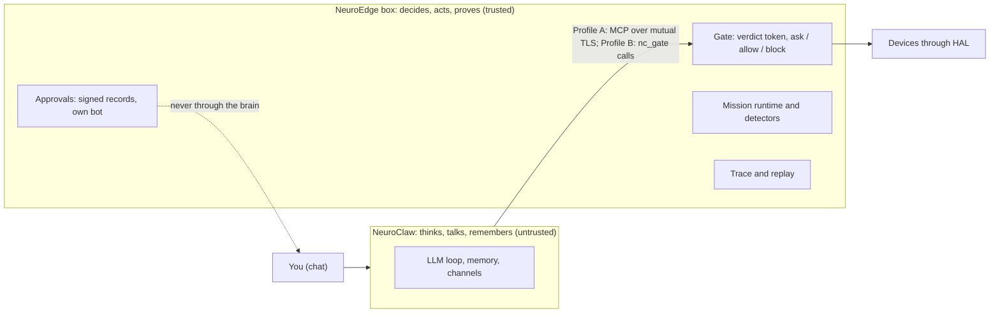

# NeuroEdge: product proposal

**Status:** current as of Q-91 (2026-10-19). **Owner of this page:** the product owner. This is a
synthesis for a partner, investor or new team member; it is read in about 15 minutes. It **references**
the documents that own each truth and does not copy them (`CONTRIBUTING.md` §8.1): requirements live in
the SRS, dates and progress in `roadmap/neuroedge-roadmap.md` §0.2, business requirements and KPIs in
the BRD, decisions in `roadmap/neuroedge-prd.md` §15 (`Q-N`). Where this page and a source differ, the
source wins; the newest decision wins over an older one. Symbols are decoded in `docs/user/thuat-ngu.md`.

It replaces the historical proposal `docs/business/proposal-blueprint-2026-10-11.md` (Q-72), kept only as
a record of the reasoning at the time (Q-90).

---

## 1. Summary

NeuroEdge is **one product in two halves**: **NeuroClaw**, the brain (an open-source, MIT-licensed chat
agent in its own repository that understands, remembers and talks), and the **NeuroEdge box**, a
rules-enforcing gate that stands between that brain and the physical devices. The brain may only *ask*
for an action; the box decides to execute, to ask a person first, or to refuse, and records every
decision so it can be replayed (`README.md`; Q-83 (6)).

The line (Q-82): **"The Physical AI that really does things, safely by design."** Safety is a property of
the architecture, not of the model behaving well: no verdict token, no action; when in doubt, block.

The experience we are building is a **calm home assistant**: the home looks after itself (a fish tank, a
greenhouse, the air), asks a person only when a rule says so, and is run through chat, with no
configuration (BRD §1, §4). Makers launch first by packaging a device with its rules and brain settings
as a **Blueprint**; families receive the experience through those Blueprints (Q-72, Q-85 (2)).

> Alpha. NeuroEdge is not a certified safety function (no SIL, no PL); gates do not replace emergency
> stops or hardware interlocks (`README.md`). Claims stay honest: most hardware is emulated today, so
> say "built to" until real boards run (Q-82).

## 2. Problem and evidence level

The BRD lists five pains P-1 to P-5 (alert fatigue, context blindness, hand-built schedules, fear of an
LLM driving devices, makers unable to turn DIY devices into products), with the evidence found by the
2026-10-15 market research (BRD §2.1).

**All of them are hypotheses of the team.** No interview has confirmed any pain yet (BRD §2.1, premise P1
of `docs/business/cong-nhu-cau-2026-10-25/README.md`). Only P-4 carries a "high" confidence, because the
market itself has seen the problem; P-5 (makers will pay) is "low". The demand gate (§9) exists to test
this before more is built (BRD §11 risk 1).

## 3. Customers and launch order

| Segment | Role | Order | Source |
|:---|:---|:---|:---|
| **Families** with several smart devices and no time to configure scenes | Target of the experience | Second, through a maker's Blueprint | BRD §4; Q-85 (2) |
| **Makers and micro-OEMs** of niche devices (fish tanks, incubators, mushroom houses, produce dryers) | Build and sell Blueprints to families | **First**; gate condition B8 measures this group | Q-72; Q-85 (2) |
| Smart-glasses users | - | Deferred (BRD Appendix A) | Q-85 (4) |

Consequence accepted in Q-85: before the gate, families reach the product only through makers'
Blueprints, and a family cannot yet install without a command line (BRD §11 risk 10). Ease of install
for families (a Home Assistant add-on, an SD-card image for a Pi, QR pairing) is planned in
TSK-I2e-12 and TSK-I2e-13 (Q-74 step 1; schedule in roadmap §0.2).

The **home app** (`docs/app-di-dong/`) is the family's way in after the gate: a native iOS and Android app
(React Native) with device views, approval cards signed with a fingerprint, replay and a device wizard; Studio
reopens as the makers' desktop web on the same box API. It is increment I2g, the first one the gate opens
(Q-91; roadmap §4.3.7).

## 4. What the product does: three loops

The three loops come from Q-72 and are restated here only as a map.

| Loop | In one line | Owner of the detail |
|:---|:---|:---|
| **Build** | Any MCP client (or the brain) suggests a kit, drafts a mission contract, tries it on `sim`. The standard MCP tool set `propose_mission`, `mission_status`, `explain_block` is the only authoring route; NeuroEdge grades, **a person locks** | TSK-I2d-23, Q-88; `docs/spec/missions.md` |
| **Run** | A 24/7 runtime on the box executes a mission contract: permitted and prohibited actions, time windows, a bounded watchdog, declared data flows, `safe_state` on failure, expiry. Deterministic detectors run first and the LLM is woken only when something happens | Q-87; `docs/spec/missions.md` |
| **Share** | A **Blueprint** packs a device, its rules and brain settings, and replayable evidence into one package with one digest, installed by one command and run on simulation | Q-86; `docs/spec/blueprint.md` |

**Asking a person is a per-action choice, decided by the box.** Each action takes one of three
treatments: *ask first* (`on_block` `ask`, RFC-0006), *act and tell* (a mission obligation `notify`) or
*silent* (the default). The brain only words the message (BR-3, Q-85 (1), Q-90 (4)); this needs no schema
change (Q-90 (4)). Message budgets keep the home from nagging (BRD P-1, NFR-COST-02).

Things the loops deliberately do not do today, each stated by its owner:

- Version 1 enforces mission terms at **skill tier on the box**; the **reflex tier on the chip** waits for
  an RFC changing the `NETR` layout, and the approval card says "reflex on the device: not yet" (Q-87 (2),
  MS-CP-04).
- A Blueprint v1 ships a kit and firmware for **reference boards** and reaches real boards through a pin
  map; its `contract` and `detectors` sections are reserved and refused until the mission core lands
  (Q-86 (2), (3); BL-FMT-04, BL-FMT-05).
- The LLM budget is held twice: the box limits how often it wakes the brain, and NeuroClaw keeps its own
  `llm_budget` (Q-87 (1)).

## 5. Architecture in one picture

- **Brain versus box (Q-83 (4)).** The box decides, acts and proves (gate, tokens, confirmation, HAL,
  traces, grammar, System 1). The brain thinks, talks and remembers (LLM loop, memory, retrieval,
  channels, reminders, LLM budget). The brain touches the world only through the box (Q-76).
- **Two deployment profiles, one contract (Q-83).** **Profile A, full:** brain and box in separate trust
  domains (one machine under separate OS users, two machines, or the brain on a future cloud), MCP over
  HTTPS with mutual TLS. **Profile B, one chip:** brain and `ne_gate` share one ESP32-S3 image, labelled
  `risk=single_chip` because one chip has no isolation boundary (Q-79). The tool list and `tool-result.v1`
  are identical; only the transport differs. Specification: `docs/spec/deployment_profiles.md`.
- **Approvals never pass through the brain (Q-83 (5), Q-89).** In Profile A the box has its own approval
  bot and signs a record the owner answers; a reply that is not tied to the exact request id confirms
  nothing. Pairing is by a one-time code shown only on the home machine; remote approvals are capped per
  hour and carry `risk=remote_approval` (Q-89). Design: `docs/rfc/0019-ban-ghi-duyet-co-chu-ky.md`.
- **Simulation first (Q-72, Q-84).** Four tiers G1 to G4 (a physical model on `sim`, `linux` with simulated
  peripherals, ESP32 firmware on QEMU, a Home Assistant route) let the three loops run before buying
  hardware (PRD §4.2, tier table). `sim-virtual` derives a virtual board from what the agent declares, with
  a catalogue of virtual parts and a pin map that carries pin names to a real board, labelled
  `risk=virtual_board` (Q-84 phases A and B; `docs/spec/virtual_parts.md`). The drag-and-drop canvas
  (phase C) is deferred and reopens only with data from the demand gate.
- **Open with transparency (Q-73).** The product labels a risk instead of blocking a flow the user chose
  (for example `risk=single_chip`, `risk=virtual_board`, `risk=remote_approval`).

Further reading: `docs/architecture/README.md`, `docs/architecture/vi/00-overview.md`.

## 6. Why it is hard to copy

| Edge | Why it matters |
|:---|:---|
| **The rule runs on a $5 chip** and the gate is deterministic | A platform-side list of forbidden actions is coarse and cloud-bound; this is conditional on sensor facts and works offline (BRD §2.2) |
| **Replayable traces** | Every verdict can be re-run on `sim`, `linux` and the chip and must agree (`neuroedge record`, `replay`, `verify`) |
| **Blueprint with evidence** | A maker packs rules and replayable proof, not just a configuration; nothing from a package runs before the person approves its summary (Q-86 (1)) |
| **Asks a person only when the rule says so** | Not every time; this answers alert fatigue (BRD P-1) |

Honest competitive picture (BRD §2.2, not copied here): Alexa+, Gemini for Home and Google Home MCP add
context and platform-side limits; Home Assistant with LLMs is experimental and has no conditional gate;
**Spatial OS is the closest competitor** on the thesis (typed actions, simulation before action, deterministic
safety layer on Home Assistant). NeuroEdge intends to travel *with* Home Assistant (RFC-0018, the add-on
in TSK-I2e-12), not replace it. Q-85 records head-on competition with Alexa+ and Gemini for Home as a
**very high** risk. None of this edge is proven with users yet (§2).

## 7. Business model: hypotheses

No price is stated before the demand gate (BRD §9). Each revenue line opens on a recorded condition:

| Hypothesis | Opens when | Constraint |
|:---|:---|:---|
| **H1** kit commission (affiliate BOM) | Planned with I2e | FR-BP-07; on a separate page outside the kit |
| **H2** paid Blueprint Hub | After the gate, if B8 holds (Q-72, FR-BP-10) | A free static index comes first (FR-BP-05); signed evidence (`TODOS.md` #1) before the Hub takes money |
| **H3** NeuroEdge Cloud (brain run for people who do not want to operate it) | Q-74 step 2, only if gate data show testers stuck on install, keys or self-hosting | Gate, approvals and trace always stay at home; keys never leave the box |
| **H4** commercial licence for companies embedding the core | After the gate (Q-85 (4), Q-90 (3)) | The core stays **PolyForm Noncommercial 1.0.0** (Q-45); selling Blueprints or devices is commercial use and needs a licence; terms and price wait for the gate. Specs and schemas are Apache-2.0 (`LICENSING.md`) |

**Tokens (Q-90 (5)).** Bring-your-own-key is the default. NeuroEdge Cloud may bundle tokens only if Q-74
step 2 opens **and** a new `Q-N` amends N4; until then nothing in this proposal resells tokens.
**Deferred past the gate (Q-85 (4)):** wearables, the paid Hub, NeuroEdge Cloud, commercial licence terms.
No revenue line sits on the safety path (Q-72).

## 8. What exists today and what is planned

What works is listed in `README.md` ("Working today") and, in the words of a person using it, in
`docs/architecture/vi/00-overview.md` §6.1. In short: rules on a laptop with virtual devices, on Linux
with emulated pins and on an emulated ESP32-S3 (QEMU); chat through Telegram to NeuroClaw to switch a
light or open a door with owner confirmation, shown in a live demo; a virtual board with a pin map and
two extra demo scenarios (a greenhouse and a fuller fish tank) on `sim-virtual`.

**Planned, not done:** the mission core and 24/7 runtime (I2d), the minimal Blueprint and its install
flow (I2e), the code of signed approval records and the box's own approval bot (TSK-I2d-12; design approved in RFC-0019),
real hardware boards, and everything in §10. Status and dates per increment are in
`roadmap/neuroedge-roadmap.md` §0.2 and are not repeated here. The fish tank Blueprint is the first
target and can already be shown on `sim`, `linux` and QEMU (roadmap §0.3, TSK-I2d-28).

I2e starts without waiting for I2d's mission core: it needs the `blueprint.v1` RFC (TSK-I2e-01) and the
fish tank agent (TSK-I2d-28); the I2d mission criteria are a prerequisite of the gate, not of I2e
(Q-90 (1)).

## 9. The demand gate: 2026-12-06

The gate is its own milestone after I2e. Interviews (TSK-I2e-10) and the measurement (TSK-I2e-11) are
part of the gate, not of I2e's exit criteria (Q-90 (2)). Conditions (PRD §11.2, BRD §3.1):

| Gate | KPI | Threshold |
|:---:|:---:|:---|
| **B6** | K1 | At least 3 external people independently install and run a Blueprint |
| **B7** | K2 | At least 1 person runs continuously for 2 weeks on simulation G2 or G3 |
| **B8** | K3 | At least 1 maker wants to package and sell a Blueprint |

The box with NeuroClaw, driving at least one device through chat with a trace, counts as a sample
Blueprint for B6 and B7; thresholds are unchanged (Q-81). Counting rules: `cham-diem.md` §4.0. Two more
KPIs are tracked before the gate: **K4**, LLM cost under 2 USD for a 30-day fish tank scenario
(NFR-COST-01), and **K5**, non-urgent messages inside the budget and no action reaching a device without
the gate (NFR-COST-02). For B8, a maker's dated commitment is enough; commercial terms come after (Q-90 (3)).

**Three branches (PRD §11.2):**

1. B6, B7 and B8 all met: invest in the Hub, a kit catalogue and a second Blueprint, and revisit v1.0 scope.
2. B6 and B7 met, B8 missed: NeuroEdge stays a personal tool; keep loops Build and Run and seek other revenue.
3. B6 or B7 missed: change the target segment or the message before building more.

The positioning line is a check, not a gate: if fewer than 3 of 5 maker interviews retell it in their own
words, it is revisited (Q-82).

## 10. Out of scope and removed

Removed from the roadmap by Q-77 (voice code on the host stays): **voice** (I4, I5), **NeuroEdge Lab**
(I4a, I5a; replaced by the MCP tool set, Q-88), opening the target list to third parties, **Fleet OS** and
self-hosted provider (I9, I10), robots (I14), **Jetson** (I16), multimodal and the device ecosystem, and all
post-Beta increments. Deferred past the gate (Q-85 (4), Q-84): **wearables**, the **paid Hub**,
**NeuroEdge Cloud** and the ESP32 cloud tier (I2f, with exceptions Q-79 and Q-83), commercial licence
terms, and the virtual-parts **canvas**. The home app waits for the gate too, as its first increment (§3).

**Each of these reopens only by a new `Q-N` with data** (Q-77; roadmap §6; PRD §14). Studio (TSK-I1-04)
remains paused, not removed.

## 11. Top risks

Full registers: `roadmap/neuroedge-prd.md` §13.2 and `docs/business/brd-ambient-intelligence.md` §11.

| # | Risk | Where recorded |
|:---:|:---|:---|
| 1 | **Demand unproven**: no interview has confirmed a pain; no maker interviewed yet | BRD §11 #1; PRD R-5, R-10 |
| 2 | **Big platforms add safety layers themselves** (Alexa+, Gemini for Home, Google Home MCP); rated very high | BRD §11 #2; Q-85 |
| 3 | **Spreading thin** for one person and AI: three loops becoming three products | PRD R-8; BRD §11 #9 |
| 4 | **Families cannot install yet**: the product needs a command line today | BRD §11 #10 |
| 5 | **Unreviewed seller code and users approving without reading** (activation runs seller `@action` code after consent; approval card is at most 5 lines) | PRD R-14, R-15; Q-86 (1) |

Also recorded: the name "Blueprint" collides with Home Assistant Blueprints (BRD §11 #4); evidence is
unsigned in the MVP (PRD R-17); and the brain rests on an early upstream project, which is why NeuroClaw
is a hard fork with its own CI (BRD §11 #8, Q-78).

## 12. Open decisions

| Decision | Where it stands |
|:---|:---|
| **Name "Blueprint"**: keep or rename | Kept through I2e; decided before the Hub is published, on maker feedback (Q-85 (5)) |
| **Reflex tier on the chip** | Needs an RFC on the `NETR` layout; until then skill tier only (Q-87 (2)) |
| **Conditional safety for shipped boards** | An RFC (TSK-I2d-02) must define `safe_state` and interlocks before a Blueprint may carry a board profile (Q-86 (2)) |
| **Home app** | Decided (Q-91): I2g after the gate; four RFCs to write (biometric approval source, `board.v1` value limits, the yellow zone, locking app-generated gates) |
| **Local-only approval gates** | Wait for TSK-I2d-20; today every `ask` may be answered remotely within the cap (Q-89 (3)) |
| **Cloud, paid Hub, licence terms, wearables** | After the gate, by a new `Q-N` (Q-85 (4)) |
| **Positioning line** | A check against interviews, not a gate (Q-82) |

## 13. Sources

| Topic | Owner |
|:---|:---|
| Decisions, requirements, gate conditions, risks, out of scope | `roadmap/neuroedge-prd.md` §15 (Q-72 to Q-90), §11.2, §13, §14 |
| Progress, dates, increments | `roadmap/neuroedge-roadmap.md` §0.2, §0.3, §6 |
| Business requirements, competitors, KPIs, hypotheses | `docs/business/brd-ambient-intelligence.md` |
| Missions | `docs/spec/missions.md` |
| Blueprint | `docs/spec/blueprint.md` |
| Two deployment profiles | `docs/spec/deployment_profiles.md` |
| Virtual parts and pin map | `docs/spec/virtual_parts.md` |
| Signed approval records | `docs/rfc/0019-ban-ghi-duyet-co-chu-ky.md` |
| What works today | `README.md`; `docs/architecture/vi/00-overview.md` §6.1 |
| Licence | `LICENSING.md`, Q-45 |
| Home app (Q-91, I2g) | `docs/app-di-dong/README.md` |
| Historical proposal (superseded) | `docs/business/proposal-blueprint-2026-10-11.md` |
