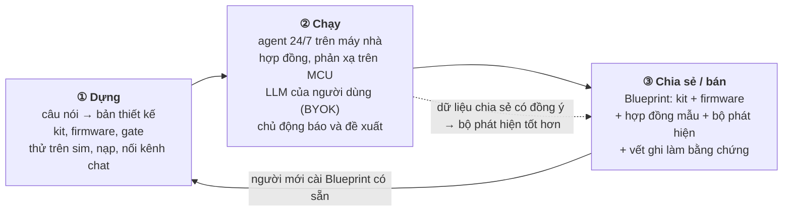
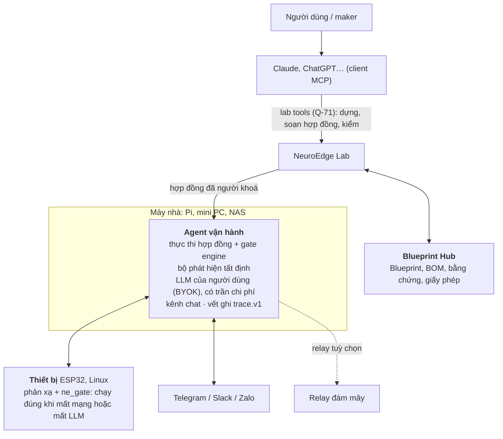
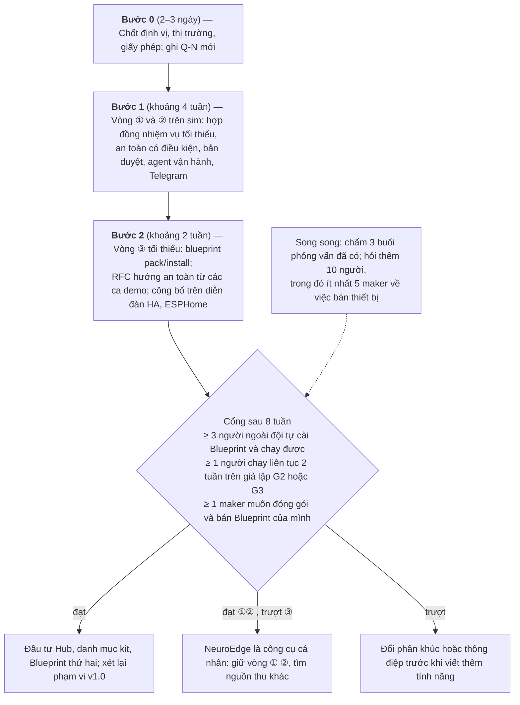

# NeuroEdge — Proposal nháp: từ một câu nói tới một sản phẩm vật lý có AI

2026-10-11 · Trong-Minh Le (@letrongminh) · **Trạng thái:** đề xuất cho **Q-72** (PRD §15); bốn điểm đã chốt khi rà soát ở mục "Quyết định cần chốt"

> **Đã tinh chỉnh sau rà soát kiến trúc (2026-10-11).** Tài liệu này viết trước rà soát kiến trúc theo Q-72; các điểm sau đã đổi và **PRD Q-72, FR-CH, FR-EGR, FR-MSN thắng** khi lệch: (1) lời duyệt qua chat là **bản ghi duyệt** `{id, nonce, hạn, digest, bản duyệt ≤ 5 dòng do trình biên dịch sinh}`, LLM không viết được dòng nào; thay đổi mở rộng quyền dữ liệu chỉ duyệt tại chỗ (FR-MSN-14); (2) luồng dữ liệu là **chống rò rỉ**: đích người dùng khai (kể cả gửi ảnh tới LLM) được nhận dữ liệu cho phép, đích không khai bị chặn (FR-EGR); (3) `safe_state` khác `off` chỉ khai trong `board.v1` kèm khoá liên động phần cứng, không có dạng phụ thuộc dữ kiện trong hợp đồng; (4) tầng giả lập G3 chạy firmware ESP32 trên **QEMU của Espressif** (Wokwi, Velxio chờ đối chiếu Q-21, Q-69). Thiết kế: `docs/architecture/vi/15-target-architecture.md` §6.
>
> **Hướng bổ sung sau proposal:** Q-73 (người dùng tự chọn cách xác minh và luồng nhiều bước, chỉ minh bạch rủi ro) và Q-74 (não trên cloud tuỳ chọn, tuỷ sống tại nhà, một ô chat cho nhiều thiết bị và nhiều nhà) — PRD §15.

## Tóm tắt

Đề xuất: NeuroEdge trở thành **nơi biến ý định thành sản phẩm vật lý có AI — dựng, chạy an toàn, chia sẻ và bán**. Shopify cho bất kỳ ai mở cửa hàng mà không cần biết làm web; NeuroEdge cho bất kỳ maker nào tạo một thiết bị AI chạy thật, rồi biến nó thành sản phẩm cho người khác.

> *"Tôi muốn trông bể cá 120 lít."* → Claude (nối MCP tới NeuroEdge) gợi ý kit, sinh firmware, chạy thử trên `sim` → người dùng dựng, nối Telegram → giao nhiệm vụ bằng lời → agent chạy 24/7, tự báo *"oxy giảm 3 ngày liền, đề xuất vệ sinh lọc"* → maker đóng gói thành **Blueprint**, người khác cài bằng một lệnh, maker bán được.

- **Ba vòng:** ① Dựng (câu nói → thiết bị chạy được) · ② Chạy (agent có hợp đồng, chủ động báo và đề xuất) · ③ Chia sẻ/bán (Blueprint). Vòng ③ quay ngược về vòng ①: người mới bắt đầu từ Blueprint có sẵn.
- **Vì sao mạnh** (theo [Paul Graham — How to Make Startups Powerful](https://paulgraham.com/powerful.html)): đứng ở thượng nguồn — lúc ý định nảy ra, trước cả quyết định mua phần cứng; tiền chảy qua NeuroEdge (BOM, Blueprint, relay); nền tảng có hiệu ứng mạng; và **giúp người dùng kiếm tiền** — maker thành nhà sản xuất nhỏ.
- **Không sao chép được:** niềm tin để bán thiết bị AI cho người lạ — gate trên MCU, hợp đồng chỉ người khoá, vết ghi làm bằng chứng, an toàn có điều kiện. Lớp an toàn không phải sản phẩm đứng riêng; nó là **giấy thông hành cho thị trường Blueprint**.
- **LLM do người dùng tự trả** (BYOK, như OpenClaw). NeuroEdge không kiếm tiền từ token.
- **PolyForm Noncommercial (Q-45) chính là cơ chế thu tiền:** cá nhân dùng miễn phí; maker bán Blueprint hay thiết bị là dùng thương mại và đi qua NeuroEdge.
- **Điểm vào hẹp:** một Blueprint bể cá đi trọn ba vòng. Phép thử cả mô hình: có ít nhất một maker muốn **bán** Blueprint của mình không.

## Vì sao đổi định vị

Mỗi vòng thảo luận tháng 10/2026 thu hẹp một giả định; định vị này là kết quả gộp lại.

| Định vị trước | Vì sao chưa đủ |
| --- | --- |
| Gate cho từng lệnh LLM gửi xuống thiết bị | Đúng kỹ thuật nhưng mỏng: với một thiết bị, danh sách trắng tự viết trong một buổi chiều; chưa ai trả tiền |
| Lớp hợp đồng trung lập cho ROS, Halos, Isaac | SROS2 và Halos để hở khoảng ý định của lệnh AI, nhưng kỹ sư robot không thấy lợi rõ khi thêm một lớp |
| Agent trông coi thiết bị | Một ca dùng, không phải sản phẩm; "trông coi" chỉ là một trong sáu động từ (mục sau) |

Bằng chứng từ deep research (nguồn ở phụ lục):

- Cho LLM điều khiển thiết bị đã rất dễ và không có lớp quyền: [ros-mcp-server](https://github.com/robotmcp/ros-mcp-server) (1.493 sao) publish mọi topic; [XiaoZhi](https://github.com/78/xiaozhi-esp32) (30.586 sao, 138 thư mục bo) chỉ khai kiểu và min/max cho tool trên thiết bị.
- Rủi ro có thật: jailbreak robot gần 100% ([RoboPAIR](https://www.arxiv.org/abs/2410.13691v2)); LLM tạo automation mở khoá cửa không cần PIN ([home-generative-agent v3.26.0](https://github.com/goruck/home-generative-agent/releases/tag/v3.26.0)).
- Giá trị tỷ lệ với *mức tự chủ của LLM × hậu quả của hành động*. Nơi LLM gần như không có việc, tự động hoá cổ điển thắng.

**Tín hiệu từ người dùng:** 3 buổi phỏng vấn (tổng hợp, chưa chấm điểm theo `docs/business/cong-nhu-cau-2026-10-25/cham-diem.md`) mô tả vòng ① và ②: hỏi Claude cách dựng, nối kênh chat, giao nhiệm vụ bằng lời, được báo chủ động. Chưa ai được hỏi về vòng ③.

NeuroEdge hiện có **0 người dùng ngoài** sau khoảng 45k dòng Python, 21k dòng C và 18 RFC. Định vị mới phải rút ngắn đường tới người dùng đầu tiên, không kéo dài nó.

## Thế giới hoàn hảo, nhìn từ người dùng

Paul Graham gợi ý: hình dung thế giới hoàn hảo từ góc khách hàng; nếu công ty biến mình thành một mảnh của thế giới đó được, thì nên làm.

> *Tôi nói điều tôi muốn thế giới vật lý làm. Nó được dựng ra, chạy, an toàn khi AI sai, càng chạy càng giỏi. Nếu người khác cũng cần, tôi bán được nó.*

"Điều tôi muốn" là bất kỳ động từ nào trong thế giới vật lý — không chỉ trông coi:

| Động từ | Ví dụ |
| --- | --- |
| Cảm nhận | Chất lượng không khí lớp học, độ ẩm đất từng luống |
| Hành động | Tưới theo nhu cầu cây, mở rèm theo nắng, cho cá ăn |
| Phản ứng | Có khói thì tắt bếp và gọi chủ; người lạ thì bật đèn và chụp ảnh |
| Phân tích, đề xuất | Oxy giảm 3 ngày liền; điện tủ lạnh tăng → gioăng hỏng |
| Phối hợp | Robot hút bụi, camera, khoá cửa cùng làm nhiệm vụ "đi vắng" |
| Sản xuất | Lò sấy nông sản, máy ấp trứng, nhà nấm, xưởng nhỏ |

Sáu động từ được thể hiện trong **định dạng Blueprint**, không phải trong số tính năng làm cùng lúc.

## Mô hình: ba vòng và một bánh đà



**Bánh đà:** người dựng tạo Blueprint → người dùng cài → dữ liệu vận hành (có đồng ý) làm bộ phát hiện tốt hơn → Blueprint tốt hơn → thêm người dùng → thêm người dựng.

### Hành trình một người dùng

1. **Dựng.** "Tôi muốn trông bể cá 120 lít." Claude gọi lab tools của NeuroEdge (Q-71), đề xuất một kit đã kiểm chứng (cảm biến nhiệt, oxy, camera, relay sục khí và sưởi), sơ đồ đấu dây, danh sách mua. Chạy thử trên `sim` trước khi mua. Sinh cấu hình bo, firmware, gate từ một nguồn; nạp bằng trình nạp web; `lab doctor` kiểm từng cảm biến ("cảm biến oxy đọc 0 — kiểm lại dây vàng"). Nối Telegram bằng một lệnh.
2. **Giao nhiệm vụ.** "Trông bể, oxy thấp thì bật sục khí, có gì lạ chụp ảnh gửi tôi." Hệ thống dịch thành hợp đồng nhiệm vụ và **hỏi lại khi mơ hồ**: "Ngưỡng oxy thấp là bao nhiêu? Gợi ý 5 mg/L cho cá nhiệt đới." Người dùng duyệt — ngay trong kênh chat hoặc ở UI cục bộ; chỉ người khoá được hợp đồng, LLM thì không (Q-26 mở rộng theo Q-72).
3. **Chạy.** Phản xạ tại chỗ (oxy dưới ngưỡng → sục khí). Agent tự nhận ra xu hướng và nhắn: *"Oxy buổi sáng giảm 3 ngày liền (6,8 → 6,1 → 5,4) trong khi nhiệt tăng 1,5 °C — có thể do trời nóng hoặc lọc bẩn. Đề xuất vệ sinh lọc và thêm sục khí 2h–5h. Thêm vào hợp đồng?"* Trả lời "Có" trong chat là lời duyệt sửa đổi đó (mục "Duyệt qua kênh chat").
4. **Chia sẻ, bán.** `neuroedge blueprint pack` gói kit, firmware, hợp đồng mẫu, bộ phát hiện và vết ghi chạy thật thành một Blueprint. Người khác cài bằng một lệnh. Nếu bán, giấy phép thương mại và thanh toán đi qua NeuroEdge.

### Blueprint là gì

Một gói khai báo, tất cả các phần đều đã có lược đồ hoặc sẽ có RFC. Cú pháp minh hoạ, chưa phải lược đồ:

```yaml
blueprint: bao-ve-be-ca-nhiet-doi
phiên_bản: 1.2.0
tác_giả:   "@maker"
giấy_phép: cá-nhân-miễn-phí; thương-mại-qua-neuroedge
kit:       board.v1 esp32s3 + DS18B20 + cảm-biến-DO + camera + relay×2   # BOM có nơi mua
firmware:  sinh từ cấu hình bo; ne_gate nhúng sẵn
hợp_đồng_mẫu:
  được:     bật/tắt sưởi trong 24–27 °C
  cấm:      tắt sục khí
  phải:     nhiệt > 30 °C quá 10 phút ⇒ ngắt sưởi, báo động
  khi_hỏng: mất mạng ⇒ sục khí giữ chạy
  dữ_liệu:  ảnh không rời mạng nội bộ
tham_số_hỏi_lại: [ngưỡng_oxy, giờ_yên_lặng, kênh_báo]
bộ_phát_hiện: [xu-hướng-oxy-3-ngày, cảm-biến-đứng-im, nhiệt-dao-động]
bằng_chứng:   vết ghi trace.v1 chạy 30 ngày trên 3 bể; replay đạt 100%
```

**Không có Blueprint nào được bán khi chưa có bằng chứng**: vết ghi chạy thật và `replay` tái hiện đúng. Đây là chỗ NeuroEdge khác một kho firmware hay một chợ tự động hoá.

**Bằng chứng ở MVP chưa được ký** (chốt khi rà soát): `trace.v1` hiện không có chữ ký (`TODOS.md` #1), nên người bán có thể sửa vết ghi trước khi gói. Chấp nhận để ra MVP nhanh; người cài vẫn tự chạy `replay` trên máy mình, và Hub ghi rõ "bằng chứng chưa ký". Ký vết ghi quay lại khi Hub bắt đầu thu tiền cho người bán.

## Áp các bài kiểm tra của Paul Graham

| Bài kiểm tra | NeuroEdge làm gì |
| --- | --- |
| Đứng ở thượng nguồn | Có mặt lúc ý định nảy ra — khi người dùng hỏi Claude "tôi muốn làm X" — trước quyết định mua phần cứng. Dữ liệu thiết bị bắt đầu từ lúc nó ra đời (provisioning), như Rippling bắt đầu từ onboarding |
| Tiền chảy qua mình | BOM đặt qua NeuroEdge; Blueprint bán qua NeuroEdge; relay và OTA theo tháng |
| Giữ quan hệ với khách | Kênh chat là nơi người dùng sống với thiết bị mỗi ngày, và đi qua agent NeuroEdge |
| Nền tảng, hiệu ứng mạng | Chợ Blueprint — công sức người khác làm sản phẩm giá trị hơn. Dữ liệu chia sẻ có đồng ý: *"mẫu oxy của bể bạn giống 214 bể từng bị tắc lọc"* |
| Giúp người dùng kiếm tiền | **Chỗ tạo thị trường:** maker thành micro-OEM — dựng một lần, bán trăm người; NeuroEdge lo firmware, OTA, hợp đồng, kênh chat, bằng chứng |
| Full stack, ăn dần việc khách | Không bán gate cho công ty IoT; giúp maker *trở thành* công ty IoT, rồi làm dần phần khó nhất của họ: thiết kế, firmware, đội thiết bị, bằng chứng, chăm sóc khách |
| Bán cho người ở giai đoạn sớm | Maker và startup phần cứng quyết nhanh; tính phí theo số thiết bị đang chạy thì doanh thu lớn cùng tốc độ của họ |
| Hào phóng | Mở định dạng hợp đồng, Blueprint, MCP tools; cá nhân miễn phí; mục tiêu là thành **chuẩn** cho thiết bị AI có hợp đồng |
| Chơi đường dài | Home Assistant, XiaoZhi, OpenClaw tối ưu cho người dùng cuối; NeuroEdge tối ưu cho **người tạo sản phẩm** — tầng ít ai đứng |
| Lắng nghe "dùng sai" | Theo dõi người dùng dựng gì ngoài Blueprint chính thức; đó là thị trường kế tiếp |

Ràng buộc Paul Graham nhấn mạnh: mọi chiến lược phải làm đời khách tốt hơn, nếu không sẽ không ai dùng. Startup quá yếu để ép ai.

## Các bên và dòng tiền

| Bên | Được gì | Trả gì |
| --- | --- | --- |
| Người dùng cuối | Cài Blueprint, có thiết bị thông minh chạy ngay | Phần cứng; LLM (BYOK); relay tuỳ chọn |
| Maker, người dựng | Công cụ dựng không ma sát; bán được Blueprint | Chia doanh thu khi bán |
| Micro-OEM, startup phần cứng | Đội thiết bị, OTA, hợp đồng, vết ghi, kênh khách | Giấy phép thương mại theo thiết bị |
| Nhà cung cấp linh kiện | Đơn hàng định sẵn theo BOM | Hoa hồng |
| Agent AI khác (đường dài) | Gọi năng lực vật lý qua MCP, có hợp đồng | Phí theo lần gọi |

**Theo tầng thời gian:**

1. **Gần:** hoa hồng kit phần cứng (liên kết, chưa giữ kho); relay đám mây tuỳ chọn — truy cập từ xa, đẩy tin, sao lưu vết ghi, không phải mở cổng mạng nhà.
2. **Giữa:** chia doanh thu chợ Blueprint; giấy phép thương mại theo thiết bị.
3. **Xa:** năng lực vật lý thành dịch vụ cho agent AI khác gọi; chỉ số tổng hợp theo ngành từ dữ liệu có đồng ý.

**LLM: người dùng tự trả (BYOK).** Người dùng nhập key Anthropic, OpenAI, Gemini, hoặc dùng mô hình tại chỗ (Ollama), qua LiteLLM đã có. NeuroEdge không giữ key trên máy chủ của mình và không kiếm tiền từ token — *"Squeezing every last penny out of customers is a distraction."* Hệ quả thiết kế ở mục "Agent vận hành".

## Kiến trúc



Ba vai tách bạch:

- **Lab (Q-71)** — dựng và soạn hợp đồng, trong phiên Claude. Không có vòng LLM riêng để dựng.
- **Agent vận hành** — chạy liên tục sau khi phiên Claude đóng. Đây là vai mới: LLM lúc chạy chỉ giải thích và *đề xuất* sửa đổi; không bao giờ tự khoá hay tự duyệt.
- **Blueprint Hub** — nơi gói, chia sẻ, bán.

Nguyên tắc: **LLM nghĩ, luật cứng giữ.** Phần giữ an toàn nằm ở tầng thấp nhất làm được (MCU, host), không phụ thuộc LLM. LLM diễn giải câu nói, giải thích xu hướng, viết đề xuất. Mọi sửa đổi hợp đồng do LLM đề xuất phải qua người duyệt.

## Thành phần cốt lõi

### Hợp đồng nhiệm vụ

Đơn vị luật cho cả chuỗi hành động trên nhiều thiết bị. Trình biên dịch hạ mỗi điều khoản xuống tầng thấp nhất cưỡng chế được: **phản xạ** (MCU, mili giây, chạy khi mất mạng) · **kỹ năng** (host, giây) · **suy nghĩ** (LLM, giây đến phút).

| Điều khoản | Ý nghĩa | Đã có trong mã | Còn thiếu |
| --- | --- | --- | --- |
| Được / cấm | Hành động và tham số cho phép | Gate, RFC-0005, kế thừa chỉ siết | Gộp nhiều gate thành nhiệm vụ |
| Tần suất, thời lượng | "Tối đa N lần/giờ" | Phong bì: `window_s`, `max_on_ms_per_window`, `min_interval_ms`, `max_continuous_ms` | — |
| Khung giờ | "Chỉ 23:00–05:00" | `RUNTIME_CRITERIA` (đồng hồ do runtime chèn) | Dữ kiện đồng hồ |
| Nghĩa vụ ("phải") | "X vượt ngưỡng quá T ⇒ Y về S" | Lease, off-debt (RFC-0018), `safe_state` của `motion.*` (RFC-0011) | **Mới:** watchdog có cận cho mọi cơ cấu |
| Luồng dữ liệu | Dữ liệu nào rời đâu | — | **Mới:** danh sách trắng trường và đích |
| Khi hỏng | Mất não, mạng, cảm biến thì làm gì | L0–L3 của cơ cấu từ xa | Hướng an toàn theo cơ cấu |
| Hết hạn | Quyền tự hết hiệu lực | Lease có hạn | Thời hạn cấp nhiệm vụ |

Gate vẫn là hàm thuần; nghĩa vụ chỉ có một khuôn hẹp (watchdog có cận). Trình biên dịch từ chối hợp đồng mâu thuẫn, chỉ rõ chỗ đụng, trước khi người duyệt. Bản duyệt ≤ 5 dòng tiếng thường, mỗi dòng ghi tầng cưỡng chế.

### An toàn có điều kiện

Toàn bộ lõi an toàn hiện mặc định **an toàn = tắt**: gate fail-closed từ chối lệnh *bật*; Q-62 không bao giờ chặn lệnh *tắt*; `digital.out`, PWM (RFC-0010), cơ cấu từ xa (RFC-0018) tự tắt khi hết thời lượng hoặc lease; chỉ `motion.*` có `safe_state` (`stop`, `hold`).

Với bể cá, lõi hiện tại sẽ từ chối bật sục khí khi mất dữ kiện, tự tắt sục khí khi lease hết lúc mất mạng, và chặn sục khí chạy cả đêm — cả ba đều giết cá.

| Cơ cấu | Bật thì | Tắt thì | Trạng thái an toàn |
| --- | --- | --- | --- |
| Sục khí bể, ao | Giữ cá sống; quá nhiệt động cơ | Cá chết ngạt | Chạy; ngắt và báo động nếu quá nhiệt |
| Sưởi bể, chuồng | Giữ ấm; nguy cơ cháy | Vật nuôi chết lạnh | Theo nhiệt; ngắt khi quá ngưỡng |
| Bơm thoát nước | Chống ngập; chạy khô hỏng bơm | Ngập | Theo phao mực nước |
| Robot đang mang vật | Giữ vật | Rơi vật, có thể ngã | Giữ có hạn rồi hạ xuống |

**Thiết kế đề xuất (cần RFC):** mở `safe_state` sang `digital.out`, PWM, cơ cấu từ xa với ba dạng `off`, `on`, *theo dữ kiện tại chỗ*; thêm trạng thái **"báo động, gọi người"** khi cả hai hướng đều nguy hiểm; rà lại Q-62, luật tự tắt ở RFC-0007, RFC-0010, RFC-0018 và chạy lại toàn bộ corpus.

**Ràng buộc chống đường tắt** (chốt khi rà soát). Q-62 miễn gate cho lệnh về phía an toàn; nếu "phía an toàn" có thể là *bật*, một Blueprint độc hại khai "sưởi an toàn khi bật" là đi vòng qua gate. Vì vậy:

- `safe_state` khác `off` **chỉ** được khai trong `board.v1` (profile phần cứng đã khoá), không trong hợp đồng nhiệm vụ, gate hay Blueprint.
- Cơ cấu khai `safe_state: on` **bắt buộc** có khoá liên động phần cứng được khai kèm (cầu chì nhiệt, rơ-le quá dòng, phao) — `board.v1` thiếu thì từ chối nạp.
- Sửa `TODOS.md` #58 trước (đầu đọc `board.v1` bỏ qua khoá lạ, kể cả khoá an toàn) để đầu đọc cũ không lặng lẽ bỏ khoá mới.
- Bản duyệt và `blueprint install` hiện riêng mọi cơ cấu có `safe_state` khác `off`.

**Ranh giới Q-38:** bảo vệ khỏi nguy hiểm (cháy, quá dòng, chạy khô) luôn do phần cứng — cầu chì nhiệt, rơ-le quá dòng, công tắc phao. NeuroEdge không bao giờ là lớp bảo vệ duy nhất; nó giữ hệ thống tiếp tục làm việc khi mất não và gọi người khi phải chọn giữa hai điều xấu.

### Luật luồng dữ liệu

| Loại luật | Ví dụ | Cưỡng chế | Bảo đảm |
| --- | --- | --- | --- |
| Tất định theo kiến trúc | "Không ảnh nào rời mạng nội bộ" | Biên mạng, danh sách trắng trường và đích | Tuyệt đối |
| Tất định theo từ vựng đóng | Chỉ gửi `{vùng, loại, lúc, tin_cậy}` | Biên mạng kiểm lược đồ sự kiện | Tuyệt đối |
| Xác suất | "Không gửi ảnh có mặt người" | Host, mô hình phát hiện | Chỉ fail-closed: không chắc thì không gửi |

Bản duyệt phải ghi rõ điều khoản nào thuộc loại xác suất. Câu tự do do LLM viết không được rời mạng nếu hợp đồng cấm — chỉ sự kiện theo lược đồ. Đánh đổi: quyền riêng tư càng chặt thì LLM càng ít việc; mỗi Blueprint chọn một điểm và ghi vào hợp đồng.

### Duyệt qua kênh chat

Chốt khi rà soát: người dùng **được duyệt qua chat** — Telegram và các kênh khác — cả sửa đổi hợp đồng lẫn câu hỏi `ask` lúc chạy. Đây là chỗ đổi Q-26 (hiện chỉ người tại thiết bị xác nhận được). Vì chat là kênh từ xa và chứa văn bản do người ngoài gửi, lời duyệt chỉ hợp lệ khi đủ:

- **Gắn người gửi:** chỉ tài khoản chat đã ghép đôi với thiết bị lúc cài (mã ghép đôi hiện tại chỗ); nhóm chat không duyệt được.
- **Một lần, có hạn:** mỗi yêu cầu duyệt có mã riêng và hết hạn; "Có" cũ hay "Có" không trả lời đúng yêu cầu thì vô hiệu.
- **Thấy điều mình duyệt:** tin yêu cầu duyệt chứa bản duyệt ≤ 5 dòng của chính thay đổi đó.
- **LLM không bao giờ là người duyệt:** nội dung chat đi vào LLM như dữ liệu; nguồn `chat:<id>` chỉ thành nguồn người khi qua đủ ba điều trên; agent không tự gửi lời duyệt.
- **Ghi vết:** mỗi lời duyệt ghi vào `trace.v1` với người gửi, mã yêu cầu và bản duyệt.

Rủi ro còn lại (tài khoản chat bị chiếm) ghi ở mục Rủi ro; threat model cần mục riêng cho kênh chat.

### Agent vận hành và chi phí LLM

Agent chủ động không sống được trong phiên Claude — phiên đóng là hết theo dõi. Agent vận hành chạy trên máy nhà, gồm bộ lập lịch, bộ phát hiện, gọi LLM, adapter kênh chat.

Vì người dùng tự trả LLM, hoá đơn phải đoán trước được:

1. **Lọc tất định trước, gọi LLM sau.** Ngưỡng, độ dốc xu hướng, cảm biến đứng im tính bằng mã thường. LLM chỉ được gọi khi bộ phát hiện bắn sự kiện — vài lần mỗi ngày cho một bể cá, không phải mỗi phút.
2. **Trần chi phí trong hợp đồng** (`llm_budget: 2 USD/tháng`). Hết trần: phản xạ và cảnh báo mẫu cứng vẫn chạy, chỉ mất phần phân tích.
3. **Gom tin.** Một bản tóm tắt mỗi ngày là một lần gọi LLM; tin khẩn dùng mẫu cứng, không cần LLM. Ngân sách tin nhắn chống làm phiền.
4. **Định tuyến mô hình.** Mô hình tại chỗ cho tóm tắt thường, mô hình mạnh cho đề xuất — cùng qua LiteLLM.

## Lợi thế không sao chép được

Ai cũng nối được LLM với ESP32. Thứ khó là **niềm tin để bán thiết bị AI cho người lạ** — maker dám bán cho trăm người khi chứng minh được thiết bị vẫn an toàn khi AI sai.

| | Home Assistant + LLM | XiaoZhi | OpenClaw | **NeuroEdge** |
| --- | --- | --- | --- | --- |
| Dựng phần cứng từ đầu | Không | Một dòng chip, trợ lý giọng nói | Không | Kit đã kiểm chứng |
| Nhiệm vụ bằng lời → giới hạn có kiểm | Tự động hoá người viết | Không | Không | Hợp đồng nhiệm vụ |
| An toàn khi mất mạng hoặc mất LLM | Một phần | Không | Không | Gate trên MCU |
| An toàn có điều kiện | Không | Không | Không | Có (cần RFC) |
| Chủ động phân tích xu hướng | Chưa kiểm | Không | Có, không có thiết bị | Có |
| Đóng gói thành sản phẩm để bán | Không | Không | Skill, không phần cứng | Blueprint có bằng chứng |

Nhận định về đối thủ là đánh giá trong đợt nghiên cứu tháng 10/2026; cột Home Assistant và OpenClaw chưa kiểm hết tính năng mới nhất.

## Tái sử dụng mã hiện có

| Mảnh | Vòng | Đã có | Mới cần |
| --- | --- | --- | --- |
| Gợi ý kit, sinh cấu hình | ① | `board.v1`, kit mẫu (I2b), lab tools (Q-71, đang làm) | Danh mục kit có BOM và nơi mua |
| Chạy thử trước khi mua | ① | `sim`, web UI, `record`/`replay`/`verify` | Kịch bản nhiệm vụ trong `sim` |
| Nạp firmware, kiểm lắp | ① | Firmware `esp32s3`, `lab doctor` (TSK-N0-08) | Trình nạp web |
| Hợp đồng nhiệm vụ | ② | `gate.v1`, RFC-0005, phong bì, lease | Lược đồ nhiệm vụ (RFC, chạm `schemas/`) |
| Bản duyệt dễ đọc | ② | `gate explain` | Dạng tiếng thường, ghi tầng cưỡng chế |
| Phản xạ, nghĩa vụ | ② | `ne_gate`, bố cục `NETR`, `safe_state` của `motion.*` | An toàn có điều kiện cho mọi cơ cấu |
| Agent vận hành | ② | Engine host, LiteLLM, System 2 | Lập lịch, bộ phát hiện, trần chi phí |
| Kênh chat | ② | — (kênh IM đang ngoài phạm vi) | Adapter Telegram trước |
| Luật luồng dữ liệu | ② | — | Toàn bộ |
| Báo cáo | ② | `trace.v1` có `gate_digest`, `trace export --report` (đã thiết kế) | Tóm tắt cho người dùng |
| Blueprint, Hub | ③ | `digests.lock`, OTA có ký, attestation | Định dạng Blueprint, `blueprint pack`/`install`, Hub |
| Nối thiết bị đang có | ① ② | `proxy mcp`, `proxy http`, plugin Home Assistant, Extension SDK | External component ESPHome bọc `ne_gate` |

Giữ nguyên, chưa dùng tới ở bước đầu: thoại, Studio, `jetson`. Không xoá gì.

## Giả lập trước, phần cứng thật sau

Chốt khi rà soát: chạy toàn bộ ba vòng trên giả lập trước; phần cứng thật mua sau. Có bốn tầng giả lập, từ nhanh nhất tới gần phần cứng nhất:

| Tầng | Công cụ | Chạy được gì | Dùng cho |
| --- | --- | --- | --- |
| G1. Mô hình vật lý | `sim` của NeuroEdge, thêm mô hình bể (nhiệt, oxy theo thời gian, tua nhanh 30 ngày) | Hợp đồng, gate, agent, bộ phát hiện, chi phí LLM | Toàn bộ vòng ② và ③; CI |
| G2. Runtime `linux` giả ngoại vi | `gpio-sim` của kernel (đã dùng ở job `linux-hal`), thêm cảm biến giả qua hwmon/IIO | Đúng runtime sẽ chạy trên Pi, chỉ thiếu điện | "Chạy liên tục 2 tuần" trước khi có Pi |
| G3. Firmware ESP32 thật trên máy | [Wokwi](https://docs.espressif.com/projects/esp-idf/en/latest/esp32s3/third-party-tools/wokwi.html) (ESP-IDF có hướng dẫn chính thức; `wokwi-cli` chạy trong CI; mạch khai ở `diagram.json`; có API chip tuỳ biến) · QEMU của Espressif · [Velxio](https://developer.espressif.com/blog/2026/07/velxio-browser-based-esp32-simulation/) (trên trình duyệt, có mô phỏng analog) | Firmware có `ne_gate`, phản xạ khi mất mạng | Kiểm tầng phản xạ; spike Q-69 đã mở hướng này |
| G4. Đường của maker Home Assistant | [ESPHome host platform](https://esphome.io/components/host/) — chạy cấu hình ESPHome trên Linux/macOS, cảm biến thay bằng template sensor | Người dùng HA thử Blueprint không cần bo | Thử với cộng đồng HA, ESPHome |

Giới hạn phải nói rõ: giả lập không bắt được lỗi đấu dây, nhiễu điện, cảm biến trôi hay Wi-Fi chập chờn — đúng những chỗ maker hay bỏ cuộc. Chưa kiểm trong phiên này: mức hỗ trợ ngoại vi ESP32-S3 của QEMU, giá và hạn mức CI của Wokwi.

## Blueprint đầu tiên: bể cá

Bể cá buộc phải giải bài "an toàn = bật", cộng đồng Home Assistant và ESPHome toàn cầu hiểu ngay, chạy được trên `sim` không cần bảng mạch, và đổi giao diện thành "ao tôm" là dùng được cho nuôi trồng.

**Kịch bản đi trọn ba vòng:**

1. *Dựng.* Người dùng nói với Claude: "Tôi muốn trông bể cá 120 lít." Claude đề xuất kit, chạy thử trên `sim`, sinh firmware.
2. *Giao nhiệm vụ.* "Giữ bể ổn, báo tôi nếu có chuyện." Hệ thống hỏi lại ngưỡng oxy; bản duyệt năm dòng; người dùng duyệt.
3. *Chạy.* Nhiệt ảo giảm → LLM bật sưởi trong khung. Claude đề nghị "tắt sục khí cho yên tĩnh" → bị chặn, kèm lý do. Ngắt mạng → sục khí vẫn chạy. Sưởi quá nhiệt 10 phút → phản xạ ngắt sưởi, báo động.
4. *Chủ động.* Dữ liệu ảo cho oxy giảm 3 ngày → agent nhắn Telegram một phát hiện xu hướng kèm đề xuất; người dùng trả lời "Có" → sửa đổi hợp đồng chờ duyệt.
5. *Chia sẻ.* `blueprint pack` → người thứ hai cài trên máy sạch bằng một lệnh, chạy được.

**Tiêu chí chấp nhận:**

- [ ] Người ngoài đội cài Blueprint và chạy được trên `sim` từ máy sạch trong dưới 10 phút.
- [ ] Hợp đồng mâu thuẫn bị từ chối trước khi duyệt, chỉ rõ điều khoản đụng nhau.
- [ ] Mất mạng: sục khí giữ chạy; sưởi theo luật phản xạ cục bộ.
- [ ] 100% lệnh vi phạm hợp đồng bị chặn trong bộ kịch bản.
- [ ] Không ảnh nào rời mạng nội bộ nếu hợp đồng cấm.
- [ ] Agent gửi ít nhất một phát hiện xu hướng đúng; chi phí LLM của kịch bản 30 ngày mô phỏng dưới 2 USD.
- [ ] Duyệt qua chat: lời duyệt từ tài khoản chưa ghép đôi, từ nhóm, lời duyệt cũ hay đã hết hạn đều bị từ chối.
- [ ] `board.v1` khai `safe_state: on` mà thiếu khoá liên động phần cứng thì bị từ chối nạp.
- [ ] `replay` tái hiện 100% phán quyết từ vết ghi.

RFC hướng an toàn viết **từ chính các ca demo này**, không viết trước.

## Rủi ro và giảm thiểu

| Rủi ro | Mức | Giảm thiểu |
| --- | --- | --- |
| Dàn rộng: ba vòng là ba sản phẩm | Cao | Một Blueprint đi trọn ba vòng; sáu động từ chỉ nằm trong định dạng |
| Chợ hai phía khởi động lạnh | Cao | Đội NeuroEdge tự làm 5–10 Blueprint đầu, như Shopify tự dựng theme đầu tiên |
| Không ai muốn bán Blueprint | Cao | Hỏi maker "bạn từng làm thiết bị cho người khác chưa, có ai trả tiền chưa?" trước khi xây Hub |
| Bị hiểu là chức năng an toàn được chứng nhận | Cao (pháp lý) | Q-38 trong README, bản duyệt, Blueprint; bảo vệ nguy hiểm luôn do phần cứng; ca y tế và người già để sau |
| Phần cứng là bùn (giao hàng, đổi trả, chất lượng) | Cao | Liên kết bán trước, chưa giữ kho |
| Tin chủ động gây phiền, người dùng tắt thông báo | Trung bình | Ngân sách tin nhắn, gom tóm tắt, tin khẩn mẫu cứng |
| Hoá đơn LLM khó đoán | Trung bình | Lọc tất định trước, trần chi phí trong hợp đồng |
| Máy nhà giữ key LLM và điều khiển thiết bị | Trung bình | Ranh giới Q-71: tách quyền, hợp đồng chỉ người khoá |
| Tài khoản chat bị chiếm thì duyệt được thay chủ | Trung bình | Gắn người gửi, mã một lần có hạn, thao tác nguy hiểm (`safe_state`, quyền dữ liệu) chỉ duyệt tại chỗ; hướng này đã chấp nhận khi chốt |
| Blueprint độc hại trên Hub | Trung bình | Blueprint chỉ khai báo (không mã chạy); `safe_state` khác `off` chỉ trong `board.v1` có khoá liên động; người cài tự chạy `replay`; quyền hiện ở bản duyệt |
| Bằng chứng chưa ký, người bán sửa được vết ghi | Trung bình | Chấp nhận ở MVP; Hub ghi "chưa ký"; ký vết ghi trước khi Hub thu tiền cho người bán (`TODOS.md` #1) |
| Giả lập khác phần cứng thật | Trung bình | Bốn tầng giả lập; mua phần cứng trước khi bán Blueprint đầu tiên |
| Người dùng bấm duyệt không đọc | Trung bình | Bản duyệt ≤ 5 dòng; chỉ nêu điều khoản khác mặc định |
| Đối thủ gắn LLM sẵn (Home Assistant, XiaoZhi) | Trung bình | Cắm vào họ (plugin, ESPHome component) thay vì đối đầu; khác biệt ở vòng ③ và lớp niềm tin |

## Quyết định cần chốt

Nếu thông qua, ghi thành một mục `Q-N` mới trong PRD §15.

| # | Câu hỏi | Đề xuất | Được | Mất |
| --- | --- | --- | --- | --- |
| 1 | Định vị | "Nơi biến ý định thành sản phẩm vật lý có AI" thay cho gate trung lập hay agent trông coi | Câu chuyện bán được; có đường thu tiền | Thêm hai vai mới (agent vận hành, Hub) |
| 2 | Thị trường đầu | Cộng đồng maker toàn cầu (Home Assistant, ESPHome) | Demo `sim` tự lan; Blueprint đi xuyên biên giới | Người xây trả ít lúc đầu; thị trường dọc trong nước để sau |
| 3 | Giấy phép | Giữ PolyForm Noncommercial (Q-45) làm cơ chế thu tiền | Cá nhân miễn phí; bán thương mại đi qua NeuroEdge | Một số hãng ngại dùng; cần điều khoản rõ cho người bán Blueprint |
| 4 | Bước đầu | Blueprint bể cá đi trọn ba vòng + RFC an toàn có điều kiện | Lần đầu người ngoài thấy NeuroEdge chạy; kiểm được cả mô hình | Khoảng 6–8 tuần công |
| 5 | Nguồn thu thử đầu | Liên kết bán kit bể cá | Kiểm nhu cầu rẻ nhất | Doanh thu nhỏ; relay và Hub để sau |

**Đã chốt khi rà soát tài liệu** (2026-10-11, chủ sản phẩm):

| # | Câu hỏi | Chốt |
| --- | --- | --- |
| 6 | Trả lời "Có" trên chat có phải lời duyệt? | **Có** — Telegram và các kênh khác, với điều kiện ở mục "Duyệt qua kênh chat" |
| 7 | Ký vết ghi trước MVP? | **Không** — đẩy nhanh MVP; bằng chứng chưa ký, ghi rõ |
| 8 | Chống đường tắt qua `safe_state: on` | **Đồng ý** — chỉ khai trong `board.v1`, bắt buộc khoá liên động phần cứng, sửa `TODOS.md` #58 trước |
| 9 | Chạy thật trên gì? | **Giả lập trước** (bốn tầng ở mục trên); phần cứng thật mua sau |

**Quan hệ với quyết định hiện có:**

- **Q-52** (MVP = v1.0 đầy đủ): không cắt gì; đổi thứ tự. Phạm vi v1.0 xét lại ở cổng 8 tuần sau khi chốt, bằng dữ liệu.
- **Q-71** (Lab qua MCP): giữ nguyên, là vòng ①; mở rộng từ action lên nhiệm vụ.
- **Q-26** (chỉ người, qua kênh thiết bị): mở rộng — người duyệt được qua kênh chat đã ghép đôi; áp cho cả `ask` lẫn sửa đổi hợp đồng do agent đề xuất; LLM vẫn không bao giờ duyệt.
- **Q-62** (lệnh về phía an toàn không bị chặn, tự tắt bắt buộc): "phía an toàn" theo `safe_state` khai trong `board.v1`; RFC an toàn có điều kiện.
- **Q-70** (đợt thử đối tác): chạy song song; là kênh người dùng thật sớm nhất.
- **Q-56** (bỏ cổng nhu cầu): đề xuất khôi phục một cổng có hiệu lực, 8 tuần sau khi chốt.
- Kênh IM đang ngoài phạm vi: đưa vào phạm vi, bắt đầu từ Telegram.

## Kế hoạch và cổng quyết định



Ngày và ngưỡng là đề xuất, chốt cùng quyết định ở mục trên. Những cuộc nói chuyện là việc của trưởng nhóm, AI agent không làm thay được.

## Phụ lục: nguồn

**Khung tư duy:** [Paul Graham — How to Make Startups Powerful](https://paulgraham.com/powerful.html).

**Giả lập** (tra 2026-10-11): [ESP-IDF — Wokwi](https://docs.espressif.com/projects/esp-idf/en/latest/esp32s3/third-party-tools/wokwi.html) · [Velxio](https://developer.espressif.com/blog/2026/07/velxio-browser-based-esp32-simulation/) · [ESPHome host platform](https://esphome.io/components/host/) · [Renode — cảm biến ảo](https://renode.readthedocs.io/en/latest/basic/sensors.html) (hỗ trợ ESP32 còn thử nghiệm).

**Nguồn công khai** (đã mở và kiểm trong đợt deep research tháng 10/2026):

- [ROS 2 — Access Controls (SROS2)](https://docs.ros.org/en/iron/Tutorials/Advanced/Security/Access-Controls.html)
- [NVIDIA Halos for Robotics — thông cáo](https://investor.nvidia.com/news/press-release-details/2026/NVIDIA-Announces-Halos-for-Robotics-the-Industrys-First-Full-Stack-Safety-System-for-Physical-AI/) · [Halos Outside-In docs](https://docs.nvidia.com/halos-outside-in/latest/index.html)
- [ros-mcp-server](https://github.com/robotmcp/ros-mcp-server)
- [XiaoZhi ESP32](https://github.com/78/xiaozhi-esp32) · [xiaozhi-esp32-server](https://github.com/xinnan-tech/xiaozhi-esp32-server) · [mcp-calculator / mcp_pipe](https://github.com/78/mcp-calculator)
- [RoboGuard](https://arxiv.org/abs/2503.07885) · [Runtime governance cho agent hiện thân](https://arxiv.org/pdf/2604.07833)
- [RoboPAIR](https://www.arxiv.org/abs/2410.13691v2) · [Tấn công VLA](https://arxiv.org/pdf/2506.03350)
- [Gemini Robotics On-Device 2 — model card](https://deepmind.google/models/model-cards/gemini-robotics-on-device-2/)
- [home-generative-agent v3.26.0](https://github.com/goruck/home-generative-agent/releases/tag/v3.26.0) · [Home Assistant — expose entities](https://www.home-assistant.io/voice_control/voice_remote_expose_devices/)

**Chưa kiểm trong phiên này, chỉ là hiểu biết tham khảo:** OpenClaw (mô hình BYOK, skill, sự cố bảo mật); Shopify, Rippling, Stripe (ví dụ trong bài Paul Graham); bộ điều khiển bể cá Apex (Neptune Systems), Reef-Pi; Frigate GenAI; LLM Vision cho Home Assistant.

**Tài liệu nội bộ:** `roadmap/neuroedge-prd.md` (Q-26, Q-35, Q-38, Q-45, Q-52, Q-56, Q-62, Q-70, Q-71) · `docs/spec/lab_mcp.md` · `docs/rfc/0011-nguyen-thuy-motion.md` · `docs/rfc/0018-co-cau-chap-hanh-tu-xa.md` · `python/neuroedge/hal/envelope.py`, `hal/remote.py`, `hal/motion_core.py` · `docs/business/cong-nhu-cau-2026-10-25/`.
