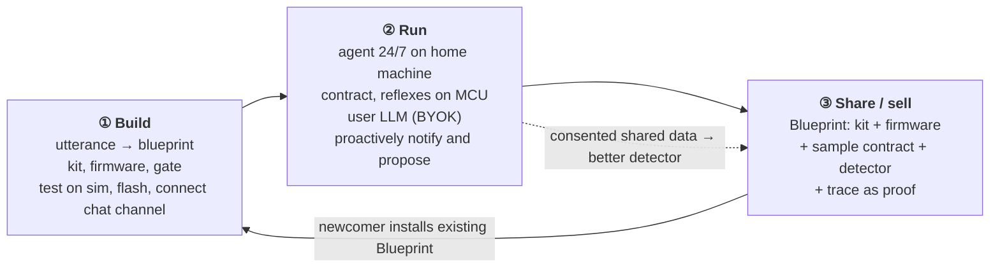
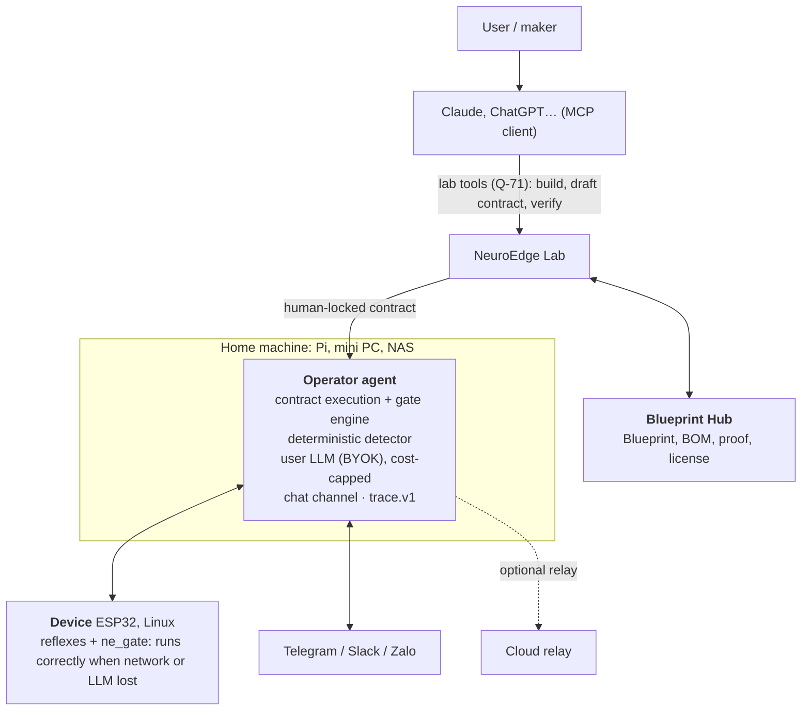
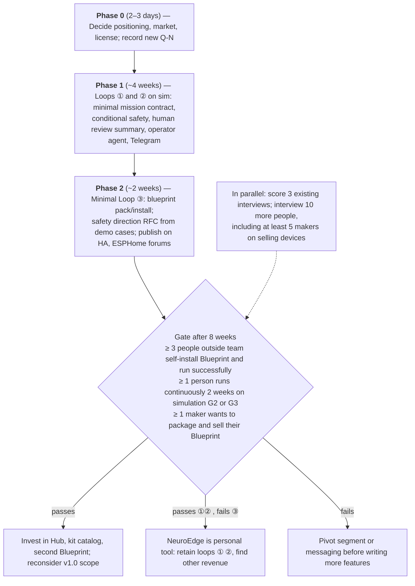

# NeuroEdge — Draft Proposal: from an utterance to a physical AI product

2026-10-11 · Trong-Minh Le (@letrongminh) · **Status:** proposed for **Q-72** (PRD §15); four items decided during review under "Decisions to finalize"

> **Refined following architecture review (2026-10-11).** This document was written prior to architecture review per Q-72; the following points changed and **PRD Q-72, FR-CH, FR-EGR, FR-MSN take precedence** upon conflict: (1) chat approvals are **approval records** `{id, nonce, expiry, digest, approval summary ≤ 5 lines generated by compiler}`, LLM cannot author any lines; permissions expansion for data must be approved locally (FR-MSN-14); (2) data flow is **leak-resistant**: user-declared destinations (including sending images to LLM) receive allowed data, undeclared destinations are blocked (FR-EGR); (3) `safe_state` other than `off` is declared only in `board.v1` with hardware interlocks, without condition-dependent forms in contracts; (4) simulation tier G3 runs ESP32 firmware on **Espressif QEMU** (Wokwi, Velxio pending Q-21, Q-69 evaluation). Architecture: `docs/architecture/vi/15-target-architecture.md` §6.
>
> **Subsequent directions post-proposal:** Q-73 (users choose verification methods and multi-step flows, only making risks transparent) and Q-74 (optional cloud brain, spinal cord at home, single chat box for multiple devices and homes) — PRD §15.

## Summary

Proposal: NeuroEdge becomes **the place turning intent into physical AI products — build, run safely, share, and sell**. Shopify empowers anyone to open a store without web development expertise; NeuroEdge enables any maker to build a live physical AI device, then turn it into a product for others.

> *"Tôi muốn trông bể cá 120 lít."* ("I want to look after a 120-liter aquarium.") → Claude (connecting via MCP to NeuroEdge) suggests a kit, generates firmware, tests on `sim` → user builds, connects Telegram → assigns mission by voice → agent runs 24/7, proactively notifying *"oxy giảm 3 ngày liền, đề xuất vệ sinh lọc"* ("oxygen dropping 3 days in a row, proposing filter cleaning") → maker packages into a **Blueprint**, others install with a single command, maker sells it.

- **Three loops:** ① Build (utterance → working device) · ② Run (agent under contract, proactively notifying and proposing) · ③ Share/sell (Blueprint). Loop ③ feeds back into Loop ①: newcomers start from existing Blueprints.
- **Why it is powerful** (per [Paul Graham — How to Make Startups Powerful](https://paulgraham.com/powerful.html)): positioned upstream — at intent inception, prior to hardware purchase decisions; money flows through NeuroEdge (BOM, Blueprint, relay); platform exhibits network effects; and **helps users make money** — makers become micro-manufacturers.
- **Defensibility / Uncopyable advantage:** trust required to sell physical AI devices to strangers — on-MCU gates, human-locked contracts, traces as proof, conditional safety. The safety layer is not a standalone product; it is the **passport for the Blueprint marketplace**.
- **User pays for LLM** (BYOK, like OpenClaw). NeuroEdge does not monetize tokens.
- **PolyForm Noncommercial (Q-45) is the monetization mechanism:** individuals use for free; makers selling Blueprints or hardware are commercial users routed through NeuroEdge.
- **Narrow entry wedge:** a single aquarium Blueprint completing all three loops. The litmus test for the model: whether at least one maker wants to **sell** their Blueprint.

## Why change positioning

Each October 2026 discussion round narrowed an assumption; this positioning synthesizes those findings.

| Previous positioning | Why insufficient |
| --- | --- |
| Gate for every LLM command sent to device | Technically correct but thin: for a single device, an allowlist can be written in an afternoon; no one pays yet |
| Neutral contract layer for ROS, Halos, Isaac | SROS2 and Halos leave gaps around AI command intent, but robotics engineers see no clear value adding a layer |
| Device watch agent | A single use case, not a product; "monitoring" is merely one of six verbs (next section) |

Evidence from deep research (sources in appendix):

- Giving LLMs device control is already trivial without authorization layers: [ros-mcp-server](https://github.com/robotmcp/ros-mcp-server) (1,493 stars) publishes all topics; [XiaoZhi](https://github.com/78/xiaozhi-esp32) (30,586 stars, 138 board folders) declares only types and min/max for on-device tools.
- Risks are real: robot jailbreak rates near 100% ([RoboPAIR](https://www.arxiv.org/abs/2410.13691v2)); LLM generates automation unlocking doors without PIN ([home-generative-agent v3.26.0](https://github.com/goruck/home-generative-agent/releases/tag/v3.26.0)).
- Value scales with *LLM autonomy × consequence of action*. Where LLM has little work, traditional automation wins.

**User signal:** 3 interviews (synthesized, not yet scored per `docs/business/cong-nhu-cau-2026-10-25/cham-diem.md`) describe loops ① and ②: asking Claude how to build, connecting chat channels, assigning missions by voice, receiving proactive notifications. No one has been asked about loop ③ yet.

NeuroEdge currently has **0 external users** after ~45k lines of Python, 21k lines of C, and 18 RFCs. New positioning must shorten the distance to the first user, not lengthen it.

## The ideal world, from the user's perspective

Paul Graham suggests: envision the ideal world from the customer's viewpoint; if the startup can make itself an indispensable piece of that world, do it.

> *I state what I want the physical world to do. It gets built, runs, stays safe when AI makes mistakes, and improves over time. If others need it, I can sell it.*

"What I want" encompasses any verb in the physical world — not just monitoring:

| Verb | Examples |
| --- | --- |
| Sense | Classroom air quality, soil moisture across garden beds |
| Actuate | Irrigate on plant demand, open blinds tracking sun, feed fish |
| React | Cut stove and call owner on smoke; turn on lights and snap photo on intruder |
| Analyze, propose | Oxygen dropping 3 days in a row; refrigerator power usage rising → gasket failure |
| Coordinate | Vacuum robot, cameras, and door locks collaborating on "away mode" |
| Produce | Crop dehydrators, egg incubators, mushroom farms, small workshops |

These six verbs are expressed through the **Blueprint format**, not implemented as concurrent features.

## Model: three loops and a flywheel



**Flywheel:** builder creates Blueprint → user installs → operational data (consented) refines detectors → Blueprint improves → more users → more builders.

### A user's journey

1. **Build.** "Tôi muốn trông bể cá 120 lít." Claude calls NeuroEdge lab tools (Q-71), suggests a validated kit (temperature, oxygen, camera, dual relays for aeration and heating), wiring diagram, purchasing BOM. Test on `sim` prior to purchasing. Generates board configuration, firmware, and gates from a single source; flash via web flasher; `lab doctor` verifies each sensor ("cảm biến oxy đọc 0 — kiểm lại dây vàng"). Connect Telegram with a single command.
2. **Assign mission.** "Trông bể, oxy thấp thì bật sục khí, có gì lạ chụp ảnh gửi tôi." System translates into mission contract and **asks for clarification when ambiguous**: "Ngưỡng oxy thấp là bao nhiêu? Gợi ý 5 mg/L cho cá nhiệt đới." User approves — directly in chat channel or local UI; only humans can lock contracts, never LLMs (Q-26 extended per Q-72).
3. **Run.** Local reflexes (oxygen below threshold → aerate). Agent autonomously detects trends and messages: *"Oxy buổi sáng giảm 3 ngày liền (6,8 → 6,1 → 5,4) trong khi nhiệt tăng 1,5 °C — có thể do trời nóng hoặc lọc bẩn. Đề xuất vệ sinh lọc và thêm sục khí 2h–5h. Thêm vào hợp đồng?"* Replying "Có" ("Yes") in chat serves as approval for that amendment (section "Chat channel approvals").
4. **Share, sell.** `neuroedge blueprint pack` bundles kit, firmware, sample contract, detectors, and real execution traces into a Blueprint. Others install with a single command. If sold, commercial licensing and payments route through NeuroEdge.

### What is a Blueprint

A declarative package, all components of which already have schemas or will have RFCs. Illustrative syntax, not yet schema:

```yaml
blueprint: tropical-fish-tank-guard
version:   1.2.0
author:    "@maker"
license:   personal-free; commercial-via-neuroedge
kit:       board.v1 esp32s3 + DS18B20 + DO-sensor + camera + relay×2   # BOM with purchasing links
firmware:  generated from board config; embedded ne_gate
sample_contract:
  allow:    toggle heater within 24–27 °C
  deny:     turn off aerator
  require:  temp > 30 °C for > 10 min ⇒ cut heater, alarm
  on_fault: network loss ⇒ keep aerator running
  data:     photos do not leave local network
ask_parameters: [oxygen_threshold, quiet_hours, alert_channel]
detectors:      [oxygen-trend-3-days, frozen-sensor, temp-fluctuation]
proof:          trace.v1 running 30 days across 3 tanks; replay passes 100%
```

**No Blueprint is sold without proof**: real execution traces and `replay` reproducing verdicts 100%. This is where NeuroEdge differs from a firmware repository or automation marketplace.

**Proof in MVP is unsigned** (decided during review): `trace.v1` currently lacks digital signatures (`TODOS.md` #1), so sellers could tamper with traces before packaging. Accepted to ship MVP fast; installers still run `replay` locally on their own machines, and Hub clearly flags "proof unsigned". Signed traces return when Hub starts collecting revenue for sellers.

## Applying Paul Graham's tests

| Test | What NeuroEdge does |
| --- | --- |
| Stand upstream | Present at intent inception — when user asks Claude "I want to do X" — before hardware purchasing decisions. Device data starts at birth (provisioning), just as Rippling begins at onboarding |
| Money flows through you | BOM purchased via NeuroEdge; Blueprints sold via NeuroEdge; monthly relay and OTA |
| Own the customer relationship | Chat channel is where users interact with devices daily, routed through NeuroEdge agent |
| Platforms and network effects | Blueprint marketplace — others' efforts make product more valuable. Consented shared data: *"your tank's oxygen pattern matches 214 tanks with clogged filters"* |
| Help users make money | **Market creation:** makers become micro-OEMs — build once, sell to hundreds; NeuroEdge handles firmware, OTA, contracts, chat channels, proof |
| Full stack, eaten from the inside | Do not sell gates to IoT companies; help makers *become* IoT companies, then absorb their hardest parts: design, firmware, device fleet, proof, customer support |
| Sell to early-stage actors | Makers and hardware startups decide fast; charging per active device scales revenue alongside their growth |
| Be generous | Open contract formats, Blueprints, MCP tools; free for individuals; goal is becoming the **standard** for contracted AI devices |
| Play the long game | Home Assistant, XiaoZhi, OpenClaw optimize for end users; NeuroEdge optimizes for **product creators** — an underserved layer |
| Listen to "misuse" | Monitor what users build outside official Blueprints; that is the next market |

Paul Graham's constraint: all strategies must make customer lives better, otherwise no one will adopt. Startups are too weak to force anyone.

## Stakeholders and cash flows

| Stakeholder | Receives | Pays |
| --- | --- | --- |
| End user | Installs Blueprint, gets smart device running immediately | Hardware; LLM (BYOK); optional relay |
| Maker, builder | Frictionless creation tooling; sells Blueprints | Revenue share on sales |
| Micro-OEM, hardware startup | Device fleet management, OTA, contracts, traces, customer channel | Commercial license per device |
| Component supplier | Pre-specified orders from BOM | Affiliate commission |
| Other AI agents (long horizon) | Call physical capabilities via MCP under contract | Per-call fee |

**Temporal horizons:**

1. **Near term:** hardware kit affiliate commissions (linked, no inventory); optional cloud relay — remote access, push alerts, trace backup without opening home firewall.
2. **Mid term:** Blueprint marketplace revenue share; per-device commercial licensing.
3. **Long term:** physical capabilities as a service invoked by other AI agents; aggregated industry benchmarks from consented data.

**LLM: user pays (BYOK).** Users enter Anthropic, OpenAI, Gemini keys, or use local models (Ollama), via existing LiteLLM integration. NeuroEdge never stores keys on central servers and does not monetize tokens — *"Squeezing every last penny out of customers is a distraction."* Design implications detailed in "Operator agent".

## Architecture



Three distinct roles:

- **Lab (Q-71)** — build and author contracts within Claude session. No separate LLM loop for building.
- **Operator agent** — runs continuously after Claude session closes. New role: running LLM only explains and *proposes* amendments; never self-locks or self-approves.
- **Blueprint Hub** — packaging, sharing, and selling.

Principle: **LLM thinks, hard rules enforce.** Safety enforcement lives at lowest feasible tier (MCU, host), independent of LLM. LLM interprets utterances, explains trends, drafts proposals. All LLM-proposed contract modifications require human approval.

## Core components

### Mission contracts

Rule unit spanning action chains across multiple devices. Compiler lowers each clause to lowest enforceable tier: **reflex** (MCU, milliseconds, runs on network loss) · **skill** (host, seconds) · **cognition** (LLM, seconds to minutes).

| Clause | Meaning | Existing in code | Missing |
| --- | --- | --- | --- |
| Allow / deny | Allowed actions and parameters | Gate, RFC-0005, tightening-only inheritance | Aggregating multiple gates into mission |
| Frequency, duration | "Max N times/hour" | Envelope: `window_s`, `max_on_ms_per_window`, `min_interval_ms`, `max_continuous_ms` | — |
| Time window | "Only 23:00–05:00" | `RUNTIME_CRITERIA` (runtime-injected clock) | Clock facts |
| Obligations ("must") | "X exceeds threshold > T ⇒ Y to S" | Lease, off-debt (RFC-0018), `safe_state` in `motion.*` (RFC-0011) | **New:** bounded watchdog for all actuators |
| Data flow | Which data leaves where | — | **New:** field and destination allowlists |
| On fault | What to do on loss of brain, network, sensors | L0–L3 for remote actuators | Per-actuator safe direction |
| Expiration | Rights self-expire | Expiring leases | Mission-level expiration |

Gates remain pure functions; obligations follow a single strict template (bounded watchdog). Compiler rejects conflicting contracts, pinpointing collisions, prior to human review. Review summary ≤ 5 plain-language lines, each stating enforcement tier.

### Conditional safety

The entire current safety core defaults to **safe = off**: fail-closed gates deny *turn on* commands; Q-62 never blocks *turn off* commands; `digital.out`, PWM (RFC-0010), remote actuators (RFC-0018) auto-off upon duration or lease expiry; only `motion.*` has `safe_state` (`stop`, `hold`).

For an aquarium, current core would deny turning on aerator when facts are missing, auto-off aerator when lease expires during network loss, and block aeration running overnight — all three kill the fish.

| Actuator | Turning on | Turning off | Safe state |
| --- | --- | --- | --- |
| Tank/pond aerator | Keeps fish alive; motor overheat risk | Fish suffocate | Run; shut off and alarm on overheat |
| Tank/coop heater | Keeps warm; fire hazard | Animals freeze | Temp-dependent; shut off above threshold |
| Drainage pump | Prevents flooding; dry-run damages pump | Flood | Float-switch dependent |
| Robot carrying load | Holds object | Drops object, tipping risk | Hold briefly then lower |

**Proposed design (requires RFC):** extend `safe_state` to `digital.out`, PWM, remote actuators across three forms: `off`, `on`, *local fact-dependent*; add **"alarm, call human"** state when both directions are hazardous; re-examine Q-62, auto-off rules in RFC-0007, RFC-0010, RFC-0018 and re-run entire corpus.

**Bypass prevention constraint** (decided during review). Q-62 exempts safe-direction commands from gates; if "safe direction" could be *on*, a malicious Blueprint declaring "heater safe when on" bypasses gates entirely. Therefore:

- `safe_state` other than `off` is declared **only** in `board.v1` (locked hardware profile), never in mission contracts, gates, or Blueprints.
- Actuators declaring `safe_state: on` **must** declare hardware interlocks (thermal fuse, overcurrent relay, float switch) — `board.v1` missing interlocks is rejected from flashing.
- Fix `TODOS.md` #58 first (`board.v1` reader ignoring unknown keys, including safety keys) so older readers do not silently discard new safety keys.
- Review summary and `blueprint install` explicitly flag all actuators with `safe_state` other than `off`.

**Q-38 boundary:** protection against physical hazards (fire, overcurrent, dry-running) always belongs to hardware — thermal fuses, overcurrent relays, float switches. NeuroEdge is never the sole protection layer; it ensures systems continue functioning on brain loss and calls humans when choosing between two evils.

### Data flow rules

| Rule type | Example | Enforcement | Guarantee |
| --- | --- | --- | --- |
| Architecturally deterministic | "No photos leave local network" | Network boundary, field and destination allowlists | Absolute |
| Closed-vocabulary deterministic | Send only `{zone, type, timestamp, confidence}` | Network boundary verifies event schema | Absolute |
| Probabilistic | "Do not send photos containing human faces" | Host, detector models | Fail-closed only: do not send when uncertain |

Review summaries must explicitly state which clauses are probabilistic. Free-form text written by LLMs cannot leave network if contract forbids — schematized events only. Tradeoff: stricter privacy leaves less work for LLMs; each Blueprint selects a point and records it in contract.

### Chat channel approvals

Decided during review: users **may approve via chat** — Telegram and other channels — for both contract amendments and runtime `ask` questions. This amends Q-26 (currently on-device only). Because chat is remote and receives text from external actors, approvals are valid only when satisfying:

- **Sender binding:** only chat accounts paired with device during setup (pairing code displayed on-device); group chats cannot approve.
- **Single-use, expiring:** each approval request has a unique expiring nonce; old "Có" ("Yes") or "Có" not matching the request is invalid.
- **Visible approval scope:** request message contains review summary ≤ 5 lines of the exact change.
- **LLM is never the approver:** chat content enters LLM as data; source `chat:<id>` becomes human source only after satisfying all three conditions above; agents cannot forge approvals.
- **Trace recording:** each approval records into `trace.v1` with sender, request ID, and review summary.

Residual risk (compromised chat account) listed under Risks; threat model requires dedicated chat section.

### Operator agent and LLM costs

Proactive agents cannot live inside Claude sessions — closing session terminates tracking. The operator agent runs on home machine, comprising scheduler, detectors, LLM caller, chat adapters.

Because users pay for LLMs, bills must be predictable:

1. **Deterministic filtering first, LLM calls second.** Thresholds, trend slopes, frozen sensors calculated via regular code. LLM is invoked only when detectors fire events — a few times daily for an aquarium, not every minute.
2. **Contract cost ceiling** (`llm_budget: 2 USD/month`). Reaching ceiling: reflexes and hard-coded alert templates continue running; only analysis ceases.
3. **Message batching.** One daily digest equals one LLM call; urgent alerts use hard-coded templates without LLM. Message budgets prevent notification fatigue.
4. **Model routing.** Local models for routine summaries, frontier models for proposals — unified via LiteLLM.

## Uncopyable advantage

Anyone can connect an LLM to an ESP32. The hard part is **the trust required to sell physical AI devices to strangers** — makers dare to sell to hundreds only when proving devices remain safe when AI makes mistakes.

| | Home Assistant + LLM | XiaoZhi | OpenClaw | **NeuroEdge** |
| --- | --- | --- | --- | --- | --- |
| Build hardware from scratch | No | Single chip family, voice assistant | No | Validated kits |
| Voice mission → bounded verification | User-written automation | No | No | Mission contracts |
| Safety on network or LLM loss | Partial | No | No | MCU gates |
| Conditional safety | No | No | No | Yes (requires RFC) |
| Proactive trend analysis | Unverified | No | Yes, no devices | Yes |
| Package as sellable product | No | No | Skills, no hardware | Proven Blueprints |

Competitor assessments reflect October 2026 research; Home Assistant and OpenClaw columns have not verified all latest features.

## Code reuse

| Component | Loop | Existing | Newly needed |
| --- | --- | --- | --- |
| Kit suggestion, config generation | ① | `board.v1`, sample kits (I2b), lab tools (Q-71, in progress) | Kit catalog with BOM and purchasing links |
| Pre-purchase simulation | ① | `sim`, web UI, `record`/`replay`/`verify` | Mission scenarios in `sim` |
| Firmware flashing, assembly check | ① | `esp32s3` firmware, `lab doctor` (TSK-N0-08) | Web flasher |
| Mission contracts | ② | `gate.v1`, RFC-0005, envelopes, leases | Mission schema (RFC touching `schemas/`) |
| Readable review summary | ② | `gate explain` | Plain-language format indicating enforcement tier |
| Reflexes, obligations | ② | `ne_gate`, `NETR` layout, `safe_state` in `motion.*` | Conditional safety across all actuators |
| Operator agent | ② | Host engine, LiteLLM, System 2 | Scheduler, detectors, cost ceiling |
| Chat channels | ② | — (IM channels currently out of scope) | Telegram adapter first |
| Data flow rules | ② | — | Complete implementation |
| Reports | ② | `trace.v1` with `gate_digest`, `trace export --report` (designed) | User-facing summaries |
| Blueprint, Hub | ③ | `digests.lock`, signed OTA, attestation | Blueprint format, `blueprint pack`/`install`, Hub |
| Existing device connectivity | ① ② | `proxy mcp`, `proxy http`, Home Assistant plugin, Extension SDK | ESPHome external component wrapping `ne_gate` |

Retained, not utilized in initial phase: voice, Studio, `jetson`. Nothing deleted.

## Simulation first, physical hardware later

Decided during review: run all three loops in simulation first; acquire physical hardware later. Four simulation tiers, from fastest to closest to hardware:

| Tier | Tooling | What runs | Used for |
| --- | --- | --- | --- |
| G1. Physical model | NeuroEdge `sim`, augmented with tank model (temp, oxygen over time, 30-day fast-forward) | Contracts, gates, agent, detectors, LLM cost | Complete loops ② and ③; CI |
| G2. `linux` runtime with dummy peripherals | Kernel `gpio-sim` (used in `linux-hal` job), dummy sensors via hwmon/IIO | Exact runtime targeting Pi, minus electricity | "2-week soak run" prior to Pi arrival |
| G3. Real ESP32 firmware on computer | [Wokwi](https://docs.espressif.com/projects/esp-idf/en/latest/esp32s3/third-party-tools/wokwi.html) (ESP-IDF official guide; `wokwi-cli` in CI; circuits declared in `diagram.json`; custom chip API) · Espressif QEMU · [Velxio](https://developer.espressif.com/blog/2026/07/velxio-browser-based-esp32-simulation/) (browser-based, analog simulation) | Firmware with `ne_gate`, offline reflexes | Reflex layer testing; spike Q-69 initiated this path |
| G4. Home Assistant maker route | [ESPHome host platform](https://esphome.io/components/host/) — runs ESPHome config on Linux/macOS, sensors replaced by template sensors | HA users test Blueprints without boards | Testing with HA, ESPHome communities |

Limitations to state clearly: simulation cannot catch wiring mistakes, electrical noise, sensor drift, or intermittent Wi-Fi — the exact failure points where makers give up. Unverified in this session: ESP32-S3 peripheral coverage in QEMU, Wokwi pricing and CI quotas.

## First Blueprint: aquarium

Aquarium forces solving "safe = on", understood immediately by global Home Assistant and ESPHome communities, runnable in `sim` without breadboards, and easily reskinned as "shrimp pond" for aquaculture.

**Scenario traversing all three loops:**

1. *Build.* User tells Claude: "Tôi muốn trông bể cá 120 lít." Claude proposes kit, tests in `sim`, generates firmware.
2. *Assign mission.* "Giữ bể ổn, báo tôi nếu có chuyện." System clarifies oxygen threshold; 5-line review summary; user approves.
3. *Run.* Simulated temp drops → LLM toggles heater within bounds. Claude suggests "tắt sục khí cho yên tĩnh" → blocked with reason. Disconnect network → aerator keeps running. Heater overheats 10 minutes → reflex shuts off heater, alarms.
4. *Proactive.* Simulated data shows oxygen dropping 3 days → agent Telegrams trend finding with proposal; user replies "Có" ("Yes") → contract amendment awaits review.
5. *Share.* `blueprint pack` → second user installs on clean machine with single command, runs successfully.

**Acceptance criteria:**

- [ ] External user installs Blueprint and runs on `sim` from clean machine in under 10 minutes.
- [ ] Conflicting contracts rejected before review, highlighting conflicting clauses.
- [ ] Network loss: aerator keeps running; heater follows local reflex rules.
- [ ] 100% contract-violating commands blocked in scenario suite.
- [ ] No photos leave local network if contract forbids.
- [ ] Agent sends at least one accurate trend finding; 30-day simulated scenario LLM cost under 2 USD.
- [ ] Chat approvals: approvals from unpaired accounts, groups, stale nonces, or expired requests rejected.
- [ ] `board.v1` declaring `safe_state: on` without hardware interlocks rejected from flashing.
- [ ] `replay` reproduces 100% of verdicts from trace.

Safety direction RFC written **from these exact demo cases**, not in advance.

## Risks and mitigations

| Risk | Level | Mitigation |
| --- | --- | --- |
| Overextension: three loops are three products | High | Single Blueprint traversing all three loops; six verbs reside only in format |
| Two-sided marketplace cold start | High | NeuroEdge team builds first 5–10 Blueprints, just as Shopify built first themes |
| No one wants to sell Blueprints | High | Ask makers "have you built devices for others, did anyone pay?" before building Hub |
| Misconstrued as certified safety function | High (legal) | Q-38 in README, review summaries, Blueprints; hazard protection always in hardware; medical and elderly care deferred |
| Hardware operations mud (shipping, returns, quality) | High | Affiliate sales first, no inventory |
| Proactive messages annoy, users mute notifications | Medium | Message budgets, digest batching, hard-coded emergency templates |
| Unpredictable LLM bills | Medium | Deterministic pre-filtering, contract cost ceilings |
| Home machine holds LLM keys and controls hardware | Medium | Q-71 boundary: separation of privileges, human-locked contracts |
| Compromised chat account approves on owner's behalf | Medium | Sender binding, single-use expiring nonces, hazardous actions (`safe_state`, data access) local approval only; accepted during review |
| Malicious Blueprints on Hub | Medium | Declarative-only Blueprints (no executable code); `safe_state` other than `off` only in `board.v1` with interlocks; installer runs local `replay`; permissions shown in review summary |
| Unsigned proof, sellers could modify traces | Medium | Accepted for MVP; Hub flags "unsigned"; sign traces before Hub collects seller revenue (`TODOS.md` #1) |
| Simulation diverges from physical hardware | Medium | Four simulation tiers; purchase hardware before selling first Blueprint |
| Users approve without reading | Medium | Review summaries ≤ 5 lines; only list non-default terms |
| Incumbents bundle LLMs (Home Assistant, XiaoZhi) | Medium | Integrate into them (plugins, ESPHome components) rather than compete; differentiate via Loop ③ and trust layer |

## Decisions to finalize

If approved, recorded as a new `Q-N` in PRD §15.

| # | Question | Proposal | Pro | Con |
| --- | --- | --- | --- | --- |
| 1 | Positioning | "The place turning intent into physical AI products" replacing neutral gate or monitoring agent | Sellable narrative; clear monetization path | Adds two new roles (operator agent, Hub) |
| 2 | Initial market | Global maker community (Home Assistant, ESPHome) | `sim` demos spread organically; Blueprints cross borders | Builders pay little initially; domestic verticals deferred |
| 3 | Licensing | Retain PolyForm Noncommercial (Q-45) as monetization mechanism | Free for individuals; commercial sales route through NeuroEdge | Some enterprises hesitate; requires clear seller terms |
| 4 | First step | Aquarium Blueprint traversing three loops + conditional safety RFC | First time external users see NeuroEdge run; validates whole model | ~6–8 engineer-weeks |
| 5 | Initial test revenue | Affiliate sales for aquarium kits | Cheapest demand validation | Small revenue; relay and Hub deferred |

**Decided during document review** (2026-10-11, product owner):

| # | Question | Decision |
| --- | --- | --- |
| 6 | Does replying "Có" ("Yes") in chat constitute approval? | **Yes** — Telegram and other channels, subject to conditions in "Chat channel approvals" |
| 7 | Sign traces before MVP? | **No** — accelerate MVP; unsigned proof, clearly noted |
| 8 | Prevent bypass via `safe_state: on` | **Agreed** — declared in `board.v1` only, mandatory hardware interlocks, fix `TODOS.md` #58 first |
| 9 | What to run on? | **Simulation first** (four tiers above); physical hardware purchased later |

**Relationship to existing decisions:**

- **Q-52** (MVP = complete v1.0): no cuts; reorder. v1.0 scope reviewed at 8-week gate post-decision, backed by data.
- **Q-71** (Lab via MCP): unchanged, serves as Loop ①; extended from actions to missions.
- **Q-26** (human only, on-device channel): extended — humans can approve via paired chat channels; applies to both `ask` and agent-proposed contract amendments; LLMs never approve.
- **Q-62** (safe-direction commands unblocked, mandatory auto-off): "safe direction" follows `safe_state` declared in `board.v1`; conditional safety RFC.
- **Q-70** (partner trial): runs in parallel; earliest real user channel.
- **Q-56** (drop demand gate): proposed reinstating an active gate, 8 weeks post-decision.
- IM channels currently out of scope: brought into scope, starting with Telegram.

## Roadmap and decision gates



Dates and thresholds are proposals, decided alongside items above. User conversations are lead responsibility, cannot be delegated to AI agents.

## Appendix: sources

**Thinking framework:** [Paul Graham — How to Make Startups Powerful](https://paulgraham.com/powerful.html).

**Simulation** (referenced 2026-10-11): [ESP-IDF — Wokwi](https://docs.espressif.com/projects/esp-idf/en/latest/esp32s3/third-party-tools/wokwi.html) · [Velxio](https://developer.espressif.com/blog/2026/07/velxio-browser-based-esp32-simulation/) · [ESPHome host platform](https://esphome.io/components/host/) · [Renode — virtual sensors](https://renode.readthedocs.io/en/latest/basic/sensors.html) (ESP32 support experimental).

**Public sources** (accessed and reviewed during October 2026 deep research):

- [ROS 2 — Access Controls (SROS2)](https://docs.ros.org/en/iron/Tutorials/Advanced/Security/Access-Controls.html)
- [NVIDIA Halos for Robotics — announcement](https://investor.nvidia.com/news/press-release-details/2026/NVIDIA-Announces-Halos-for-Robotics-the-Industrys-First-Full-Stack-Safety-System-for-Physical-AI/) · [Halos Outside-In docs](https://docs.nvidia.com/halos-outside-in/latest/index.html)
- [ros-mcp-server](https://github.com/robotmcp/ros-mcp-server)
- [XiaoZhi ESP32](https://github.com/78/xiaozhi-esp32) · [xiaozhi-esp32-server](https://github.com/xinnan-tech/xiaozhi-esp32-server) · [mcp-calculator / mcp_pipe](https://github.com/78/mcp-calculator)
- [RoboGuard](https://arxiv.org/abs/2503.07885) · [Runtime governance for embodied agents](https://arxiv.org/pdf/2604.07833)
- [RoboPAIR](https://www.arxiv.org/abs/2410.13691v2) · [VLA attacks](https://arxiv.org/pdf/2506.03350)
- [Gemini Robotics On-Device 2 — model card](https://deepmind.google/models/model-cards/gemini-robotics-on-device-2/)
- [home-generative-agent v3.26.0](https://github.com/goruck/home-generative-agent/releases/tag/v3.26.0) · [Home Assistant — expose entities](https://www.home-assistant.io/voice_control/voice_remote_expose_devices/)

**Unverified in this session, background knowledge only:** OpenClaw (BYOK model, skills, security incidents); Shopify, Rippling, Stripe (examples in Paul Graham essay); Apex aquarium controller (Neptune Systems), Reef-Pi; Frigate GenAI; LLM Vision for Home Assistant.

**Internal documents:** `roadmap/neuroedge-prd.md` (Q-26, Q-35, Q-38, Q-45, Q-52, Q-56, Q-62, Q-70, Q-71) · `docs/spec/lab_mcp.md` · `docs/rfc/0011-nguyen-thuy-motion.md` · `docs/rfc/0018-co-cau-chap-hanh-tu-xa.md` · `python/neuroedge/hal/envelope.py`, `hal/remote.py`, `hal/motion_core.py` · `docs/business/cong-nhu-cau-2026-10-25/`.
