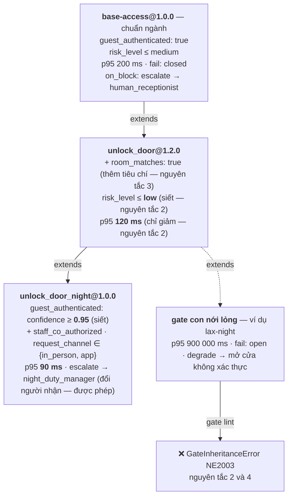

# Hợp đồng nền: API, `board.toml`, `agent.toml`, gate, HAL, vết ghi

Đặc tả chuẩn tắc của bề mặt lập trình và ba định dạng lõi. Mã và thông báo lỗi dẫn tới các mục ở
đây (ví dụ "Phụ lục B.5 nguyên tắc 2"). Lược đồ máy đọc được ở `schemas/`; khi lệch, lược đồ và
RFC đã chấp thuận thắng. Thay đổi những gì cần RFC: `CONTRIBUTING.md` §3.

## 1. API và trải nghiệm lập trình

Đối với một nền tảng lập trình, thiết kế giao diện API chính là diện mạo của sản phẩm.

### 1.1 Năm nguyên tắc thiết kế API

| # | Nguyên tắc | Tác động thiết kế |
|:---:|:---|:---|
| 1 | **Năng lực phần cứng là khai báo tĩnh** | Bo mạch và Agent cùng khai báo năng lực qua định dạng TOML; công cụ kiểm tra tự động đối chiếu ngay khi build. |
| 2 | **Cấm gọi trực tiếp hành động vật lý** | Mã nguồn chỉ có thể kích hoạt cơ cấu chấp hành thông qua `c.do()`, bắt buộc phải thẩm định qua gate an toàn. |
| 3 | **Gate an toàn là dữ liệu có cấu trúc** | Định dạng YAML có schema chuẩn, quản lý phiên bản độc lập với mã nguồn logic nghiệp vụ. |
| 4 | **Một mã nguồn duy nhất cho đa nền tảng** | Chuyển đổi môi trường thực thi qua tham số dòng lệnh (`--target`), không rẽ nhánh logic bằng các câu lệnh `if/else`. |
| 5 | **Mặc định chặn an toàn (Fail-closed by default)** | Mọi ngoại lệ, timeout hoặc sự cố trong quá trình thẩm định gate đều dẫn đến hành vi từ chối hành động. |

### 1.2 Đặc tả phần cứng — `board.toml`

```toml
# boards/villa-panel.board.toml
[board]
id     = "villa-panel-v2"
target = "esp32s3"

[capabilities."audio.in"]
channels       = 2
sample_rate_hz = 16000
aec            = true

[capabilities."audio.out"]
channels       = 1
sample_rate_hz = 16000

[capabilities."display"]
width  = 320
height = 240

[capabilities."digital.out"]
pins = ["door_lock", "courtesy_lamp"]
```

Khi chuyển sang định nghĩa bo mạch cho môi trường máy tính công nghiệp `linux`, cấu hình chỉ khác đúng hai dòng:

```toml
# boards/villa-gateway.board.toml
[board]
id     = "villa-gateway-x86"
target = "linux"          # ← Thay đổi môi trường
backend = "gpiod"         # ← Sử dụng chuẩn driver Linux

[capabilities."digital.out"]
pins = ["door_lock", "courtesy_lamp"]
# Toàn bộ phần khai báo còn lại hoàn toàn giữ nguyên
```

### 1.3 Đặc tả yêu cầu của Agent — `agent.toml`

```toml
# agent.toml
[agent]
name    = "villa-concierge"
version = "0.3.1"

[requires]
"audio.in"    = { aec = true }
"audio.out"   = {}
"display"     = { min_width = 240 }
"digital.out" = { pins = ["door_lock"] }

[gates]
unlock_door = "neuroedge://gates/hospitality/physical-access@1.2.0"
order_food  = "./gates/order_food@0.1.0.yaml"

[targets]
supported = ["sim", "linux", "esp32s3"]
```

*Điểm nhấn:* Cú pháp `neuroedge://` cho phép kế thừa các gói gate chuẩn đã được kiểm định từ cộng đồng về sử dụng trực tiếp theo phiên bản mong muốn.

**Chạy trên `sim` (TSK-S3-06).** Hai bảng tuỳ chọn cấp dữ kiện phiên cho gate khi chạy `neuroedge run --target sim`; trên thiết bị, dữ kiện này đến từ hệ thống của khách hàng:

```toml
[sim.facts]                 # dữ kiện phiên — không bao giờ suy từ chữ người dùng gõ
guest_authenticated = true
risk_level          = "low"

[sim.slot_facts]            # dữ kiện tính từ slot mà ngữ pháp lệnh trích được
room_matches = { slot = "room", equals = "101" }

[sim.sensors]               # giá trị cảm biến giả lập — đổi bằng `:sensor` trong REPL hoặc UI
temperature  = { value = 24.5, unit = "C" }
door_contact = true

[sim.sensor_facts]          # dữ kiện gate đọc từ cảm biến: giá trị, equals, gte / lte, hoặc bands
door_closed = { sensor = "door_contact" }   # luật: docs/spec/simulation_coverage.md §2
```

Tiêu chí không có trong hai bảng và không do lệnh khớp chứng minh (`facts` trong `commands.toml`) là **chưa xác định** → gate chặn. Trong `commands.toml`, mỗi `[[command]]` làm **đúng một việc**: `tool` (tên `@action`; câu khớp thành một **tool call tổng hợp** nguồn `local_grammar`, kèm `arguments` là tham số ← slot và `default_args` là tham số cố định — Q-24; tên cũ `action` vẫn nhận), `say` (câu trả lời cố định), hoặc `ask` (một tác vụ System 2 như `"news"`, kèm `offline_say` khi System 2 không trả lời được); `neuroedge build` từ chối tool không tồn tại, tham số không có trong chữ ký, và `default_args` sai kiểu. Bảng `[mcp]` / `[mcp.servers.<tên>]` khai MCP server bên ngoài mà System 2 được dùng — `command`, `args`, và **`tools`: allowlist các tool thông tin**; tool có hiệu ứng vật lý phải là `@action` có gate (Q-27, `docs/spec/tool_calling.md` §10). `knowledge.toml` cạnh `agent.toml` là knowledge base: mỗi `[[entry]]` có `questions` và `answer`; câu hỏi khớp được tìm cục bộ làm context cho System 2 (RAG), mất mạng thì nói `answer` (`python/neuroedge/models/knowledge.py`).

### 1.4 Định nghĩa hành động chuẩn kiểu — `@action`

```python
# actions/unlock_door.py
from neuroedge import action
from neuroedge.hal import digital

@action(
    name     = "unlock_door",
    requires = "digital.out:door_lock",
    gate     = "unlock_door",
)
def unlock_door(guest_id: str, duration_s: int = 30) -> None:
    """Mở chốt cửa phòng cho khách đã được xác thực an toàn."""
    digital.out("door_lock").pulse(seconds=duration_s)
```

Ba ràng buộc an toàn bắt buộc từ decorator `@action`:

| # | Ràng buộc an toàn | Xử lý khi vi phạm |
|:---:|:---|:---|
| 1 | Không thể gọi hàm trực tiếp từ mã nguồn agent mà bắt buộc phải qua `c.do()` | Báo lỗi `ActionContractViolation` lúc runtime |
| 2 | Năng lực khai báo tại `requires` tham gia đối chiếu tự động lúc biên dịch | Dừng quá trình build, chặn nạp firmware (§1.9) |
| 3 | Tham số `gate` phải khớp với cổng an toàn đã khai báo trong `agent.toml` | Dừng quá trình build |

**Mỗi `@action` là một tool (Q-24).** Chữ ký hàm sinh ra schema của tool; ngữ pháp cục bộ, System 1/2 và client MCP gọi nó bằng cùng một tool call qua cùng gate (`tool_calling.md`). Quy tắc đầy đủ: [`docs/spec/tool_calling.md`](tool_calling.md).

Hệ thống ngoại lệ an toàn chuẩn mực:

| Ngoại lệ | Điều kiện phát sinh |
|:---|:---|
| `ActionContractViolation` | Phát sinh khi cố ý kích hoạt cơ cấu chấp hành mà không thông qua `c.do()`. |
| `TokenReplayError` | Phát sinh khi token phán quyết bị dùng lại, quá hạn, hoặc do tiến trình khác phát hành. Fail-closed khi quá ngân sách **không** là ngoại lệ mà là phán quyết `BLOCK` ghi vào vết ghi (PRD Phụ lục B). |
| `BoardCapabilityError` | Phát sinh khi agent yêu cầu năng lực phần cứng mà bo mạch không cung cấp. |
| `SafetyRegressionError` | Phát sinh khi `neuroedge replay` / `verify` thấy phán quyết hoặc lệnh chân lệch golden — kể cả lệch giữa các môi trường (NE4002, PRD Phụ lục B). |

### 1.5 Cấu trúc tệp cổng an toàn (Gate Artifact) và cơ chế kế thừa `extends`

```yaml
# gates/unlock_door@1.2.0.yaml
schema:  neuroedge.gate/v1
name:    unlock_door
version: 1.2.0
extends: neuroedge://gates/hospitality/base-access@1.0.0

evaluate:
  guest_authenticated:
    type: bool
    instructions: "Khách đã hoàn tất xác thực danh tính hợp lệ trong phiên hiện tại"
  room_matches:
    type: bool
    instructions: "Số phòng yêu cầu trùng khớp hoàn toàn với hồ sơ đặt phòng của khách"
  risk_level:
    type: level
    levels: [low, medium, high]
    instructions: "Mức độ rủi ro bất thường tại thời điểm phát sinh yêu cầu"

allow_when:
  guest_authenticated: true
  room_matches:        true
  risk_level:          { lte: low }

on_block:
  action:  escalate
  to:      human_receptionist
  message: "Yêu cầu cần được nhân viên lễ tân xác nhận trực tiếp trước khi mở khóa."

budget:
  p95_latency_ms: 120
  fail:           closed      # Mất kết nối hoặc quá thời gian chờ → CHẶN HÀNH ĐỘNG
```

Năm ưu điểm vượt trội của định dạng cấu hình độc lập:

| Ưu điểm | Giá trị thực tiễn |
|:---|:---|
| **Hỗ trợ kế thừa chuẩn mực (`extends`)** | Kế thừa trực tiếp các chính sách an toàn công nghiệp, chỉ cần ghi đè các quy định riêng biệt. |
| **Phân tách thẩm định và điều kiện** | Đổi mô hình AI không làm đổi chính sách; tinh chỉnh chính sách không cần sửa mã nguồn. |
| **Khai báo Fail-Closed rõ ràng** | Hành vi khi mất kết nối mạng được quy định rõ ràng trong cấu hình, loại bỏ nguy cơ thiếu sót khối `try/except`. |
| **Trực quan với người quản lý vận hành** | Quản lý nghiệp vụ dễ dàng xem xét, đối soát tiêu chuẩn an toàn mà không cần am hiểu lập trình. |
| **Dễ dàng quản lý phiên bản** | Dễ dàng tạo pull request, so sánh diff và phát hành lên kho lưu trữ chung. |

Chi tiết các toán tử và quy tắc kế thừa: **Phụ lục B**.

#### Quy trình chuẩn tắc hóa Gate phục vụ băm và ký số mật mã

Theo nguyên tắc an toàn tại Phụ lục A.2, mọi lệnh điều khiển cơ cấu chấp hành (`digital.out`) đều bắt buộc phải mang theo chữ ký số mật mã của Gate đã phê duyệt. Để việc ký số và đối soát chữ ký diễn ra ổn định tuyệt đối, dữ liệu cần có dạng chuẩn tắc (canonical form). Vì tệp YAML có thể thay đổi cách thụt lề, thứ tự khóa hoặc kiểu trích dẫn mà không làm đổi ngữ nghĩa (dẫn đến mã băm bị lệch), NeuroEdge thiết lập cơ chế biên dịch hai lớp rõ ràng:

| Lớp | Định dạng | Vai trò |
|:---|:---|:---|
| **Tác giả viết** | YAML (`gates/*.yaml`) | Giao diện thân thiện cho con người đọc, viết và duyệt Pull Request |
| **Hệ thống biên dịch** | JSON chuẩn tắc theo RFC 8785 (JCS) | Đối tượng xác định (deterministic byte stream) để băm (SHA-256), ký số và phân phối |

Lập trình viên vẫn hoàn toàn viết Gate bằng YAML minh bạch. Khi chạy lệnh `neuroedge build` hoặc `neuroedge gate publish`, hệ thống tự động chuẩn tắc hóa Gate sang JSON theo chuẩn RFC 8785 trước khi tính toán mã băm và tạo chữ ký số mật mã.

### 1.6 Mã nguồn Agent mẫu hoàn chỉnh

*Mã dưới đây minh họa **hướng** API viết bằng mã (`agent.mind`, `c.fast.choice`…), chưa hiện thực. Bản chạy được hôm nay khai bằng dữ liệu — `agent.toml`, `commands.toml`, `knowledge.toml` (§1.3) — còn `@action` và `c.do()` là API thật.*

```python
# agent.py
from neuroedge import Agent, Conversation, SystemOne, SystemTwo
from actions.unlock_door import unlock_door
from actions.order_food import order_food

agent = Agent.from_toml("agent.toml")

agent.mind(
    fast  = SystemOne("jev-latest",     fallback="local/command-grammar"),  # Q-14: ngữ pháp lệnh cố định
    slow  = SystemTwo("claude-sonnet-5", fallback="local/qwen2.5-3b"),
    route = "fast_first",
)

agent.memory.ingest("./villa_docs/")

@agent.on_turn
async def turn(c: Conversation):
    intent = await c.fast.choice(
        "intent",
        options = ["faq", "unlock", "order", "other"],
        state   = {"utterance": c.utterance, "context": c.recall(k=3)},
    )

    if intent.top == "unlock":
        # Gate unlock_door@1.2.0 tự động thẩm định TRƯỚC khi chân door_lock nhận tín hiệu.
        # Nếu bị chặn → tự động xử lý theo quy định on_block, hàm vật lý không bao giờ bị kích hoạt.
        await c.do(unlock_door, guest_id=c.session.guest_id)

    elif intent.top == "order":
        await c.do(order_food, dish=await c.slow.extract("dish_name"))

    elif intent.top == "faq" and intent.confidence > 0.85:
        await c.say(c.recall_answer())          # Trả lời nhanh từ dữ liệu, tiết kiệm chi phí System 2

    else:
        await c.say(await c.slow.reply())
```

Ba đặc điểm quan trọng trong thiết kế mã nguồn:
- **Không tồn tại các nhánh kiểm tra điều kiện nền tảng:** Cùng một tệp mã nguồn chạy trực tiếp trên `sim`, `linux` và `esp32s3`.
- **`c.do()` là cổng kiểm soát duy nhất:** Không có bất kỳ đường tắt nào để tác động vào thế giới vật lý mà bỏ qua thẩm định gate.
- **Tách bạch rõ giữa phản hồi thông tin (`c.say`) và tác vụ vật lý (`c.do`):** Lời nói có thể thu hồi và sửa đổi, còn hành vi vật lý tác động trực tiếp ra môi trường thực tế nên đòi hỏi mức độ kiểm soát nghiêm ngặt hơn.

Cùng API cho trợ lý giọng nói trong nhà — hỏi đáp RAG, tin tức, đèn:

```python
@agent.on_turn
async def turn(c: Conversation):
    intent = await c.fast.choice("intent", options=["knowledge", "news", "light_on", "light_off", "other"])

    if intent.top == "knowledge":
        passages = c.recall(k=3)                      # tìm cục bộ, tất định
        try:
            await c.say(await c.slow.reply(context=passages))   # System 2 diễn đạt lại (RAG)
        except PerceptionUnavailableError:
            await c.say(passages[0].answer)           # mất mạng: câu trả lời cục bộ
    elif intent.top == "news":
        await c.say(await c.slow.reply(task="news"))  # cần mạng; không có thì nói rõ, không bịa
    elif intent.top == "light_off":
        await c.do(light_off)                         # gate: room_empty từ cảm biến motion
    elif intent.top == "light_on":
        await c.do(light_on)
```

Hôm nay trên `sim`, bản chạy được của đoạn này khai bằng dữ liệu thay vì mã: `commands.toml` nối lệnh với `action` hoặc `ask`, `knowledge.toml` là knowledge base (§1.3, `fixtures/agents/home-voice/`).

### 1.7 Bộ kịch bản kiểm thử hồi quy Action CI

*Minh họa API kiểm thử dự kiến (`replay()`, `scenario()`). Helper hiện hành: `neuroedge.testing` (`assertions.py`, `golden.py`) và lệnh `neuroedge test`.*

```python
# tests/test_gates.py
from neuroedge.testing import replay, scenario

def test_khong_mo_khoa_khi_chua_xac_thuc():
    """Đảm bảo khách chưa xác thực tuyệt đối không thể kích hoạt chốt cửa."""
    s = replay("traces/unverified_attempt.json")
    assert s.action("unlock_door").blocked
    assert s.blocked_by   == "unlock_door@1.2.0"
    assert s.escalated_to == "human_receptionist"
    assert s.pin("door_lock").never_pulsed()

def test_gate_fail_closed_khi_mat_mang():
    """Đảm bảo mất kết nối mạng khi không có fallback cục bộ chạy được sẽ chặn hành động (Q-14), không được tự ý cấp quyền."""
    s = scenario("traces/happy-path.json", network="offline")
    assert s.action("unlock_door").blocked
    assert s.reason == "gate_unreachable"
    assert s.pin("door_lock").never_pulsed()

def test_doi_model_khong_lam_hoi_quy_an_toan():
    """Đổi mô hình LLM System 2: Dù câu từ sinh ra phi xác định, Gate verdict và GPIO vẫn an toàn tuyệt đối."""
    s = replay("traces/unverified_attempt.json", slow="claude-haiku-4-5")
    # Action CI KHÔNG assert trên chuỗi văn bản của LLM (phi xác định)
    # mà assert trên phán quyết của Gate và trạng thái vật lý của chân chốt cửa:
    assert s.action("unlock_door").blocked
    assert s.pin("door_lock").never_pulsed()

@scenario.parametrize(target=["sim", "linux", "esp32s3"])
def test_ba_target_cho_cung_mot_quyet_dinh_gate(target):
    """Xác thực tính tương đương môi trường: Gate rule engine cho phán quyết và lệnh GPIO đồng nhất 100%."""
    s = replay("traces/happy-path.json", target=target)
    assert s.gate("unlock_door").verdict == "ALLOW"
    assert s.pin("door_lock").pulsed_once(duration_ms=30000)
```

Quy trình kiểm thử tự động trên biến các cam kết an toàn thành các bài test thực thi tự động. Nếu có sự cố hồi quy, hệ thống CI sẽ lập tức báo đỏ và chặn quá trình phát hành.

**Nền tảng hiện thực:** bộ kiểm thử Action CI là helper cho **Pytest** trong `neuroedge.testing` (đóng gói thành plugin `pytest-neuroedge` là dự kiến), dùng **DeepDiff** để so khớp chuỗi phán quyết với mẫu chuẩn Golden Reference. Lập trình viên chạy nó bằng đúng công cụ họ đã quen, không phải học một trình chạy kiểm thử riêng.

### 1.8 Giao diện dòng lệnh (CLI Surface)

Bề mặt lệnh chuẩn tắc — nhóm lệnh, hợp đồng mã thoát, tiêu chí nghiệm thu: **[PRD §7.2](../../roadmap/neuroedge-prd.md#72-giao-diện-dòng-lệnh-fr-cli)** (FR-CLI). Lệnh cụ thể và đầu ra kỳ vọng: [`CHANGELOG.md`](../../CHANGELOG.md) §2. Mục này chỉ nêu lựa chọn thiết kế.

**Nền tảng hiện thực CLI:** xây trên **Typer** cho định nghĩa lệnh, **Rich** cho hiển thị và báo lỗi có cấu trúc. Khuôn mẫu dự án của `neuroedge new` là **generator Python thuần** trong gói — không dùng Copier, vì nó kéo theo `jinja2-ansible-filters` GPL3 (TSK-S3-07).

**Giao diện mô phỏng:** `neuroedge run --target sim` là vòng lặp gõ chữ, không mạng, không key (Q-15). Thêm `--ui`, lệnh mở một trang web cục bộ tự chứa — không tải CDN — để thấy chốt cửa, đèn và cảm biến ảo đổi trạng thái; `neuroedge mcp serve --ui` dùng chung phiên đó với một client MCP như Claude Desktop. Wokwi Elements là phương án đã cân nhắc cho giao diện giàu hơn, chưa dùng (Phụ lục H.1).

Hai lệnh `record` và `replay` giúp việc tái hiện và xử lý lỗi hiện trường trở nên đơn giản: Một sự cố xảy ra ngoài thực tế được đưa về tái hiện chính xác trên máy tính cá nhân của kỹ sư chỉ bằng một câu lệnh.

### 1.9 Báo cáo lỗi đối chiếu năng lực lúc biên dịch

```text
$ neuroedge build --target esp32s3 --board villa-panel

✗ CAPABILITY MISMATCH — Dừng quá trình build, từ chối nạp firmware

  agent  villa-concierge@0.3.1   yêu cầu   sensor.read:motion
  board  villa-panel-v2          cung cấp  audio.in, audio.out, display,
                                           digital.out:[door_lock, courtesy_lamp]

  thiếu  sensor.read:motion      được gọi tại  actions/auto_light.py:14

  → Hướng dẫn xử lý: Bổ sung cảm biến tương ứng vào board.toml hoặc điều chỉnh lại yêu cầu trong agent.toml.

  Lỗi bất tương thích phần cứng này được ngăn chặn ngay từ khâu build thay vì để phát sinh sự cố ngoài hiện trường.
```

### 1.10 Trải nghiệm 10 phút đầu tiên (Time-to-First-Value)

Hành trình chuẩn tắc, từng phút và yêu cầu chi phối: **[PRD §2.3, Hành trình 1](../../roadmap/neuroedge-prd.md#hành-trình-1--mười-phút-đầu-tiên-u1)**. Ràng buộc thiết kế đi kèm: trong 10 phút đầu, người dùng không mua phần cứng, không tạo tài khoản, không nhập thẻ tín dụng.

---

## Phụ lục A — Đặc tả hợp đồng năng lực HAL

### A.1 Năm nguyên thủy và thuộc tính đối chiếu

| Nguyên thủy | Thuộc tính bo mạch khai báo | Yêu cầu từ phía Agent | Quy tắc đối chiếu hợp lệ |
|:---|:---|:---|:---|
| `audio.in` | `channels`, `sample_rate_hz`, `aec`, `vad` | `aec`, `min_channels`, `sample_rate_hz` | Bo mạch phải đáp ứng bằng hoặc vượt thông số yêu cầu. |
| `audio.out` | `channels`, `sample_rate_hz` | `channels` | Bo mạch phải đáp ứng bằng hoặc vượt số kênh yêu cầu. |
| `digital.out` | Danh sách chân logic `pins[]`, trình điều khiển `backend` | Danh sách chân logic `pins[]` | Mọi chân logic agent yêu cầu bắt buộc phải có mặt trên bo mạch. |
| `sensor.read` | Danh mục cảm biến `sensors[]` (`motion`, `temp`, `touch`, `imu`) | Danh mục cảm biến `sensors[]` | Mọi cảm biến agent yêu cầu bắt buộc phải tồn tại trên bo mạch. |
| `display` | `width`, `height`, `color` | `min_width`, `min_height` | Độ phân giải phần cứng phải bằng hoặc lớn hơn yêu cầu hiển thị. |

### A.2 Ba nguyên tắc thiết kế bất biến

| # | Nguyên tắc | Hậu quả khi vi phạm |
|:---:|:---|:---|
| 1 | **Chân cắm và cảm biến định danh bằng tên logic, không dùng số chân vật lý** | Mã nguồn agent bị gắn cứng vào một layout phần cứng cụ thể, làm mất tính đa nền tảng. |
| 2 | **Mọi lệnh kích hoạt `digital.out` bắt buộc phải kèm chữ ký gate hợp lệ** | Hệ thống HAL ném lỗi `ActionContractViolation` và từ chối thực thi tác vụ. |
| 3 | **Quá trình đối chiếu năng lực diễn ra ngay khi biên dịch (build-time)** | Phát hiện lỗi cấu hình sớm, tránh để phát sinh sự cố bất tương thích ngoài thực địa. |

### A.3 Ba bản hiện thực chuẩn mực của cùng một hợp đồng

| Nguyên thủy | Môi trường mô phỏng (`sim`) | Linux công nghiệp (`linux`) | Vi điều khiển biên (`esp32s3`) |
|:---|:---|:---|:---|
| `audio.in` | Tệp âm thanh mẫu WAV hoặc micro máy tính | `sounddevice` qua PipeWire, đọc nút đã khử vang của `module-echo-cancel` (Q-22) | I2S + WebRTC AEC phần mềm (FR-PER-06) |
| `audio.out` | Loa máy tính cá nhân hoặc thiết bị ảo | `sounddevice` qua PipeWire, phát vào nút `sink` của module khử vang (Q-22) | Bộ giải mã âm thanh I2S DAC |
| `digital.out` | Chân ảo trong bộ nhớ (`SimHAL`), hiện trên trang `run --ui`, ghi ra trace | Driver chuẩn Linux `gpiod` | Trình điều khiển chân GPIO vật lý |
| `sensor.read` | Giá trị khai trong `[sim.sensors]`, đổi được trong REPL hoặc UI | sysfs hwmon và IIO | Trình điều khiển driver I2C/SPI phần cứng |
| `display` | Khung trong bộ nhớ + digest, hiện trên trang `run --ui` | Cửa sổ đồ họa hoặc framebuffer | Màn hình LCD giao tiếp SPI |

---

## Phụ lục B — Đặc tả định dạng cấu hình gate v1

### B.1 Các trường cấu hình cấp cao

*(v5.5, 2026-09-23 — RFC-0001.)* Chỉ ba trường `schema`, `name`, `version` bắt buộc với **mọi** gate. Bốn trường `evaluate`, `allow_when`, `on_block`, `budget` bắt buộc với **gate gốc** (không có `extends`); gate dẫn xuất được phép bỏ trống và kế thừa chúng từ gate cha theo Phụ lục B.5.

| Tên trường | Bắt buộc | Mô tả chức năng |
|:---|:---:|:---|
| `schema` | Có | Định danh phiên bản schema, cố định là `neuroedge.gate/v1`. |
| `name` | Có | Tên logic của cổng an toàn, trùng khớp với khóa định danh trong `agent.toml`. |
| `version` | Có | Phiên bản theo chuẩn SemVer. Mọi thay đổi trong `allow_when` được coi là thay đổi lớn (breaking change). |
| `extends` | Không | URI tới gate cơ sở cần kế thừa, dạng `neuroedge://gates/<đường dẫn>@<major.minor.patch>`. Quy tắc kế thừa tại Phụ lục B.5. |
| `evaluate` | Gate gốc: Có · Gate dẫn xuất: kế thừa được | Danh mục các đại lượng cần thẩm định trước khi cấp quyền hành động; khi khai báo phải có ít nhất một đại lượng. |
| `allow_when` | Gate gốc: Có · Gate dẫn xuất: kế thừa được | Điều kiện phê duyệt bắt buộc. Tất cả các mệnh đề phải đồng thời thỏa mãn. Hai dạng viết tại Phụ lục B.2. |
| `on_block` | Gate gốc: Có · Gate dẫn xuất: kế thừa được | Hành vi ứng xử khi yêu cầu bị cổng an toàn từ chối (Phụ lục B.3). |
| `budget` | Gate gốc: Có · Gate dẫn xuất: kế thừa được | Ngân sách thời gian thẩm định và chính sách xử lý khi có sự cố kết nối (Phụ lục B.4). |

### B.2 Bốn kiểu dữ liệu trong khối `evaluate`

| Kiểu dữ liệu | Tham số khai báo | Kết quả trả về | Toán tử điều kiện trong `allow_when` |
|:---|:---|:---|:---|
| `bool` | `instructions` *(không được có `levels` hay `options`)* | Giá trị đúng/sai kèm độ tin cậy | `true`, `false`, `{ confidence_gte: x }` |
| `level` | `levels[]` theo thứ tự (bắt buộc, ≥ 2 giá trị), `instructions` | Mức xếp hạng kèm phân phối | `eq`, `lte`, `gte` |
| `choice` | `options[]` (bắt buộc, ≥ 2 giá trị), `instructions` | Lựa chọn kèm xác suất các nhánh | `in`, `not_in`, `eq` |
| `numeric` *(RFC-0009)* | `unit`, `range { min, max }`, `max_age_ms` (cả ba bắt buộc), `instructions` | Số đọc `f64` kèm mốc đọc của HAL | `gt`, `gte`, `lt`, `lte`, ghép được thành khoảng; không `eq`, không `confidence_gte`; không được nằm trong `on_block.confirms`. Gate con chỉ thu hẹp khoảng (nguyên tắc 2) |

Ba kiểu đầu tương thích trực tiếp với hợp đồng chuẩn của nhà cung cấp `SystemOne` (PRD §4.3, FR-MDL); `numeric` chỉ đến từ số đọc phần cứng, không từ model.

#### Hai dạng viết `allow_when` *(v5.5 — RFC-0001)*

| Dạng | Cách viết | Phạm vi sử dụng |
|:---|:---|:---|
| **Ánh xạ toán tử** *(chuẩn tắc)* | Ánh xạ từ tên tiêu chí trong `evaluate` tới một toán tử của bảng trên | Mọi gate. Là **dạng duy nhất được phép trong chuỗi kế thừa** — chỉ dạng này cho phép chứng minh cơ học rằng gate con không nới lỏng gate cha (nguyên tắc 2, B.5) |
| **Chuỗi CEL** | Một biểu thức CEL (PRD §5.2) | Chỉ trong gate **không có `extends`**. Chuỗi CEL trong chuỗi kế thừa bị bước phân giải **từ chối (fail-closed)**, lỗi `GateInheritanceError`. Tới khi bộ biên dịch CEL xong (TSK-S2-06, đang hoãn), bước phân giải từ chối cả chuỗi CEL ở gate độc lập (`GateSchemaError`) |

*Dạng mảng:* `gate.v1.json` khai `allow_when` kiểu `string`, `object` **hoặc `array`** và không ràng buộc phần tử mảng, nhưng v1 **không định nghĩa ngữ nghĩa nào cho dạng mảng**. Bước phân giải từ chối mọi `allow_when` không phải ánh xạ — `GateInheritanceError` trong chuỗi kế thừa, `GateSchemaError` ở gate độc lập. Một gate `allow_when: [...]` vì thế qua được thẩm định lược đồ nhưng **không qua `neuroedge gate lint`**. Bỏ `array` khỏi lược đồ cần RFC vì `schemas/` đã đóng băng.

### B.3 Bốn hành vi xử lý khi bị chặn (`on_block`)

| Hành vi (`action`) | Tham số bắt buộc | Mô tả chi tiết |
|:---|:---|:---|
| `escalate` | `to` | Chuyển tiếp yêu cầu xử lý đến đối tượng tiếp nhận `to:`, kèm thông báo giải thích `message` (tùy chọn). `to` là **định danh tự do** của một đối tượng tiếp nhận do bản triển khai đăng ký — ví dụ `human_receptionist` ở §1.5; `human`, `slow` (System 2) hoặc tên một agent khác là các giá trị quy ước. Lược đồ chỉ ràng buộc chuỗi không rỗng; đối chiếu với danh sách người nhận đã đăng ký là trách nhiệm của bản triển khai. |
| `deny` | — | Từ chối thực thi trong im lặng và ghi nhận sự kiện vào tệp nhật ký vết. |
| `ask` | `message` | Chủ động yêu cầu người dùng xác nhận lại theo nội dung câu hỏi định sẵn `message`. Tuỳ chọn `confirms: [tiêu chí…]` *(RFC-0006)*: những tiêu chí mà lời "có" của **người trên thiết bị** được thay khi gate lượng giá lại; mọi tiêu chí khác vẫn phải đạt, gate con chỉ được bớt phần tử. Không có `confirms` ⇒ chỉ thông báo. |
| `degrade` | `fallback_action` | Chuyển sang thực thi `fallback_action` — một phương án thay thế an toàn hơn đã được đăng ký trước. |

Ngoài `action`, các tham số trên và `confirms` *(RFC-0006)*, `on_block` không nhận trường nào khác *(v5.5 — RFC-0001)*.

**Hành vi ở v1.0** *(Q-17)*: với **mọi** `on_block`, hành động vật lý gốc bị chặn. `deny`: chặn. `escalate` / `ask`: chặn, ghi sự kiện vào vết ghi và gọi hook `on_escalate` / `on_ask` (mặc định no-op). `degrade`: chặn hành động gốc, chạy `fallback_action` **qua gate của chính nó** — không có đường tắt nào bỏ qua thẩm định. Đây là hành vi được đặc tả, fail-closed và được kiểm thử đầy đủ, không phải nợ kỹ thuật. `ask` có `confirms`: lời xác nhận của người trên kênh thiết bị làm gate lượng giá lại (Q-26, RFC-0006). Người nhận `escalate` thật: `TODOS.md` #20.

### B.4 Ngân sách thời gian và cơ chế Fail-Closed (`budget`)

| Tham số | Bắt buộc | Nội dung quy định |
|:---|:---:|:---|
| `p95_latency_ms` | Có *(khi khai khối `budget`)* | Ngân sách thời gian thẩm định tối đa (số nguyên ≥ 1). Nếu vượt quá giới hạn này, hệ thống sẽ xử lý như một trường hợp lỗi. |
| `fail` | Không | `closed` (Từ chối hành động) hoặc `open` (Cho phép thực thi; chỉ áp dụng cho các hành vi có thể hoàn tác an toàn và bắt buộc phải khai báo tường minh). **Vắng mặt nghĩa là `closed`** *(v5.5 — RFC-0001)*: một gate chỉ trở thành fail-open khi nói rõ như vậy. |

### B.5 Năm nguyên tắc kế thừa an toàn (`extends`)

Ba gate mẫu trong `gates/` là một chuỗi kế thừa 3 cấp. Mỗi cấp chỉ **siết chặt** thêm:



| # | Nguyên tắc kế thừa |
|:---:|:---|
| 1 | Gate con **tự động kế thừa toàn bộ** các mục đánh giá `evaluate` từ gate cha. |
| 2 | Gate con **chỉ được phép siết chặt thêm**, tuyệt đối không được nới lỏng chính sách an toàn — với các điều kiện `allow_when`, **và** *(v5.5 — Q-18, RFC-0004)* với `budget` và `on_block`: (a) `p95_latency_ms` của con ≤ giá trị đã phân giải của cha; (b) con không được tự đưa vào `degrade` / `fallback_action` mới — chỉ được giữ nguyên `degrade` cùng `fallback_action` của cha; con được đổi sang `deny` / `escalate` / `ask` và được đổi `to` / `message`. |
| 3 | Gate con **được quyền bổ sung** thêm các tiêu chí đánh giá `evaluate` mới. |
| 4 | Chính sách `fail: open` **không được tự động kế thừa** mà bắt buộc phải khai báo tường minh tại từng cấp. *(v5.5 — RFC-0004)* Và chuỗi đã phân giải thành `closed` (khai tường minh hoặc mặc định do vắng mặt) thì con **không được mở lại** bằng cách tự khai `fail: open`. |
| 5 | Giới hạn độ sâu kế thừa tối đa 3 cấp; mọi vòng lặp phụ thuộc sẽ bị chặn ngay khi phân giải cấu hình. |

*Ý nghĩa an toàn:* Nguyên tắc 2 và 4 bảo đảm việc kế thừa các gate an toàn từ cộng đồng sẽ không bao giờ làm suy giảm tiêu chuẩn bảo vệ của hệ thống. Phần mở rộng của RFC-0004 đóng lỗ hổng một gate con hợp lệ về `allow_when` nhưng nới lỏng qua ngân sách thời gian hoặc hành vi khi bị chặn (ENG-A2). Vi phạm ⇒ `GateInheritanceError` (`NE2003`), kèm số nguyên tắc.

**Cổng kiểm tra an toàn là `neuroedge gate lint` (phân giải), không phải thẩm định lược đồ.** Các nguyên tắc 2, 4 và 5 là mệnh đề về quan hệ giữa **hai** (hoặc nhiều) tài liệu trong chuỗi kế thừa; JSON Schema chỉ thẩm định **một** tài liệu. Một gate con hợp lệ theo `gate.v1.json` vẫn có thể nới lỏng gate cha — chỉ bước phân giải mới phát hiện được.

---

### B.6 Ràng buộc tham số (`arguments`) — *RFC-0005, Q-25*

> Chuẩn tắc từ 2026-09-24 ([`docs/rfc/0005-rang-buoc-tham-so-trong-gate.md`](../rfc/0005-rang-buoc-tham-so-trong-gate.md)).
> Mã: `python/neuroedge/engine/arguments.py`.

Khi hành động đến từ LLM hoặc client MCP, mô hình chọn cả tham số. Gate khai giới hạn cho
tham số của `@action`, lượng giá tất định **trước** `evaluate`:

```yaml
arguments:
  duration_s: { type: integer, minimum: 1, maximum: 60 }
```

Mỗi tham số khai `type` (`string` · `integer` · `number` · `boolean`) và tuỳ chọn `minimum`,
`maximum` (số), `enum`, `max_length` (chuỗi). Engine kiểm **giá trị thực chạy** — kể cả giá trị
mặc định của hàm — trước mọi tiêu chí, không hỏi mô hình, không tốn ngân sách. Vi phạm ⇒ BLOCK
`argument_out_of_range` với `failed_criterion` là tên tham số, rồi `on_block` như mọi lần chặn.
Gate con chỉ thu hẹp khoảng hoặc tập giá trị; không nhắc lại là kế thừa, nên không bỏ được
ràng buộc của cha — cùng hình dạng với nguyên tắc 2 và 4 của B.5. `neuroedge build` từ chối
giới hạn trên tham số mà `@action` không có, hoặc khác kiểu. Giới hạn
đi vào `inputSchema` của tool để mô hình thấy trước ([`docs/spec/tool_calling.md`](tool_calling.md) §3).

---

## Phụ lục C — Đặc tả lược đồ vết ghi (JSON)

### C.1 Sáu nhóm sự kiện trong tệp vết

Tên sự kiện cụ thể cho từng nguyên thủy HAL (`sensor_read`, `display_frame`, `audio_in_segment`…) và vai trò của chúng khi replay: [`docs/spec/simulation_coverage.md`](simulation_coverage.md) §3.

| Nhóm sự kiện | Dữ liệu ghi nhận chi tiết |
|:---|:---|
| `input` | Khung âm thanh đầu vào (hoặc mã băm hash khi bật chế độ bảo mật), dữ liệu đọc cảm biến, tín hiệu ngắt hệ thống. |
| `perception` | Kết quả nhận diện wake-word, phân loại VAD, văn bản STT kèm độ trễ xử lý từng bước. |
| `decision` | Chi tiết lượt gọi System 1 / System 2: dữ liệu đầu vào, kết quả, độ tin cậy, thời gian xử lý và chi phí tài nguyên. |
| `gate` | Chi tiết thẩm định gate: phiên bản áp dụng, kết quả từng tiêu chí `evaluate`, đối chiếu `allow_when` và phán quyết cuối cùng. |
| `action` | Lệnh điều khiển cơ cấu chấp hành: tên hành động, tham số thực thi, gate phê duyệt và mốc thời gian chính xác. |
| `output` | Luồng âm thanh phản hồi TTS, thông tin hiển thị trên màn hình. |

### C.2 Bốn thuộc tính tiêu chuẩn

| # | Thuộc tính | Mục tiêu kỹ thuật |
|:---:|:---|:---|
| 1 | **Tái hiện độc lập trên mọi môi trường** | Là nền tảng bảo đảm nguyên tắc tương đương môi trường ([`10-target-equivalence.md`](../architecture/vi/10-target-equivalence.md)). |
| 2 | **Tương thích ổn định giữa các phiên bản** | Vết ghi hôm nay vẫn có thể tái hiện chính xác sau 12 tháng, bảo toàn giá trị dữ liệu kiểm thử. |
| 3 | **Định dạng minh bạch, chuẩn JSON** | Tệp JSON tiêu chuẩn có schema khai báo rõ ràng, mở và phân tích trực tiếp bằng mọi công cụ phổ biến (`jq`, IDE, trình duyệt) mà không cần bộ giải mã chuyên dụng. |
| 4 | **Hỗ trợ ẩn danh dữ liệu tại nguồn** | Cung cấp tùy chọn mã hóa băm (hash) nội dung nhạy cảm mà vẫn giữ nguyên tính hợp lệ của chuỗi quyết định. |

### C.3 Chuỗi quyết định chuẩn mực tham chiếu (Golden Reference)

Tệp Golden là phần trích xuất cốt lõi gồm chuỗi quyết định (`decision`), thẩm định an toàn (`gate`) và thao tác vật lý (`action`) từ một tệp trace chuẩn, đã lược bỏ mốc thời gian thực tế và dữ liệu âm thanh thô.

Quá trình đối chiếu Golden trả lời chính xác câu hỏi: **Với cùng một dữ liệu đầu vào, liệu Agent có đưa ra chuỗi quyết định an toàn hoàn toàn đồng nhất hay không.** Đây là công cụ hữu hiệu nhất giúp phát hiện sớm các lỗi hồi quy an toàn khi thay đổi mô hình AI, chỉnh sửa prompt hoặc chuyển đổi nền tảng phần cứng.

---
