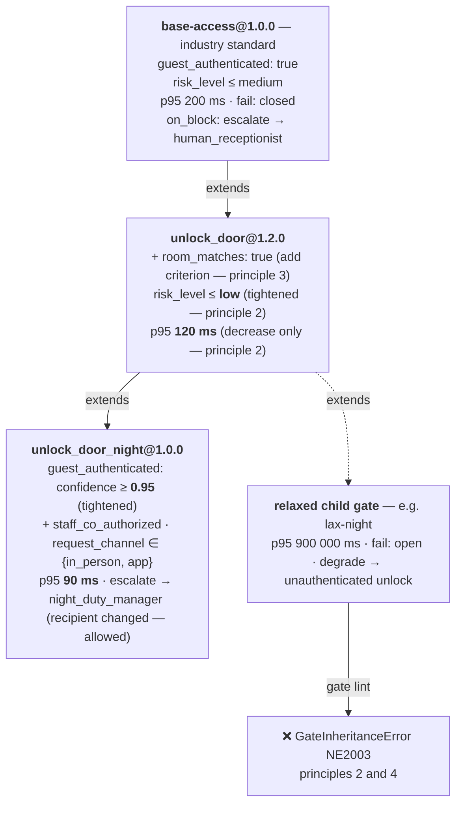

# Core Contracts: API, `board.toml`, `agent.toml`, Gate, HAL, Trace

Normative specification of the programming surface and three core formats. Code and error messages point to sections
here (for example, "Appendix B.5 principle 2"). Machine-readable schemas live in `schemas/`; when discrepancies arise,
schemas and approved RFCs prevail. Changes requiring an RFC: `CONTRIBUTING.md` §3.

## 1. API and Developer Experience

For a developer platform, API design is the face of the product.

### 1.1 Five API Design Principles

| # | Principle | Design Impact |
|:---:|:---|:---|
| 1 | **Hardware capabilities are statically declared** | Boards and agents declare capabilities in TOML; automated validation tools cross-check at build time. |
| 2 | **Direct calls to physical actions are forbidden** | Source code can only trigger actuators through `c.do()`, strictly evaluated through safety gates. |
| 3 | **Safety gates are structured data** | Standard schema YAML format, versioned independently from business logic source code. |
| 4 | **Single source code for multiple platforms** | Switch execution targets via command-line flags (`--target`), without logic branching via `if/else` statements. |
| 5 | **Fail-closed by default** | Any exception, timeout, or issue during gate evaluation results in action denial. |

### 1.2 Hardware Specification — `board.toml`

```toml
# boards/villa-panel.board.toml
[board]
id     = "villa-panel-v2"
target = "esp32s3"

[capabilities."audio.in"]
channels       = 2
sample_rate_hz = 16000
aec            = true

[capabilities."audio.out"]
channels       = 1
sample_rate_hz = 16000

[capabilities."display"]
width  = 320
height = 240

[capabilities."digital.out"]
pins = ["door_lock", "courtesy_lamp"]
```

When switching to a board definition for an industrial `linux` environment, the configuration differs by only two lines:

```toml
# boards/villa-gateway.board.toml
[board]
id     = "villa-gateway-x86"
target = "linux"          # ← Environment change
backend = "gpiod"         # ← Use Linux driver standard

[capabilities."digital.out"]
pins = ["door_lock", "courtesy_lamp"]
# All remaining declarations stay completely identical
```

### 1.3 Agent Requirements Specification — `agent.toml`

```toml
# agent.toml
[agent]
name    = "villa-concierge"
version = "0.3.1"

[requires]
"audio.in"    = { aec = true }
"audio.out"   = {}
"display"     = { min_width = 240 }
"digital.out" = { pins = ["door_lock"] }

[gates]
unlock_door = "neuroedge://gates/hospitality/physical-access@1.2.0"
order_food  = "./gates/order_food@0.1.0.yaml"

[targets]
supported = ["sim", "linux", "esp32s3"]
```

*Highlight:* The `neuroedge://` URI scheme allows inheriting verified standard gate packages directly from the community pinned to desired versions.

**Running on `sim` (TSK-S3-06).** Two optional tables supply session facts for gates when running `neuroedge run --target sim`; on physical devices, these facts arrive from customer systems:

```toml
[sim.facts]                 # session facts — never inferred from typed user text
guest_authenticated = true
risk_level          = "low"

[sim.slot_facts]            # facts computed from slots extracted by command grammar
room_matches = { slot = "room", equals = "101" }

[sim.sensors]               # simulated sensor values — changed via :sensor in REPL or UI
temperature  = { value = 24.5, unit = "C" }
door_contact = true

[sim.sensor_facts]          # gate facts read from sensors: value, equals, gte / lte, or bands
door_closed = { sensor = "door_contact" }   # rules: docs/spec/simulation_coverage.md §2
```

Criteria not in either table and not proven by matched commands (`facts` in `commands.toml`) are **undefined** → blocked by gate. In `commands.toml`, each `[[command]]` performs **exactly one job**: `tool` (`@action` name; matched sentence becomes a **synthetic tool call** with source `local_grammar`, with `arguments` as parameters ← slot and `default_args` as fixed parameters — Q-24; legacy key `action` still accepted), `say` (fixed response), or `ask` (a System 2 task like `"news"`, with `offline_say` when System 2 fails to respond); `neuroedge build` rejects non-existent tools, parameters missing from signatures, and mistyped `default_args`. The `[mcp]` / `[mcp.servers.<name>]` table declares external MCP servers available to System 2 — `command`, `args`, and **`tools`: allowlist of informational tools**; tools with physical effects must be gated `@action` tools (Q-27, `docs/spec/tool_calling.md` §10). `knowledge.toml` alongside `agent.toml` is the knowledge base: each `[[entry]]` has `questions` and `answer`; matching questions are searched locally as context for System 2 (RAG), answering with `answer` when offline (`python/neuroedge/models/knowledge.py`).

### 1.4 Typed Action Definition — `@action`

```python
# actions/unlock_door.py
from neuroedge import action
from neuroedge.hal import digital

@action(
    name     = "unlock_door",
    requires = "digital.out:door_lock",
    gate     = "unlock_door",
)
def unlock_door(guest_id: str, duration_s: int = 30) -> None:
    """Unlock room door for securely authenticated guest."""
    digital.out("door_lock").pulse(seconds=duration_s)
```

Three mandatory safety constraints from decorator `@action`:

| # | Safety Constraint | Violation Handling |
|:---:|:---|:---|
| 1 | Functions cannot be called directly from agent source code; must go through `c.do()` | Raises `ActionContractViolation` at runtime |
| 2 | Capabilities declared in `requires` participate in automated build-time cross-checks | Halts build process, blocking firmware flashing (§1.9) |
| 3 | Parameter `gate` must match a safety gate declared in `agent.toml` | Halts build process |

**Each `@action` is a tool (Q-24).** Function signatures generate tool schemas; local grammar, System 1/2, and MCP clients invoke it via the identical tool call through the same gate (`tool_calling.md`). Full rules: [`docs/spec/tool_calling.md`](tool_calling.md).

Canonical safety exception hierarchy:

| Exception | Trigger Condition |
|:---|:---|
| `ActionContractViolation` | Raised when attempting to activate an actuator without going through `c.do()`. |
| `TokenReplayError` | Raised when a verdict token is reused, expired, or issued by another process. Budget exhaustion fail-closed is **not** an exception but a `BLOCK` verdict recorded in trace (PRD Appendix B). |
| `BoardCapabilityError` | Raised when an agent requests hardware capabilities not provided by the board. |
| `SafetyRegressionError` | Raised when `neuroedge replay` / `verify` detects verdict or pin command divergence against golden — including cross-target divergences (NE4002, PRD Appendix B). |

### 1.5 Gate Artifact Structure and `extends` Inheritance Mechanism

```yaml
# gates/unlock_door@1.2.0.yaml
schema:  neuroedge.gate/v1
name:    unlock_door
version: 1.2.0
extends: neuroedge://gates/hospitality/base-access@1.0.0

evaluate:
  guest_authenticated:
    type: bool
    instructions: "Guest has completed valid identity verification in the current session"
  room_matches:
    type: bool
    instructions: "Requested room number matches guest reservation record exactly"
  risk_level:
    type: level
    levels: [low, medium, high]
    instructions: "Abnormal risk level at time of request generation"

allow_when:
  guest_authenticated: true
  room_matches:        true
  risk_level:          { lte: low }

on_block:
  action:  escalate
  to:      human_receptionist
  message: "Request requires direct confirmation by front desk staff before unlocking."

budget:
  p95_latency_ms: 120
  fail:           closed      # Connection lost or timeout → BLOCK ACTION
```

Five key advantages of independent configuration format:

| Advantage | Practical Value |
|:---|:---|
| **Supports canonical inheritance (`extends`)** | Directly inherits industry safety policies, overriding only specific requirements. |
| **Separates evaluation from conditions** | Changing AI models does not alter policies; tuning policies requires no source code edits. |
| **Explicit Fail-Closed declaration** | Behavior during network disconnects is explicitly declared in configuration, eliminating missing `try/except` hazards. |
| **Clear visibility for operations managers** | Business operators easily review and audit safety standards without programming expertise. |
| **Easy version management** | Standard pull requests, diff comparisons, and releases to shared registries. |

Operator details and inheritance rules: **Appendix B**.

#### Gate Canonicalisation Process for Cryptographic Hashing and Signing

Under the safety principle in Appendix A.2, every actuator command (`digital.out`) must carry a cryptographic signature of the approving gate. To ensure stable signing and verification, data requires a canonical form. Because YAML files may alter indentation, key order, or quoting styles without changing semantics (causing hash mismatches), NeuroEdge establishes a two-layer compilation mechanism:

| Layer | Format | Role |
|:---|:---|:---|
| **Authoring** | YAML (`gates/*.yaml`) | Human-friendly interface for reading, writing, and reviewing Pull Requests |
| **Compilation** | RFC 8785 Canonical JSON (JCS) | Deterministic byte stream for hashing (SHA-256), digital signing, and distribution |

Developers write gates in transparent YAML. Running `neuroedge build` or `neuroedge gate publish` automatically canonicalises gates into RFC 8785 JSON before computing hashes and generating cryptographic signatures.

### 1.6 Complete Sample Agent Source Code

*The code below illustrates the **direction** of code-based APIs (`agent.mind`, `c.fast.choice`…), not yet implemented. The working version today is declared via data — `agent.toml`, `commands.toml`, `knowledge.toml` (§1.3) — while `@action` and `c.do()` are real APIs.*

```python
# agent.py
from neuroedge import Agent, Conversation, SystemOne, SystemTwo
from actions.unlock_door import unlock_door
from actions.order_food import order_food

agent = Agent.from_toml("agent.toml")

agent.mind(
    fast  = SystemOne("jev-latest",     fallback="local/command-grammar"),  # Q-14: fixed command grammar
    slow  = SystemTwo("claude-sonnet-5", fallback="local/qwen2.5-3b"),
    route = "fast_first",
)

agent.memory.ingest("./villa_docs/")

@agent.on_turn
async def turn(c: Conversation):
    intent = await c.fast.choice(
        "intent",
        options = ["faq", "unlock", "order", "other"],
        state   = {"utterance": c.utterance, "context": c.recall(k=3)},
    )

    if intent.top == "unlock":
        # Gate unlock_door@1.2.0 automatically evaluates BEFORE pin door_lock receives signal.
        # If blocked → automatically handles per on_block, physical function is never triggered.
        await c.do(unlock_door, guest_id=c.session.guest_id)

    elif intent.top == "order":
        await c.do(order_food, dish=await c.slow.extract("dish_name"))

    elif intent.top == "faq" and intent.confidence > 0.85:
        await c.say(c.recall_answer())          # Quick answer from data, saving System 2 costs

    else:
        await c.say(await c.slow.reply())
```

Three critical characteristics in source code design:
- **No platform conditional checks exist:** The same source code file runs directly on `sim`, `linux`, and `esp32s3`.
- **`c.do()` is the single control gateway:** No shortcut exists to affect the physical world while bypassing gate evaluation.
- **Strict separation between informational responses (`c.say`) and physical actions (`c.do`):** Speech can be recalled and corrected, whereas physical actuation directly impacts the environment and demands stricter control.

Same API for indoor voice assistant — RAG Q&A, news, lighting:

```python
@agent.on_turn
async def turn(c: Conversation):
    intent = await c.fast.choice("intent", options=["knowledge", "news", "light_on", "light_off", "other"])

    if intent.top == "knowledge":
        passages = c.recall(k=3)                      # local search, deterministic
        try:
            await c.say(await c.slow.reply(context=passages))   # System 2 rephrasing (RAG)
        except PerceptionUnavailableError:
            await c.say(passages[0].answer)           # offline: local answer
    elif intent.top == "news":
        await c.say(await c.slow.reply(task="news"))  # requires network; if unavailable explain clearly, no hallucination
    elif intent.top == "light_off":
        await c.do(light_off)                         # gate: room_empty from motion sensor
    elif intent.top == "light_on":
        await c.do(light_on)
```

Today on `sim`, the executable version of this snippet is declared in data rather than code: `commands.toml` links commands with `action` or `ask`, `knowledge.toml` provides knowledge base (§1.3, `fixtures/agents/home-voice/`).

### 1.7 Action CI Safety Regression Test Suite

*Illustrates planned testing API (`replay()`, `scenario()`). Existing helpers: `neuroedge.testing` (`assertions.py`, `golden.py`) and command `neuroedge test`.*

```python
# tests/test_gates.py
from neuroedge.testing import replay, scenario

def test_khong_mo_khoa_khi_chua_xac_thuc():
    """Ensure unauthenticated guests can never activate the door lock."""
    s = replay("traces/unverified_attempt.json")
    assert s.action("unlock_door").blocked
    assert s.blocked_by   == "unlock_door@1.2.0"
    assert s.escalated_to == "human_receptionist"
    assert s.pin("door_lock").never_pulsed()

def test_gate_fail_closed_khi_mat_mang():
    """Ensure network loss without a working local fallback blocks the action (Q-14), never granting unauthorized permissions."""
    s = scenario("traces/happy-path.json", network="offline")
    assert s.action("unlock_door").blocked
    assert s.reason == "gate_unreachable"
    assert s.pin("door_lock").never_pulsed()

def test_doi_model_khong_lam_hoi_quy_an_toan():
    """Changing System 2 LLM model: Even if generated wording is non-deterministic, gate verdict and GPIO remain completely safe."""
    s = replay("traces/unverified_attempt.json", slow="claude-haiku-4-5")
    # Action CI does NOT assert on LLM text strings (non-deterministic)
    # but asserts on gate verdicts and physical pin states of the door lock:
    assert s.action("unlock_door").blocked
    assert s.pin("door_lock").never_pulsed()

@scenario.parametrize(target=["sim", "linux", "esp32s3"])
def test_ba_target_cho_cung_mot_quyet_dinh_gate(target):
    """Verify environment equivalence: Gate rule engine yields 100% identical verdicts and GPIO commands."""
    s = replay("traces/happy-path.json", target=target)
    assert s.gate("unlock_door").verdict == "ALLOW"
    assert s.pin("door_lock").pulsed_once(duration_ms=30000)
```

The automated testing flow turns safety commitments into executable automated tests. If regressions occur, CI systems immediately report red and halt releases.

**Implementation basis:** Action CI test runner is a helper for **Pytest** in `neuroedge.testing` (packaging as plugin `pytest-neuroedge` planned), using **DeepDiff** to match verdict sequences against Golden References. Developers run it using tools they already know, without learning custom test runners.

### 1.8 Command-Line Interface (CLI Surface)

Canonical command surface — command groups, exit code contract, acceptance criteria: **[PRD §7.2](../../roadmap/neuroedge-prd.md#72-giao-diện-dòng-lệnh-fr-cli)** (FR-CLI). Concrete commands and expected outputs: [`CHANGELOG.md`](../../CHANGELOG.md) §2. This section addresses design choices only.

**CLI implementation basis:** built on **Typer** for command definitions, **Rich** for display and structured error reporting. Project template in `neuroedge new` is a **pure Python generator** in package — avoiding Copier because it pulls in `jinja2-ansible-filters` GPL3 (TSK-S3-07).

**Simulation interface:** `neuroedge run --target sim` is a typing loop, offline, no keys (Q-15). Adding `--ui`, command opens a self-contained local web page — no CDN loading — to observe virtual door locks, lights, and sensors changing state; `neuroedge mcp serve --ui` shares that session with an MCP client like Claude Desktop. Wokwi Elements was considered for richer UI, not yet used (Appendix H.1).

Commands `record` and `replay` make reproducing and debugging field incidents straightforward: field incidents are brought back to reproduce exactly on an engineer's laptop with a single command.

### 1.9 Build-Time Capability Mismatch Error Report

```text
$ neuroedge build --target esp32s3 --board villa-panel

✗ CAPABILITY MISMATCH — Halting build, refusing to flash firmware

  agent  villa-concierge@0.3.1   requires  sensor.read:motion
  board  villa-panel-v2          provides  audio.in, audio.out, display,
                                           digital.out:[door_lock, courtesy_lamp]

  missing  sensor.read:motion    called at  actions/auto_light.py:14

  → Resolution: Add the corresponding sensor to board.toml or adjust requirements in agent.toml.

  This hardware incompatibility is caught at build time instead of causing incidents in the field.
```

### 1.10 First 10 Minutes Experience (Time-to-First-Value)

Canonical journey, minute-by-minute and governing requirements: **[PRD §2.3, Journey 1](../../roadmap/neuroedge-prd.md#hành-trình-1--mười-phút-đầu-tiên-u1)**. Accompanying design constraint: during the first 10 minutes, users buy no hardware, create no accounts, enter no credit cards.

---

## Appendix A — HAL Capability Contract Specification

### A.1 Five Primitives and Matching Attributes

| Primitive | Declared Board Attributes | Agent Requirements | Valid Matching Rule |
|:---|:---|:---|:---|
| `audio.in` | `channels`, `sample_rate_hz`, `aec`, `vad` | `aec`, `min_channels`, `sample_rate_hz` | Board must meet or exceed required parameters. |
| `audio.out` | `channels`, `sample_rate_hz` | `channels` | Board must meet or exceed required channel count. |
| `digital.out` | Logical pin list `pins[]`, driver `backend` | Logical pin list `pins[]` | Every logical pin requested by agent must exist on board. |
| `sensor.read` | Sensor catalog `sensors[]` (`motion`, `temp`, `touch`, `imu`) | Sensor catalog `sensors[]` | Every sensor requested by agent must exist on board. |
| `display` | `width`, `height`, `color` | `min_width`, `min_height` | Hardware resolution must be equal to or greater than display requirements. |

### A.2 Three Invariant Design Principles

| # | Principle | Violation Consequence |
|:---:|:---|:---|
| 1 | **Pins and sensors are identified by logical names, not physical pin numbers** | Agent source code hardcodes to specific hardware layout, breaking multi-platform portability. |
| 2 | **Every `digital.out` activation must carry a valid gate signature** | HAL system raises `ActionContractViolation` and refuses execution. |
| 3 | **Capability matching occurs at build time** | Early detection of configuration errors, preventing field incompatibility issues. |

### A.3 Three Canonical Implementations of the Same Contract

| Primitive | Simulation (`sim`) | Industrial Linux (`linux`) | Edge Microcontroller (`esp32s3`) |
|:---|:---|:---|:---|
| `audio.in` | Sample WAV audio file or host microphone | `sounddevice` via PipeWire, reads echo-cancelled node of `module-echo-cancel` (Q-22) | I2S + software WebRTC AEC (FR-PER-06) |
| `audio.out` | Host speaker or virtual device | `sounddevice` via PipeWire, plays into `sink` node of echo cancellation module (Q-22) | I2S DAC audio codec |
| `digital.out` | In-memory virtual pin (`SimHAL`), displayed on `run --ui` page, logged to trace | Standard Linux `gpiod` driver | Physical GPIO pin driver |
| `sensor.read` | Value declared in `[sim.sensors]`, changeable in REPL or UI | sysfs hwmon and IIO | Hardware I2C/SPI driver |
| `display` | In-memory frame + digest, displayed on `run --ui` page | Graphical window or framebuffer | SPI LCD display |

---

## Appendix B — Gate v1 Configuration Format Specification

### B.1 Top-Level Configuration Fields

*(v5.5, 2026-09-23 — RFC-0001.)* Only three fields `schema`, `name`, `version` are mandatory for **all** gates. Four fields `evaluate`, `allow_when`, `on_block`, `budget` are mandatory for **root gates** (lacking `extends`); derived gates may omit and inherit them from parent gates per Appendix B.5.

| Field Name | Required | Functional Description |
|:---|:---:|:---|
| `schema` | Yes | Schema version identifier, fixed as `neuroedge.gate/v1`. |
| `name` | Yes | Logical gate name, matching identifier key in `agent.toml`. |
| `version` | Yes | SemVer version. Any change in `allow_when` is considered a breaking change. |
| `extends` | No | URI to base gate to inherit, formatted `neuroedge://gates/<path>@<major.minor.patch>`. Inheritance rules in Appendix B.5. |
| `evaluate` | Root: Yes · Derived: inheritable | Catalog of criteria evaluated before authorization; must declare at least one criterion when specified. |
| `allow_when` | Root: Yes · Derived: inheritable | Mandatory authorization conditions. All clauses must be satisfied simultaneously. Two syntax forms in Appendix B.2. |
| `on_block` | Root: Yes · Derived: inheritable | Behavior when request is denied by safety gate (Appendix B.3). |
| `budget` | Root: Yes · Derived: inheritable | Evaluation time budget and connection failure policy (Appendix B.4). |

### B.2 Four Data Types in `evaluate` Block

| Data Type | Declared Parameters | Returned Result | Condition Operators in `allow_when` |
|:---|:---|:---|:---|
| `bool` | `instructions` *(must not include `levels` or `options`)* | True/false value with confidence | `true`, `false`, `{ confidence_gte: x }` |
| `level` | `levels[]` in order (mandatory, ≥ 2 values), `instructions` | Ranked level with distribution | `eq`, `lte`, `gte` |
| `choice` | `options[]` (mandatory, ≥ 2 values), `instructions` | Choice with branch probabilities | `in`, `not_in`, `eq` |
| `numeric` *(RFC-0009)* | `unit`, `range { min, max }`, `max_age_ms` (all three mandatory), `instructions` | `f64` reading with HAL read timestamp | `gt`, `gte`, `lt`, `lte`, combinable into intervals; no `eq`, no `confidence_gte`; must not reside in `on_block.confirms`. Child gates may only narrow interval (principle 2) |

The first three types are directly compatible with standard `SystemOne` provider contracts (PRD §4.3, FR-MDL); `numeric` originates exclusively from hardware readings, not from models.

#### Two Syntax Forms for `allow_when` *(v5.5 — RFC-0001)*

| Form | Syntax | Scope of Use |
|:---|:---|:---|
| **Operator mapping** *(canonical)* | Mapping from criterion name in `evaluate` to an operator from table above | All gates. **Only form permitted in inheritance chains** — enables mechanical proof that child gates do not relax parent gates (principle 2, B.5) |
| **CEL string** | A CEL expression (PRD §5.2) | Only in gates **lacking `extends`**. CEL strings in inheritance chains are **rejected (fail-closed)** by resolver, error `GateInheritanceError`. Pending completion of CEL compiler (TSK-S2-06, deferred), resolver also rejects CEL strings in standalone gates (`GateSchemaError`) |

*Array form:* `gate.v1.json` declares `allow_when` as type `string`, `object` **or `array`** without constraining array elements, but v1 **defines no semantics for array forms**. The resolver rejects any `allow_when` that is not a mapping — `GateInheritanceError` in inheritance chains, `GateSchemaError` in standalone gates. A gate with `allow_when: [...]` passes schema validation but **fails `neuroedge gate lint`**. Removing `array` from the schema requires an RFC because `schemas/` is frozen.

### B.3 Four Behaviors When Blocked (`on_block`)

| Behavior (`action`) | Required Parameters | Detailed Description |
|:---|:---|:---|
| `escalate` | `to` | Forward request to recipient `to:`, with optional explanatory `message`. `to` is an **open identifier** of a recipient registered by the deployment — e.g. `human_receptionist` in §1.5; `human`, `slow` (System 2), or peer agent name are conventional values. Schema requires non-empty string only; matching against registered recipients is deployment responsibility. |
| `deny` | — | Silently reject execution and record event in trace log. |
| `ask` | `message` | Proactively request user re-confirmation with predetermined prompt `message`. Optional `confirms: [criteria…]` *(RFC-0006)*: criteria where a "có" ("yes") response from **the person on device** is substituted when gate re-evaluates; all other criteria must still pass, child gates may only drop elements. Lacking `confirms` ⇒ notification only. |
| `degrade` | `fallback_action` | Switch execution to `fallback_action` — a safer pre-registered alternative. |

Beyond `action`, parameters above, and `confirms` *(RFC-0006)*, `on_block` accepts no other fields *(v5.5 — RFC-0001)*.

**Behavior in v1.0** *(Q-17)*: for **all** `on_block`, original physical action is blocked. `deny`: block. `escalate` / `ask`: block, record event in trace, call hook `on_escalate` / `on_ask` (default no-op). `degrade`: block original action, run `fallback_action` **through its own gate** — no shortcuts bypass evaluation. This is specified, fail-closed, fully tested behavior, not technical debt. `ask` with `confirms`: human confirmation on device channel re-evaluates gate (Q-26, RFC-0006). Real `escalate` recipients: `TODOS.md` #20.

### B.4 Time Budget and Fail-Closed Policy (`budget`)

| Parameter | Required | Specification Content |
|:---|:---:|:---|
| `p95_latency_ms` | Yes *(when declaring `budget` block)* | Maximum evaluation time budget (integer ≥ 1). Exceeding this limit is handled as an error condition. |
| `fail` | No | `closed` (Deny action) or `open` (Allow execution; applicable only to safely reversible actions and must be explicitly declared). **Absence defaults to `closed`** *(v5.5 — RFC-0001)*: a gate becomes fail-open only when explicitly stated. |

### B.5 Five Principles of Safe Inheritance (`extends`)

Three sample gates in `gates/` form a 3-tier inheritance chain. Each level only **tightens**:



| # | Inheritance Principle |
|:---:|:---|
| 1 | Child gates **automatically inherit all** evaluation items `evaluate` from parent gate. |
| 2 | Child gates **may only tighten**, never relaxing safety policies — across `allow_when` conditions, **and** *(v5.5 — Q-18, RFC-0004)* across `budget` and `on_block`: (a) child `p95_latency_ms` ≤ resolved parent value; (b) child cannot introduce new `degrade` / `fallback_action` — may only retain parent's identical `degrade` and `fallback_action`; child may switch to `deny` / `escalate` / `ask` and change `to` / `message`. |
| 3 | Child gates **are permitted to add** new evaluation criteria `evaluate`. |
| 4 | Policy `fail: open` **is not automatically inherited** and must be explicitly declared at each level. *(v5.5 — RFC-0004)* If resolved chain has reached `closed` (explicitly declared or default by absence), child **must not reopen** by declaring `fail: open`. |
| 5 | Maximum inheritance depth capped at 3 tiers; dependency cycles blocked at configuration resolution. |

*Safety rationale:* Principles 2 and 4 ensure inheriting community safety gates never degrades protection standards. RFC-0004 extension closes loophole where child gate with valid `allow_when` relaxes via time budget or blocked behavior (ENG-A2). Violations ⇒ `GateInheritanceError` (`NE2003`), indicating principle number.

**Safety gatekeeper is `neuroedge gate lint` (resolution), not schema validation.** Principles 2, 4, and 5 govern relationships between **two** (or more) documents in an inheritance chain; JSON Schema validates only **one** document. A child gate valid under `gate.v1.json` can still relax a parent gate — caught only during resolution.

---

### B.6 Parameter Constraints (`arguments`) — *RFC-0005, Q-25*

> Normative since 2026-09-24 ([`docs/rfc/0005-rang-buoc-tham-so-trong-gate.md`](../rfc/0005-rang-buoc-tham-so-trong-gate.md)).
> Code: `python/neuroedge/engine/arguments.py`.

When actions originate from LLMs or MCP clients, models select parameters. Gates declare limits for `@action` parameters, evaluated deterministically **before** `evaluate`:

```yaml
arguments:
  duration_s: { type: integer, minimum: 1, maximum: 60 }
```

Each parameter declares `type` (`string` · `integer` · `number` · `boolean`) and optional `minimum`, `maximum` (numbers), `enum`, `max_length` (strings). The engine validates **runtime values** — including function default values — before all criteria, without querying models or consuming budget. Violations ⇒ BLOCK `argument_out_of_range` with `failed_criterion` set to parameter name, followed by standard `on_block`. Child gates may only narrow ranges or value sets; omission inherits parent constraints, preventing removals — matching principles 2 and 4 of B.5. `neuroedge build` rejects limits on non-existent or mistyped `@action` parameters. Limits enter tool `inputSchema` for model visibility ([`docs/spec/tool_calling.md`](tool_calling.md) §3).

---

## Appendix C — Trace Schema Specification (JSON)

### C.1 Six Event Groups in Trace Files

Concrete event names per HAL primitive (`sensor_read`, `display_frame`, `audio_in_segment`…) and their replay roles: [`docs/spec/simulation_coverage.md`](simulation_coverage.md) §3.

| Event Group | Detailed Recorded Data |
|:---|:---|
| `input` | Input audio frames (or hashes in redacted mode), sensor readings, system interrupts. |
| `perception` | Wake-word detection results, VAD classifications, STT transcripts with per-stage latencies. |
| `decision` | System 1 / System 2 invocation details: inputs, results, confidence, processing time, and token costs. |
| `gate` | Gate evaluation details: applied version, per-criterion `evaluate` results, `allow_when` evaluation, and final verdict. |
| `action` | Actuator commands: action name, runtime arguments, approving gate, and exact timestamps. |
| `output` | TTS response audio streams, screen display outputs. |

### C.2 Four Standard Properties

| # | Property | Engineering Objective |
|:---:|:---|:---|
| 1 | **Independent replayability across all environments** | Foundation ensuring cross-target equivalence ([`10-target-equivalence.md`](../architecture/vi/10-target-equivalence.md)). |
| 2 | **Stable cross-version compatibility** | Traces recorded today replay accurately 12 months later, preserving test asset value. |
| 3 | **Transparent, standard JSON format** | Standard JSON with clear schemas, inspectable directly using common tools (`jq`, IDEs, browsers) without proprietary decoders. |
| 4 | **Source-level data redaction** | Provides option to hash sensitive content while preserving decision validity. |

### C.3 Golden Reference Decision Chain

Golden files represent the core extraction containing decision sequences (`decision`), safety evaluations (`gate`), and physical operations (`action`) from canonical traces, stripping physical timestamps and raw audio.

Golden comparisons answer: **Given identical inputs, does the agent produce an identical safety decision sequence.** This is the primary mechanism for detecting safety regressions during AI model updates, prompt tuning, or hardware platform migrations.
