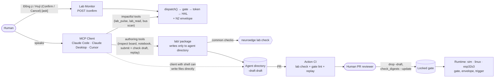

# NeuroEdge — NeuroEdge Lab Design Notes (lab via MCP)

## Hardware bring-up under contract, using the AI users already have

> **Historical design note.** NeuroEdge Lab was removed from the roadmap by Q-77; Q-88 lists which parts still live in I2d. Normative only where a live spec cites a section: §7 and §7.1 (physical safety envelope and its regression contract — roadmap I2a §4.3.1, `python/tests/test_safety_regressions.py`, `python/tests/test_mcp_serve_ui.py`) and §12 (N6 trigger rules — `docs/spec/missions.md` MS-RT-03). §2.4 (device privileges separated from the client) is the design behind TSK-N0-08, which stays in I2d. Everything else describes the removed Lab and is kept for reference; the contract tools that replace loop ① are TSK-I2d-23, specified in `docs/spec/missions.md` MS-AP-03 and MS-LB-01.
>
> This document carries no schedules, statuses, exit criteria, or scope ladders: tasks reside solely in [`neuroedge-roadmap.md`](../../roadmap/neuroedge-roadmap.md) — the N-tasks that stay in I2d (§4.3.4), the N2 envelope in I2a (§4.3.1), every removed Lab task in §6. Decisions reside solely in `neuroedge-prd.md` §15: **Q-71** (NeuroEdge Lab via MCP, replacing NeuroBrain and Q-31), **Q-72** (Lab as loop ① of NeuroEdge Blueprint; operator agent), **Q-77** (Lab removed), **Q-88** (what stays in I2d).

**Updated:** 2026-10-16 (Q-77, Q-88: historical status banner; Q-72: §1.3.4, §1.5; Q-71: previously `neuroedge-design-neurobrain.md`) · change history: `CHANGELOG.md`

**Source documents:**
- `neuroedge-prd.md` §1.5 (P-1), §15 (Q-24, Q-26, Q-27, Q-11, Q-21, Q-55, Q-71)
- `docs/spec/core_contracts.md` Appendix B (B.4 budget, B.5 inheritance, B.6 `arguments`)
- `docs/spec/threat_model.md` (§2b, §2c), `docs/spec/simulation_coverage.md`, `docs/spec/tool_calling.md` §8
- `docs/rfc/0005-rang-buoc-tham-so-trong-gate.md`, `docs/rfc/0006-xac-nhan-ask-confirms.md`, `docs/rfc/0007-digital-in-i2c-analog-in-phong-bi.md`

**Scope:** Blocks N0 · N1 · N2 · N3 · N4 · N5 · N5b · N6 · N7

**Out of scope:**
- Raw pin MCP tools bypassing gates.
- MCP tools locking policy, editing `digests.lock`, enabling `[lab]`, or answering `ask` — never permitted (§1.3.3).
- Dedicated NeuroEdge LLM loops for authoring contracts (Q-71). Runtime LLMs belong to the *operator agent* (Q-72): explaining and proposing modifications, never authoring or locking contracts.
- Pin blacklists.
- ESP-Claw style Lua runtime.
- IM channels (Telegram, Zalo) — not part of Lab; moved to product scope under operator agent (Q-72).
- Generating gate constraints from datasheets.
- Cloud-only clients (ChatGPT): requires network port without mTLS — `TODOS.md` #61.

---

## Table of contents

1. [Positioning, architecture, and principles](#1-positioning-architecture-and-principles)
2. [Boundary with safety tier](#2-boundary-with-safety-tier)
3. [Resource assumptions](#3-resource-assumptions)
4. [Critical path and dependencies](#4-critical-path-and-dependencies)
5. [Block N0 — Governance](#5-block-n0--governance)
6. [Block N1 — Gated lab actions](#6-block-n1--gated-lab-actions)
7. [Block N2 — Physical safety envelopes](#7-block-n2--physical-safety-envelopes)
8. [Block N3 — Read-only I2C bus](#8-block-n3--read-only-i2c-bus)
9. [Block N4 — Workbench notebook](#9-block-n4--workbench-notebook)
10. [Block N5 — Draft contracts via MCP](#10-block-n5--draft-contracts-via-mcp)
11. [Block N5b — Lab Monitor](#11-block-n5b--lab-monitor)
12. [Block N6 — Event-based triggers](#12-block-n6--event-based-triggers)
13. [Block N7 — NeuroEdge Lab on ESP32-S3](#13-block-n7--neuroedge-lab-on-esp32-s3)
14. [Demand gate and milestones](#14-demand-gate-and-milestones)
15. [Risks and mitigations](#15-risks-and-mitigations)
16. [Scope cuts](#16-scope-cuts)

**Appendices**
- [A — Selective reuse from ESP-Claw](#appendix-a--selective-reuse-from-esp-claw)

---

## Document conventions

All codes and symbols (`TSK-N*`, `N0`–`N7`, `§x.y`…) are defined in
**[`docs/user/thuat-ngu.md`](../user/thuat-ngu.md)**. Task codes `TSK-N*` are preserved from the
NeuroBrain era; codes are never renumbered.

---

## 1. Positioning, architecture, and principles

### 1.1 Positioning (Q-71, merged into Q-30)

> **NeuroEdge Lab — Physical AI, under contract, with the AI you already use.**
> *Bring up hardware with the AI you already use — under contract: AI scans buses, authors drafts; NeuroEdge
> grades it in CI and enforces it on the board; humans review before locking.*

Q-71 replaces NeuroBrain (Q-31). NeuroBrain constructed an internal conversational loop with LLMs inside
NeuroEdge. NeuroEdge Lab removes that loop: the "brain" is the MCP client users already have — Claude Code,
Claude Desktop, Cursor — and NeuroEdge focuses solely on the parts no client can do on its own.

**Distinction from ESP-Claw.** ESP-Claw follows the sequence: speak → LLM writes Lua → Lua executes immediately
on chip. For the "LLM toggles GPIO via MCP" part, Espressif already released that freely
([esp-gpio-tool](https://github.com/espressif/esp-gpio-tool), `cap_mcp_server` from ESP-Claw).
NeuroEdge Lab does not compete there. Its sequence:

1. Human speaks to their MCP client.
2. Client inspects board, scans buses, probes pins — all impactful commands are gated `@action`.
3. Client submits a **draft contract**: `@action` + gate `0.1.0-draft` + bidirectional replay tests.
4. NeuroEdge grades drafts (`neuroedge lab check`) — identical checks rerun in Action CI.
5. Humans review PR; only then is the gate locked.
6. The identical gate runs unchanged on `sim`, `linux`, and silicon.

The difference lies in two places, unchanged since the NeuroBrain era:
- every physical manipulation has gates, traces, and fail-closed posture;
- all generated behavior becomes versioned gates backed by regression tests.

### 1.2 Architecture: client authors, NeuroEdge grades and enforces, human locks

**Three roles of NeuroEdge (Q-71):**

| Role | Where | Nowhere else |
|:---|:---|:---|
| **Grading** — drafts match schema, clean `gate lint`, bidirectional tests, pins traceable to traces, `motion.*` has envelope and safe state, no overwrite | `neuroedge lab check` — same code in MCP tool (N5) and CI Action (TSK-N5-06) | Do not trust client self-checks. CI is the checkpoint |
| **Enforcement** — gates, envelopes, trigger rate ceilings | Runtime, HAL (N2), firmware (N7) | Not in client. If client errs, commands are still blocked |
| **Lock gatekeeper** — dropping `-draft` suffix, locking digest | PR with human approval, protected branch (TSK-N0-05) | No tool can perform this |

**Why avoid a dedicated LLM loop.** A dedicated LLM loop (NeuroBrain) must handle model errors,
provider selection, and conversation maintenance — effort that does not make gates safer. The parts providing safety
(grading, enforcement, locking) remain unchanged regardless of who writes drafts. Any MCP-compliant client works,
and users benefit from the strongest models available to them.

### 1.3 Tool surface

The list below represents the removed Lab design. A separate Lab tool specification was planned and never written; the
live MCP tool contract is `docs/spec/missions.md` MS-AP-03 (TSK-I2d-23, specified ahead of code by TSK-N0-07, Q-88). All tools are registered only when
`[lab] enabled` (TSK-N1-02). Tools must remain usable by clients **lacking a shell**: everything shell-capable clients
accomplish via files, shell-less clients accomplish via tools.

#### 1.3.1 Impactful tools — gated `@action`

| Tool | Function | Block |
|:---|:---|:---:|
| `lab_pulse(pin, duration_ms)` | Pulse `digital.out`; gate `gates/lab/lab_pulse@1.0.0`, `duration_ms ≤ 2000` | N1 |
| `lab_read(pin)` | Read `digital.in` | N1 |
| `lab_scan(bus)` | Read-only I2C scan (read-byte), read chip ID | N3 |

These are standard `mcp` calls: `dispatch()` → gate → token → HAL, with envelope validated before
`authorize`. Responses include `gate explain` to help clients self-correct failed commands (TSK-N1-04).

#### 1.3.2 Authoring tools — no physical side-effects

| Tool | Function | Block |
|:---|:---|:---:|
| `lab_board` | Allow-listed pins, per-pin envelope limits, rationale for prohibited pins (same content as `board show --lab`) | N1 |
| `lab_notebook` | Read workbench notebook: discovered facts, each entry accompanied by source trace | N4 |
| `lab_board_draft` | Accept draft board profile proposed by client, validate via `BoardProfile`, warn about special pins, write **new** profile | N4 |
| `lab_draft_check` | Grade a draft (structured proposal or existing file in agent directory) — writes nothing | N5 |
| `lab_draft_write` | Validate then render proposal via `templates.scaffold` into `@action` + gate `0.1.0-draft` + replay tests; **return file content** to client; write directly to agent directory only when client and `mcp serve` share workspace (`sim` on laptop); no overwrite | N5 |
| `lab_replay` | Run draft replay test on `sim` (and `linux` on gpio-sim) using traces captured via locked lab actions; do not load drafts onto real boards prior to locking (§2.4) | N5 |
| `lab_trigger_check` | Grade draft trigger declaration: point only to locked actions, never point to lab actions, enforce debounce and rate ceiling | N6 |
| `lab_report` | Markdown bring-up report (same as `trace export --report`) | N5 |

`lab_draft_check` and `neuroedge lab check` are the **same** function, and accept draft **content**, not
device filesystem paths. Shell-capable clients write files in their repositories and send content to
`lab_draft_check`; shell-less clients call `lab_draft_write`. Both paths meet at the same verification
logic, and project CI reruns those checks on PR. When device privileges are separated (§2.4), drafts
reside in client repositories and reach devices only after being locked — processes holding devices do not
write to client repositories, and clients do not write to trees loaded by `mcp serve`.

The proposal shape represents tool `inputSchema`, defined in code. Introducing it into `schemas/` for third-party
implementations requires an RFC (CONTRIBUTING §3).

#### 1.3.3 Never permitted

| No tool to… | Why |
|:---|:---|
| Lock drafts (drop `-draft`), update `digests.lock` | Principle 5. Locking is human responsibility, via PR (TSK-N0-05) |
| Modify or delete locked gates | CONTRIBUTING §3: RFC required |
| Enable or disable `[lab]`, edit `agent.toml` outside draft trigger table | Flag is an operator decision (TSK-N1-02) |
| Answer `ask` | Q-26: `mcp` ∉ `HUMAN_SOURCES`. Humans confirm on Lab Monitor |
| Write pins without gates, write I2C | Principle 1; RFC-0007 has no I2C write function |

#### 1.3.4 Planned per Q-72 (planned · Q-72, I2d)

Loop ① of Q-72 expands authoring surfaces from single board bring-up to full device construction. The three capabilities below were planned for Lab; after Q-77 and Q-88, contract checking moves to TSK-I2d-23 (`docs/spec/missions.md` MS-AP-03, MS-LB-01) and the per-sensor check to TSK-I2d-17 (MS-LB-02):

| Capability | Function | Tier |
|:---|:---|:---|
| Suggest kits and BOM | From user intent, propose verified kits, wiring diagrams, and procurement lists (BOM with purchase sources) | Authoring tool — no physical effects |
| Validate draft mission contracts | Grade draft mission contracts like `lab_draft_check` grades draft gates: conflicting clauses rejected, highlighting conflicts before human review; requires `mission.v1` schema (planned RFC) | Authoring tool — identical check in CI |
| Per-sensor `lab doctor` | Beyond privilege separation checks (TSK-N0-08), check individual sensors after assembly: "cảm biến oxy đọc 0 — kiểm lại dây vàng" ("oxygen sensor reads 0 — check yellow wire") | CLI command, read via `dispatch()` |

Three constants remain: these capabilities are authoring tools or route through gates; no tool locks mission contracts or
answers `ask` (§1.3.3).

### 1.4 Seven principles

| # | Principle | Consequence |
|:---:|:---|:---|
| 1 | **No raw pin tools** | The sole path to pins is `dispatch()` → `c.do()` → gate → token → HAL (P-1, Q-24) |
| 2 | **B-1: `lab/` never calls HAL** | Package `python/neuroedge/lab/` routes strictly through `dispatch()`. Guarded by an AST and import scanner test (TSK-N1-07) |
| 3 | **Allow-list, not blacklist** | Pins undeclared in board profiles are rejected (`BoardProfile.require_pin`) |
| 4 | **Pure gates** | Cumulative state (envelopes) resides in HAL/runtime; gates never read clocks. `gate.v1` unchanged |
| 5 | **AI never self-locks policy** | Everything submitted by clients is a draft (`0.1.0-draft`); no tool can lock; locking occurs only via `gate lint`, PR, and human review |
| 6 | **`sim` never outpowers reference boards** | Do not write custom emulators (Q-16, Q-21). Bus data on `sim` only replays from traces |
| 7 | **Governance precedes code** | `Q-N` decisions, threat models, and RFCs precede code for corresponding blocks |

### 1.5 Lab and operator agent (Q-72)

Q-72 places Lab across the three loops of NeuroEdge Blueprint (authoring, operation, sharing/monetization) and introduces a complementary role alongside it.

| | **NeuroEdge Lab** | **Operator agent** |
|:---|:---|:---|
| Loop | ① Bring-up | ② Operation |
| Where it lives | Inside user's MCP client session; terminated when session closes | On home box, 24/7: trusted runtime + untrusted LLM worker |
| Whose LLM | Client chosen by user (Q-71) | User's key (BYOK, via LiteLLM, with local models), capped by `llm_budget` |
| What LLM does | Author drafts: actions, gates, mission contracts | Explain trends and **propose** contract amendments, only when deterministic detectors fire events |
| Never | Lock drafts, answer `ask` (§1.3.3) | Lock or approve; send approvals on behalf of humans |

**Reused from this document:**

- **N6 triggers are the seed** for operator agent schedulers and detectors: "when X then Y" rules are configuration,
  pointing solely to locked `@action`s, with debounce and rate ceilings residing in runtime since runtime runs without active sessions (§12).
- **Privilege separation in §2.4 reuses for key-holding home boxes.** LLM workers are untrusted MCP clients similar to shell-capable
  clients: runtime maintains device privileges and assigns call sources; workers hold BYOK keys but cannot write to policy trees
  loaded by runtime, and worker networks are restricted to declared provider endpoints.
- **Human confirmation (§2.2) expands under Q-72:** beyond Lab Monitor, humans can approve via paired chat channels —
  for both `ask` and contract modifications — via approval records with single-use codes, expirations, and runtime-generated approval summaries ≤ 5 lines. Sources
  `mcp` (both Lab clients and LLM workers) remain ∉ `HUMAN_SOURCES`. Pairing lifecycle: `TODOS.md` #62.

All parts of the table above lacking code are planned (I2d); parts touching `schemas/` (`mission.v1`, source `chat:<id>`) require RFCs
(CONTRIBUTING §3). Rationale: `docs/architecture/vi/15-target-architecture.md` §6 and
[`docs/business/proposal-blueprint-2026-10-11.md`](../business/proposal-blueprint-2026-10-11.md).

---

## 2. Boundary with safety tier

### 2.1 Three things NeuroEdge Lab must not touch

| Item | Why |
|:---|:---|
| `schemas/gate.v1.json` | Envelopes declared in `board.v1`, not in gates. Gates preserve purity (invariant #4) |
| Gate resolution semantics (`gate_resolver.py`, `constraints.py`) | Lab gates are standard gates; no new inheritance rules |
| Locked gates in `digests.lock` | Draft gates do not enter `digests.lock` until approved. Modifying locked gates still requires an RFC (CONTRIBUTING §3) |

`extends` rejects pre-release versions, preventing gates from extending drafts. This is
intended behavior.

### 2.2 Human confirmation

- Q-26: `mcp` and `system_two` cannot confirm `ask`. Neither can source `trigger`.
- Humans present beside boards confirm via `POST /confirm` on Lab Monitor (same-origin).
- Lacking device channels, lab gates use `deny`, not `ask`.

### 2.3 Software limitations upon shutdown

Libgpiod releases lines on process exit, and *"it should not be assumed that a line will retain its state"* ([gpioset](https://libgpiod.readthedocs.io/en/latest/gpioset.html)).

| Shutdown mode | Restores pins to safe state? |
|:---|:---|
| Normal exit, SIGINT, SIGTERM | **Yes**, via `hal.close()` (TSK-N2-03) |
| Crash, SIGKILL | **Cannot be guaranteed by software.** Lab README must explicitly state requirement for pull-down resistors or hardware watchdogs |

### 2.4 Clients with shell (Q-71)

Claude Desktop only calls tools. Claude Code — and any client capable of running commands — can additionally write
files and execute `gpioset`, `i2cset`, and `git`. NeuroEdge cannot prevent those processes; safety
resides in two boundaries clients cannot bypass via software:

| Boundary | Enforcement | If absent |
|:---|:---|:---|
| **Device privileges separated from client** | Only `mcp serve` process holds `gpio`/`i2c` privileges. Primary path for shell-capable clients: **stdio over SSH** to board host, with forced command key `restrict,command="neuroedge mcp serve …"` in `authorized_keys` (`restrict` disables port, agent, and pty forwarding — `command=` alone is insufficient). Two other paths: `mcp serve` under dedicated user on same host, client user not in `gpio`/`i2c` groups; or `mcp serve --http` — only when client presents mTLS client certificates and cert-bound tokens (`threat_model.md` §2b), unverified with Claude Code (TSK-N0-08). Unneeded on `sim` lacking physical devices | Client runs `gpioset` directly — gates become decorative. `neuroedge lab doctor` warns when running user can access devices (TSK-N0-08); cannot detect `sudo` or alternate users available to client |
| **Policies loaded from approved tree** | `mcp serve` on real board loads gates, board profiles (including envelopes), and `agent.toml` from approved checkout **unwritable** by client user. `-draft` drafts and draft board profiles not loaded on real boards prior to locking; on real boards, lab actions run under locked gates and envelopes | Client edits policy enforced by `mcp serve` — rendering device privilege separation meaningless. Envelopes "blocked by HAL" are only trustworthy when profiles are not client-written |
| **Locking exclusively via humans** | Main branch protected, PR requires human approval; `CODEOWNERS` and required workflows running from base branch for `.github/`, `scripts/check_digests.py`, `digests.lock`, `gates/`, and `lab check` code — since clients with shell can edit those exact files in PR to make CI green (TSK-N0-05) | Client self-drops `-draft`, modifies checks, and merges. A loose gate matching schema with bidirectional tests can only be caught by human reviewers |

**Residual risk, explicitly stated:** clients with shell can edit drafts *in local agent directories*
and run them on `sim` or on boards where they possess privileges. `[lab]` and `build --release` (TSK-N1-03)
keep drafts out of release builds, not off user machines. Details:
`docs/spec/threat_model.md` §2c.

---

## 3. Resource assumptions

→ Personnel (V7): [`neuroedge-roadmap.md`](../../roadmap/neuroedge-roadmap.md) §1.1. I4a was removed by Q-77 (roadmap §6).

---

## 4. Critical path and dependencies

→ I4a and I5a were removed by Q-77; their tasks keep one row each in [`neuroedge-roadmap.md`](../../roadmap/neuroedge-roadmap.md) §6.

---

## 5. Block N0 — Governance

Documentation only, no code (principle 7, §1.4): `Q-N` decisions (Q-71), threat model §2c, tool surface
specifications (§1.3), draft review processes, and device privilege separation guides (§2.4).

→ Tasks: [`neuroedge-roadmap.md`](../../roadmap/neuroedge-roadmap.md) §6 (removed, Q-77); TSK-N0-07 and N0-08 stay in I2d, reworded without Lab (§4.3.4, Q-88).

---

## 6. Block N1 — Gated lab actions

`lab_pulse` runs on `sim`. `lab_read` utilizes `digital.in` primitives from RFC-0007. Lab via MCP
on physical `linux` boards requires interactive `linux` sessions (TSK-S5-10).

**`call_source` for lab actions:**
- **Accepted:** `mcp` (and `mcp:<client>`), `test`, and human sources `local_grammar` and `ui`.
- **Rejected:** `trigger` and `system_two`. Lab tools are workbench instruments, not autonomous behavior.

**Client configuration.** `mcp desktop-config --lab` for Claude Desktop; for shell-capable clients
(Claude Code), an equivalent `.mcp.json` entry. Exactly one server entry per client is preserved (TSK-N1-05).

→ Tasks: [`neuroedge-roadmap.md`](../../roadmap/neuroedge-roadmap.md) §6 (removed, Q-77); TSK-N1-02, N1-04, N1-05 moved there from I2d by Q-88.

---

## 7. Block N2 — Physical safety envelopes

Envelopes include per-pin total duration and frequency bounds declared in `board.v1` (RFC-0007).
Enforcement does not reside in clients: clients propose limits in draft profiles, but on physical boards HAL blocks
per **locked** profiles loaded from trees unwritable by clients (§2.4) — not per draft profiles.

→ Envelope hooks and check order (TSK-N2-01), atomic check-and-reserve policies (TSK-N2-02), safe shutdown hooks (TSK-N2-03), and exit criteria: [`neuroedge-roadmap.md`](../../roadmap/neuroedge-roadmap.md) I2a (§4.3.1), Block N2.

### 7.1 Regression contract

1. No envelope configuration ⇒ `digital_out` identical to before: same error order, invalid pins consume no tokens.
2. Corpus `fixtures/tool_calls/` produces identical results.
3. All profiles in `boards/` valid against `board.v1` with new fields.
4. `verify` preserves verdict sequences of three canonical traces.
5. `mcp serve` upon exit still records traces and calls `hal.close()`.

---

## 8. Block N3 — Read-only I2C bus

**Removed (Q-77).** The read-only I2C bus itself shipped in I2a (RFC-0007, TSK-I2a-03); the Lab additions below (`lab_scan`, chip detection) are not planned.

N3 builds upon `sensor.read` over `i2c-stub` from TSK-S5-09. HAL scanning surfaces already exist
(TSK-I2a-03); N3 adds chip detection and tool `lab_scan`.

**ADC.** Spike TSK-N3-03 passed (`ads7828`, `ina219` on `i2c-stub`), so `analog.in` reads hwmon
(TSK-I2a-04). `sim` only replays recorded values, without live I2C scanning.

→ Bus scanning (TSK-N3-01), tests on `i2c-stub` (TSK-N3-02): [`neuroedge-roadmap.md`](../../roadmap/neuroedge-roadmap.md) §6.

---

## 9. Block N4 — Workbench notebook

**Removed (Q-77).**

Notebook records discovered facts, each entry accompanied by source trace, exposed via `lab_notebook` so clients
read rather than guess. Draft board profiles proposed by clients; NeuroEdge validates and writes via `BoardProfile`
read/write code, not raw TOML string formatting. If new profiles must pass `test_boards.py`, it depends
on RFC-0002 (signed).

→ Fact notebook (TSK-N4-01), draft board profiles (TSK-N4-02), special pin warnings (TSK-N4-03): [`neuroedge-roadmap.md`](../../roadmap/neuroedge-roadmap.md) §6.

---

## 10. Block N5 — Draft contracts via MCP

Prior to Q-71, this block was named "Chat Contracting": NeuroEdge invoked LLMs directly to generate drafts and had to
handle three classes of model failures. Now clients write proposals; NeuroEdge **grades and renders**. Verification runs on `sim` with drafts; on
real boards, only locked gates are loaded (§2.4):

1. Structured proposals (action, gate, test) or existing files in agent directories.
2. Verification: schema, `gate lint`, bidirectional tests (at least one ALLOW, one BLOCK/
   `argument_out_of_range`), all pins traceable to traces, `motion.*` has envelopes and safe states,
   unique action names.
3. Malformed proposals ⇒ typed, three-part errors (what, where, how to fix — FR-DX-04), no corrupted files written.
4. Render via existing `templates.scaffold`/`_render`, restricted to user agent directories.
5. Draft PRs print verbal `gate explain`, policy diffs, and ALLOW/BLOCK test suites.

→ Tasks: [`neuroedge-roadmap.md`](../../roadmap/neuroedge-roadmap.md) §6 (removed, Q-77); TSK-N5-01…03, N5-05, N5-06 moved there from I2d by Q-88. Drafting mission contracts over MCP: TSK-I2d-23 (`docs/spec/missions.md` MS-AP-03).

---

## 11. Block N5b — Lab Monitor

**Removed (Q-77).**

A panel within the existing sim page (`python/neuroedge/viz/assets/ui.js`, `ui.css`), **without
an independent tab**. The panel displays only when `[lab] enabled`. This is the sole place humans answer `ask`
questions for lab calls — MCP clients cannot do so on their behalf (Q-26). Reference wireframe:
`wireframe/lab-monitor-v2.html` (removed, see git history).

**Hierarchy:**
- Right column: confirmation card → active row → pulse timeline → verdicts.
- Left column: devices → I2C buses.
- Header: LAB MODE badge.

→ Tasks: [`neuroedge-roadmap.md`](../../roadmap/neuroedge-roadmap.md) §6.

---

## 12. Block N6 — Event-based triggers

"When X then Y" rules are **agent configuration**, not gate extensions. Each trigger invokes a
**locked** `@action` with gates; lab actions reject source `trigger` (§6). Clients author draft
trigger declarations; `lab_trigger_check` grades them; runtime executes them — even without active client
sessions, so debounce and rate ceilings reside in runtime, not in clients.

Since Q-88 these rules serve the operator runtime's scheduler and detectors, not Lab: the runtime's non-human source is `schedule` (`docs/spec/missions.md` MS-RT-03), and trigger declarations are part of a locked mission contract rather than graded by a Lab tool.

→ Tasks: [`neuroedge-roadmap.md`](../../roadmap/neuroedge-roadmap.md) I2d (§4.3.4), TSK-N6-01 → N6-03 (Q-88); `lab_trigger_check` (TSK-N6-04) in §6.

---

## 13. Block N7 — NeuroEdge Lab on ESP32-S3

**Removed (Q-77).**

N7 delivers N1–N6 lab actions, gates, and envelopes to silicon, requiring Box-3 hardware and `esp32s3` HAL.
Silicon runs no clients: drafts are authored and locked on host, while chip runs locked gates. MCP on
chip occurs solely via authenticated ports from TSK-P2-04, or via UART.

→ Tasks: [`neuroedge-roadmap.md`](../../roadmap/neuroedge-roadmap.md) §6; firmware envelope enforcement (TSK-N7-02) stays in I3a.

## 14. Demand gate and milestones

→ Q-72 restored a single general demand gate (PRD §11.2), reversing Q-56, and Q-92 removed it. Q-77 removed Lab, so Lab was never measured at that gate; mission contracts reach testers through TSK-I2d-23 (Q-88). Lab's re-opening trigger: [`neuroedge-roadmap.md`](../../roadmap/neuroedge-roadmap.md) §6.

---

## 15. Risks and mitigations

| # | Risk | Severity | Early indicator | Mitigation strategy |
|:---:|:---|:---:|:---|:---|
| **1** | NeuroEdge Lab diverts personnel from v1.0 critical path | High | v1.0 tasks assigned to N0/N1 | Closed by Q-77: Lab is removed from the roadmap and I6 no longer depends on I5a (Q-55 superseded) |
| **2** | AI writes gates looser than user intent | High | Draft contains only ALLOW tests | Bidirectional tests (TSK-N5-02), rerun in CI (TSK-N5-06), `gate explain` in PR (TSK-N5-04), human review (TSK-N0-05) |
| **3** | Pin stuck HIGH upon process death | Medium | Relays warm or clicking after crash | §2.3: software cannot save it. Lab README and runbooks must explicitly state requirement for pull-down resistors |
| **4** | Lab leaks into release builds | Medium | Build report records `lab_enabled: true` | Flag disabled by default, blocked by `build --release` (TSK-N1-03) |
| **5** | No personnel available for role V7 | Medium | Role unfilled when I4a approaches opening | Q-60: one person + AI agents; if short-staffed, adjust dates in `neuroedge-roadmap.md` §0.2, do not cut scope |
| **6** | Extension Q-11 (OFL fonts) rejected | Low | Critique focused on font licensing | Restyle retains system fonts, only removing left border (TSK-N5b-07) |
| **7** | Client with shell bypasses gates (`gpioset`, file edits) | High | Lab runs on board where client user belongs to `gpio` group | §2.4: separate device privileges; `neuroedge doctor` warns (TSK-N0-08, still in I2d); `threat_model.md` §2c |
| **8** | Client self-locks drafts | High | Commits dropping `-draft` without PR | No locking tools (§1.3.3); protected branches; `check_digests.py` and `lab check` in CI |
| **9** | Experience dependent on external clients | Medium | Clients alter MCP support; users lack accounts | Neutral tools, acceptance tested on two clients (A11, dropped with Lab by Q-77); `sim` and `neuroedge add` remain usable without AI |

---

## 16. Scope cuts

→ NeuroEdge Lab has no independent scope ladder; MVP uncut core: [`neuroedge-roadmap.md`](../../roadmap/neuroedge-roadmap.md) §9.1 (Q-52).

---

# Appendices

## Appendix A — Selective reuse from ESP-Claw

**Removed (Q-77)** with blocks N3, N4 and N7; kept for reference.

Source: [espressif/esp-claw](https://github.com/espressif/esp-claw), Apache-2.0 (in allowlist Q-11). Following the XiaoZhi pattern (`NOTICE` Section A item 1):
- clone **outside repository** for inspection, pin commits;
- each ported file documents original file and commit at file top (CONTRIBUTING §4).

| Adopt | Use for |
|:---|:---|
| `application/edge_agent/boards/*/board_peripherals.yaml` (including `esp_box_3`) | "Pins occupied by peripherals" data for TSK-N4-03 |
| ESP-IDF layer underneath Lua bindings of `lua_driver_{i2c,adc,gpio}` | N3/N7 firmware |
| `components/claw_modules/claw_event_router` | N6/N7 design reference |

**Excluded:**
- `cap_lua`, `lua_module_*`: Unrestricted Lua violates P-1.
- `claw_core`, `cap_im_*`, `cap_web_search`.
- MCP HTTP + mDNS in `cap_mcp_server`: only authenticated ports from TSK-P2-04 (NFR-SEC-09), never open unauthenticated ports.

Former Appendix B (decisions pending `Q-N` code) was finalized in Q-71 and removed from this document.
