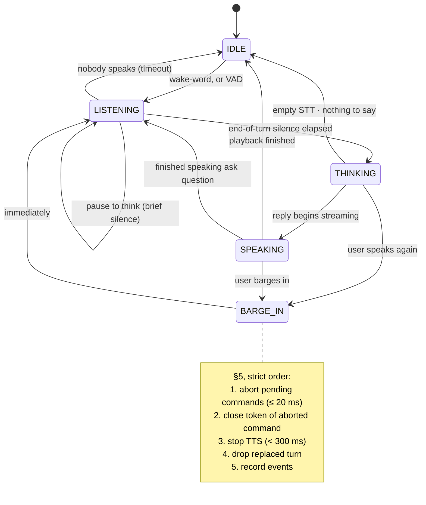

# Conversation state machine — normative specification

**Status:** normative (TSK-S2-07). Host implementation normative (`python/neuroedge/perception/voice_fsm.py`); the `esp32s3` C port was removed from the roadmap by Q-77 (roadmap §6). §5 (revocation) also governs scheduled `digital.out` pulses and motion. Implementation: Python for `sim`/`linux` (TSK-S3-11; audio path
and STT/TTS providers: TSK-S3-13); the C/C++ port for `esp32s3` (TSK-S5-03, S5-04) is removed (Q-77; `targets/esp32s3/fsm/` does not exist); the compliance vector suite (TSK-S3-10, §9) is the host contract. Requirements: FR-PER-02 → FR-PER-05 (`neuroedge-prd.md` §4.4), FR-MDL-09,
FR-PER-07. Decisions: Q-8 (two languages), Q-12 (OpenAI standard), Q-14 (network loss), Q-17 (`on_block`),
Q-26 (`ask` confirmation), Q-46 (D3) (spoken answers valid only within answer turn of the exact question).

This document is the **sole** definition of the conversation state machine and physical command
revocation contract. Roadmap §3.8 preserves the rationale for a single specification covering both implementations;
`docs/spec/hal_mcu_review.md` RB-3 points to §5. Keywords **MUST**, **MUST NOT**, **SHOULD** carry RFC 2119 meanings.

## 0. Why this state machine touches physical safety

Q-8 mandates two implementations: Python on `sim`/`linux`, C/C++ on `esp32s3`. FR-PER-02 requires that when
users barge in, unexecuted actuator commands must be revoked. Therefore, barge-in behavior directly enters
the physical action domain. Two implementations with divergent barge-in behaviors would revoke commands differently, breaking
target equivalence (FR-TGT-04) at the most safety-critical junction. The safeguard: **one specification, two implementations, one vector suite**.

## 1. Scope

The state machine coordinates **conversational turns**: when to listen, when to think, when to speak, when barged into.

- It **does not** evaluate gates and **never** emits pin commands autonomously. Pins move strictly via `c.do()` →
  gate → token (`docs/spec/threat_model.md` §2). The state machine only decides which turns remain valid,
  and aborts pending commands per §5.
- Out of scope: AEC algorithms, VAD, and wake-word models (integrating existing libraries — PRD §4.4);
  STT, TTS, and language inference (running at cloud providers — FR-PER-07). The state machine sees only **results**
  via §8 events; provider contracts and declaration (`[stt]`, `[tts]`, `[wake_word]`
  in `agent.toml`) live in `python/neuroedge/perception/providers/` (TSK-S3-13, TSK-I4-01).
- **Wake-word** (TSK-I4-01, Q-7): `[wake_word]` declares a detector (input frames, output `(word,
  score)`) and **a user-supplied model** — NeuroEdge ships and downloads no models
  (pre-built openWakeWord models are CC BY-NC-SA 4.0, incompatible with Q-45). When `[wake_word]` is present,
  `vad_activation` is disabled: turns open via `wake_word_detected` (T01), and VAD **does not** open turns alone.
  When absent, legacy behavior is preserved: VAD opens turns.

## 2. Model: inputs, clock, determinism

- The state machine **MUST** change state strictly based on **input events** (§8) and an **external monotonic
  clock in ms**, matching gate engines (`ActionContractEngine(clock=…)`). It **MUST NOT**
  read real time, generate random numbers, or measure time outside this clock.
- The same sequence of events, at identical `offset_ms`, **MUST** produce identical state sequences, pin commands,
  and aborted commands across both implementations. This enables replay and the §9 vector suite to run in
  **virtual time**.
- Each turn has a strictly increasing sequence number (`turn`). Pin commands, `ask` questions, and late-arriving results are tagged
  with the turn that originated them.

## 3. Five states

| State | Meaning | Microphone | Speaker |
|:---|:---|:---|:---|
| `IDLE` | No open turns. Awaiting wake-word or VAD | Listening; ring buffer retains pre-trigger audio (RB-2) | Silent |
| `LISTENING` | Recording user speech. Measuring end-of-turn silence | Recording | Silent |
| `THINKING` | Turn closed: awaiting STT, model, or local grammar. Gates evaluated here via `c.do()` | Still listening, to detect user follow-up speech | Silent |
| `SPEAKING` | Streaming reply audio | Still listening (post-AEC), to detect barge-in | Playing |
| `BARGE_IN` | **Transitory.** Executes §5 contract, then transitions immediately to `LISTENING` without awaiting inputs | — | Stopped |

## 4. State transition table

This table is normative: any (state, event) pair not listed here **MUST NOT** alter state. Event names
reside in §8; parameters (`end_of_turn_silence_ms`…) in §6. Row codes `T01`…`T14` are declared by the
§9 vector suite under `covers`.

| # | From | Event or condition | To | Side-effect |
|:---:|:---|:---|:---|:---|
| T01 | `IDLE` | `wake_word_detected`; or `audio_in_vad_start` when implementation enables VAD activation | `LISTENING` | Open new turn |
| T02 | `LISTENING` | `audio_in_vad_end` | `LISTENING` | Begin counting `end_of_turn_silence_ms` |
| T03 | `LISTENING` | `audio_in_vad_start` while counting | `LISTENING` | Cancel counter: speaker paused to think, do not truncate (FR-PER-03) |
| T04 | `LISTENING` | Counter elapsed | `THINKING` | Close turn, dispatch audio to STT |
| T05 | `LISTENING` | No `audio_in_vad_start` within `listen_timeout_ms` since entry | `IDLE` | Close turn, no-op |
| T06 | `THINKING` | `stt_result` with empty `text` | `IDLE` | At most `max_reprompts` consecutive reprompts, then silent (FR-PER-05) |
| T07 | `THINKING` | `tts_stream_start` for current turn | `SPEAKING` | — |
| T08 | `THINKING` | Turn finishes with nothing to speak | `IDLE` | — |
| T09 | `THINKING` | `think_timeout` elapsed, `system_two_unavailable`, or `stt_unavailable` for turn | `THINKING` | Per §7: offline prompt, streamed like standard reply |
| T10 | `THINKING` | `audio_in_vad_start` | `BARGE_IN` | User continues speaking: thinking turn replaced |
| T11 | `SPEAKING` | `tts_stream_end` `done`, spoken utterance was `ask` question (RFC-0006) | `LISTENING` | Open **answer turn** for that question (§5.4) |
| T12 | `SPEAKING` | `tts_stream_end` `done` (not a question), or `error` (including `ask` questions) | `IDLE` | Unheard questions do not open answer turns — Q-46 (D3) |
| T13 | `SPEAKING` | `audio_in_vad_start` | `BARGE_IN` | — |
| T14 | `BARGE_IN` | (immediately upon entry) | `LISTENING` | §5, then open new turn |

Every state change **MUST** record `voice_state_changed` (§8).

## 5. Physical command revocation contract

### 5.1 Pending commands

A **pending command** is a pin command approved by gate `ALLOW` with issued token, but whose **hardware delivery
timestamp lies in the future**: scheduled commands (commencing after a delay), or commands queued after speech. The moment
a command is delivered to hardware — pin driven, pulse initiated — it is **no longer** a pending command.

### 5.2 On barge-in

Entering `BARGE_IN`, implementations **MUST** execute in exact sequence:

1. **Abort all pending commands** across turns up to the current turn. From barge-in trigger event reception
   to guaranteed pin inhibition: **≤ 1 audio frame = 20 ms** (20 ms Opus frame, PRD Appendix
   D.2; RB-3). Each aborted command records `actuator_aborted {pin, reason: "ACTUATOR_ABORTED_BY_BARGE_IN"}`
   (`docs/spec/simulation_coverage.md` §3). This step **MUST NOT** await step 3.
   **`motion.*` (RFC-0011 §3d):** within this same step, `VoiceStateMachine` invokes `stop_motion` (`motion_barge_in` of HAL):
   all active or holding motion channels are returned **immediately** to declared safe states (`stop`, or
   `hold` for position-holding servos), recording `motion_safe {channel, state, cause: "barge_in"}` on the same tick as the trigger event,
   prior to lease expiry, and leases cannot be renewed. Unlike `digital.out`, **delivered** motion commands are still
   stopped: no "continue running" flag exists (§5.3).
2. **Close tokens** of aborted commands (`TokenLedger.close` / `ne_token_close`): that exact verdict can
   never actuate pins in the future. Repeating actions requires fresh gate evaluations via fresh `c.do()` calls.
3. **Stop TTS**: flush DAC buffers, record `tts_stream_end {duration_ms, reason: "barge_in"}`. From user
   speech onset to speaker silence: **< 300 ms**, including VAD latency (FR-PER-02).
4. **Drop replaced turn.** Late-arriving results from previous turns — STT, model responses, tool calls —
   **MUST NOT** invoke `c.do()` and **MUST NOT** be synthesized to speech.
5. **Record** `voice_state_changed` entering `BARGE_IN`, then from `BARGE_IN` to `LISTENING`.

### 5.3 Delivered commands run to completion

Barge-in **MUST NOT** abort commands already delivered to pins. Example: `happy-path.json` unlocks `door_lock
pulse 30000`, TTS speaks "Door unlocked. Welcome home.", the guest says "cảm ơn" (thank you) when the pulse has only run for one
second — the pulse still runs its full 30 s and the door remains open for entry.

Rationale: FR-PER-02 revokes **unexecuted** commands only; speech is revocable, executed physical actions
are not (`docs/spec/core_contracts.md` §1.6). `PendingCommand.cancel()` in `LinuxHAL` can abort active pulses, but that
capability is reserved for system shutdown (SIGTERM), not barge-in. No per-action flags like "abort even if
running" exist (Q-57): `motion.*` always stops immediately on barge-in (RFC-0011 §3d), while `digital.out` pulses preserve this rule.

### 5.4 Untouched by barge-in

- **Pending `ask` questions** (RFC-0006, `docs/spec/tool_calling.md` §6): barge-in **MUST NOT** consume
  them. The barged-in utterance might be the actual confirmation. Questions expire solely via TTL or when
  answered.
- **Answer turns** — Q-46 (D3). A spoken "có" (yes) / "không" (no) answers an `ask` question in
  exactly one turn: the turn opened while streaming that exact question — T11 when playback finishes, or T13 → T14
  when the user barges in during question playback. In all other turns, the utterance is standard speech (command
  grammar or System 2), confirming **nothing**, even if the question remains within TTL: questions from earlier turns,
  or questions nobody heard (`tts_stream_end` `error` ⇒ T12, no answer turn opened). Expired questions still
  record `tool_confirm_expired` when subsequent turns inspect them, matching typed input. Typed text and web buttons
  (`:confirm`, `run --ui`) preserve RFC-0006: answering the latest pending question.
- **Recorded verdicts**: barge-in never modifies or deletes previously recorded events; it only appends events.

### 5.5 Current implementation

`motion.*` (TSK-I2a-05): `VoiceStateMachine(stop_motion=…)` wired by `VoiceSession` to `hal.motion_barge_in`
(`SimHAL`, `LinuxHAL`); tests `test_a_barge_in_sends_safe_in_the_same_tick_and_before_the_lease_ends`,
`test_a_barge_in_does_not_cut_a_delivered_digital_pulse` (`tests/test_motion.py`).

Python (TSK-S3-11): `digital.out(pin).pulse(…, after_ms=N)` is a **scheduled command**. On `sim`
(`SimHAL`), gates evaluate and tokens are consumed immediately; pins toggle and `actuator_command` is recorded
only upon deadline arrival (`PendingCommand.delivered`), delivered by `perception.VoiceSession` on an injected clock.
Lacking that driver, scheduled commands are rejected. `LinuxHAL` does not yet support scheduled commands: it **rejects**
`after_ms` (`BoardCapabilityError`), never delivering early. Commands "queued after speech" exist in no
implementation today. `esp32s3`: TSK-S4-01 and S5-04 (cancellable handles — RB-3). Any implementation adding scheduled commands
without implementing §5.2 violates this specification.

Three constraints on scheduled commands, finalized during TSK-S3-11 review:

- **Delivered within verdict TTL.** Delivery offset relative to token issuance cannot exceed token TTL
  (`p95_latency_ms` × 3, `actions/token.py`); exceeding rejects commands at scheduling time
  (`ActionContractViolation`). Verdicts never actuate pins on facts unseen by gates.
- **`after_ms` rounds up**, never down: 0.5 ms becomes 1 ms, remaining a pending command. Negative values rejected.
- **The safeguard is command cancellation, not tokens.** In Python, `c.do()` closes tokens upon action return and
  `SimHAL.run_due()` does not re-query token ledgers: pins remain stationary because commands are cancelled (`run_due` skips cancelled commands).
  Step 2 of §5.2 still executes so C/C++ builds, where tokens may remain open, maintain contract parity.
- **Action errors cancel pending commands.** Commands scheduled before action exceptions are cancelled with
  `actuator_aborted {pin, reason: "ACTUATOR_ABORTED_BY_ACTION_ERROR"}`: verdicts cover complete actions, never
  partial executions.

## 6. Parameters

The values below are configurable, **not** safety contracts. The contracts are the two latency budgets of §5.2
(20 ms, 300 ms) and step execution order. Implementations declare default values; test vectors record
applied values.

| Parameter | Meaning | Suggested default |
|:---|:---|:---|
| `end_of_turn_silence_ms` | Silence following `audio_in_vad_end` marking turn completion (FR-PER-03) | 700 |
| `listen_timeout_ms` | `LISTENING` without speech returns to `IDLE` | 8000 |
| `think_timeout` | Maximum wait for replies. System 2: `timeout_s` × `GRACE` of `[system_two]` (`models/providers/`); local grammar replies immediately | per provider |
| `max_reprompts` | Consecutive reprompts on empty STT before silence | 1 |

Empirical measurements on physical hardware replace suggested defaults in TSK-S5-01, S5-03.

## 7. Degradation and network loss

- On network loss, gates **continue evaluating** via local command grammars; lacking workable fallbacks,
  actions are blocked with reason `gate_unreachable` (Q-14, engine). State machines never alter this.
- On `think_timeout` expiry or provider non-response: devices speak offline prompts (`reply_source` =
  `offline_help`, `docs/spec/tool_calling.md` §7) then return to `IDLE`. State machines **MUST NOT** convert
  timeouts into `ALLOW`, and **MUST NOT** autonomously re-invoke `c.do()` (`threat_model.md` §2b).
- **Unavailable STT** — HTTP errors, timeouts, missing keys, replies not transcripts (non-text,
  control characters, U+FFFD, longer than maximum turn length): `stt_unavailable {turn, reason}`, followed by T09 with
  offline prompts stating device could not hear and typed commands remain functional (FR-MDL-03). Transcripts are never
  fabricated, no `c.do()`; subsequent transcripts for that turn are dropped (§5.2 step 4). STT uncompleted upon
  `think_timeout` expiry is also treated as unavailable. **Empty** transcripts from functioning STT indicate
  silence — T06, not an error (V5).
- **Fallback STT** (Q-14, TSK-I4-01): `[stt.fallback]` declares local endpoints (faster-whisper /
  speaches on-host, distinct from primary STT `base_url`). When primary STT fails, implementations **MUST**
  record `stt_unavailable` for the turn (failure fact), **cancel pending timers of primary STT**
  (preventing turn execution; record `voice_late_result_dropped`), emit `stt_fallback {from, to,
  reason}`, send the **same audio chunk** to fallback endpoints, and **keep turns open under a NEW, capped
  thinking deadline** (`think_timeout_ms`, not transport limits): fallback transcripts enter
  standard `stt_result` pathways — identical command grammar / System 2, identical `c.do()` and gates (Q-14).
  Without `[stt.fallback]`, or if both fail (fallback timeout / non-response), execute T09 with
  offline prompts as above. Empty fallback transcripts trigger T06. Fallbacks never autonomously invoke
  `c.do()` and never fabricate transcripts.
- **Unavailable TTS:** `tts_unavailable {reason}` then `tts_stream_end {reason: "error"}` — utterances remain
  recorded and displayed (`tts_stream_start`), without audio playback. `error` terminates utterances like `done`,
  with one exception: failed `ask` question playback transitions to `IDLE` (T12), opening no answer turns — if nobody
  heard the question, no speech may confirm it (§5.4, Q-46 (D3)). No retries.
- Python implementation: `python/neuroedge/perception/voice_session.py` (audio pipeline) and
  `python/neuroedge/perception/providers/` (OpenAI audio adapters, errors → `SpeechUnavailable`).
- Consecutive errors trip circuit breakers (`engine/circuit_breaker.py`), routing directly to fallbacks. Gate latency is
  governed by gate `budget.p95_latency_ms` (FR-GATE-09). This specification adds **no** P95
  thresholds: NFR-PERF-07 (P95 < 1500 ms) is a measurement target, not a trigger condition.

## 8. Traces

The **sole** catalog of conversation state machine events. Hardware abstraction primitives reside in
`docs/spec/simulation_coverage.md` §3; tool calls, confirmations, System 2 in `docs/spec/tool_calling.md` §7.
Adding events requires no RFC.

| Event | `data` | Role | Available since |
|:---|:---|:---|:---|
| `wake_word_detected` | `{word, score}` | Input | New |
| `wake_word_unavailable` | `{reason}` — `[wake_word]` detector failed (broken model, adapter exception); **no turns open** from it, session continues in degraded mode, recorded once per session | Output | New (TSK-I4-01) |
| `audio_in_vad_start` | `{energy_db}` | Input | simulation_coverage §3 |
| `audio_in_vad_end` | `{}` | Input | New |
| `stt_result` | `{text, turn}` — `""` indicates silence; `turn` is turn sending audio | Input; transcripts from `[stt.fallback]` also enter here | New |
| `stt_unavailable` | `{turn, reason}` — STT provider failed to produce transcript for turn (§7); with `[stt.fallback]`, `stt_fallback` follows immediately | Input (T09; does not trigger T09 while fallback runs) | New (TSK-S3-13) |
| `stt_fallback` | `{from, to, reason}` — primary STT failed and `[stt.fallback]` endpoint accepted turn (Q-14). `from`/`to` are provider labels (never keys); turn remains open awaiting fallback transcript | Output | New (TSK-I4-01) |
| `audio_in_segment` | `{sha256, duration_ms, sample_rate_hz}` — turn audio dispatched to STT (T04), digest only | Output | simulation_coverage §3 |
| `tts_stream_start` | `{text}` | State machine input (speech playback started). Python implementation generates this internally from turn replies, so `VoiceSession.feed` rejects it (§9.1); C/C++ builds accept it as input | simulation_coverage §3 |
| `tts_stream_end` | `{duration_ms, sha256?, reason?}` — `reason`: `done` · `barge_in` · `error` | Input on `done` / `error`; **output** on `barge_in` (§5.2 step 3). With TTS providers, Python implementation generates both `done` (audio finished, with `sha256`) and `error` | simulation_coverage §3; new `reason` |
| `tts_unavailable` | `{reason}` — TTS provider failed to synthesize utterance (§7) | Output, immediately preceding `tts_stream_end` `error` | New (TSK-S3-13) |
| `system_two_unavailable` | `{task, reason}` | Input | tool_calling §7 |
| `voice_state_changed` | `{from, to, trigger, turn}` | Output | New |
| `actuator_aborted` | `{pin, reason}` | Output (§5.2 step 1) | simulation_coverage §3 |
| `voice_reprompt` | `{turn, count}` — `count` is consecutive empty STT count, ≤ `max_reprompts` | Output (T06) | New (TSK-S3-11) |
| `voice_late_result_dropped` | `{turn, input}` — `input`: `stt_result` · `stt_unavailable` · `system_two_reply` | Output (§5.2 step 4) | New (TSK-S3-11) |

`trigger` is one of: `wake_word`, `speech_start`, `turn_end`, `listen_timeout`, `transcript_empty`,
`reply_start`, `reply_empty`, `reply_end`, `ask_asked`, `barge_in`.

Spoken words reside only in `text` fields (`stt_result`, `text_input`, `command_not_recognized`), and device
responses in `text` of `tts_stream_start`, so anonymization mode (FR-TRC-07) hashes them to `sha256:`.
Exception, preceding TSK-S3-13: gate `ask` questions remain verbatim in `message` of
`tool_confirm_requested` and `gate_evaluation_result` — this is gate text (digested gate files),
not user speech. `reason` of `stt_unavailable` / `tts_unavailable` **MUST NOT** carry spoken words:
OpenAI audio adapters do not echo server response bodies into errors, and custom adapter errors
retain only class names.

Replay and golden:

- **Inputs** are replayed at recorded `offset_ms`. Specifically, `audio_in_vad_start` during
  `SPEAKING` is an **input**: replay must re-inject it so `actuator_aborted` is **recomputed**. Otherwise,
  abort events vanish during replay and golden comparisons report divergence.
- `actuator_aborted` participates in golden comparisons during `replay` / `verify` (`testing/golden.py`).
  `voice_state_changed` does not, being timing-dependent; it is validated in the §9 vector suite.

## 9. Compliance — input of TSK-S3-10

An implementation is considered **compliant** when passing the complete corpus `fixtures/compliance/voice/` against
`expected_results.yaml`, bidirectionally closed like all corpuses (`CONTRIBUTING.md` §3). The corpus **does not**
reside at root `fixtures/traces/`: that directory preserves three canonical decision traces, and modifications
require RFCs. Phase 2 expands into `fixtures/compliance/multimodal/` (TSK-V3-02, removed by Q-77).

- **Case files**: agent (directory under `fixtures/agents/`), §6 parameters applied to case, gate facts, and §8
  input event sequences with `offset_ms` — virtual time.
- **Expected results**: `voice_state_changed` sequences, gate verdicts, pin commands, and aborted commands in exact
  sequence, with TTS termination causes. Timing compared in virtual time; e.g. `actuator_aborted` at identical `offset_ms`
  to barge-in trigger events.
- C/C++ implementations pass acceptance only upon clearing the **entire** corpus (roadmap §3.8, TSK-S5-03).

Mandatory scenarios:

| # | Scenario | Expected result must include |
|:---:|:---|:---|
| V1 | Barge-in with pending scheduled command | `actuator_aborted` (`ACTUATOR_ABORTED_BY_BARGE_IN`) · pin never pulses · token reuse rejected |
| V2 | Barge-in while pulse is running | Pulse runs full duration · no `actuator_aborted` |
| V3 | User speaks during `THINKING`, prior to reply availability | Late-arriving reply not spoken · previous turn does not invoke `c.do()` |
| V4 | Barge-in during `ask` question | Question remains open · "có" (yes) in answer turn (§5.4), within TTL, confirms · "có" (yes) in another turn, or following failed playback (`error`), confirms nothing (Q-46 (D3)) |
| V5 | 20 consecutive noise frames (VAD triggers, empty STT) | Each returns to `IDLE` · at most `max_reprompts` consecutive reprompts · subsequent genuine commands execute (FR-PER-05) |
| V6 | Provider timeout / network loss | Offline prompt · gate evaluates via local grammar, or `gate_unreachable` · never `ALLOW` due to timeout |
| V7 | Slow speaker: pauses shorter than `end_of_turn_silence_ms` mid-sentence | Turn not truncated (FR-PER-03) |

The two real-time budgets (20 ms, 300 ms) **cannot** be tested in virtual time. They are measured on physical
hardware, (the I5 exit criterion was removed with I5, Q-77) and nightly job TSK-S4-05.

Three vectors of TSK-I4-01 reside in the same corpus (`scenario: "table"`): `i4_wake_word_opens_the_turn`
(VAD alone does not open turns when `vad_activation` is disabled — detector never fired, matching cases
with `[wake_word]`; `wake_word_detected` opens turns), and `i4_primary_stt_down_falls_back` (`world.stt_fallback`
designates fallback endpoint; primary STT `stt_unavailable` ⇒ `stt_fallback` ⇒ fallback transcript
follows standard command grammar pathways). Real detectors (openWakeWord + user model) belong to the
driver tier: contracts and adapters in `python/neuroedge/perception/providers/wake.py`, verified in
`python/tests/test_wake_word.py` — corpus sees only `wake_word_detected` events.

### 9.1 Test vector suite conventions (TSK-S3-10)

Each case is a JSON file; its keys, and expected results `{proves, events}` in `expected_results.yaml`, are
validated by `neuroedge/testing/voice_corpus.py`. The corpus agent is `fixtures/agents/voice-door/`.

- **Cases:** `scenario` (`V1`…`V7`), `covers` (§4 rows), `agent`, `params` (§6, undeclared fields default
  to suggestions; `think_timeout_ms` and `vad_activation` — enabling T01 via VAD — are also parameters), `world`
  (`facts`, `unset_facts`, `sensors`, `system_two` — provider presence, `facts_source` —
  `local_grammar` or `unreachable`: model deciding facts on network loss without local fallback,
  `stt_fallback` — fallback endpoint label: test runner provides scripted fallback STT, TSK-I4-01,
  `wake_word` — `true`: runner supplies a detector that **never triggers autonomously**, proving
  VAD alone does not open turns — T01), `inputs`, `until_ms`.
- **Inputs:** §8 input events, plus two corpus-only inputs: `system_two_reply {turn,
  text?, tool_calls?}` — scripted provider reply for a turn; `reuse_token {pin}` — re-drives
  pins with aborted command tokens (V1). `tts_stream_start` is not a case input: devices
  play replies autonomously. Input `tts_stream_end` carries only `done` or `error`.
- **Through mock providers.** Python implementation runs each case twice with identical expectations (TSK-S3-13): once feeding
  inputs as recorded, once through mock STT and TTS scripted from cases — transcripts (or `stt_unavailable`)
  emerge from STT paths at input `offset_ms`; speech plays until case `tts_stream_end`.
  Inputs no provider could emit (second transcript for identical turn) are fed as recorded
  (`neuroedge/testing/voice_corpus.py`).
- **Comparable expectations:** `voice_state_changed`, `action_requested` (`c.do()` invoked),
  `gate_evaluation_result` (`verdict`, `reason`, `action`), `actuator_command`, `actuator_aborted`,
  `actuator_command_rejected`, `tts_stream_start` (`text` compared only when recorded in expectation), `tts_stream_end` with
  `barge_in`, `tool_confirm_requested` / `tool_confirmed` / `tool_confirm_declined` /
  `tool_confirm_expired`, `voice_reprompt`, `voice_late_result_dropped`, `stt_fallback` (`reason` always
  compared; `from`/`to` when recorded) — complete, strictly ordered, matching `offset_ms`.
- **Intra-millisecond ordering.** Deadlines with offsets **strictly less than** an input are processed before that input,
  earliest first; within identical timestamps, scheduled commands deliver before state machine timers. Inputs at the
  **exact** millisecond of a deadline precede that deadline: barge-in at the exact millisecond of scheduled command delivery aborts the command
  (fail-closed); speech at the exact millisecond `end_of_turn_silence_ms` elapses continues the turn. At `until_ms`,
  all deadlines up to and including it are executed.
- **Side-effects precede states.** Side-effect events of a row are recorded prior to `voice_state_changed` of
  that row, matching §5.2 steps 1–4 preceding step 5. Rows remaining in identical states (T02, T03, T09) emit no
  `voice_state_changed`.
- **Turns.** `turn` of `X → BARGE_IN` reflects the replaced turn; `BARGE_IN → LISTENING` carries the new turn. Timer
  `think_timeout` runs from entry into `THINKING`. Only one result for turns in `THINKING` takes effect;
  subsequent results record `voice_late_result_dropped` as no-ops.

## 10. Open issues

- ~~Per-action flag "abort even if running" (§5.3)~~ — decided against flags (Q-57, RFC-0011 §3d); `motion.*` stops immediately upon barge-in.
- FR-PER-04 (P1, retraction when models reverse conclusions): relationship between retracted speech and pending commands
  remains undecided. TSK-S3-11 and TSK-S3-13 do **not** resolve this: Python implementation synthesizes full replies
  before playback, and OpenAI-compliant STT (`/v1/audio/transcriptions`) emits single final transcripts per
  turn — no streaming tokens exist to retract, and no partial transcripts exist. When available (streaming clients
  TSK-S5-06; live microphone/speaker sessions, `TODOS.md` #45): partial transcripts **MUST
  NOT** execute turns; resolve alongside `Q-N`.
- **How T06 reprompts are vocalized.** T06 enters `IDLE` (speaker silent, §3) but side-effect is "reprompt".
  TSK-S3-11 opted for minimal behavior: state machine records `voice_reprompt` (counting, enforcing `max_reprompts`) and
  emits nothing, preserving state. TSK-S3-13 preserves this: vocalizing reprompts requires speaking in `IDLE`
  (violating §3) or transitioning T06 to `SPEAKING` — altering V5 and all T06 case expectations, requiring prior `Q-N`.
- **Barge-in during `THINKING`** emits no `tts_stream_end`: no stream is playing (§3). Steps 1, 2,
  4, 5 of §5.2 execute completely.
- **`system_two_unavailable`** triggers T09 only when turns await providers; turns possessing replies from local
  grammars are not interrupted by offline prompts. `tts_stream_end` with `error` terminates utterances like `done`, except
  for `ask` questions (T12, §5.4).
- **Scheduled commands on `linux`** and commands "queued after speech": not yet implemented (§5.5). Voice sessions on `linux`
  (`VoiceSession` outside `sim`) exist since TSK-S5-08 via `--voice-file`: WAV files serve as frame sources, `Speaker`
  timelines as outputs; `audio_source()`/`audio_sink()` connect real microphones/speakers (PipeWire AEC, Q-22) but
  concurrent real-time sessions with providers remain tracked in `TODOS.md` #45.
- **Two §5.2 budgets on `sim`** operate in virtual time: speaker stops at exact ms VAD confirms barge-in speech (energy
  VAD requires 60 ms speech), unrepresentative of physical acoustic latency. Measured on silicon (§9).
- **Commands become irrevocable once utterances finish.** Only `THINKING` and `SPEAKING` trigger barge-in (§4). When reply
  playback completes (`IDLE`, then `LISTENING` in new turns), if users say "thôi, đừng mở" (never mind, don't open), scheduled
  commands from previous turns still deliver. Verdict TTL (§5.5) bounds that window, but cannot infer user
  retraction intent. TSK-S3-13 leaves this open — a product decision (abort pending commands on new turns,
  or dedicated "cancel" intent), requiring `Q-N`; today scheduled commands exist solely on `sim`.
- **Scheduled horizons currently borrow verdict TTL (§5.5).** Maximum delay currently = `p95_latency_ms`
  × 3, forcing delays of N ms to declare p95 ≥ N/3 — relaxing fail-closed latency bounds on gates (`voice-door`
  had to increase 120 → 700). These parameters carry different meanings. Proposed direction, modeling select-before-operate
  (IEC 61850 `sboTimeout`, DNP3 CROB) and Matter timed interactions: a **dedicated scheduling horizon**, small by default
  with board-enforced hard ceilings, plus **gate re-evaluation at delivery time** for commands exceeding TTL (check-at-use
  conditions, like macaroon temporal caveats). Declaring horizons in gates requires RFCs (`gate.v1` rejects
  unknown fields); declaring in board or `agent.toml` does not. Tech lead to finalize alongside `Q-N`.
- Default values for §6: measured and finalized on hardware (TSK-S5-01, S5-03).
