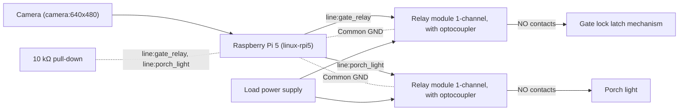

# Kit 4 — Gate camera (`gate-camera`)

> **Task ID:** TSK-I2b-02. General workflow, safety rules, and unverified checklist:
> [`kit-phan-cung.md`](kit-phan-cung.md). This page covers details specific to this kit.

A camera monitors the gate. When the vision model detects a **stranger** ("người lạ") in the gate area, the agent turns on the porch light and locks the gate; in all
other cases — no stranger, low model confidence, stale frame, lost camera, occupants have not consented to recording, someone in private zone — the command is
**blocked** and pins do not change. The camera only provides facts (labels, bounding boxes, confidence scores, RFC-0012); thresholds reside in the gate (Q-54), and the model can be swapped without changing the gate.

## Locked gates

`stranger_light@1.0.0` and `stranger_lock@1.0.0` reside in `fixtures/agents/gate-camera/gates/` and have digests in
`digests.lock`. Both **inherit `gates/home/camera@1.0.0`** from the starter library and only tighten constraints:

| Condition | Source | Parent gate locked? |
|:---|:---|:---|
| `recording_consent`: occupants consented to recording | session fact (`[sim.facts]`; on device: switch or home mode) | yes |
| `person_in_private_zone: false` and `private_zone_confidence ≤ 0.10` | camera, `private_zone` region | yes, with `max_age_ms` 300 |
| `stranger_at_gate: true` and `stranger_confidence ≥ 0.85` (light) or `≥ 0.90` (lock) | camera, `gate_area` region, `unknown_person` label | added by child gate |

Each visual criterion is evaluated on **every frame** of the window and results are ANDed together; confidence scores
carry `max_age_ms`, so a frozen camera repeating "no one present" cannot prove an empty private zone, and
losing the camera results in `criterion_unavailable`. Modifying locked gates requires an RFC (`CONTRIBUTING.md` §3).

## BOM

Described by function and specifications. **Không có mã hàng, giá hay nhà bán** (no part numbers, prices, or vendors); all rows "chưa kiểm trên phần cứng thật" (not verified on real hardware).

| # | Item | Specification | `linux` (Pi 5) |
|:--|:---|:---|:---|
| 1 | Control board | Raspberry Pi 5 (`linux-rpi5` profile) | yes |
| 2 | Camera | CSI or USB camera for V4L2, at least 640×480 at 30 fps (profile declares two modes: 640×480 `rgb888`, 1280×720 `yuyv`) | yes |
| 3 | Relay module (gate lock) | 1-channel, 3.3 V compatible input, optically isolated, contacts rated for latch mechanism current | yes |
| 4 | Gate lock latch mechanism | Solenoid strike (30 s pulse) or electromagnetic lock installed by a professional; separate power supply, isolated from board power supply | yes |
| 5 | Relay module (light) | 1-channel, same as row 3 | yes |
| 6 | Porch light | Household light or 12 V test light; **test with LED + resistor first** | yes |
| 7 | Pull-down resistor | 10 kΩ from each of `gate_relay`, `porch_light` to GND | yes |
| 8 | Board power supply | 5 V supply for Pi 5 | yes |

This kit **does not build on `esp32s3-box-3`** (board does not declare `vision.in`; `NE3001`) and does not run on
`sim-default`. The "stranger" recognition model is yours: the repository only includes a scripted mock model
(`provider = "replay"`); switching to a real model simply changes `provider` in `[vision]`, without modifying action code.

## Sơ đồ đấu dây

The label `line:<name>` is the board pin name in `boards/*.toml`; `camera:<width>x<height>` is a mode in
`[capabilities.vision_in.modes]`. Test `python/tests/test_kits.py` verifies both against the board profile. Physical header
pin numbers on Pi are not assigned in the repository. Diagram provided for `linux-rpi5` only: Box-3 lacks a camera.

<!-- wiring: linux-rpi5 -->


## Từ hộp tới chạy thật

General workflow in [`kit-phan-cung.md`](kit-phan-cung.md) §2. For this kit specifically, camera is an **additional step** (requires a board with
`vision.in`):

```bash
neuroedge new cong --template gate-camera && cd cong
neuroedge build --target sim --board sim-rpi5
neuroedge test
neuroedge run --board sim-rpi5       # REPL; virtual camera replays scenario: frames 5–12 have stranger at gate
```

- **`sim-rpi5`**: virtual camera; `neuroedge test` runs six cases (allow light and lock; no one, score 0.60,
  person in private zone, missing consent, camera lost ⇒ BLOCK, pins do not change).
- **`linux` on Pi 5**: set `NEUROEDGE_LINUX_CAMERA=/dev/videoN`; HAL opens the exact mode declared by the board and rejects
  if the driver rounds values. The agent can be replayed using recorded labels, without needing a camera (`neuroedge verify`).
  Test: `python/tests_linux/test_kit_gate_camera.py` (virtual camera `vivid`, pins `gpio-sim`; `linux-hal` job).
- Raw images never enter traces: traces only store hashes and frame dimensions (NFR-PRIV-03).

## Golden traces

`fixtures/traces/kits/gate-camera-allow.json` (stranger ⇒ light on, gate locked: ALLOW ×2),
`gate-camera-block.json` (no one, missing consent, score 0.60, person in private zone, camera lost ⇒
BLOCK ×5, pins do not change). Generated with `scripts/gen_kit_traces.py`; replayed by `neuroedge verify` on boards
declaring `vision.in`.
