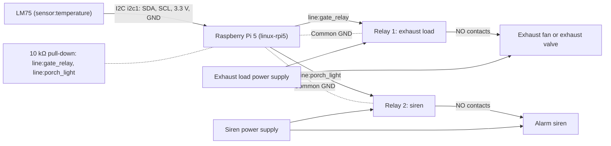
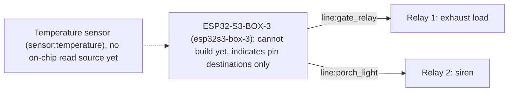

# Kit 3 — Factory monitor (`factory-monitor`)

> **Task ID:** TSK-I2b-01. General workflow, safety rules, and unverified checklist:
> [`kit-phan-cung.md`](kit-phan-cung.md). This page covers details specific to this kit.

Industrial environment monitoring per PRD Q-72 item 3: a temperature sensor provides a temperature band
(`low · normal · high · critical`), and two physical loads operate through gates — **exhaust load** (exhaust fan, or solenoid exhaust
valve ["van xả"]: same `gate_relay` pin, same `vent_*` gates) and **alarm siren** (còi báo động; `porch_light` pin,
`alarm_*` gates). The template name `factory-monitor` is preserved; rationale and adjustment scope in
[`kit-phan-cung.md`](kit-phan-cung.md) §1.

| Command | Gate decision |
|:---|:---|
| `bật quạt` | `vent_on`: always allowed (adding air is safe) |
| `tắt quạt` | `vent_off`: allowed up to `normal`; `high` asks user on device; `critical` blocks without asking |
| `bật báo động` | `alarm_on`: always allowed |
| `tắt báo động` | `alarm_off`: blocked above `normal` — no one turns off siren while room is hot |

If sensor reading is missing, faulty, or below -40 °C ⇒ both facts undetermined: `tắt quạt` and `tắt báo động` are blocked
without asking; `bật quạt`, `bật báo động` continue to run. Band and threshold details: generated project `README.md`.

## Locked gates

The four gates `vent_on`, `vent_off`, `alarm_on`, `alarm_off` (`@1.0.0`) in `fixtures/agents/factory-monitor/gates/`
have digests in `digests.lock`. Modifying them requires an RFC (`CONTRIBUTING.md` §3).

## BOM

Described by function and specifications. **Không có mã hàng, giá hay nhà bán** (no part numbers, prices, or vendors), except for the temperature sensor named in repo
(LM75, read via hwmon). All rows "chưa kiểm trên phần cứng thật" (not verified on real hardware).

| # | Item | Specification | `linux` (Pi 5) | `esp32s3` |
|:--|:---|:---|:---|:---|
| 1 | Control board | Raspberry Pi 5 (`linux-rpi5` profile) | yes | — |
| 2 | Control board | ESP32-S3-BOX-3 | — | **cannot build yet** (agent declares `supported = ["sim", "linux"]`: temperature bands `[sim.sensor_facts]` exist only on `sim` and `linux`) |
| 3 | Temperature sensor | LM75 on I2C bus (kernel loads `lm75` driver, reads `hwmon:lm75/temp1`), measurement range covers -40 to 125 °C | yes | — |
| 4 | Exhaust load relay module | 1-channel, 3.3 V compatible input, optically isolated, contacts rated for exhaust fan or valve coil current; AC loads wired by an electrician | yes | — |
| 5 | Exhaust load | Ventilation exhaust fan, or solenoid exhaust valve ("van xả"); whether a valve closing on power loss is fail-safe or not depends on valve design, not verified by kit | yes | — |
| 6 | Siren relay module | Same as row 4, 1-channel | yes | — |
| 7 | Alarm siren | Alarm siren ("còi báo động") or bell matching siren power supply voltage | yes | — |
| 8 | Pull-down resistor | 10 kΩ from each of `gate_relay`, `porch_light` to GND | yes | — |
| 9 | Power supply | 5 V supply for Pi; separate supplies for each load | yes | — |

On ESP32-S3-BOX-3 this kit **cannot build yet**, so there is no BOM for it yet: if the agent declares `esp32s3` in the future,
the changed rows will be 1 and 3 (Box-3 does not expose verified I2C bus in repo) — the ESP32 diagram below only indicates
pin destinations.

## Sơ đồ đấu dây

The label `line:<name>` is the board pin name in `boards/*.toml`; `sensor:<name>` is the sensor name in
`[capabilities.sensor_read]`. Test `python/tests/test_kits.py` verifies both. Physical header pin numbers on Pi
are not assigned in the repository: you choose the pins, as long as lines carry correct names.

<!-- wiring: linux-rpi5 -->


<!-- wiring: esp32s3-box-3 -->


## Từ hộp tới chạy thật

General workflow in [`kit-phan-cung.md`](kit-phan-cung.md) §2. Specifically for this kit (`sim` starts at 45 °C, `high` band):

```bash
neuroedge new xuong --template factory-monitor && cd xuong
neuroedge run -c "bật quạt"           # ALLOW: gate_relay turns on
neuroedge run -c "tắt quạt"           # BLOCK ask: asks for confirmation (room is hot)
neuroedge run -c "tắt báo động"       # BLOCK deny
neuroedge test
```

In REPL: `:sensor temperature 60` then `tắt quạt` ⇒ blocks without asking; `:sensor temperature 30` then
`tắt báo động` ⇒ allowed.

- **`linux` on Pi 5**: same agent, readings come from LM75 via hwmon:
  `NEUROEDGE_LINUX_SENSORS="temperature=hwmon:lm75/temp1" neuroedge run --target linux`. If kernel reports a unit
  other than `C`, the reading is rejected. Test: `python/tests_linux/test_kit_factory_monitor.py` (same dummy LM75 of
  `i2c-stub` used by `test_sensor_display.py`).
- **`esp32s3`**: does not build (see BOM row 2).

## Golden traces

`fixtures/traces/kits/factory-monitor-allow.json` (turn on fan, turn on alarm, turn off fan at `normal`, turn off
alarm when cooled ⇒ ALLOW), `factory-monitor-block.json` (turn off fan during `high` and `critical`, turn off alarm
when hot, invalid readings ⇒ BLOCK, pin never changes). Generated with `scripts/gen_kit_traces.py`;
replayed by `neuroedge verify`.
