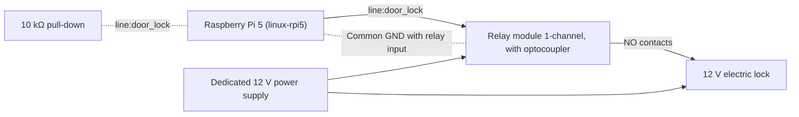
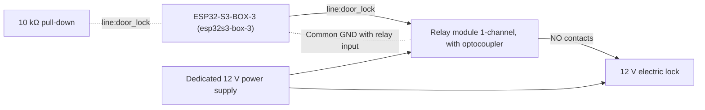

# Kit 1 — Villa door lock (`villa-concierge`)

> **Task ID:** TSK-I2b-01. General workflow, safety rules, and unverified checklist:
> [`kit-phan-cung.md`](kit-phan-cung.md). This page covers details specific to this kit.

The agent receives the command "mở cửa phòng 101" (unlock room 101), passes it through gate `unlock_door@1.2.0`, and only when the gate allows emits
**a single pulse** (default 30 s) on the `door_lock` pin. The gate requires an authenticated guest, risk label no higher than `low`,
and a room number matching the reservation record; missing any item ⇒ block and transfer to receptionist.

## Locked gates

`unlock_door@1.2.0` is located at `gates/unlock_door@1.2.0.yaml` (inheriting `gates/hospitality/base-access@1.0.0.yaml`)
and has its digest locked in `digests.lock`. The agent references it via `neuroedge://gates/unlock_door@1.2.0`, so
the generated project carries no detached copy to drift. Modifying it requires an RFC (`CONTRIBUTING.md` §3).

## BOM

Described by function and specifications. **Không có mã hàng, giá hay nhà bán** (no part numbers, prices, or vendors); all rows "chưa kiểm trên phần cứng thật" (not verified on real hardware).

| # | Item | Specification | `esp32s3` | `linux` (Pi 5) |
|:--|:---|:---|:---|:---|
| 1 | Control board | ESP32-S3-BOX-3 (only reference board, includes codec, microphone, speaker, 320×240 display) | yes | — |
| 2 | Control board | Raspberry Pi 5 (`linux-rpi5` profile: "Raspberry Pi 5 + I2S HAT") | — | yes |
| 3 | Relay module | 1-channel, 3.3 V compatible input, optically isolated, contacts rated for lock current | yes | yes |
| 4 | Electric lock | 12 V solenoid deadbolt or strike for doors; fail-secure or fail-safe chosen according to building fire exit codes | yes | yes |
| 5 | Lock power supply | Dedicated 12 V power supply, sufficient inrush current for lock; do not share with board power supply | yes | yes |
| 6 | Flyback diode | Connected in parallel with lock coil if relay board lacks one | yes | yes |
| 7 | Pull-down resistor | 10 kΩ from `door_lock` pin to GND, ensuring lock stays locked when pin floats | yes | yes |
| 8 | Board power supply | Per board (USB-C for Box-3; 5 V supply for Pi 5) | yes | yes |
| 9 | Voice hardware (Pi 5) | I2S HAT and microphone described by profile; **profile declares `aec = false`** so agent does not build on `linux-rpi5` | — | unusable |

## Sơ đồ đấu dây

The label `line:<name>` is the **board pin name** in `boards/*.toml`. Test `python/tests/test_kits.py` verifies that every
`line:` here exists in the corresponding board profile and every pin required by the agent is drawn, preventing documentation drift.
Physical header pin numbers on Pi and GPIO numbers on ESP32 **are not assigned in the repository** (see
[`kit-phan-cung.md`](kit-phan-cung.md) §2 Step 4): you choose the physical pins, as long as the line carries the correct name.

<!-- wiring: linux-rpi5 -->


<!-- wiring: esp32s3-box-3 -->


## Từ hộp tới chạy thật

General workflow in [`kit-phan-cung.md`](kit-phan-cung.md) §2. Specifically for this kit:

```bash
neuroedge new villa --template villa-concierge && cd villa
neuroedge run -c "mở cửa phòng 101"      # ALLOW: door_lock active 30 s
neuroedge run -c "mở cửa phòng 202"      # BLOCK room_matches, transfer to receptionist
neuroedge run -c "mở cửa"                # BLOCK: missing room number, undetermined fact
neuroedge test
neuroedge build --target esp32s3 --board esp32s3-box-3     # firmware; flash per nap-firmware.md
```

- **`sim`**: runs out of the box (`neuroedge run`, `run --ui`).
- **`linux` on Pi 5**: `neuroedge build --target linux --board linux-rpi5` is rejected (`NE3003`) because the agent
  requires `audio.in` with AEC while Pi 5 profile declares `aec = false`; the repository **does not** lower that requirement to fit. Lock control and
  gate still run on real GPIO pins: test `python/tests_linux/test_kit_villa_concierge.py` uses a clone
  of the agent declaring only `digital.out` to demonstrate that ALLOW pulses the `door_lock` line, while BLOCK never changes
  the line level. Voice on Pi 5 requires a profile with AEC (I5), not yet available.
- **`esp32s3`**: builds into an ESP-IDF project; firmware does not control pins yet (TSK-S4-01).

## Golden traces

`fixtures/traces/kits/villa-concierge-allow.json` (correct room ⇒ ALLOW, 30 s pulse),
`villa-concierge-block.json` (wrong room, missing room number, high risk ⇒ BLOCK, pin never changes).
Generated with `scripts/gen_kit_traces.py`; replayed by `neuroedge verify`.
