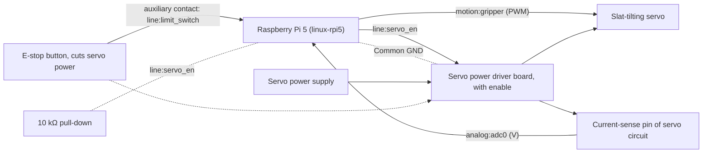

# Kit 5 — Blinds (`blinds`)

> **Task ID:** TSK-I2b-02. General workflow, safety rules, and unverified checklist:
> [`kit-phan-cung.md`](kit-phan-cung.md). This page covers details specific to this kit.

Venetian blinds tilted with a servo (`motion.*`, RFC-0011): **open** ("mở", 90°) and **close** ("đóng", 0°). Each command passes through a gate and then
receives a single-command **lease** for 200 ms; if unrenewed, the channel transitions to its `safe_state` (`hold`: holds position for at most
`max_hold_ms` = 2 s then cuts power). The channel's **time envelope** cuts commands exceeding limits even if the gate allowed them.
This kit is designed for Venetian slat blinds; for roller shutters, see "Limitations" at the bottom of the page.

## Locked gates

`blinds_open@1.0.0` and `blinds_close@1.0.0` reside in `fixtures/agents/blinds/gates/` and have digests in
`digests.lock`. Both **inherit `gates/home/motor@1.0.0`** from the starter library and only tighten constraints:

- (parent gate) `estop_released`: emergency stop button released, read from a digital input (`limit_switch`, `digital.in`);
- (parent gate) `motor_current_sense` ≤ 1.0 V: voltage on current-sense pin of servo driver board, read via
  channel `adc0` (`analog.in`, unit V, max age 200 ms); child gate lowers ceiling to 0.8 V. The V→A scale depends on your
  circuit: calibrate thresholds against its datasheet, tightening only;
- `blinds_close` adds `path_clear`: blind slot free of pinch obstacles (closing is the pinch-hazard direction);
- 100 ms budget = `lease_ms / 2` of the channel, verified during `neuroedge build`.

Missing, corrupted, or stale readings ⇒ `criterion_unavailable` ⇒ block. Commands in safe directions (transition to `safe_state`, stop)
never pass through gates (RFC-0011). Modifying locked gates requires an RFC.

## BOM

Described by function and specifications. **Không có mã hàng, giá hay nhà bán** (no part numbers, prices, or vendors); all rows "chưa kiểm trên phần cứng thật" (not verified on real hardware).

| # | Item | Specification | `linux` (Pi 5) |
|:--|:---|:---|:---|
| 1 | Control board | Raspberry Pi 5 (`linux-rpi5` profile) | yes |
| 2 | Slat-tilting servo | Model servo controlled by PWM pulses, travel at least 90°, sufficient torque for blind slat shaft | yes |
| 3 | Servo power driver board | Includes enable pin from board (`servo_en`): low enable cuts servo power; separate power supply, isolated from board power supply | yes |
| 4 | Pull-down resistor | 10 kΩ from `servo_en` pin to GND (floating pin ⇒ servo disabled) | yes |
| 5 | Emergency stop button | Latching push button, cuts servo power in hardware, independent of software; includes auxiliary contact wired to `limit_switch` pin (high = released) to inform software | yes |
| 5b | ADC and current-sense circuit | 12-bit ADC with 0–2.5 V range (profile declares `adc0`) connected to current-sense pin of servo power driver | yes |
| 6 | Blind slot sensor (optional) | Switch or sensor detecting pinch obstacles; kit simulates `path_clear` via session facts | yes |
| 7 | Board power supply | 5 V supply for Pi 5 | yes |

This kit **does not build on `esp32s3-box-3`** or `sim-default` (does not declare `motion`). The `gripper` channel is the servo channel name
in the profile; the kit uses it as the tilt shaft of the slat blinds.

## Sơ đồ đấu dây

The label `line:<name>` is the board pin name in `boards/*.toml`; `motion:<channel>` is the channel name in
`[[capabilities.motion.servo]]`; `analog:<channel>` is the channel in `[capabilities.analog_in]`. Test `python/tests/test_kits.py` verifies both against the board profile. The channel PWM signal
is controlled by HAL (not an agent `digital.out` pin), so the diagram only shows wiring to the servo.
Diagram provided for `linux-rpi5` only: Box-3 does not declare `motion`.

<!-- wiring: linux-rpi5 -->


## Từ hộp tới chạy thật

General workflow in [`kit-phan-cung.md`](kit-phan-cung.md) §2. Specifically for this kit (requires board with `motion`):

```bash
neuroedge new rem --template blinds && cd rem
neuroedge build --target sim --board sim-rpi5
neuroedge run --board sim-rpi5 -c "mở rèm"      # ALLOW: servo gripper to 90°
neuroedge test
```

- **`sim-rpi5`**: `neuroedge test` runs six cases (open, close, lease expires ⇒ `safe_state`, three BLOCKs do not
  budge the servo, envelope rejects second command issued too soon). In REPL, `:input limit_switch false` (e-stop),
  `:analog adc0 0.9` (excessive current), or `:set path_clear false` then `mở rèm` / `đóng rèm` ⇒ BLOCK.
- **`linux` on Pi 5**: channel requires a PWM source declared via environment variable (`NEUROEDGE_LINUX_MOTION`,
  e.g. `gripper=pwmchip0/1`, requiring Pi PWM overlay), source for `adc0` (`NEUROEDGE_LINUX_ANALOG`, e.g.
  `adc0=hwmon:ads7828/in0`), and `servo_en`, `limit_switch` lines named by device-tree. Missing ADC ⇒ session
  rejected, servo unpowered. Test:
  `python/tests_linux/test_kit_blinds.py` (`gpio-sim` pins, dummy PWM tree). Real servo, torque, and driver power
  cut when `servo_en` goes low **have not been verified** (requires test rig, RFC-0011 §3f).

## Limitations

- **Roller shutters**: repository `motor` channel currently lacks reverse direction (`direction` is `forward` only, RFC-0011), so kit does not
  support bidirectional roller shutters; slat blinds use a servo (with positional feedback) so both opening and closing work.

## Golden traces

`fixtures/traces/kits/blinds-allow.json` (open, lease unrenewed ⇒ `hold`, close while still held: ALLOW ×2),
`blinds-block.json` (e-stop, obstacle in slot, actuator fault ⇒ BLOCK ×3; then open, `hold` reaches `max_hold_ms`
then power cut, and closing command sent too soon rejected by envelope). Generated with `scripts/gen_kit_traces.py`;
replayed by `neuroedge verify` on boards declaring `motion`.
