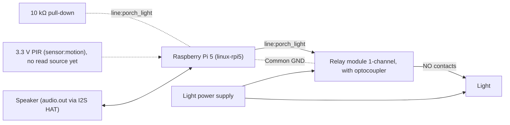
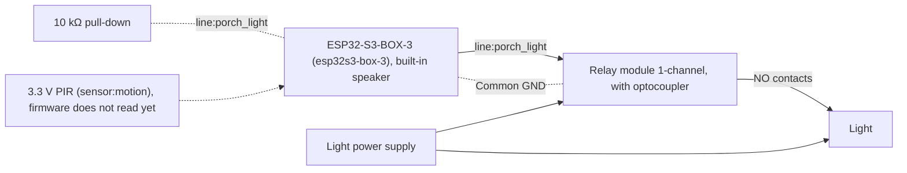

# Kit 2 — Home voice assistant (`home-voice`)

> **Task ID:** TSK-I2b-01. General workflow, safety rules, and unverified checklist:
> [`kit-phan-cung.md`](kit-phan-cung.md). This page covers details specific to this kit.

One agent, three kinds of tasks, each with its own contract: Q&A over family knowledge base (voice, no gate;
when offline, reads local answers), news reading (requires network; when offline, states unavailable, never hallucinates), and
**bật/tắt đèn** (turn on/off lights: physical, through gates): lights never turn off while the motion sensor still detects occupants.

> **Note:** voice input was removed from the roadmap (Q-77, roadmap §6; the host voice code still ships). This kit runs
> through text, chat or MCP.

## Locked gates

`light_on@1.0.0` and `light_off@1.0.0` reside in `fixtures/agents/home-voice/gates/` and have digests in
`digests.lock`. `light_off` reads the `room_empty` fact supplied by the `motion` sensor; if occupied ⇒ block and
ask for confirmation, if the user on device says "có" (yes) then turn off (RFC-0006); models or MCP **cannot**
answer on the user's behalf. Modifying gates requires an RFC (`CONTRIBUTING.md` §3).

## BOM

Described by function and specifications. **Không có mã hàng, giá hay nhà bán** (no part numbers, prices, or vendors); all rows "chưa kiểm trên phần cứng thật" (not verified on real hardware).

| # | Item | Specification | `esp32s3` | `linux` (Pi 5) |
|:--|:---|:---|:---|:---|
| 1 | Control board | ESP32-S3-BOX-3 (built-in speaker and microphone) | yes | — |
| 2 | Control board | Raspberry Pi 5 (`linux-rpi5` profile: "Raspberry Pi 5 + I2S HAT") | — | yes |
| 3 | Audio output | Box-3 speaker (built-in); for Pi 5: output from I2S HAT described in profile, with amplified speaker | built-in | yes |
| 4 | Relay module | 1-channel, 3.3 V compatible input, optically isolated, contacts rated for lamp current (220 V mains lamps require suitably rated relay and wiring, installed by an electrician) | yes | yes |
| 5 | Light | Household lamp or 12 V test light; **test with LED + resistor first** | yes | yes |
| 6 | Motion sensor | 3.3 V digital output PIR (profile declares `motion` sensor) | see note | see note |
| 7 | Pull-down resistor | 10 kΩ from `porch_light` pin to GND | yes | yes |
| 8 | Board power supply | Per board (USB-C for Box-3; 5 V supply for Pi 5) | yes | yes |

Note for row 6 — **`motion` sensor is not yet physically connected**: `linux` reads sensors via sysfs (hwmon, IIO) and
the repository has no driver for a GPIO-connected PIR yet. A `--target linux` session for this agent is therefore
**rejected before requesting any pin** (Q-16: do not guess without a source) until you declare a source for `motion`
via `NEUROEDGE_LINUX_SENSORS="motion=hwmon:<name>/<channel>"`; and even when declared, sysfs readings are dimensional numbers
rather than true/false, so the `room_empty` fact **remains undetermined** and `light_off` always **blocks**
(`criterion_unavailable`). The light can turn on; **it cannot be turned off via the agent on `linux`**. This is fail-safe,
but the kit cannot be fully used on Pi until a proper `motion` source exists. Firmware for `esp32s3` does not
read sensors yet (TSK-S4-01).

**On `linux`, the `motion` source is not wired yet, and the fix awaits the real hardware rig.** Currently `light_off` always **blocks**
fail-safe (`criterion_unavailable`); the light can only be turned on. Planned fix: connect PIR to a
`digital.in` line of `linux-rpi5` and declare `[sim.digital_facts] room_empty = { pin = "<PIR line>", equals = false }`
(low line means empty room). Gates do not change (`room_empty` is `bool`), but the PIR pin is a physical rig parameter,
the `linux-rpi5` profile does not declare it yet, and `digital.in` only exists on `linux-rpi5`/`sim-rpi5` — so this
awaits the hardware assembly step and will not be done before real boards arrive.

## Sơ đồ đấu dây

The label `line:<name>` is the board pin name in `boards/*.toml`; `sensor:<name>` is the sensor name in
`[capabilities.sensor_read]`. Test `python/tests/test_kits.py` verifies both against corresponding board profiles.
Physical header pin numbers on Pi and GPIO numbers on ESP32 are not assigned in the repository.

<!-- wiring: linux-rpi5 -->


<!-- wiring: esp32s3-box-3 -->


## Từ hộp tới chạy thật

General workflow in [`kit-phan-cung.md`](kit-phan-cung.md) §2. Specifically for this kit:

```bash
neuroedge new nha --template home-voice && cd nha
neuroedge run -c "bật đèn"                    # ALLOW: porch_light turns on
neuroedge run -c "wifi nhà mình là gì"        # answered from knowledge.toml, no gate
neuroedge test
```

In REPL (`neuroedge run`): `:sensor motion true` then `tắt đèn` (turn off light) ⇒ BLOCK `room_empty`, ask for confirmation; `có` (yes) ⇒
turns off. System 2 and news use your API key if you enable `[system_two]` (pre-commented in
`agent.toml`); if not enabled, everything runs offline.

- **`linux` on Pi 5**: the `porch_light` line is controllable. If `motion` source is not declared ⇒ session is rejected,
  no lines are requested. Declaring a source ⇒ `light_on` ALLOW and claims pin, `light_off` BLOCK and pin never
  changes (see BOM note row 6). Test: `python/tests_linux/test_kit_home_voice.py`; the `motion` source
  in tests is a dummy hwmon device created in a temporary directory, because the kernel lacks a PIR driver.
- **`esp32s3`**: `neuroedge build --target esp32s3 --board esp32s3-box-3` outputs an ESP-IDF project; lacks audio
  (I5) and does not control pins yet (TSK-S4-01).

## Golden traces

`fixtures/traces/kits/home-voice-allow.json` (turn on light, turn off light when room is empty ⇒ ALLOW),
`home-voice-block.json` (turn off light while occupied or sensor unreadable ⇒ BLOCK, pin does not change).
Generated with `scripts/gen_kit_traces.py`; replayed by `neuroedge verify`.
