# Examples on virtual parts

> **Task ID:** TSK-I2d-33 (Q-84). How parts and the virtual board work: [`docs/spec/virtual_parts.md`](../spec/virtual_parts.md).
> Screenshots taken on 2026-10-16 from `neuroedge run --ui` on a laptop, typing the steps of each demo script.
> Everything on this page runs on `sim` only: no hardware, no account, no key.

A **part** says what a pin, sensor or channel is: its kind (`heater`, `pump`, `servo`, `ph`…), what it is wired
to, and the words a person reads. The live page uses it to draw the right card with the right name. The
**virtual board** (`sim-virtual`) gives an agent the pins and sensors it declares when no reference board has them,
labelled **Bảng mạch ảo** on the page.

This page shows three things:

1. [the existing samples](#1-the-15-samples-now-name-their-devices), which now name their devices;
2. [a greenhouse](#2-greenhouse), a use case only the virtual board can hold;
3. [a full fish tank](#3-full-fish-tank), the same.

[Section 4](#4-try-your-own-idea) shows how to start your own.

## 1. The 15 samples now name their devices

Every agent in `fixtures/agents/` declares its devices as parts in `[sim.parts]`. Nothing else changed:
the same pins, gates and recorded traces, and the kits build for `linux` and `esp32s3` as before.

| Before | After |
|:---:|:---:|
| 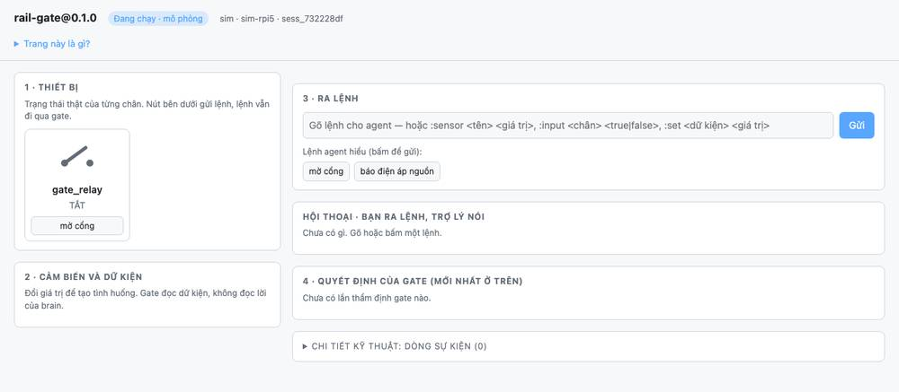 | 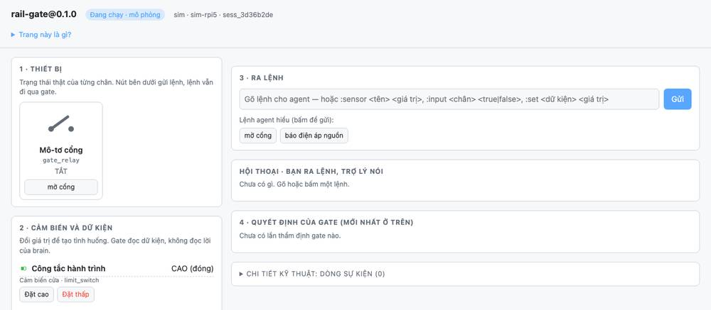 |
| `rail-gate` showed the board's relay name and hid its two inputs. | The motor is "Mô-tơ cổng"; the limit switch has **Đặt cao / Đặt thấp**, the supply voltage a field. |
| 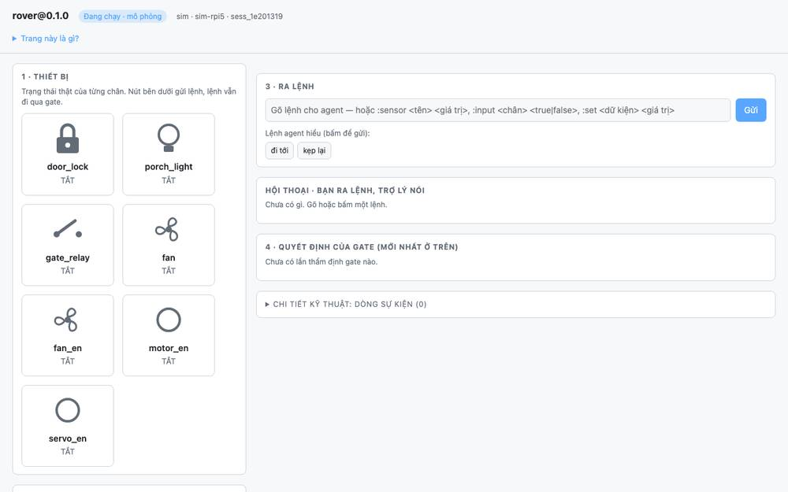 | 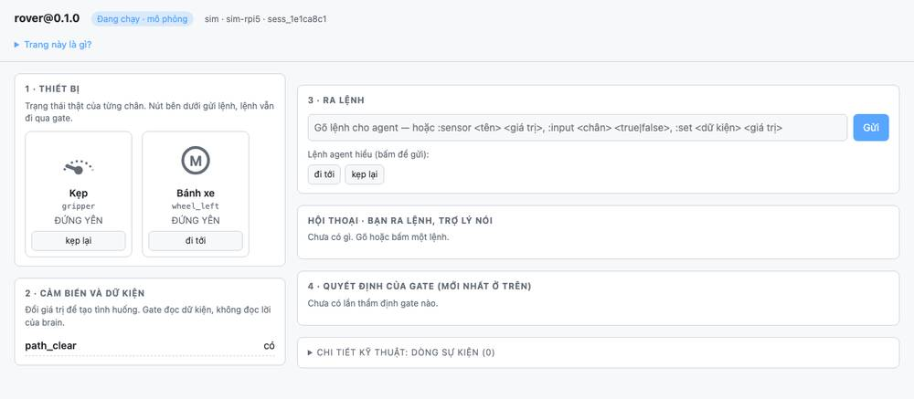 |
| `rover` listed every pin of the board, none of them its own. | The claw (servo) and the wheel (motor) are devices with their buttons. |

What each sample calls its devices:

| Sample | Parts |
|:---|:---|
| `aquarium` | Máy sưởi, Máy sục khí, Đèn bể, Nhiệt độ nước |
| `blinds` | Lá rèm (servo), Mạch dừng khẩn (contact), Dòng servo (analog) |
| `bridge-lamp` | Đèn |
| `chat-den-cua` | Đèn hiên, Khoá cửa |
| `contract-bench` | Rơ-le sưởi và còi, Khoá cửa khách, Đèn hiên |
| `driveway` | Khoá cửa ngõ, Mô-tơ cổng, Đèn hiên |
| `factory-monitor` | Quạt thông gió, Còi báo động, Nhiệt độ xưởng |
| `fan-pwm` | Quạt làm mát (PWM) |
| `gate-camera` | Khoá cổng, Đèn hiên |
| `gate-watch` | Mô-tơ cổng, Đèn hiên |
| `home-voice` | Đèn phòng, Cảm biến chuyển động |
| `rail-gate` | Mô-tơ cổng, Công tắc hành trình, Điện áp nguồn, Màn hình |
| `rover` | Bánh xe (motor), Kẹp (servo) |
| `villa-concierge` | Khoá cửa phòng |
| `voice-door` | Khoá cửa, Đèn hiên, Cảm biến chuyển động |

Run any of them with `neuroedge run --agent fixtures/agents/<sample>/agent.toml --ui`. The samples that need
servos, motors, inputs or PWM (`blinds`, `fan-pwm`, `gate-camera`, `gate-watch`, `rail-gate`, `rover`) also take
`--board sim-rpi5`.

`factory-monitor`'s probe is a plain sensor part, not a temperature part. A temperature part refuses readings
outside −40…125 °C, and this sample's tests feed a broken probe (−300 °C) on purpose to show the gates refuse it.

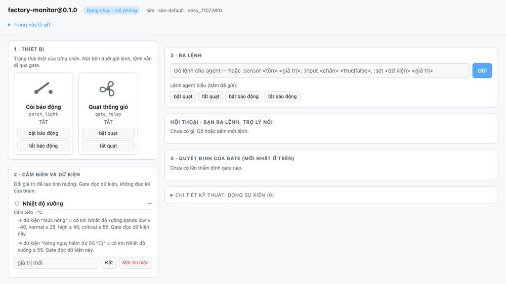

## 2. Greenhouse

`fixtures/agents/greenhouse` · script [`demo/i2d-nha-kinh/kich-ban.md`](../../demo/i2d-nha-kinh/kich-ban.md) ·
tests `python/tests/test_greenhouse.py`

| Device | Part kind | Rule (the gate decides) |
|:---|:---|:---|
| Máy sưởi | heater | not on from 30 °C, or with no reading |
| Quạt hút | fan | not off from 35 °C, or with no reading |
| Cửa mái | servo | not closed from 35 °C, or with no reading |
| Bơm phun sương | pump | not on from 90 % humidity, or with no reading |
| Đèn quang hợp | light | always allowed |
| Nhiệt độ không khí · Độ ẩm không khí · Độ ẩm đất | temperature · humidity · humidity | the readings the gates use |

The safe direction (heater off, fan on, vent open, misting off) is always allowed.

```bash
neuroedge run --agent fixtures/agents/greenhouse/agent.toml --ui
bash demo/i2d-nha-kinh/chay-sim.sh --ui      # the same steps, typed for you
```

**Step 1: light on, roof vent open.** Both are allowed. The roof vent is a servo, so it is a device with its own
buttons; after its lease the card reads "GIỮ ở 90° (hết lease)".

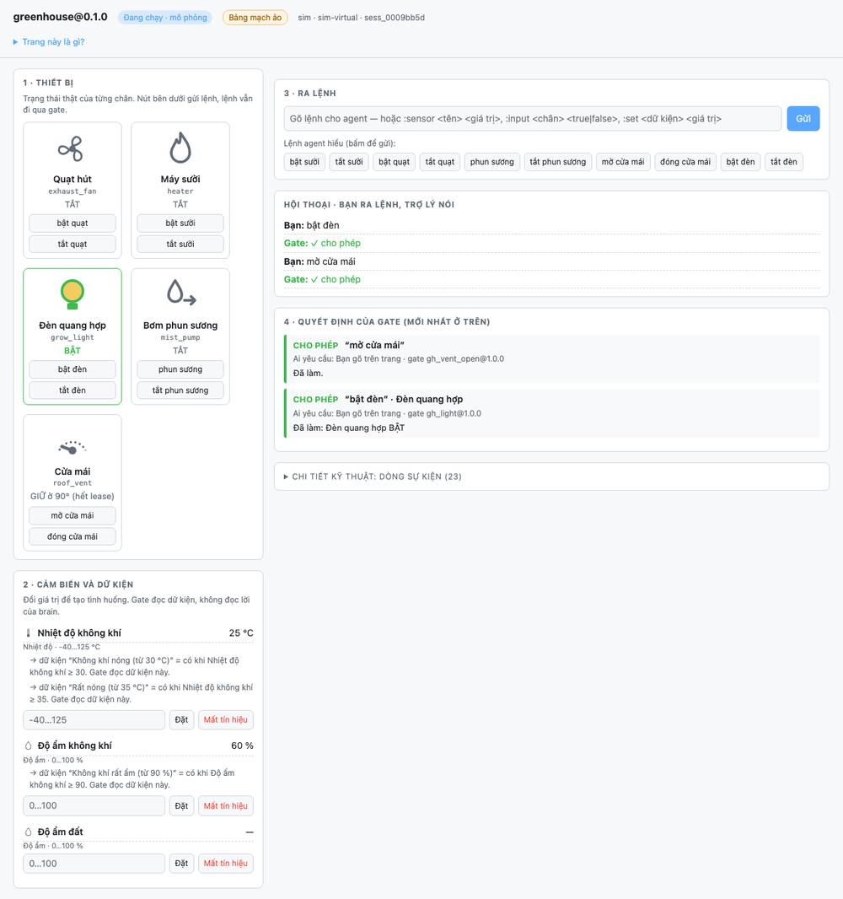

**Step 2: at 31 °C the heater stays off.** `:sensor air_temp 31`, then `bật sưởi`: blocked on "Không khí nóng (từ 30 °C)".

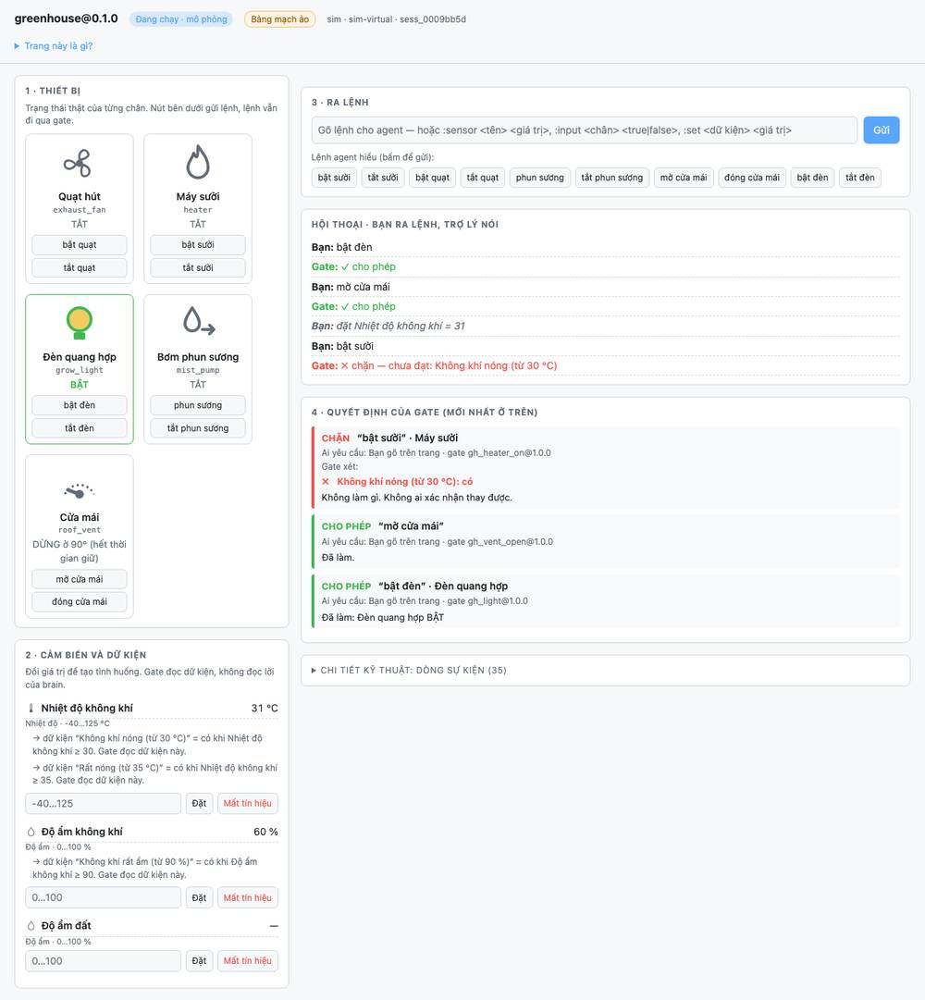

**Step 3: at 36 °C the fan and the vent stay as they are.** `tắt quạt` and `đóng cửa mái` are both blocked on
"Rất nóng (từ 35 °C)"; `bật quạt` is allowed. No one can confirm past these rules.

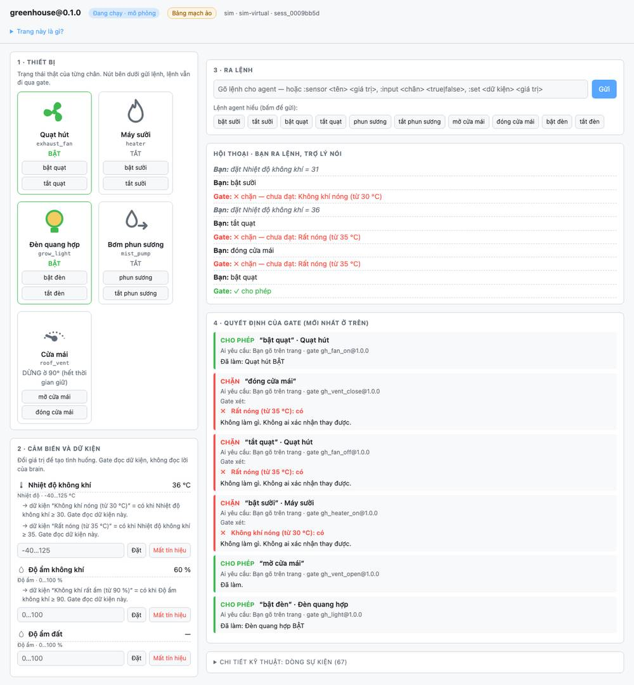

**Step 4: at 95 % no misting.** `:sensor air_humidity 95`, then `phun sương`: blocked.

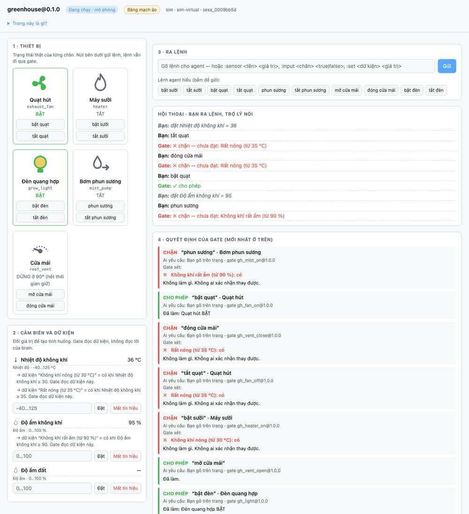

**Step 5: a lost reading, then a good one.** The page's **Mất tín hiệu** button (or `:sensor air_humidity lỗi`)
makes `phun sương` blocked as "không đọc được": the gate does not guess. Back at 70 %, misting is allowed.

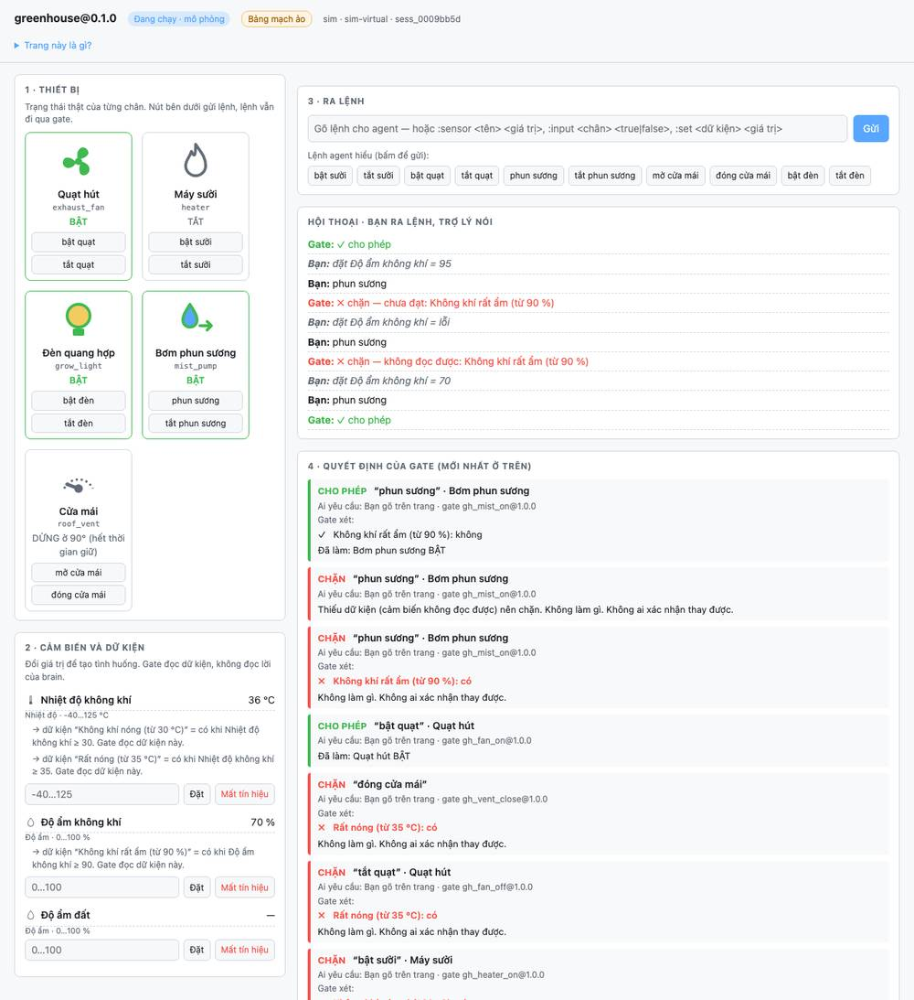

## 3. Full fish tank

`fixtures/agents/aquarium-full` · script [`demo/i2d-be-ca-day-du/kich-ban.md`](../../demo/i2d-be-ca-day-du/kich-ban.md) ·
tests `python/tests/test_aquarium_full.py`

Unlike `aquarium`, which borrows three relays of the reference board, this tank has its own names and four probes.

| Device | Part kind | Rule (the gate decides) |
|:---|:---|:---|
| Máy sưởi | heater | not on from 29 °C, or with no reading |
| Máy sục khí | pump | off only when the owner agrees at home; refused without asking when oxygen is below 5 mg/L, the water is from 29 °C, or there is no reading |
| Bơm lọc | pump | not on below 30 % water level (it would run dry); off only when the owner agrees |
| Van CO₂ | relay | not on below pH 6.5 or below 5 mg/L oxygen, or with no reading |
| Đèn bể | light | always allowed |
| Nhiệt độ nước · Độ pH · Oxy hoà tan · Mực nước | temperature · ph · sensor (mg/L, 0…20) · level | the readings the gates use |

```bash
neuroedge run --agent fixtures/agents/aquarium-full/agent.toml --ui
bash demo/i2d-be-ca-day-du/chay-sim.sh --ui
```

**Step 1: a healthy tank.** 25 °C, pH 7.0, oxygen 7.5 mg/L, water 80 %: light, heater, filter and air pump all on.

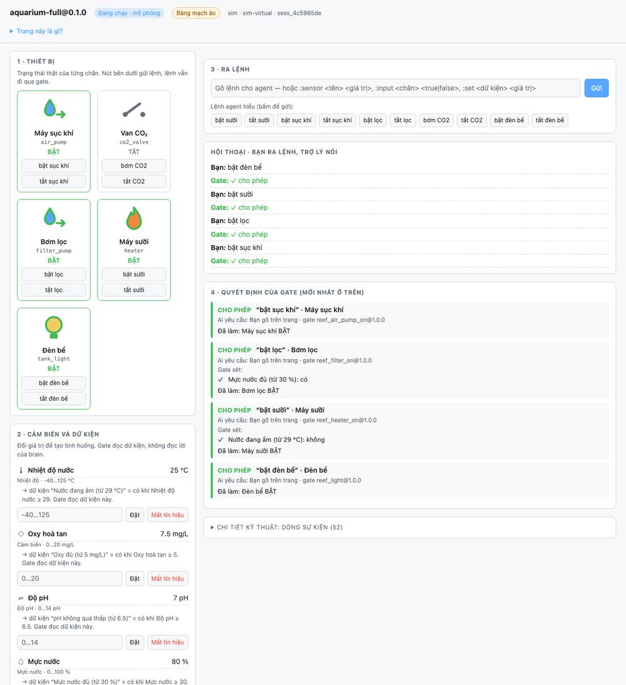

**Step 2: pH 6.2 locks the CO₂ valve.** `bơm CO2` works at pH 7.0. After `:sensor ph 6.2` it is blocked without
asking anyone; `tắt CO2` is still allowed.

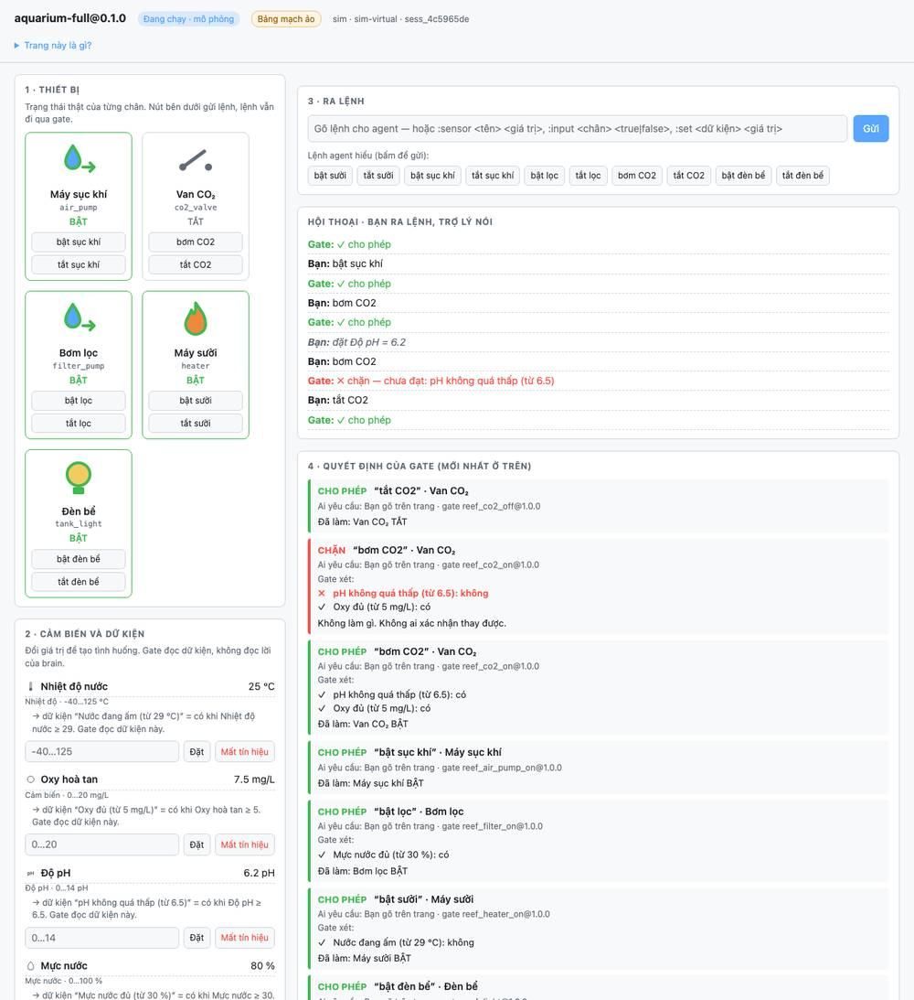

**Step 3a: turning the filter off asks the owner.** The yellow box is the device asking the person at home.
The assistant or an MCP client cannot answer it.

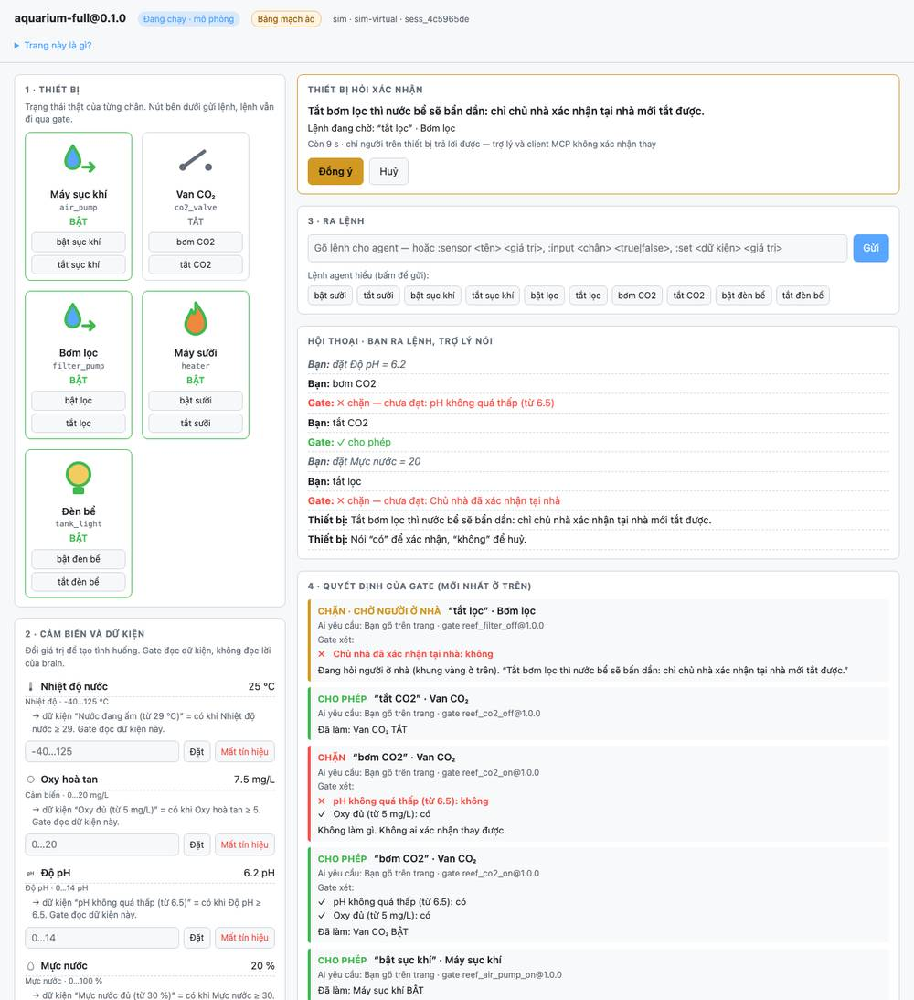

**Step 3b: low water keeps the filter off.** The owner agreed and the filter stopped. At 20 % water `bật lọc` is
blocked so the pump does not run dry.

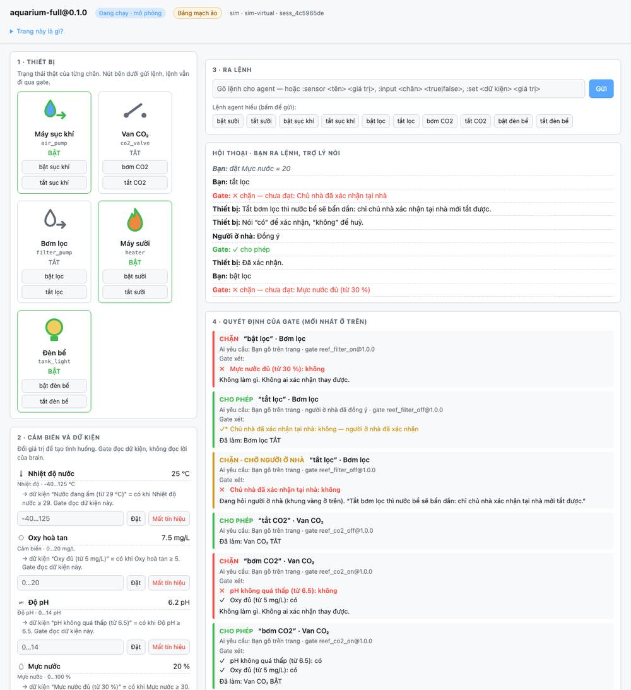

**Step 4: at 3.5 mg/L oxygen the air pump stays on.** `tắt sục khí` is blocked at once, without a question: a "yes"
from the owner would not save the fish.

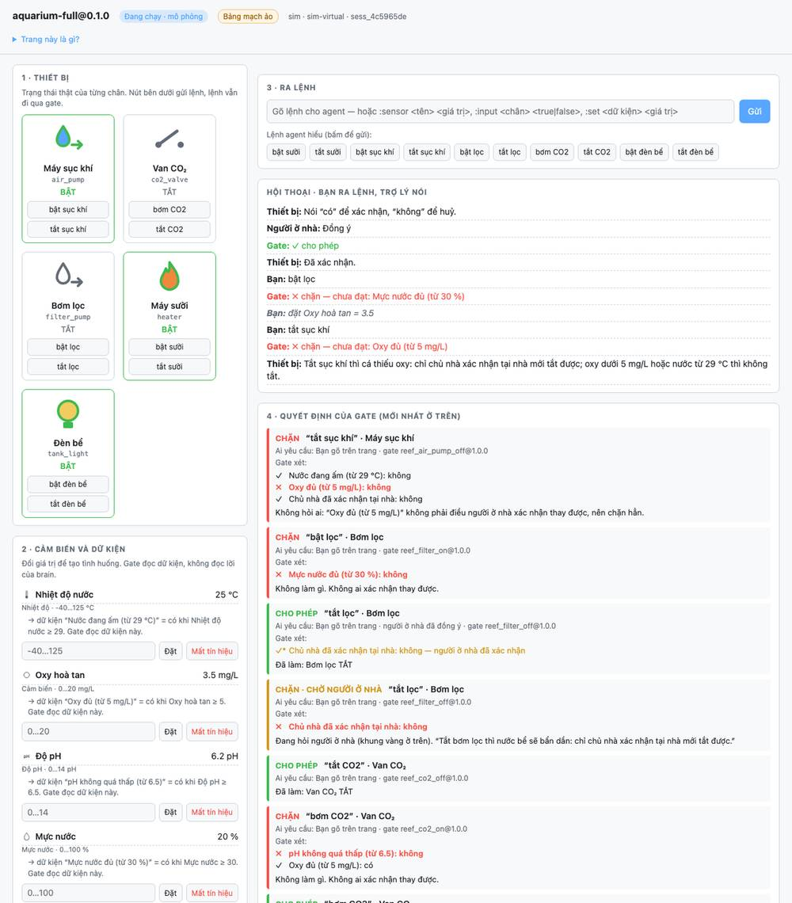

**Step 5: oxygen back, the owner decides.** At 7.5 mg/L the device asks again. The owner pressed **Huỷ** the first
time and **Đồng ý** the second: the air pump stops and the decision says "người ở nhà đã đồng ý".

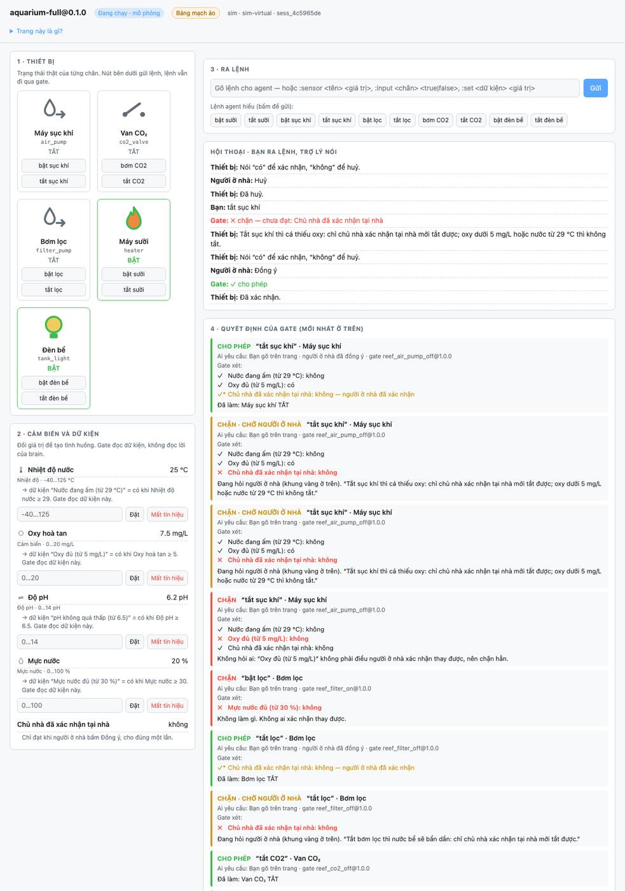

## 4. Try your own idea

```bash
neuroedge new my-greenhouse --board sim-virtual    # a project on the virtual board
cd my-greenhouse
neuroedge add part --list                          # the 17 kinds
neuroedge add part heater heater --pin heater --label "Máy sưởi"     # the part, [requires], an action, a gate, a test
neuroedge add part temperature air_temp --sensor air_temp --label "Nhiệt độ" --drives heater
neuroedge test && neuroedge run --ui
```

Full command reference: [`docs/reference/cli.md`](../reference/cli.md).

## Limits

- **`sim` only.** The virtual board is refused for `linux` and `esp32s3`. To move to real hardware, choose a
  real board and map your pin names onto it with `[targets.<board>.pins]`
  ([`virtual_parts.md`](../spec/virtual_parts.md) §3.3).
- **No physics.** A temperature stays where you set it. The fish tank physics model of 30 days is TSK-I2d-15.
- **Not verified on hardware.** Envelopes on the virtual board are the defaults of each part kind, not a
  datasheet's.
